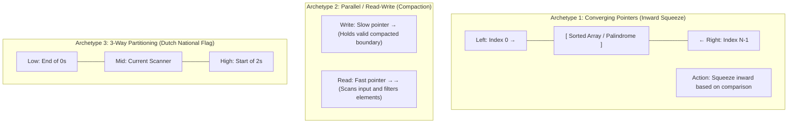
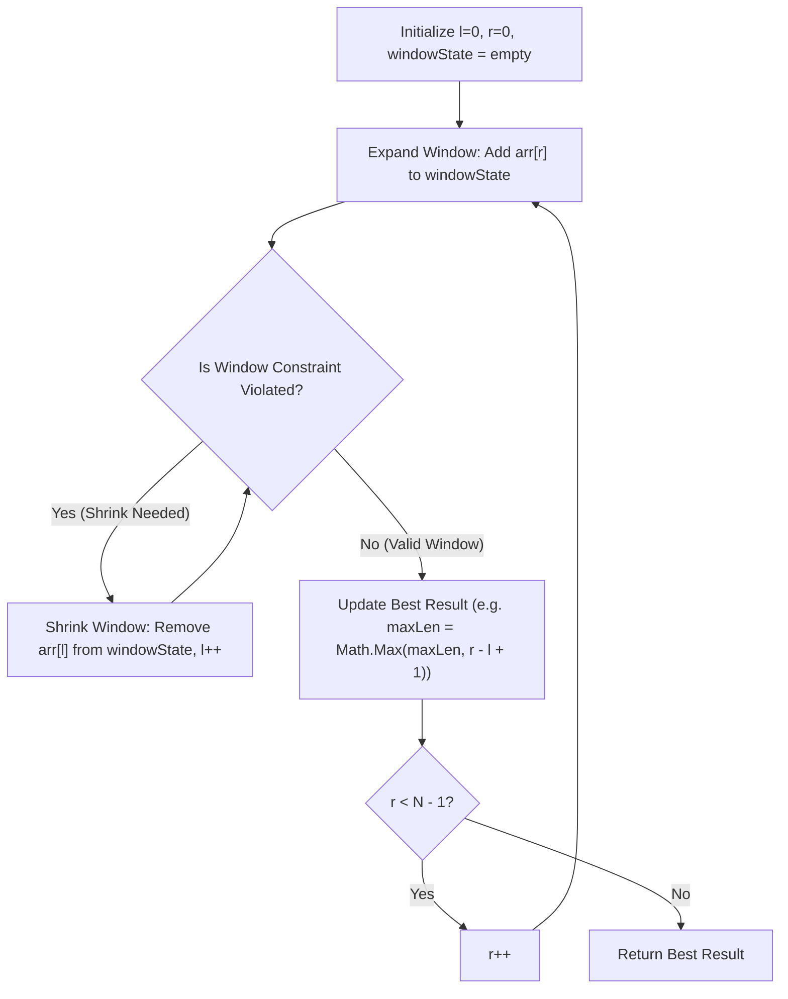
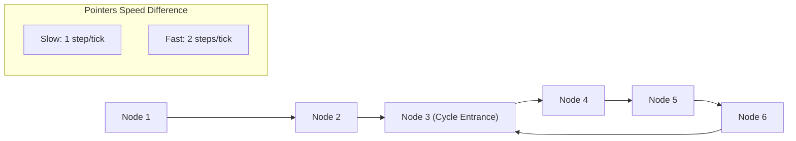
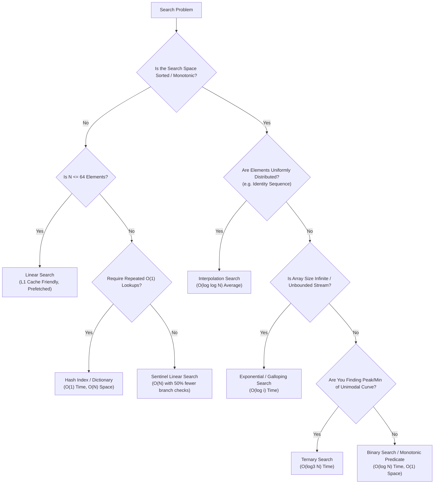
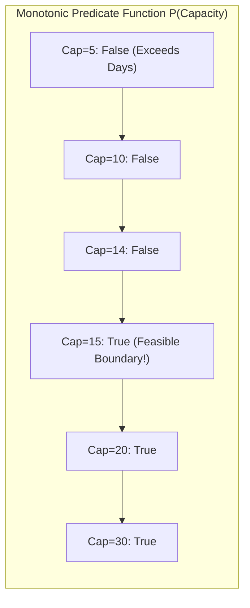
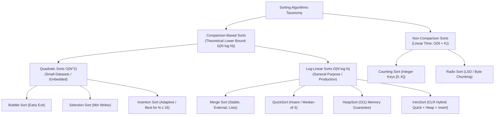
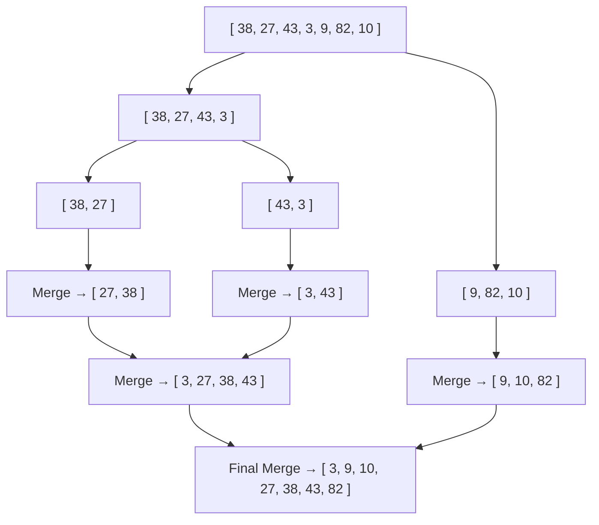
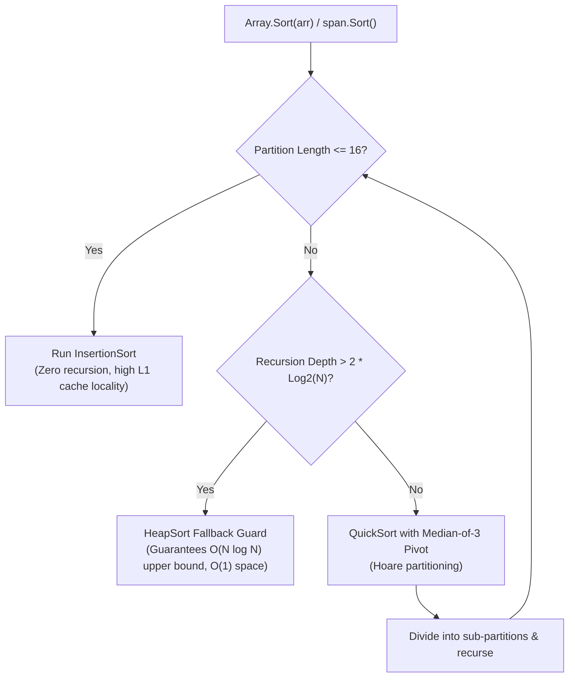

# THE COMPLETE .NET DEVELOPER ENCYCLOPEDIA + INTERVIEW MASTERY GUIDE
## Volume 1: Logical Thinking & Data Structures and Algorithms

> **Target Audience:** .NET backend developer (~3 years experience) aiming for senior-level algorithmic fluency and acing technical interview rounds at tier-1 MNCs like Infosys, TCS, Wipro, Accenture, as well as product engineering firms.  
> **Core Objective:** Bridge the gap between writing enterprise business CRUD code and developing instinctive, low-level algorithmic logic. Transform from "memorizing LeetCode" to "architectural decomposition and problem solving."  
> **Production Domains Used:** Order Management Systems, Core Banking & Ledger Engines, Healthcare EHR Records, High-Throughput SaaS, Distributed Notification Hubs, Payment Gateways.  
> **Language & Runtime:** C# 12 / .NET 8 LTS (featuring `Span<T>`, `ReadOnlySpan<T>`, `PriorityQueue<TElement, TPriority>`, Memory-efficient Collections, and CLR Heap layout insights).

---

# TABLE OF CONTENTS

1. [The Engineer's Mindset: From "Struggling with DSA" to "Architectural Problem Solver"](#1-the-engineers-mindset-from-struggling-with-dsa-to-architectural-problem-solver)
   - 1.1 Why .NET Enterprise Developers Struggle with DSA
   - 1.2 The "LINQ Crutch" vs. Mechanical Sympathy
   - 1.3 The Infosys & MNC Interview Philosophy for 3 YOE
   - 1.4 The 7-Step Universal Problem-Solving Blueprint
2. [Mastering the Core Algorithmic Thinking Patterns](#2-mastering-the-core-algorithmic-thinking-patterns)
   - 2.1 The 10 Essential Algorithmic Archetypes
   - 2.2 Pattern Recognition Decision Matrix (The Clue-to-Pattern Rosetta Stone)
3. [Pattern 1: Arrays & Hashing](#3-pattern-1-arrays--hashing)
   - 3.1 CLR Internals: Array Layout on the Managed Heap & CPU Cache Locality
   - 3.2 Problem 1: Two Sum (Unsorted Array)
   - 3.3 Problem 2: Valid Anagram
   - 3.4 Problem 3: Group Anagrams
   - 3.5 Problem 4: Top K Frequent Elements (Bucket Sort)
   - 3.6 Problem 5: Product of Array Except Self
   - 3.7 Problem 6: Kadane's Algorithm (Maximum Subarray Sum)
   - 3.8 Problem 7: Rotate Array (In-Place 3-Step Reversal)
4. [Pattern 2: Two Pointers](#4-pattern-2-two-pointers)
   - 4.1 The Two Pointers Mental Model & Archetypes
   - 4.2 Problem 1: Two Sum II (Input Array Is Sorted)
   - 4.3 Problem 2: Valid Palindrome
   - 4.4 Problem 3: Container With Most Water (LeetCode 11)
   - 4.5 Problem 4: 3Sum (Zero-Sum Triplets - LeetCode 15)
   - 4.6 Problem 5: Trapping Rain Water (LeetCode 42)
   - 4.7 Problem 6: Sort Colors / Dutch National Flag (LeetCode 75)
   - 4.8 Problem 7: Remove Duplicates from Sorted Array
   - 4.9 Problem 8: Move Zeroes
5. [Pattern 3: Sliding Window](#5-pattern-3-sliding-window)
   - 5.1 Universal Sliding Window Architecture & Flowchart
   - 5.2 Problem 1: Maximum Sum Subarray of Size K (Fixed Window)
   - 5.3 Problem 2: Longest Substring Without Repeating Characters (LeetCode 3)
   - 5.4 Problem 3: Minimum Size Subarray Sum (LeetCode 209)
   - 5.5 Problem 4: Longest Repeating Character Replacement (LeetCode 424)
   - 5.6 Problem 5: Longest Substring with At Most K Distinct Characters
   - 5.7 Problem 6: Minimum Window Substring (LeetCode 76 - Hard)
6. [Pattern 4: Fast & Slow Pointers (Tortoise & Hare)](#6-pattern-4-fast--slow-pointers-tortoise--hare)
   - 6.1 The Mathematical Principle of Floyd's Algorithm
   - 6.2 Problem 1: Linked List Cycle Detection (LeetCode 141)
   - 6.3 Problem 2: Middle of the Linked List (LeetCode 876)
   - 6.4 Problem 3: Find the Duplicate Number in an Array (LeetCode 287)
7. [Pattern 5: Searching Algorithms Encyclopedia](#7-pattern-5-searching-algorithms-encyclopedia)
   - 7.1 The Searching Taxonomy & Mechanical Sympathy Decision Matrix
   - 7.2 Linear Search & The Sentinel Optimization (Eliminating Boundary Checks)
   - 7.3 Classic Binary Search (The Monotonic Mindset)
   - 7.4 Search in Rotated Sorted Array (Shifted Ledger Partitions)
   - 7.5 Find First and Last Position in Sorted Array (Lower & Upper Bounds)
   - 7.6 Binary Search on Monotonic Answer Range (Capacity to Ship Packages Within D Days)
   - 7.7 Interpolation Search (Uniformly Distributed Probing Engine)
   - 7.8 Exponential Search (Unbounded Ledger Streams & Fast Galloping)
   - 7.9 Ternary Search (Finding Extrema in Unimodal Functions)
8. [Pattern 6: Sorting Algorithms Encyclopedia](#8-pattern-6-sorting-algorithms-encyclopedia)
   - 8.1 The Sorting Taxonomy & Complexity Matrix
   - 8.2 Bubble Sort (Standard & Early-Exit Optimization)
   - 8.3 Selection Sort (Minimum-Scan & Minimal Memory Writes)
   - 8.4 Insertion Sort (Adaptive Shifting & Small Partition Powerhouse)
   - 8.5 Merge Sort (Divide & Conquer, In-Depth Memory Mechanics & Stability)
   - 8.6 Quick Sort (Lomuto vs. Hoare Partitioning & Median-of-3 Pivot)
   - 8.7 Heap Sort (In-Place Array-Based Max-Heapify)
   - 8.8 Counting Sort (Non-Comparison O(N + K) Integer Sorting)
   - 8.9 Radix Sort (LSD Base-10 / 256 Distribution Engine)
   - 8.10 Under the Hood: .NET 8 IntroSort & ArraySortHelper<T>
9. [Pattern 7: Stack & Queue](#9-pattern-7-stack--queue)
   - 9.1 Memory Models: Array-Backed vs. Node-Backed Queues
   - 9.2 Problem 1: Valid Parentheses (Syntax Validation for Config Tokens)
   - 9.3 Problem 2: Min Stack (O(1) Retrieval via Companion State)
   - 9.4 Problem 3: Evaluate Reverse Polish Notation (Financial Math Engine)
   - 9.5 Problem 4: Implement Queue Using Stacks (Amortized Cost Transfer)
   - 9.6 Problem 5: Moving Average from Data Stream (Circular Queue Buffer)
10. [Pattern 8: Linked Lists](#10-pattern-8-linked-lists)
    - 10.1 Linked List Memory Architecture & Cache Miss Penalty
    - 10.2 Problem 1: Reverse Linked List (Iterative Pointer Rewiring)
    - 10.3 Problem 2: Merge Two Sorted Lists (Splice Nodes with Sentinel Head)
11. [Pattern 9: Trees & Binary Search Trees](#11-pattern-9-trees--binary-search-trees)
    - 11.1 Tree Representations & Stack Frame Traversal Mechanics
    - 11.2 Problem 1: Maximum Depth of Binary Tree (DFS vs. BFS)
    - 11.3 Problem 2: Binary Tree Level Order Traversal (Batch Queue Sizing)
    - 11.4 Problem 3: Validate Binary Search Tree (Range Constraint Propagation)
    - 11.5 Problem 4: Lowest Common Ancestor (Organizational Hierarchy Resolution)
12. [Pattern 10: Graphs](#12-pattern-10-graphs)
    - 12.1 Adjacency List vs. Adjacency Matrix Trade-offs
    - 12.2 Problem 1: Number of Islands (Grid DFS/BFS Connected Components)
    - 12.3 Problem 2: Course Schedule (Cycle Detection & Topological Sort via Kahn's Algorithm)
13. [Pattern 11: Heap & PriorityQueue (.NET 6+)](#13-pattern-11-heap--priorityqueue-net-6)
    - 13.1 Binary Heap Mechanics on Contiguous Arrays
    - 13.2 Problem 1: Kth Largest Element in an Array (Min-Heap of Size K)
    - 13.3 Problem 2: Merge K Sorted Lists / Telemetry Streams (K-Way Min-Heap Merge)
14. [Pattern 12: Recursion & Backtracking](#14-pattern-12-recursion--backtracking)
    - 14.1 Backtracking Template: Choose -> Explore -> Unchoose
    - 14.2 Problem 1: Subsets (Combinatorial Role-Based Access Matrix)
    - 14.3 Problem 2: Permutations (Distinct Sequencing Generation)
    - 14.4 Problem 3: Word Search (2D Board Backtracking with Visited Tracking)
15. [Pattern 13: Dynamic Programming](#15-pattern-13-dynamic-programming)
    - 15.1 The DP Framework: Optimal Substructure + Overlapping Subproblems
    - 15.2 Problem 1: Climbing Stairs (Fibonacci State Transitions)
    - 15.3 Problem 2: Coin Change (Unbounded Knapsack / Minimum Denominations)
    - 15.4 Problem 3: Longest Common Subsequence (Audit Diff & Reconciliation Engine)
    - 15.5 Problem 4: 0/1 Knapsack Problem (SaaS Resource Allocation Under Budget)
16. [Pattern 14: Greedy Algorithms & Intervals](#16-pattern-14-greedy-algorithms--intervals)
    - 16.1 The Greedy-Choice Property
    - 16.2 Problem 1: Best Time to Buy and Sell Stock (Running Valley & Peak)
    - 16.3 Problem 2: Jump Game (Boundary Horizon Expansion)
    - 16.4 Problem 3: Merge Intervals (Booking & Calendar Overlap Consolidation)
    - 16.5 Problem 4: Meeting Rooms I & II (Resource Contention Peaks)
17. [Pattern 15: Bit Manipulation](#17-pattern-15-bit-manipulation)
    - 17.1 Bitwise Operators and Bitmask Flags in C#
    - 17.2 Problem 1: Single Number (XOR Cancellation Property)
    - 17.3 Problem 2: Number of 1 Bits (Brian Kernighan's Bit Clear)
    - 17.4 Problem 3: Power of Two (Bitmask Decrement Boundary)
18. [Infosys & Technical Interview Survival Playbook](#18-infosys--technical-interview-survival-playbook)
    - 18.1 How Infosys Evaluates a 3 YOE .NET Developer
    - 18.2 Real 45-Minute Interview Simulation Transcript
    - 18.3 The .NET 8 Big-O Time & Space Complexity Reference Matrix

---

# 1. THE ENGINEER'S MINDSET: FROM "STRUGGLING WITH DSA" TO "ARCHITECTURAL PROBLEM SOLVER"

## 1.1 Why .NET Enterprise Developers Struggle with DSA

A typical backend .NET developer with 3 years of experience spends 90% of their working day doing the following:
1. Creating ASP.NET Core Web API controllers or Minimal API endpoints.
2. Writing Entity Framework Core LINQ queries (`_context.Orders.Where(x => x.Status == OrderStatus.Pending).Include(x => x.Items).ToListAsync()`).
3. Mapping DTOs using AutoMapper or Mapster.
4. Injecting services through dependency injection containers (`IServiceCollection`).
5. Calling external REST APIs or reading messages off RabbitMQ / Azure Service Bus.

When dropped into a technical interview room and asked:
> *"Given an array of integers representing stock prices, find the maximum profit you can achieve with at most two transactions,"*

the developer freezes. Panic sets in. Why?

### The Three Disconnects
1. **The Declarative Abstraction Trap:** In daily enterprise work, you tell the framework *what* you want (LINQ: `.OrderBy().GroupBy().Select()`), not *how* to achieve it. DSA requires you to dictate the exact byte-level, index-by-index execution mechanism.
2. **The "Everything is an Object" Mental Model:** In C#, we get comfortable treating everything as high-level heap allocations. We pass around `List<T>`, `IEnumerable<T>`, and complex nested domain models. When an interviewer asks to manipulate an array in-place without auxiliary memory, the developer struggles because they are conditioned to create new collections with LINQ.
3. **The Absence of Systematic Tracing:** In enterprise code, when something goes wrong, you attach the Visual Studio debugger, inspect the locals window, and step through. In an interview, **you are the debugger**. You must be able to maintain variable state inside your head and walk through an execution table on a whiteboard or shared notepad.

```
Enterprise Mindset (Declarative):
Database / EF Core  ──>  LINQ Query  ──>  DTO Projection  ──>  JSON Response
"Framework, give me the data that matches this shape."

Algorithmic Mindset (Procedural & Structural):
Raw Memory / Array  ──>  Pointers / State  ──>  In-Place Mutations  ──>  O(1) Space Result
"CPU, look at index i, compare with index j, swap bytes, increment pointer."
```

---

## 1.2 The "LINQ Crutch" vs. Mechanical Sympathy

Consider a real interview scenario. The interviewer asks:
> *"Given an array of integers, remove duplicates in-place such that each unique element appears only once, returning the count of unique elements."*

The developer with a LINQ crutch immediately responds:
```csharp
// THE WRONG WAY TO ANSWER AN ALGORITHMIC QUESTION
public int[] RemoveDuplicates(int[] nums)
{
    return nums.Distinct().ToArray();
}
```

### Why the Interviewer Rejects This Answer
1. **Time Complexity:** `.Distinct()` internally allocates a `HashSet<int>`. It iterates over the array and adds items to the hash set. Time complexity: $O(N)$.
2. **Space Complexity:** It allocates a hash set on the Managed Heap ($O(N)$ memory) and then allocates a completely brand-new array via `.ToArray()` ($O(N)$ memory).
3. **Ignores Constraints:** The problem specified **in-place**. Allocating $2N$ heap memory violates the fundamental requirement.
4. **Hides Problem-Solving Capability:** The interviewer learns nothing about whether you understand memory traversal, pointers, or loop invariants.

### The Mechanical Sympathy Approach
Mechanical sympathy means understanding how the underlying CLR runtime and CPU hardware execute your code. An in-place two-pointer approach writes directly to memory addresses:

```csharp
// THE SENIOR ENGINEER'S ANSWER (Mechanical Sympathy)
public int RemoveDuplicates(Span<int> nums)
{
    if (nums.IsEmpty) return 0;

    int writeIndex = 1;
    for (int readIndex = 1; readIndex < nums.Length; readIndex++)
    {
        if (nums[readIndex] != nums[readIndex - 1])
        {
            nums[writeIndex] = nums[readIndex];
            writeIndex++;
        }
    }
    return writeIndex;
}
```
**Zero allocations ($O(1)$ space), single pass ($O(N)$ time), cache-friendly contiguous memory reads, CPU branch predictor optimal.**

---

## 1.3 The Infosys & MNC Interview Philosophy for 3 YOE

Interviews at massive tech consultancies (Infosys, TCS, Cognizant, Wipro) and tier-1 product delivery teams for candidates with ~3 years of experience are standardized. They follow a predictable pattern:

| Dimension | What Junior Developers Think Interviewers Want | What Interviewers Actually Grade You On |
|---|---|---|
| **Speed** | Blurt out working code in 60 seconds. | Structured thought process, clarifying edge cases, calm decomposition. |
| **Complexity** | Using fancy syntax or one-liner LINQ queries. | Writing optimal loops, analyzing Big-O time and space accurately. |
| **Edge Cases** | "I'll handle nulls if it crashes." | Proactively listing empty arrays, duplicates, negative numbers, overflow. |
| **Communication** | Silence while typing, then saying "Done." | Thinking out loud: explaining trade-offs before writing a single bracket. |
| **Code Cleanliness** | Single-letter variables (`a`, `b`, `t`). | Production-grade C#: descriptive naming, guard clauses, proper types. |

### The Infosys Assessment Pattern
1. **Screening Round:** Online test with 2–3 algorithmic problems (typically 1 String manipulation, 1 Array manipulation, 1 Math/DP or Hash problem).
2. **Technical Round 1 (60 Mins):**
   - 20 mins: C# / CLR internals & ASP.NET Core architecture.
   - 25 mins: Live coding on an interactive editor (e.g., HackerRank CodePair or Notepad). Focus: **Strings, Arrays, Dictionaries, Two Pointers**.
   - 15 mins: SQL Queries & EF Core performance.
3. **Technical Round 2 (Managerial / Architect):**
   - Scenario-based problem solving: "How would you deduplicate 10 million transactions using minimal RAM?"

---

## 1.4 The 7-Step Universal Problem-Solving Blueprint

Whenever an interviewer presents a DSA problem, **do not touch the keyboard for the first 3 minutes.** Follow this ironclad protocol:

```
Step 1: CLARIFY CONSTRAINTS & BOUNDARIES
        ├── What are the input sizes (N <= 10^3, 10^5, 10^9)?
        ├── Can elements be negative, null, zero, or duplicate?
        └── What is the expected return type on invalid input?
            ↓
Step 2: WORKED EXAMPLE (MANUAL DRY RUN)
        ├── Trace a small, concrete test case by hand.
        └── Formulate an edge case (e.g., single element, empty, all identical).
            ↓
Step 3: STATE THE BRUTE FORCE (ESTABLISH THE BASELINE)
        ├── Express the naive approach clearly (e.g., "Nested loops gives O(N^2)").
        └── State its time and space complexity without apology.
            ↓
Step 4: IDENTIFY THE BOTTLENECK & SELECT PATTERN
        ├── "We are repeatedly scanning backward: could a HashMap give O(1)?"
        ├── "The array is sorted: can we use Two Pointers or Binary Search?"
        └── "We need sliding boundaries: can a Sliding Window reduce O(N^2) to O(N)?"
            ↓
Step 5: PROPOSE THE OPTIMAL ALGORITHM & VALIDATE COMPLEXITY
        ├── State: "I can achieve O(N) time and O(1) auxiliary space using Two Pointers."
        └── Gain interviewer buy-in: "Would you like me to code this approach?"
            ↓
Step 6: WRITE CLEAN, PRODUCTION-GRADE C#
        ├── Guard clauses first (`ArgumentNullException`, empty check).
        ├── Meaningful variable names (`leftPointer`, `currentSum`, `frequencyMap`).
        └── Modern C# idioms (`Span<T>`, Pattern Matching where beneficial).
            ↓
Step 7: TRACE TEST CASES & STATE TIME/SPACE COMPLEXITY
        ├── Walk through your code line-by-line with the sample input.
        └── Conclude with formal Big-O: "Time is O(N), Space is O(1) auxiliary."
```

---

# 2. MASTERING THE CORE ALGORITHMIC THINKING PATTERNS

## 2.1 The 10 Essential Algorithmic Archetypes

Every algorithmic problem asked in an interview is an instantiation of one of ten fundamental patterns. Once you learn to recognize the pattern signature, you no longer memorize individual problems.

```
                                  ┌──────────────────────────────┐
                                  │ DSA Problem Solving Toolkit  │
                                  └──────────────┬───────────────┘
                                                 │
         ┌───────────────────┬───────────────────┼───────────────────┬───────────────────┐
         │                   │                   │                   │                   │
  [1. Two Pointers]  [2. Sliding Window]  [3. Fast & Slow]   [4. Binary Search]  [5. Hash Caching]
  (Sorted Arrays,     (Contiguous Sub-    (Cycle Detection,   (Monotonic Search   (O(1) Lookups,
   Converging/Read-    arrays, Strings,    Middle of List,     Space, Rotated      Frequency Counts,
   Write Bounds)       Max/Min Windows)    Memory Loops)       Bounds)             Complements)
         │                   │                   │                   │                   │
  [6. Monotonic Stack][7. BFS Traversal]  [8. DFS / Backtrack][9. Dynamic Prog]  [10. Greedy Choice]
  (Next Greater/      (Shortest Path,     (Exhaustive Search, (Overlapping Sub-   (Local Optimal
   Smaller, Histograms,Level Order,        Permutations,       problems, Min/Max   Step = Global
   Parentheses)        Unweighted Graphs)  Grid Traversals)    Cost Paths)         Optimal Solution)
```

### Pattern 1: Two Pointers
- **Core Mechanism:** Maintain two indices moving across one or two linear collections.
- **Variations:**
  - *Converging:* Left starts at 0, Right starts at $N-1$; move toward each other (used in sorted pair sums, palindrome verification).
  - *Parallel / Read-Write:* Slow write pointer, fast read pointer (used in array deduplication, zero compaction).
  - *Two Arrays:* Merge two sorted arrays into one.

### Pattern 2: Sliding Window
- **Core Mechanism:** Maintain a dynamic or fixed subarray range `[left, right]`. Expand `right` to include elements; shrink `left` when window invariants are violated.
- **Trigger Clues:** "Longest contiguous substring...", "Subarray with sum equal to $K$...", "Maximum sum of $K$ consecutive elements...".

### Pattern 3: Fast and Slow Pointers (Tortoise & Hare)
- **Core Mechanism:** Two pointers traverse at different speeds (usually slow advances 1 step, fast advances 2 steps).
- **Trigger Clues:** "Detect cycle in linked list", "Find middle node", "Find duplicate in array where values point to indices".

### Pattern 4: Binary Search
- **Core Mechanism:** Repeatedly divide a sorted or monotonic search space in half.
- **Trigger Clues:** "Find element in sorted array", "Search in logarithmic time $O(\log N)$", "Find the minimum value that satisfies condition $P(x)$".

### Pattern 5: HashMap / HashSet Caching
- **Core Mechanism:** Trade space for time. Store seen elements or cumulative states in an $O(1)$ lookup table.
- **Trigger Clues:** "Find pair with sum $K$", "Check if duplicate exists", "Subarray sum equals $K$ (prefix sums)", "Group items by signature".

### Pattern 6: Stack / Monotonic Stack
- **Core Mechanism:** Last-In, First-Out (LIFO). A monotonic stack maintains elements in strictly increasing or decreasing order.
- **Trigger Clues:** "Valid parentheses / brackets", "Next greater element", "Daily temperatures", "Largest rectangle in histogram".

### Pattern 7: Breadth-First Search (BFS)
- **Core Mechanism:** Level-order exploration using a FIFO `Queue<T>`.
- **Trigger Clues:** "Shortest path in unweighted graph/grid", "Level-by-level tree traversal", "Minimum steps to reach target".

### Pattern 8: Depth-First Search (DFS) & Backtracking
- **Core Mechanism:** Deep branch exploration using recursion or explicit `Stack<T>`. Backtracking undoes the state when a branch terminates.
- **Trigger Clues:** "Find all permutations/subsets", "Word search in 2D grid", "Tree path sums", "Connected components / Islands".

### Pattern 9: Dynamic Programming (DP)
- **Core Mechanism:** Breaking a problem into overlapping subproblems with optimal substructure. Store subproblem answers in an array or dictionary (memoization or tabulation).
- **Trigger Clues:** "Count total number of ways to...", "Find minimum / maximum cost to reach...", "Can you partition the set...".

### Pattern 10: Greedy Strategy
- **Core Mechanism:** Make the locally optimal choice at each step, proving that it leads to the globally optimal solution.
- **Trigger Clues:** "Interval scheduling", "Minimum number of platforms / meeting rooms", "Gas station circuit".

---

## 2.2 Pattern Recognition Decision Matrix

When you read a question prompt in an interview, refer to this mapping:

| If the problem states... | And the data structure is... | Then your primary intuition should be... |
|---|---|---|
| "Array is sorted" and "Find pair/triplet" | Array | **Two Pointers (Converging)** |
| "Contiguous subarray / substring" with "Max/Min/Length" | Array / String | **Sliding Window** |
| "Find cycle", "Find middle", "Loop in pointer references" | Linked List / Array | **Fast & Slow Pointers (Floyd's)** |
| "Search target in $O(\log N)$" or "Monotonic condition" | Sorted Collection | **Binary Search** |
| "Frequency of elements", "Pair sum unsorted", "Group by" | Unsorted Collection | **HashMap / HashSet** |
| "Matching brackets", "Nested tags", "Next Greater Element" | Sequence / Expression | **Stack / Monotonic Stack** |
| "Shortest path (unweighted)", "Minimum transformation steps" | Graph / Matrix / Tree | **BFS with Queue** |
| "Generate all combinations", "Exhaustive paths", "Sudoku" | Combinatorial / Board | **Recursion with Backtracking** |
| "Count total ways", "Longest increasing...", "Choices with weights" | Integer / Sequence | **Dynamic Programming** |
| "Schedule meetings", "Non-overlapping intervals", "Stocks" | Intervals / Values | **Sorting + Greedy Selection** |

---

---

# 3. PATTERN 1: ARRAYS & HASHING

Arrays and Hash Maps form the foundation of 80% of backend engineering problems. An array provides $O(1)$ indexed memory access with sequential CPU cache locality, while a Hash Map trades memory space to provide $O(1)$ amortized lookups by key.

---

## 3.1 CLR Internals: Array Layout on the Managed Heap & CPU Cache Locality

In .NET 8, every array is a contiguous block of memory allocated on the Managed Heap:
- **Object Header (8 bytes on 64-bit):** SyncBlock index for locking and hashcode.
- **MethodTable Pointer (8 bytes):** Points to the type descriptor.
- **Length (4 bytes):** 32-bit signed integer storing the element count.
- **Contiguous Elements:** Array data follows immediately in physical memory.

```
Array Layout on 64-bit CLR Heap:
[ SyncBlock (8B) | MethodTable* (8B) | Length (4B) | Padding (4B) | Item 0 | Item 1 | Item 2 ... ]
```

### CPU Cache Lines & Mechanical Sympathy
Modern CPUs fetch memory in **64-byte Cache Lines** (holding 16 consecutive 32-bit integers). Iterating sequentially through an array allows the hardware prefetcher to stream data into the L1 cache with zero CPU wait cycles.

---

## 3.2 Problem 1: Two Sum (Unsorted Array)

### 1. The Idea in 1 Sentence
For each number $X$, calculate its required partner $	ext{diff} = 	ext{Target} - X$. If $	ext{diff}$ is already in our map, we found our pair! Otherwise, store $X$ with its index and keep scanning.

### 2. NeetCode-Style C# Solution

```csharp
public int[] TwoSum(int[] nums, int target)
{
    var map = new Dictionary<int, int>();

    for (int i = 0; i < nums.Length; i++)
    {
        int diff = target - nums[i];

        if (map.ContainsKey(diff))
        {
            return [map[diff], i];
        }

        map[nums[i]] = i;
    }

    return [];
}
```

> 💡 **.NET Senior Note:** In production, you can replace `map.ContainsKey(diff)` + `map[diff]` with `map.TryGetValue(diff, out int idx)` to avoid two hash lookups. In interviews, `ContainsKey` is universally accepted and much cleaner to read!

- **Time Complexity:** $O(N)$ — Single pass over the array with $O(1)$ dictionary lookups.
- **Space Complexity:** $O(N)$ — Stores up to $N$ elements in the dictionary.

---

## 3.3 Problem 2: Valid Anagram

### 1. The Idea in 1 Sentence
Count the character frequencies in both strings. If every character appears the exact same number of times, they are anagrams.

### 2. NeetCode-Style C# Solution

```csharp
public bool IsAnagram(string s, string t)
{
    if (s.Length != t.Length) return false;

    var count = new int[26];

    for (int i = 0; i < s.Length; i++)
    {
        count[s[i] - 'a']++;
        count[t[i] - 'a']--;
    }

    foreach (int val in count)
    {
        if (val != 0) return false;
    }

    return true;
}
```

- **Time Complexity:** $O(N)$ — Single pass over both strings.
- **Space Complexity:** $O(1)$ — Array size is strictly 26 regardless of input size.

---

## 3.4 Problem 3: Group Anagrams

### 1. The Idea in 1 Sentence
Sort the characters of each string to create a "canonical signature" key (e.g. `"eat"` $	o$ `"aet"`, `"tea"` $	o$ `"aet"`). Group strings that share the exact same sorted key in a Dictionary.

### 2. NeetCode-Style C# Solution

```csharp
public IList<IList<string>> GroupAnagrams(string[] strs)
{
    var map = new Dictionary<string, List<string>>();

    foreach (string s in strs)
    {
        // 1. Sort string to use as the canonical key
        char[] chars = s.ToCharArray();
        Array.Sort(chars);
        string key = new string(chars);

        // 2. Group into list
        if (!map.ContainsKey(key))
        {
            map[key] = new List<string>();
        }

        map[key].Add(s);
    }

    return map.Values.ToList<IList<string>>();
}
```

- **Time Complexity:** $O(N \cdot K \log K)$ where $N$ is word count and $K$ is maximum word length.
- **Space Complexity:** $O(N \cdot K)$ to store keys and grouped lists.

---

## 3.5 Problem 4: Top K Frequent Elements

### 1. The Idea in 1 Sentence
Count frequencies with a Dictionary, then use **Bucket Sort** where the array index represents the frequency count, avoiding full $O(N \log N)$ sorting!

### 2. NeetCode-Style C# Solution

```csharp
public int[] TopKFrequent(int[] nums, int k)
{
    // 1. Count frequencies
    var count = new Dictionary<int, int>();
    foreach (int n in nums)
    {
        count[n] = count.GetValueOrDefault(n, 0) + 1;
    }

    // 2. Bucket sort: index = frequency, value = list of numbers
    var buckets = new List<int>[nums.Length + 1];
    foreach (var pair in count)
    {
        int freq = pair.Value;
        if (buckets[freq] == null)
        {
            buckets[freq] = new List<int>();
        }
        buckets[freq].Add(pair.Key);
    }

    // 3. Collect top k elements from highest frequency down to lowest
    var res = new List<int>();
    for (int i = buckets.Length - 1; i >= 0 && res.Count < k; i--)
    {
        if (buckets[i] != null)
        {
            res.AddRange(buckets[i]);
        }
    }

    return res.Take(k).ToArray();
}
```

- **Time Complexity:** $O(N)$ — Tallying counts and walking buckets takes linear time.
- **Space Complexity:** $O(N)$ — Buckets and frequency dictionary.

---

## 3.6 Problem 5: Product of Array Except Self

### 1. The Idea in 1 Sentence
The product of all numbers except `nums[i]` is simply the product of all elements to its left ($	ext{prefix}$) multiplied by the product of all elements to its right ($	ext{postfix}$).

```
Array:   [  1,   2,   3,   4 ]
Prefix:  [  1,   1,   2,   6 ]  (Elements to the left)
Postfix: [ 24,  12,   4,   1 ]  (Elements to the right)
Result:  [ 24,  12,   8,   6 ]  (Prefix * Postfix)
```

### 2. NeetCode-Style C# Solution

```csharp
public int[] ProductExceptSelf(int[] nums)
{
    int n = nums.Length;
    int[] res = new int[n];

    // 1. Calculate prefix products
    int prefix = 1;
    for (int i = 0; i < n; i++)
    {
        res[i] = prefix;
        prefix *= nums[i];
    }

    // 2. Multiply with postfix products
    int postfix = 1;
    for (int i = n - 1; i >= 0; i--)
    {
        res[i] *= postfix;
        postfix *= nums[i];
    }

    return res;
}
```

- **Time Complexity:** $O(N)$ — Two sequential linear passes.
- **Space Complexity:** $O(1)$ auxiliary memory (excluding the returned result array).

---

## 3.7 Problem 6: Kadane's Algorithm (Maximum Subarray Sum)

### 1. The Idea in 1 Sentence
Walk through the array keeping a running streak `curSum`. If the streak ever drops below zero, reset it to zero because a negative streak will only hurt future subarrays!

### 2. NeetCode-Style C# Solution

```csharp
public int MaxSubArray(int[] nums)
{
    int curSum = 0;
    int maxSum = nums[0];

    foreach (int n in nums)
    {
        // If current streak is negative, reset it
        if (curSum < 0)
        {
            curSum = 0;
        }

        curSum += n;
        maxSum = Math.Max(maxSum, curSum);
    }

    return maxSum;
}
```

- **Time Complexity:** $O(N)$ — Single pass over the array.
- **Space Complexity:** $O(1)$ — Only two scalar integers.

---

## 3.8 Problem 7: Rotate Array (In-Place 3-Step Reversal)

### 1. The Idea in 1 Sentence
Rotating an array to the right by $K$ steps can be done in-place in 3 simple reversals: reverse the whole array, reverse the first $K$ items, then reverse the remaining items.

```
nums = [1, 2, 3, 4, 5], k = 2
1. Reverse All:       [ 5, 4, 3, 2, 1 ]
2. Reverse First 2:   [ 4, 5, 3, 2, 1 ]
3. Reverse Remaining: [ 4, 5, 1, 2, 3 ] (Final Rotated Result!)
```

### 2. NeetCode-Style C# Solution

```csharp
public void Rotate(int[] nums, int k)
{
    k = k % nums.Length;

    // 1. Reverse entire array
    Reverse(nums, 0, nums.Length - 1);

    // 2. Reverse first k elements
    Reverse(nums, 0, k - 1);

    // 3. Reverse the rest
    Reverse(nums, k, nums.Length - 1);
}

private void Reverse(int[] nums, int l, int r)
{
    while (l < r)
    {
        (nums[l], nums[r]) = (nums[r], nums[l]);
        l++;
        r--;
    }
}
```

- **Time Complexity:** $O(N)$ — Every element is swapped twice.
- **Space Complexity:** $O(1)$ — Zero heap allocation.

---

# 4. PATTERN 2: TWO POINTERS

The **Two Pointers** pattern maintains two index pointers moving across one linear array or string. By taking advantage of sorted data or bilateral constraints, it eliminates nested loops and reduces $O(N^2)$ brute-force solutions to $O(N)$ linear scans with strictly $O(1)$ stack memory.

---

## 4.1 The Two Pointers Mental Model & Archetypes



---

## 4.2 Problem 1: Two Sum II (Input Array Is Sorted)

### 1. The Idea in 1 Sentence
Because the array is sorted, the smallest numbers are on the left and the largest on the right. If the sum of `nums[l] + nums[r]` is too small, advance `l++`. If it is too big, decrement `r--`.

```
nums = [ 2, 7, 11, 15 ], target = 9
l = 0 (val 2), r = 3 (val 15) &rarr; sum = 17 > 9 &rarr; r--
l = 0 (val 2), r = 2 (val 11) &rarr; sum = 13 > 9 &rarr; r--
l = 0 (val 2), r = 1 (val 7)  &rarr; sum = 9 == target! Found [1, 2]!
```

### 2. NeetCode-Style C# Solution

```csharp
public int[] TwoSum(int[] nums, int target)
{
    int l = 0;
    int r = nums.Length - 1;

    while (l < r)
    {
        int sum = nums[l] + nums[r];

        if (sum == target)
        {
            return [l + 1, r + 1]; // 1-indexed for LeetCode 167
        }

        if (sum < target)
        {
            l++;
        }
        else
        {
            r--;
        }
    }

    return [];
}
```

- **Time Complexity:** $O(N)$ — Each step eliminates one element.
- **Space Complexity:** $O(1)$ — Zero heap allocation.

---

## 4.3 Problem 2: Valid Palindrome

### 1. The Idea in 1 Sentence
Compare characters from the outside inward (`l` from start, `r` from end), skipping non-alphanumeric characters. If any mismatch occurs, it's not a palindrome.

### 2. NeetCode-Style C# Solution

```csharp
public bool IsPalindrome(string s)
{
    int l = 0;
    int r = s.Length - 1;

    while (l < r)
    {
        // Skip non-alphanumeric characters
        while (l < r && !char.IsLetterOrDigit(s[l])) l++;
        while (l < r && !char.IsLetterOrDigit(s[r])) r--;

        if (char.ToLower(s[l]) != char.ToLower(s[r]))
        {
            return false;
        }

        l++;
        r--;
    }

    return true;
}
```

- **Time Complexity:** $O(N)$ — Single pass over string.
- **Space Complexity:** $O(1)$ — In-place pointer comparison without creating reversed strings.

---

## 4.4 Problem 3: Container With Most Water (LeetCode 11)

### 1. The Idea in 1 Sentence
The water volume is bounded by the shorter pillar ($	ext{Area} = (r - l) 	imes \min(h[l], h[r])$). Moving the taller pillar only reduces width without any chance of increasing height, so **always move the shorter pillar inward**!

```
Heights: [ 1, 8, 6, 2, 5, 4, 8, 3, 7 ]
           L                         R
           h[L]=1 < h[R]=7 &rarr; Bottleneck is L. Advance L!
```

### 2. NeetCode-Style C# Solution

```csharp
public int MaxArea(int[] height)
{
    int l = 0;
    int r = height.Length - 1;
    int maxArea = 0;

    while (l < r)
    {
        int area = (r - l) * Math.Min(height[l], height[r]);
        maxArea = Math.Max(maxArea, area);

        // Move the shorter pillar inward
        if (height[l] < height[r])
        {
            l++;
        }
        else
        {
            r--;
        }
    }

    return maxArea;
}
```

- **Time Complexity:** $O(N)$ — Pointers converge in at most $N$ steps.
- **Space Complexity:** $O(1)$ — Only three integer registers.

---

## 4.5 Problem 4: 3Sum (LeetCode 15)

### 1. The Idea in 1 Sentence
Sort the array first. Loop through each number as a fixed pivot, then use converging Two Pointers (`l` and `r`) to find the remaining two numbers that sum to zero, while skipping duplicate values to prevent duplicate triplets.

```
Sorted Array: [ -4,   -1,   -1,    0,    1,    2 ]
                 ▲      ▲                      ▲
               Pivot  Left                   Right
```

### 2. NeetCode-Style C# Solution

```csharp
public IList<IList<int>> ThreeSum(int[] nums)
{
    Array.Sort(nums);
    var res = new List<IList<int>>();

    for (int i = 0; i < nums.Length; i++)
    {
        // If the smallest number > 0, three positive numbers cannot sum to 0
        if (nums[i] > 0) break;

        // Skip duplicate pivot values
        if (i > 0 && nums[i] == nums[i - 1]) continue;

        int l = i + 1;
        int r = nums.Length - 1;

        while (l < r)
        {
            int sum = nums[i] + nums[l] + nums[r];

            if (sum == 0)
            {
                res.Add([nums[i], nums[l], nums[r]]);

                // Skip duplicate values for both pointers
                while (l < r && nums[l] == nums[l + 1]) l++;
                while (l < r && nums[r] == nums[r - 1]) r--;

                l++;
                r--;
            }
            else if (sum < 0)
            {
                l++;
            }
            else
            {
                r--;
            }
        }
    }

    return res;
}
```

- **Time Complexity:** $O(N^2)$ — Sorting takes $O(N \log N)$; outer loop runs $N$ times with an $O(N)$ two-pointer scan.
- **Space Complexity:** $O(1)$ auxiliary memory (ignoring the output list).

---

## 4.6 Problem 5: Trapping Rain Water (LeetCode 42)

### 1. The Idea in 1 Sentence
Water trapped at any position is determined by $\min(	ext{leftMax}, 	ext{rightMax}) - 	ext{height}[i]$. By advancing whichever pointer has the smaller maximum (`leftMax < rightMax`), we can calculate trapped water in $O(1)$ space without precomputing prefix arrays!

```
Elevation Map & Trapped Water:
Height: [ 0, 1, 0, 2, 1, 0, 1, 3, 2, 1, 2, 1 ]

   3 |                      █
   2 |             █  ░░░░  █  █  ░░  █
   1 |       █  ░░ █  █  ░░ █  █  █  ██  █
   0 | ──█───█──██─█──█──██─█──█──█──██──█─
Index: 0  1  2  3  4  5  6  7  8  9 10 11
       (█ = Concrete Pillar, ░░ = Trapped Rain Water)
```

### 2. NeetCode-Style C# Solution

```csharp
public int Trap(int[] height)
{
    if (height.Length == 0) return 0;

    int l = 0, r = height.Length - 1;
    int leftMax = height[l], rightMax = height[r];
    int res = 0;

    while (l < r)
    {
        if (leftMax < rightMax)
        {
            l++;
            leftMax = Math.Max(leftMax, height[l]);
            res += leftMax - height[l];
        }
        else
        {
            r--;
            rightMax = Math.Max(rightMax, height[r]);
            res += rightMax - height[r];
        }
    }

    return res;
}
```

- **Time Complexity:** $O(N)$ — Single pass over the array.
- **Space Complexity:** $O(1)$ — Only five scalar integer variables on the stack.

---

## 4.7 Problem 6: Sort Colors / Dutch National Flag (LeetCode 75)

### 1. The Idea in 1 Sentence
Partition the array in-place into 3 regions (0s, 1s, 2s) using 3 pointers: `low` marks the boundary for 0s, `high` marks the boundary for 2s, and `mid` is the active scanner.

```
Array State During Execution:
+-------------------+-------------------+-------------------+-------------------+
|       0 0 0       |       1 1 1       |    ? ? ? ? ? ?    |       2 2 2       |
+-------------------+-------------------+-------------------+-------------------+
0                 low-1 low            mid-1 mid           high high+1             N-1
```

### 2. NeetCode-Style C# Solution

```csharp
public void SortColors(int[] nums)
{
    int low = 0;
    int mid = 0;
    int high = nums.Length - 1;

    while (mid <= high)
    {
        if (nums[mid] == 0)
        {
            (nums[low], nums[mid]) = (nums[mid], nums[low]);
            low++;
            mid++;
        }
        else if (nums[mid] == 1)
        {
            mid++;
        }
        else // nums[mid] == 2
        {
            (nums[mid], nums[high]) = (nums[high], nums[mid]);
            high--;
            // Notice: do NOT advance mid here: the swapped value is uninspected!
        }
    }
}
```

- **Time Complexity:** $O(N)$ — Single pass over array.
- **Space Complexity:** $O(1)$ — In-place swap without auxiliary buffers.

---

## 4.8 Problem 7: Remove Duplicates from Sorted Array

### 1. The Idea in 1 Sentence
Use a slow write pointer `w` that only advances when the fast read pointer `r` finds a new unique value.

### 2. NeetCode-Style C# Solution

```csharp
public int RemoveDuplicates(int[] nums)
{
    if (nums.Length == 0) return 0;

    int w = 1; // write pointer

    for (int r = 1; r < nums.Length; r++) // read pointer
    {
        if (nums[r] != nums[r - 1])
        {
            nums[w] = nums[r];
            w++;
        }
    }

    return w;
}
```

- **Time Complexity:** $O(N)$ — Single linear scan.
- **Space Complexity:** $O(1)$ — In-place array modification.

---

## 4.9 Problem 8: Move Zeroes

### 1. The Idea in 1 Sentence
Shift all non-zero numbers to the front using a slow write pointer `w`, then fill all remaining slots up to the end with zeros.

### 2. NeetCode-Style C# Solution

```csharp
public void MoveZeroes(int[] nums)
{
    int w = 0; // write pointer

    // 1. Shift non-zero values to front
    for (int r = 0; r < nums.Length; r++)
    {
        if (nums[r] != 0)
        {
            nums[w] = nums[r];
            w++;
        }
    }

    // 2. Fill remaining slots with 0
    while (w < nums.Length)
    {
        nums[w++] = 0;
    }
}
```

- **Time Complexity:** $O(N)$ — Two linear passes.
- **Space Complexity:** $O(1)$ — In-place modification.

---

# 5. PATTERN 3: SLIDING WINDOW

The **Sliding Window** pattern solves contiguous subarray and substring problems in $O(N)$ linear time by avoiding redundant recalculations. Instead of re-evaluating the entire range from scratch, the window maintains a running state: **adding the incoming element at the right boundary** and **subtracting the outgoing element at the left boundary**.

---

## 5.1 Universal Sliding Window Architecture



---

## 5.2 Problem 1: Maximum Sum Subarray of Size K (Fixed Window)

### 1. The Idea in 1 Sentence
Calculate the sum of the first $K$ numbers. Then slide the window across the rest of the array: add the new element at index $i$ and subtract the old element at index $i - K$ in $O(1)$ time.

```
Window slides by 1 position:
[ E0,  E1,  E2 ], E3,  E4   &rarr; Sum = E0 + E1 + E2
  E0, [ E1,  E2,  E3 ], E4   &rarr; NewSum = PrevSum - E0 + E3  (O(1) update!)
```

### 2. NeetCode-Style C# Solution

```csharp
public long MaxSubarraySumOfSizeK(int[] nums, int k)
{
    if (nums.Length < k || k <= 0) return 0;

    long curSum = 0;

    // 1. Establish first window of size k
    for (int i = 0; i < k; i++)
    {
        curSum += nums[i];
    }

    long maxSum = curSum;

    // 2. Slide the window: add incoming, remove outgoing
    for (int i = k; i < nums.Length; i++)
    {
        curSum += nums[i] - nums[i - k];
        maxSum = Math.Max(maxSum, curSum);
    }

    return maxSum;
}
```

- **Time Complexity:** $O(N)$ — Single pass over array.
- **Space Complexity:** $O(1)$ — Only running sum variables.

---

## 5.3 Problem 2: Longest Substring Without Repeating Characters (LeetCode 3)

### 1. The Idea in 1 Sentence
Expand the right pointer to add characters to a `HashSet`. If a character is already in the set (duplicate!), shrink the window from the left until the duplicate character is removed.

```
s = "abcabcbb"
r = 0 ('a') &rarr; set: {a}, len = 1
r = 1 ('b') &rarr; set: {a, b}, len = 2
r = 2 ('c') &rarr; set: {a, b, c}, len = 3
r = 3 ('a') &rarr; Duplicate 'a'! Remove s[l] ('a') from set, l++ &rarr; add 'a' &rarr; len = 3
Max Length = 3 ("abc")
```

### 2. NeetCode-Style C# Solution

```csharp
public int LengthOfLongestSubstring(string s)
{
    var charSet = new HashSet<char>();
    int l = 0;
    int maxLen = 0;

    for (int r = 0; r < s.Length; r++)
    {
        // Shrink window from left until duplicate character is removed
        while (charSet.Contains(s[r]))
        {
            charSet.Remove(s[l]);
            l++;
        }

        charSet.Add(s[r]);
        maxLen = Math.Max(maxLen, r - l + 1);
    }

    return maxLen;
}
```

> 💡 **.NET Senior Note:** In high-throughput .NET APIs, you can replace `HashSet<char>` with a `stackalloc int[128]` array storing last-seen character indices to eliminate heap allocations. In interviews, `HashSet<char>` is completely accepted and much simpler to write!

- **Time Complexity:** $O(N)$ — Each character is visited at most twice (`l` and `r`).
- **Space Complexity:** $O(\min(N, M))$ where $M$ is alphabet size.

---

## 5.4 Problem 3: Minimum Size Subarray Sum (LeetCode 209)

### 1. The Idea in 1 Sentence
Expand the right pointer until `curSum >= target`. Once the target is reached, shrink the window from the left greedily to record the smallest possible window length!

### 2. NeetCode-Style C# Solution

```csharp
public int MinSubArrayLen(int target, int[] nums)
{
    int minLen = int.MaxValue;
    long curSum = 0;
    int l = 0;

    for (int r = 0; r < nums.Length; r++)
    {
        curSum += nums[r];

        // Shrink window greedily from left while sum satisfies target
        while (curSum >= target)
        {
            minLen = Math.Min(minLen, r - l + 1);
            curSum -= nums[l];
            l++;
        }
    }

    return minLen == int.MaxValue ? 0 : minLen;
}
```

- **Time Complexity:** $O(N)$ — Both pointers increment at most $N$ times.
- **Space Complexity:** $O(1)$ — Zero heap allocation.

---

## 5.5 Problem 4: Longest Repeating Character Replacement (LeetCode 424)

### 1. The Idea in 1 Sentence
In any window of length $L = (r - l + 1)$, the number of characters we need to replace is $(L - 	ext{maxFreq})$. As long as $(L - 	ext{maxFreq}) \le k$, the window is valid! If it exceeds $k$, shrink the window from the left.

### 2. NeetCode-Style C# Solution

```csharp
public int CharacterReplacement(string s, int k)
{
    var count = new int[26];
    int maxFreq = 0;
    int l = 0;
    int maxLen = 0;

    for (int r = 0; r < s.Length; r++)
    {
        count[s[r] - 'A']++;
        maxFreq = Math.Max(maxFreq, count[s[r] - 'A']);

        // If characters to replace exceed k, shrink window from left
        while ((r - l + 1) - maxFreq > k)
        {
            count[s[l] - 'A']--;
            l++;
        }

        maxLen = Math.Max(maxLen, r - l + 1);
    }

    return maxLen;
}
```

- **Time Complexity:** $O(N)$ — Single pass over string.
- **Space Complexity:** $O(1)$ — 26-element array for alphabet counts.

---

## 5.6 Problem 5: Longest Substring with At Most K Distinct Characters

### 1. The Idea in 1 Sentence
Track distinct characters in a frequency Dictionary. When the number of distinct keys exceeds $K$, advance the left pointer and decrement character counts until a character count hits zero and is removed.

### 2. NeetCode-Style C# Solution

```csharp
public int LengthOfLongestSubstringKDistinct(string s, int k)
{
    if (string.IsNullOrEmpty(s) || k <= 0) return 0;

    var map = new Dictionary<char, int>();
    int l = 0;
    int maxLen = 0;

    for (int r = 0; r < s.Length; r++)
    {
        map[s[r]] = map.GetValueOrDefault(s[r], 0) + 1;

        // If distinct character count exceeds k, shrink window from left
        while (map.Count > k)
        {
            map[s[l]]--;
            if (map[s[l]] == 0)
            {
                map.Remove(s[l]);
            }
            l++;
        }

        maxLen = Math.Max(maxLen, r - l + 1);
    }

    return maxLen;
}
```

- **Time Complexity:** $O(N)$ — Linear scan.
- **Space Complexity:** $O(K)$ — Dictionary stores at most $K+1$ distinct characters.

---

## 5.7 Problem 6: Minimum Window Substring (LeetCode 76 - Hard)

### 1. The Idea in 1 Sentence
Keep frequency maps for target `t` and the current window. Expand `r` until the window contains all required characters (`have == need`). Then greedily shrink `l` from the left to find the minimum possible substring window length!

### 2. NeetCode-Style C# Solution

```csharp
public string MinWindow(string s, string t)
{
    if (s.Length < t.Length) return "";

    var countT = new Dictionary<char, int>();
    var window = new Dictionary<char, int>();

    foreach (char c in t)
    {
        countT[c] = countT.GetValueOrDefault(c, 0) + 1;
    }

    int have = 0, need = countT.Count;
    int resLen = int.MaxValue;
    int[] res = [-1, -1];
    int l = 0;

    for (int r = 0; r < s.Length; r++)
    {
        char c = s[r];
        window[c] = window.GetValueOrDefault(c, 0) + 1;

        if (countT.ContainsKey(c) && window[c] == countT[c])
        {
            have++;
        }

        // Window satisfies all required characters: greedily shrink from left
        while (have == need)
        {
            if ((r - l + 1) < resLen)
            {
                res = [l, r];
                resLen = r - l + 1;
            }

            window[s[l]]--;
            if (countT.ContainsKey(s[l]) && window[s[l]] < countT[s[l]])
            {
                have--;
            }
            l++;
        }
    }

    return resLen != int.MaxValue ? s.Substring(res[0], resLen) : "";
}
```

- **Time Complexity:** $O(N + M)$ where $N = 	ext{length}(s)$ and $M = 	ext{length}(t)$.
- **Space Complexity:** $O(N + M)$ to store character counts.

---

# 6. PATTERN 4: FAST & SLOW POINTERS (TORTOISE & HARE)

The **Fast & Slow Pointers** pattern (also called Floyd's Cycle Detection Algorithm) uses two pointers that traverse a sequence at different speeds: the slow pointer advances 1 step at a time, while the fast pointer advances 2 steps at a time.

---

## 6.1 The Mathematical Principle of Floyd's Algorithm



### Why They Are Guaranteed to Meet in a Cycle:
1. When both pointers enter the cycle of length $C$, the distance between them changes by:
   $$	ext{Speed}(	ext{Fast}) - 	ext{Speed}(	ext{Slow}) = 2 - 1 = 1 	ext{ step per tick}$$
2. Because the gap reduces by exactly 1 step on every iteration, Fast can never "jump over" Slow without colliding. They are mathematically guaranteed to meet in at most $C$ iterations!

---

## 6.2 Problem 1: Linked List Cycle Detection (LeetCode 141)

### 1. The Idea in 1 Sentence
Advance `slow` by 1 and `fast` by 2. If `fast` or `fast.next` reaches `null`, there is no cycle. If `slow == fast`, a cycle exists!

### 2. NeetCode-Style C# Solution

```csharp
public bool HasCycle(ListNode head)
{
    ListNode slow = head;
    ListNode fast = head;

    while (fast != null && fast.next != null)
    {
        slow = slow.next;
        fast = fast.next.next;

        if (slow == fast)
        {
            return true;
        }
    }

    return false;
}
```

- **Time Complexity:** $O(N)$ — In the worst-case, fast catches up to slow in $O(N)$ steps.
- **Space Complexity:** $O(1)$ — Only two node pointers.

---

## 6.3 Problem 2: Middle of the Linked List (LeetCode 876)

### 1. The Idea in 1 Sentence
Because `fast` travels at double the speed of `slow`, by the time `fast` reaches the end of the list, `slow` is guaranteed to be at the exact middle node!

```
List: 1 &rarr; 2 &rarr; 3 &rarr; 4 &rarr; 5 &rarr; null
Step 0: S=1, F=1
Step 1: S=2, F=3
Step 2: S=3, F=5 (Fast at end! Slow is at node 3, the exact middle!)
```

### 2. NeetCode-Style C# Solution

```csharp
public ListNode MiddleNode(ListNode head)
{
    ListNode slow = head;
    ListNode fast = head;

    while (fast != null && fast.next != null)
    {
        slow = slow.next;
        fast = fast.next.next;
    }

    return slow;
}
```

- **Time Complexity:** $O(N)$ — Single pass through list.
- **Space Complexity:** $O(1)$ — Zero heap allocation.

---

## 6.4 Problem 3: Find the Duplicate Number in an Array (LeetCode 287)

### 1. The Idea in 1 Sentence
Because the numbers are in the range $[1..N]$ and the array has length $N+1$, we can treat the array as a linked list where `index` points to `nums[index]`. A duplicate number means two indices point to the same value, creating a cycle!

```
Array: [ 1, 3, 4, 2, 2 ]
0 &rarr; nums[0]=1 &rarr; nums[1]=3 &rarr; nums[3]=2 &rarr; nums[2]=4 &rarr; nums[4]=2 (Points back to 2! Cycle!)
```

### 2. NeetCode-Style C# Solution

```csharp
public int FindDuplicate(int[] nums)
{
    int slow = nums[0];
    int fast = nums[0];

    // Phase 1: Detect collision point inside the cycle
    do
    {
        slow = nums[slow];
        fast = nums[nums[fast]];
    } while (slow != fast);

    // Phase 2: Find cycle entrance (the duplicate number)
    slow = nums[0];
    while (slow != fast)
    {
        slow = nums[slow];
        fast = nums[fast];
    }

    return slow;
}
```

- **Time Complexity:** $O(N)$ — Two linear phases.
- **Space Complexity:** $O(1)$ — Solved without modifying the array or using auxiliary memory.

---

# 7. PATTERN 5: SEARCHING ALGORITHMS ENCYCLOPEDIA

Searching is the fundamental operation of retrieving a target record from a data space. While novice developers treat searching as a binary choice between $O(N)$ linear scans and $O(\log N)$ binary searches, senior backend engineers evaluate algorithms based on **hardware cache locality, CPU branch prediction, data distribution, and monotonic decision spaces**.

---

## 7.1 The Searching Taxonomy & Mechanical Sympathy Decision Matrix



### Complete Searching Complexity Matrix

| Algorithm | Preconditions | Best Time | Average Time | Worst Time | Space | Cache Friendly? | Primary Production Use Case |
|---|---|---|---|---|---|---|---|
| **Linear Search** | None (Unsorted ok) | $O(1)$ | $O(N)$ | $O(N)$ | $O(1)$ | **Maximum** (L1 Line Prefetch) | Arrays $< 64$ items, unsorted streams |
| **Sentinel Linear** | Mutable Array / End Slot | $O(1)$ | $O(N)$ | $O(N)$ | $O(1)$ | **Maximum** | Low-latency loops eliminating `i < N` check |
| **Binary Search** | Sorted / Monotonic | $O(1)$ | $O(\log N)$ | $O(\log N)$ | $O(1)$ | Moderate (Cache line jumps) | Primary database clustered index lookups |
| **Binary Search on Answer** | Monotonic Predicate $P(x)$ | $O(1)$ | $O(K \log R)$ | $O(K \log R)$ | $O(1)$ | High | Resource allocation, autoscaling, SLA capacities |
| **Interpolation Search** | Sorted + **Uniformly Distributed** | $O(1)$ | $O(\log \log N)$ | $O(N)$ (skewed) | $O(1)$ | Moderate | Memory address tables, numeric sequenced IDs |
| **Exponential Search** | Sorted + Unbounded / Unknown size | $O(1)$ | $O(\log i)$ | $O(\log i)$ | $O(1)$ | Moderate | Network streaming logs, boundless ring buffers |
| **Ternary Search** | Unimodal Function (Single Peak/Trough) | $O(1)$ | $O(\log_3 N)$ | $O(\log_3 N)$ | $O(1)$ | Moderate | Mathematical optimization, server cost curves |

---

## 7.2 Linear Search & The Sentinel Optimization

### 1. Mechanical Sympathy: Why Linear Search Wins on Small Arrays
Modern CPU architectures load memory into **64-byte L1 Cache Lines**. If you search an array of 32-bit integers, an entire cache line holds:
$$rac{64 	ext{ bytes}}{4 	ext{ bytes/int}} = 16 	ext{ integers}$$
When the CPU hardware prefetcher detects sequential memory access, it streams consecutive cache lines directly into the L1 data cache with **zero CPU wait cycles**. 
- In contrast, Binary Search jumps wildly across memory indices ($0 	o 500,000 	o 750,000 	o \dots$), triggering **L1/L2/L3 CPU Cache Misses** on every step.
- For $N \le 64$ items, a simple linear scan is frequently **faster than binary search in real wall-clock time** despite Big-O!

### 2. The Sentinel Optimization (Eliminating Boundary Checks)
In a standard linear search loop, every iteration executes **two boolean conditional branches**:
1. `if (i < length)` &rarr; Array bounds check.
2. `if (arr[i] == target)` &rarr; Value comparison check.

In high-frequency low-latency execution engines, 50% of the branch instructions can be eliminated using a **Sentinel**:
1. Temporarily place the `target` value into the last slot of the array.
2. Run a loop with ONLY `while (arr[i] != target) i++`.
3. No bounds checking required! The loop is mathematically guaranteed to terminate.

```
Standard Loop:   [ Compare i < N ] &rarr; [ Compare arr[i] == target ] (2 Branches per step!)
Sentinel Loop:   [ Compare arr[i] == target ]                          (1 Branch per step!)
```

### 3. C# Production Code

```csharp
using System;

public static class LinearSearchEngine
{
    /// <summary>
    /// Standard cache-friendly linear search for small spans.
    /// </summary>
    public static int LinearSearch(ReadOnlySpan<int> data, int target)
    {
        for (int i = 0; i < data.Length; i++)
        {
            if (data[i] == target) return i;
        }
        return -1;
    }

    /// <summary>
    /// Sentinel Linear Search: Eliminates the i < N boundary check from the inner loop.
    /// Requires a mutable buffer where the last element can be swapped with target.
    /// </summary>
    public static int SentinelLinearSearch(Span<int> data, int target)
    {
        int n = data.Length;
        if (n == 0) return -1;

        int lastVal = data[n - 1];
        if (lastVal == target) return n - 1;

        // Place sentinel at end
        data[n - 1] = target;

        int i = 0;
        while (data[i] != target)
        {
            i++;
        }

        // Restore original value
        data[n - 1] = lastVal;

        // If i stopped before the last element, we found a genuine match!
        if (i < n - 1) return i;

        return -1;
    }
}
```

---

## 7.3 Classic Binary Search (The Monotonic Midset)

### 1. Invariants & Overflow Protection
1. **Midpoint Overflow Protection:**
   ```csharp
   // WRONG: Overflows int.MaxValue when low + high > 2,147,483,647
   int mid = (low + high) / 2;

   // CORRECT: Mathematically equivalent, safe from 32-bit integer overflow
   int mid = low + (high - low) / 2;
   ```
2. **Termination Guarantee:**
   Using `low <= high` ensures the search space terminates when `low == high + 1`. Every branch MUST update `low = mid + 1` or `high = mid - 1`.

```
Halving Search Space:
Initial Space: [ 0 ........................................ 1,000,000 ]
Pass 1:        [ 0 .................... 500,000 ]
Pass 2:        [ 250,000 .............. 500,000 ]
Pass 3:        [ 375,000 .............. 500,000 ]
Terminates in <= ceil(log2(1,000,000)) = 20 comparisons!
```

### 2. C# Solution (.NET 8)

```csharp
using System;

public static class BinarySearchEngine
{
    /// <summary>
    /// Searches for target in sorted span in O(log N) time and O(1) space.
    /// </summary>
    public static int BinarySearch(ReadOnlySpan<int> sortedArr, int target)
    {
        int low = 0;
        int high = sortedArr.Length - 1;

        while (low <= high)
        {
            int mid = low + (high - low) / 2;
            int midVal = sortedArr[mid];

            if (midVal == target)
            {
                return mid;
            }

            if (midVal < target)
            {
                low = mid + 1;
            }
            else
            {
                high = mid - 1;
            }
        }

        return -1;
    }
}
```

---

## 7.4 Search in Rotated Sorted Array (Shifted Ledger Partitions)

### 1. How to Think
An array sorted in ascending order is rotated at an unknown pivot (e.g., `[4, 5, 6, 7, 0, 1, 2]`). Find `target` in $O(\log N)$ time.
- **Key Invariant:** For ANY midpoint `mid`, **at least one half of the array (either `[low..mid]` or `[mid..high]`) is strictly sorted!**
- Determine which half is sorted:
  - If `nums[low] <= nums[mid]`: Left half is sorted.
    - If `target >= nums[low] && target < nums[mid]`, target lies in sorted left &rarr; `high = mid - 1`.
    - Else search right &rarr; `low = mid + 1`.
  - Else: Right half is sorted.
    - If `target > nums[mid] && target <= nums[high]`, target lies in sorted right &rarr; `low = mid + 1`.
    - Else search left &rarr; `high = mid - 1`.

### 2. C# Solution (.NET 8)

```csharp
using System;

public static class RotatedArraySearcher
{
    public static int Search(ReadOnlySpan<int> nums, int target)
    {
        int low = 0;
        int high = nums.Length - 1;

        while (low <= high)
        {
            int mid = low + (high - low) / 2;
            if (nums[mid] == target) return mid;

            if (nums[low] <= nums[mid]) // Left half sorted
            {
                if (target >= nums[low] && target < nums[mid])
                    high = mid - 1;
                else
                    low = mid + 1;
            }
            else // Right half sorted
            {
                if (target > nums[mid] && target <= nums[high])
                    low = mid + 1;
                else
                    high = mid - 1;
            }
        }

        return -1;
    }
}
```

---

## 7.5 Find First and Last Position in Sorted Array (Lower & Upper Bounds)

### 1. Invariants & Code
Find the starting and ending index of a given target value in a sorted array containing duplicates.
- `FindFirst`: When `nums[mid] == target`, don't terminate! Continue searching to the left (`high = mid - 1`) to find earlier occurrences.
- `FindLast`: When `nums[mid] == target`, continue searching to the right (`low = mid + 1`).

```csharp
using System;

public static class RangeFinder
{
    public static int[] SearchRange(ReadOnlySpan<int> nums, int target)
    {
        int first = FindBound(nums, target, isFirst: true);
        if (first == -1) return [-1, -1];

        int last = FindBound(nums, target, isFirst: false);
        return [first, last];
    }

    private static int FindBound(ReadOnlySpan<int> nums, int target, bool isFirst)
    {
        int low = 0;
        int high = nums.Length - 1;
        int result = -1;

        while (low <= high)
        {
            int mid = low + (high - low) / 2;

            if (nums[mid] == target)
            {
                result = mid;
                if (isFirst) high = mid - 1;
                else low = mid + 1;
            }
            else if (nums[mid] < target)
            {
                low = mid + 1;
            }
            else
            {
                high = mid - 1;
            }
        }

        return result;
    }
}
```

---

## 7.6 Binary Search on Monotonic Answer Range (Capacity to Ship Packages Within D Days / Allocation Engine)

### 1. The Architectural Paradigm: "Search Space as Solution Domain"
In standard binary search, you search indices of an existing array. In **Binary Search on the Answer**, the array is completely unsorted or represents arbitrary items (e.g. package weights, jobs, page counts).
- The **search space** is the range of all possible answers $[	ext{MinPossibleAnswer}, \, 	ext{MaxPossibleAnswer}]$.
- We define a **feasibility predicate** $P(	ext{capacity}) 	o \{	ext{True}, 	ext{False}\}$.
- Because $P(	ext{capacity})$ is **monotonic**:
  $$	ext{Capacity: } [1, 2, \dots, C-1, \mathbf{C}, C+1, \dots]$$
  $$P(	ext{Capacity}): [	ext{False}, 	ext{False}, \dots, 	ext{False}, \mathbf{True}, \mathbf{True}, \dots]$$
  Binary Search finds the **exact minimum capacity $C$** where False turns into True in $O(N \log(	ext{Max} - 	ext{Min}))$!



### 2. Production Problem: Capacity To Ship Packages Within D Days (LeetCode 1011)
A conveyor belt has packages that must be shipped within `days` days. Find the **minimum ship weight capacity** so that all packages are shipped within `days` in order.
- **Lower Bound:** $\max(	ext{weights})$ — The ship must at least carry the heaviest single package.
- **Upper Bound:** $\sum 	ext{weights}$ — A ship that carries all packages in 1 day.

### 3. C# Solution (.NET 8)

```csharp
using System;

public static class ShippingCapacityOptimizer
{
    /// <summary>
    /// Finds minimum ship capacity to deliver all packages within maxDays in O(N log(Sum - Max)) time.
    /// </summary>
    public static int ShipWithinDays(ReadOnlySpan<int> weights, int maxDays)
    {
        int low = 0;
        int high = 0;

        foreach (int w in weights)
        {
            if (w > low) low = w; // Ship must hold at least the largest item
            high += w;           // Max capacity holds everything in 1 day
        }

        int optimalCapacity = high;

        while (low <= high)
        {
            int midCapacity = low + (high - low) / 2;

            if (CanShipWithinDays(weights, midCapacity, maxDays))
            {
                optimalCapacity = midCapacity; // Found valid capacity; try smaller!
                high = midCapacity - 1;
            }
            else
            {
                low = midCapacity + 1; // Cannot ship in time; must increase capacity
            }
        }

        return optimalCapacity;
    }

    private static bool CanShipWithinDays(ReadOnlySpan<int> weights, int capacity, int maxDays)
    {
        int daysUsed = 1;
        int currentDayLoad = 0;

        foreach (int w in weights)
        {
            if (currentDayLoad + w > capacity)
            {
                daysUsed++;
                currentDayLoad = 0;
            }
            currentDayLoad += w;
        }

        return daysUsed <= maxDays;
    }
}
```

---

## 7.7 Interpolation Search (Uniformly Distributed Probing Engine)

### 1. How to Think
When a human looks up the name "Smith" in a printed phonebook, they do not open the exact middle page (M). They open near the end (S).
**Interpolation Search** mimics this intuition for sorted arrays whose elements are **uniformly distributed** (e.g. sequential IDs, timestamps, linear sensor readings).
- Instead of fixed midpoint splitting ($50\%$), it uses linear interpolation:
  $$	ext{pos} = 	ext{low} + \left\lfloor rac{	ext{target} - 	ext{arr}[	ext{low}]}{	ext{arr}[	ext{high}] - 	ext{arr}[	ext{low}]} 	imes (	ext{high} - 	ext{low}) 
ight
floor$$

```
Binary Search Probe:        [------------------- MID (50%) -------------------]
Interpolation Probe:        [--------- TARGET IS 25% &rarr; PROBE HERE ---]
```

### 2. Performance & The Danger Warning
- **Best / Average Time:** $O(\log \log N)$ — For $1,000,000$ uniformly distributed items, $\log_2(\log_2(10^6)) pprox 4.3$ probes!
- **Worst-Case Trap ($O(N)$):** If data is **exponentially distributed** (e.g., `[1, 2, 4, 8, 16, 1024, 65536]`), the interpolation formula degenerates to crawling 1 element at a time, degrading to $O(N)$.
- **Engineering Rule:** Only use Interpolation Search on validated linear data sets!

### 3. C# Solution (.NET 8)

```csharp
using System;

public static class InterpolationSearchEngine
{
    /// <summary>
    /// Performs interpolation search on sorted uniformly distributed data.
    /// Average Time: O(log log N), Worst Time: O(N).
    /// </summary>
    public static int InterpolationSearch(ReadOnlySpan<int> arr, int target)
    {
        int low = 0;
        int high = arr.Length - 1;

        while (low <= high && target >= arr[low] && target <= arr[high])
        {
            if (low == high)
            {
                return arr[low] == target ? low : -1;
            }

            // Proportional slope calculation
            long numerator = (long)(target - arr[low]) * (high - low);
            long denominator = arr[high] - arr[low];
            int pos = low + (int)(numerator / denominator);

            if (arr[pos] == target)
            {
                return pos;
            }

            if (arr[pos] < target)
            {
                low = pos + 1;
            }
            else
            {
                high = pos - 1;
            }
        }

        return -1;
    }
}
```

---

## 7.8 Exponential Search (Unbounded Ledger Streams & Fast Galloping)

### 1. How to Think
Exponential Search (also known as Galloping Search or Doubling Search) is designed for **unbounded, infinite, or unknown-length streams** (e.g., live append-only transactional logs, continuous telemetry feeds).
- **Two-Step Strategy:**
  1. Find the range where target exists by testing indices that double exponentially: $1, 2, 4, 8, 16, 32, \dots, 2^k$.
  2. Once `arr[bound] >= target` (or array bounds reached), perform standard **Binary Search** inside the narrow slice $[rac{	ext{bound}}{2}, \, \min(	ext{bound}, N-1)]$.

```
Index Doubling:
Probe:   1 &rarr; 2 &rarr; 4 &rarr; 8 &rarr; 16 &rarr; 32 &rarr; 64 (arr[64] >= target!)
Narrow Binary Search between Index 32 and 64!
```

### 2. Complexity Analysis
- Let $i$ be the index where `target` resides.
- Doubling step takes $O(\log i)$ iterations.
- Binary search within a slice of size $i$ takes $O(\log i)$.
- **Total Time Complexity:** $O(\log i)$ — If target is near the start of a multi-million-row dataset, Exponential Search finds it in microseconds without evaluating the full array!

### 3. C# Solution (.NET 8)

```csharp
using System;

public static class ExponentialSearchEngine
{
    /// <summary>
    /// Searches sorted data in O(log i) time where i is the target index.
    /// Ideal for unbounded streams or when target is expected near the beginning.
    /// </summary>
    public static int ExponentialSearch(ReadOnlySpan<int> arr, int target)
    {
        int n = arr.Length;
        if (n == 0) return -1;
        if (arr[0] == target) return 0;

        // Phase 1: Galloping index doubling
        int bound = 1;
        while (bound < n && arr[bound] < target)
        {
            bound *= 2;
        }

        // Phase 2: Binary Search in [bound / 2 .. min(bound, n - 1)]
        int low = bound / 2;
        int high = Math.Min(bound, n - 1);

        while (low <= high)
        {
            int mid = low + (high - low) / 2;
            if (arr[mid] == target) return mid;

            if (arr[mid] < target) low = mid + 1;
            else high = mid - 1;
        }

        return -1;
    }
}
```

---

## 7.9 Ternary Search (Finding Extrema in Unimodal Functions)

### 1. How to Think
Ternary Search is a divide-and-conquer algorithm used when a function or array is **unimodal**: it strictly increases to a single peak (maximum) and then strictly decreases, or vice-versa.
- Standard Binary Search divides space into 2 halves using 1 midpoint.
- Ternary Search divides the range $[L, R]$ into **3 equal segments** using two midpoints $m_1$ and $m_2$:
  $$m_1 = L + rac{R - L}{3}, \quad m_2 = R - rac{R - L}{3}$$
- By comparing $f(m_1)$ and $f(m_2)$, we can discard one-third of the search space on every iteration!

```
Unimodal Peak Curve:
            /           /  \  Peak Maximum
          /      -------/------\-------
        m1      m2
If f(m1) < f(m2) &rarr; Peak cannot be in [L, m1]. Discard left third! Set L = m1 + 1.
If f(m1) > f(m2) &rarr; Peak cannot be in [m2, R]. Discard right third! Set R = m2 - 1.
```

### 2. C# Solution (.NET 8)

```csharp
using System;

public static class TernarySearchEngine
{
    /// <summary>
    /// Finds the peak element index in a unimodal strictly increasing-then-decreasing array in O(log3 N).
    /// </summary>
    public static int FindPeakInUnimodal(ReadOnlySpan<int> arr)
    {
        int low = 0;
        int high = arr.Length - 1;

        while (high - low > 2)
        {
            int third = (high - low) / 3;
            int m1 = low + third;
            int m2 = high - third;

            if (arr[m1] < arr[m2])
            {
                low = m1; // Peak is in [m1 .. high]
            }
            else
            {
                high = m2; // Peak is in [low .. m2]
            }
        }

        // Exhaustive check on remaining 1-3 elements
        int maxIdx = low;
        for (int i = low + 1; i <= high; i++)
        {
            if (arr[i] > arr[maxIdx]) maxIdx = i;
        }

        return maxIdx;
    }
}
```

---

# 8. PATTERN 6: SORTING ALGORITHMS ENCYCLOPEDIA

Sorting is the core foundation of data organization, database indexing, and query execution planning. In enterprise .NET systems, choosing the wrong sorting algorithm or failing to understand stability, memory allocations, and hardware cache efficiency can trigger severe performance bottlenecks, garbage collection spikes, and CPU branch thrashing.

---

## 8.1 The Sorting Taxonomy & Complexity Matrix



### Complete Sorting Master Comparison Table

| Algorithm | Best Time | Average Time | Worst Time | Space | Stable? | In-Place? | Key Architectural Property |
|---|---|---|---|---|---|---|---|
| **Bubble Sort** | $O(N)$ (swapped flag) | $O(N^2)$ | $O(N^2)$ | $O(1)$ | **Yes** | **Yes** | Academic reference; early-exit detection |
| **Selection Sort** | $O(N^2)$ | $O(N^2)$ | $O(N^2)$ | $O(1)$ | No | **Yes** | **Minimizes writes:** strictly $N-1$ swaps total |
| **Insertion Sort** | $O(N)$ | $O(N^2)$ | $O(N^2)$ | $O(1)$ | **Yes** | **Yes** | **Fastest on tiny arrays ($N \le 16$)**; used in IntroSort & TimSort |
| **Merge Sort** | $O(N \log N)$ | $O(N \log N)$ | $O(N \log N)$ | $O(N)$ | **Yes** | No | Stable; guaranteed worst-case; ideal for linked data |
| **Quick Sort** | $O(N \log N)$ | $O(N \log N)$ | $O(N^2)$ | $O(\log N)$ | No | **Yes** | Highest practical speed; optimal L1/L2 cache locality |
| **Heap Sort** | $O(N \log N)$ | $O(N \log N)$ | $O(N \log N)$ | $O(1)$ | No | **Yes** | Zero extra memory; immune to QuickSort worst-case |
| **IntroSort** | $O(N \log N)$ | $O(N \log N)$ | $O(N \log N)$ | $O(\log N)$ | No | **Yes** | **.NET `Array.Sort` default**: Quick + Heap + Insert hybrid |
| **Counting Sort** | $O(N + K)$ | $O(N + K)$ | $O(N + K)$ | $O(N + K)$ | **Yes** | No | Non-comparison; linear time when $K = O(N)$ |
| **Radix Sort** | $O(d(N + b))$ | $O(d(N + b))$ | $O(d(N + b))$ | $O(N + b)$ | **Yes** | No | Non-comparison; fixed-width integers and hashes |

---

## 8.2 Bubble Sort (Standard & Early-Exit Optimization)

### 1. Invariants & Mechanics
Bubble Sort repeatedly steps through the list, compares adjacent elements, and swaps them if they are in the wrong order.
- **Pass Invariant:** After pass $k$, the **$k$-th largest element has "bubbled up"** into its permanent final position at the end of the array.
- **The Optimization:** If an entire pass completes without a single swap (`hasSwapped == false`), the array is **already sorted**! The algorithm terminates immediately in $O(N)$ time.

```
Pass 1 Trace:
[ 5, 1, 4, 2, 8 ] &rarr; Compare (5, 1) &rarr; Swap: [ 1, 5, 4, 2, 8 ]
[ 1, 5, 4, 2, 8 ] &rarr; Compare (5, 4) &rarr; Swap: [ 1, 4, 5, 2, 8 ]
[ 1, 4, 5, 2, 8 ] &rarr; Compare (5, 2) &rarr; Swap: [ 1, 4, 2, 5, 8 ]
[ 1, 4, 2, 5, 8 ] &rarr; Compare (5, 8) &rarr; No Swap: 8 is locked in final slot!
```

### 2. C# Solution (.NET 8)

```csharp
using System;

public static class BubbleSortEngine
{
    /// <summary>
    /// Bubble sort with early-exit optimization. In-place O(1) space, O(N) best case.
    /// </summary>
    public static void Sort(Span<int> arr)
    {
        int n = arr.Length;
        for (int i = 0; i < n - 1; i++)
        {
            bool hasSwapped = false;

            // Invariant: Last i elements are already locked in sorted position
            for (int j = 0; j < n - 1 - i; j++)
            {
                if (arr[j] > arr[j + 1])
                {
                    (arr[j], arr[j + 1]) = (arr[j + 1], arr[j]);
                    hasSwapped = true;
                }
            }

            // If no elements were swapped during this pass, array is completely sorted
            if (!hasSwapped) break;
        }
    }
}
```

---

## 8.3 Selection Sort (Minimum-Scan & Minimal Memory Writes)

### 1. Invariants & Mechanics
Selection Sort divides the array into a sorted prefix and an unsorted suffix. In each pass, it scans the unsorted suffix to find the **index of the minimum element**, and performs **one single swap** to place it at the boundary.
- **The Key Architectural Advantage:**
  - Bubble Sort and Insertion Sort can trigger up to $O(N^2)$ memory writes.
  - Selection Sort performs **strictly at most $N - 1$ swaps**!
  - In hardware environments where **memory writes degrade flash storage** (e.g. EEPROM, solid-state embedded devices, NVRAM), Selection Sort is prized for minimal write amplification.

```
Array Division:
[ Sorted Prefix | Unsorted Suffix ]
[ 1, 2, 3       | 8, 5, 4, 9, 7   ]
                  ▲  ▲
                 Find min in suffix (4) &rarr; Swap with first unsorted element (8)!
```

### 2. C# Solution (.NET 8)

```csharp
using System;

public static class SelectionSortEngine
{
    /// <summary>
    /// Selection sort: Minimizes memory writes to O(N) swaps.
    /// </summary>
    public static void Sort(Span<int> arr)
    {
        int n = arr.Length;

        for (int i = 0; i < n - 1; i++)
        {
            int minIndex = i;

            for (int j = i + 1; j < n; j++)
            {
                if (arr[j] < arr[minIndex])
                {
                    minIndex = j;
                }
            }

            if (minIndex != i)
            {
                (arr[i], arr[minIndex]) = (arr[minIndex], arr[i]);
            }
        }
    }
}
```

---

## 8.4 Insertion Sort (Adaptive Shifting & Small Partition Powerhouse)

### 1. Mechanical Sympathy: Why All Runtimes Use Insertion Sort
Insertion Sort works like sorting a hand of playing cards. For element `i`, it shifts all preceding elements that are greater than `key` one position to the right, and drops `key` into its open slot.
- **Why It Is Essential in Modern Runtimes (.NET, Java, V8):**
  1. **Adaptive:** If an array is already sorted or nearly sorted, Insertion Sort runs in strictly $O(N)$ time with minimal comparisons.
  2. **Cache Locality:** Memory access is completely sequential and backwards adjacent, remaining entirely inside the **CPU L1 Data Cache**.
  3. **Zero Call Stack Overhead:** Unlike QuickSort or MergeSort, it has no function calls or stack frame allocations.
  - This is why **.NET IntroSort switches to Insertion Sort whenever partition size is $\le 16$!**

```
Shifting Trace:
Array: [ 2, 4, 7, 9, | 5 ]  &rarr; key = 5
Compare 5 < 9 &rarr; Shift 9 right: [ 2, 4, 7, _, 9 ]
Compare 5 < 7 &rarr; Shift 7 right: [ 2, 4, _, 7, 9 ]
Compare 5 >= 4 &rarr; Stop shifting! Insert key: [ 2, 4, 5, 7, 9 ]
```

### 2. C# Solution (.NET 8)

```csharp
using System;

public static class InsertionSortEngine
{
    /// <summary>
    /// Insertion sort: In-place, stable, adaptive O(N) best case.
    /// Optimal for small slices (N <= 16) and nearly-sorted telemetry streams.
    /// </summary>
    public static void Sort(Span<int> arr)
    {
        int n = arr.Length;

        for (int i = 1; i < n; i++)
        {
            int key = arr[i];
            int j = i - 1;

            // Shift elements of arr[0..i-1] that are greater than key to one position ahead
            while (j >= 0 && arr[j] > key)
            {
                arr[j + 1] = arr[j];
                j--;
            }

            arr[j + 1] = key;
        }
    }
}
```

---

## 8.5 Merge Sort (Divide & Conquer, In-Depth Memory Mechanics & Stability)

### 1. Invariants, Recursion & Stability
Merge Sort is a classic Divide and Conquer algorithm:
1. **Divide:** Recursively divide array into two equal halves until sub-arrays of size 1 are reached.
2. **Conquer & Combine:** Merge two sorted sub-arrays into a single sorted buffer.
- **Why Stability Matters in Enterprise Systems:**
  - Suppose you sort an Employee table by `HireDate`, and then sort by `Department`.
  - A **Stable Sort** guarantees that within the same Department, employees remain sorted by their original `HireDate`!
  - QuickSort and HeapSort are **Unstable** (they reorder equal elements). MergeSort is strictly **Stable** because during merging, when `arr[i] == arr[j]`, we always pick the left element first.



### 2. High-Performance C# Solution (Reusing Temporary Buffer)
Novice implementations allocate a new `new int[...]` inside every recursive call, generating massive GC pressure ($O(N \log N)$ allocations).
The senior implementation allocates **one single auxiliary buffer upfront** ($O(N)$ allocation) and slices it using `Span<T>`.

```csharp
using System;

public static class MergeSortEngine
{
    /// <summary>
    /// High-performance stable MergeSort with a single pre-allocated scratch buffer.
    /// Guarantees O(N log N) worst-case time.
    /// </summary>
    public static void Sort(Span<int> arr)
    {
        if (arr.Length <= 1) return;

        // Allocate auxiliary buffer once upfront
        int[] aux = new int[arr.Length];
        MergeSortInternal(arr, aux.AsSpan(), 0, arr.Length - 1);
    }

    private static void MergeSortInternal(Span<int> arr, Span<int> aux, int low, int high)
    {
        if (low >= high) return;

        int mid = low + (high - low) / 2;

        MergeSortInternal(arr, aux, low, mid);
        MergeSortInternal(arr, aux, mid + 1, high);

        Merge(arr, aux, low, mid, high);
    }

    private static void Merge(Span<int> arr, Span<int> aux, int low, int mid, int high)
    {
        // Copy to aux buffer
        for (int k = low; k <= high; k++)
        {
            aux[k] = arr[k];
        }

        int i = low;
        int j = mid + 1;
        int current = low;

        while (i <= mid && j <= high)
        {
            // Stable condition: '<=' preserves original relative ordering
            if (aux[i] <= aux[j])
            {
                arr[current++] = aux[i++];
            }
            else
            {
                arr[current++] = aux[j++];
            }
        }

        // Copy remaining elements of left half (if any)
        while (i <= mid)
        {
            arr[current++] = aux[i++];
        }

        // Note: Remaining elements of right half are already in their correct places!
    }
}
```

---

## 8.6 Quick Sort (Lomuto vs. Hoare Partitioning & Median-of-3 Pivot)

### 1. Partitioning Mechanics: Lomuto vs. Hoare
- **Lomuto Partitioning:** Uses a single scanner pointer and a boundary pointer. Simple to write, but executes **3x more swap instructions** and degrades severely on duplicate elements.
- **Hoare Partitioning:** Uses two pointers moving inward from both ends towards each other. It terminates faster and performs on average **one-third the number of swaps**!
- **Median-of-3 Pivot Defense:**
  - Choosing the first or last element as pivot causes $O(N^2)$ runtime on already-sorted arrays.
  - Median-of-3 samples `arr[low]`, `arr[mid]`, `arr[high]`, finds their median value, and places it as pivot. This completely neuters the worst-case scenario.

```
Hoare Partitioning Inward Scanners:
Array: [ 5, 2, 8, 3, 9, 1, 6 ], Pivot = 5
         ▲                 ▲
         i &rarr;             &larr; j
Advance i while arr[i] < pivot; Decrement j while arr[j] > pivot.
Swap arr[i] and arr[j] when out of place!
```

### 2. C# Solution (.NET 8 with Hoare Partitioning)

```csharp
using System;

public static class QuickSortEngine
{
    public static void Sort(Span<int> arr)
    {
        if (arr.Length <= 1) return;
        QuickSortInternal(arr, 0, arr.Length - 1);
    }

    private static void QuickSortInternal(Span<int> arr, int low, int high)
    {
        while (low < high)
        {
            // Small partition optimization: Switch to Insertion Sort for N <= 16
            if (high - low < 16)
            {
                InsertionSortEngine.Sort(arr.Slice(low, high - low + 1));
                break;
            }

            int pivotIndex = Partition(arr, low, high);

            // Tail-call recursion optimization: Recurse on smaller half, loop on larger
            if (pivotIndex - low < high - pivotIndex)
            {
                QuickSortInternal(arr, low, pivotIndex);
                low = pivotIndex + 1;
            }
            else
            {
                QuickSortInternal(arr, pivotIndex + 1, high);
                high = pivotIndex;
            }
        }
    }

    private static int Partition(Span<int> arr, int low, int high)
    {
        // Median-of-3 Pivot Selection
        int mid = low + (high - low) / 2;
        if (arr[low] > arr[mid]) (arr[low], arr[mid]) = (arr[mid], arr[low]);
        if (arr[low] > arr[high]) (arr[low], arr[high]) = (arr[high], arr[low]);
        if (arr[mid] > arr[high]) (arr[mid], arr[high]) = (arr[high], arr[mid]);

        int pivot = arr[mid];
        int i = low - 1;
        int j = high + 1;

        while (true)
        {
            do { i++; } while (arr[i] < pivot);
            do { j--; } while (arr[j] > pivot);

            if (i >= j) return j;

            (arr[i], arr[j]) = (arr[j], arr[i]);
        }
    }
}
```

---

## 8.7 Heap Sort (In-Place Array-Based Max-Heapify)

### 1. Invariants & Complete Binary Tree Mapping
Heap Sort is an in-place $O(N \log N)$ algorithm that requires **$O(1)$ auxiliary memory**.
It models the flat array as a Complete Binary Tree:
- **Parent Index:** $	ext{parent}(i) = \lfloor (i - 1) / 2 
floor$
- **Left Child:** $	ext{left}(i) = 2i + 1$
- **Right Child:** $	ext{right}(i) = 2i + 2$

```
Array to Binary Tree Mapping:
Array: [ 90, 75, 80, 40, 60, 70, 50 ]
Index:    0   1   2   3   4   5   6

               90 (Index 0)
             /         (Idx 1) 75    80 (Idx 2)
            /  \   /       (3)  40  60  70  50 (6)
```

### 2. The Two Execution Phases
1. **Phase 1: Build Max-Heap ($O(N)$ Time):**
   - Starting from the lowest non-leaf node $\lfloor N/2 
floor - 1$ down to index $0$, run `SiftDown`.
   - Amazingly, building the heap is $O(N)$, not $O(N \log N)$, because the majority of nodes reside near the bottom with minimal tree height.
2. **Phase 2: Repeated Extraction ($O(N \log N)$ Time):**
   - The maximum element is always at index $0$.
   - Swap `arr[0]` with `arr[end]`.
   - Shrink the active heap boundary (`end--`).
   - Sift down the new root `arr[0]`.

### 3. C# Solution (.NET 8)

```csharp
using System;

public static class HeapSortEngine
{
    /// <summary>
    /// In-place HeapSort with guaranteed O(N log N) worst-case time and O(1) space.
    /// </summary>
    public static void Sort(Span<int> arr)
    {
        int n = arr.Length;
        if (n <= 1) return;

        // Phase 1: Build Max-Heap in O(N) time
        for (int i = (n / 2) - 1; i >= 0; i--)
        {
            SiftDown(arr, i, n);
        }

        // Phase 2: Extract maximum to end and restore heap
        for (int end = n - 1; end > 0; end--)
        {
            (arr[0], arr[end]) = (arr[end], arr[0]); // Move max to sorted end slot
            SiftDown(arr, 0, end);                   // Restore heap invariant on remaining [0..end-1]
        }
    }

    private static void SiftDown(Span<int> arr, int root, int heapSize)
    {
        while (true)
        {
            int largest = root;
            int leftChild = 2 * root + 1;
            int rightChild = 2 * root + 2;

            if (leftChild < heapSize && arr[leftChild] > arr[largest])
            {
                largest = leftChild;
            }

            if (rightChild < heapSize && arr[rightChild] > arr[largest])
            {
                largest = rightChild;
            }

            if (largest == root) break; // Heap property satisfied

            (arr[root], arr[largest]) = (arr[largest], arr[root]);
            root = largest; // Continue down the tree
        }
    }
}
```

---

## 8.8 Counting Sort (Non-Comparison O(N + K) Integer Sorting)

### 1. The Power of Direct Index Addressing
Comparison-based sorting has a mathematical lower bound of $\Omega(N \log N)$.
**Counting Sort** breaks this barrier by avoiding comparisons entirely. It operates by counting the occurrences of each discrete integer value in a predefined range $[0..K]$.
- **Three Steps:**
  1. Count frequencies of each value into `count[K + 1]`.
  2. Compute running prefix sums in `count`: `count[i] += count[i - 1]` (this calculates the exact ending position of each value).
  3. Iterate **backwards** through the input array to populate the output array, maintaining **absolute stability**!

```
Count Array Prefix Sums:
Values:       [ 1, 4, 1, 2, 7, 5, 2 ]
Frequencies:  Val 1: 2, Val 2: 2, Val 4: 1, Val 5: 1, Val 7: 1
Prefix Sums:  Val 1 &rarr; Index 1, Val 2 &rarr; Index 3, Val 4 &rarr; Index 4...
```

### 2. C# Solution (.NET 8)

```csharp
using System;

public static class CountingSortEngine
{
    /// <summary>
    /// Non-comparison stable sort in O(N + K) time and O(N + K) space.
    /// </summary>
    public static void Sort(Span<int> arr, int minVal, int maxVal)
    {
        int range = maxVal - minVal + 1;
        Span<int> count = stackalloc int[range < 1024 ? range : 0];
        int[]? heapCount = range >= 1024 ? new int[range] : null;
        Span<int> countSpan = heapCount != null ? heapCount.AsSpan() : count;

        // Step 1: Tally frequencies
        foreach (int val in arr)
        {
            countSpan[val - minVal]++;
        }

        // Step 2: Accumulate prefix sums
        for (int i = 1; i < range; i++)
        {
            countSpan[i] += countSpan[i - 1];
        }

        // Step 3: Populate output backwards for stability
        int[] output = new int[arr.Length];
        for (int i = arr.Length - 1; i >= 0; i--)
        {
            int val = arr[i];
            int destIdx = countSpan[val - minVal] - 1;
            output[destIdx] = val;
            countSpan[val - minVal]--;
        }

        // Copy back
        output.AsSpan().CopyTo(arr);
    }
}
```

---

## 8.9 Radix Sort (LSD Base-10 / 256 Distribution Engine)

### 1. Invariants & Digit Bucketing
Radix Sort sorts integers by processing individual digits, from the **Least Significant Digit (LSD)** to the Most Significant Digit (MSD).
- By using stable Counting Sort as a subroutine for each digit, the relative order established by earlier digits is strictly preserved!
- **Byte-Chunking Optimization (Base-256):**
  - Instead of dividing by decimal 10 (`% 10`), low-level high-performance engines sort 32-bit integers in **4 passes of 8-bit bytes** ($2^8 = 256$ buckets) using bitwise shifts (`>> 0`, `>> 8`, `>> 16`, `>> 24`).
  - Total passes: exactly 4, regardless of $N$!

```
LSD Radix Sort (Base 10):
Input:   [ 170, 045, 075, 090, 002, 024, 802, 066 ]
Pass 1 (Units):   [ 170, 090, 002, 802, 024, 045, 075, 066 ]
Pass 2 (Tens):    [ 002, 802, 024, 045, 066, 170, 075, 090 ]
Pass 3 (Hundreds):[ 002, 024, 045, 066, 075, 090, 170, 802 ] &rarr; Sorted!
```

### 2. C# Solution (.NET 8)

```csharp
using System;

public static class RadixSortEngine
{
    /// <summary>
    /// LSD Radix Sort for non-negative integers in O(d * (N + 10)) time.
    /// </summary>
    public static void Sort(Span<int> arr)
    {
        if (arr.Length <= 1) return;

        int max = arr[0];
        foreach (int v in arr) if (v > max) max = v;

        int[] aux = new int[arr.Length];

        // Process each digit position: 1, 10, 100, 1000...
        for (long exp = 1; max / exp > 0; exp *= 10)
        {
            CountingSortByDigit(arr, aux.AsSpan(), exp);
        }
    }

    private static void CountingSortByDigit(Span<int> arr, Span<int> aux, long exp)
    {
        Span<int> count = stackalloc int[10];

        foreach (int val in arr)
        {
            int digit = (int)((val / exp) % 10);
            count[digit]++;
        }

        for (int i = 1; i < 10; i++)
        {
            count[i] += count[i - 1];
        }

        for (int i = arr.Length - 1; i >= 0; i--)
        {
            int digit = (int)((arr[i] / exp) % 10);
            aux[count[digit] - 1] = arr[i];
            count[digit]--;
        }

        aux.CopyTo(arr);
    }
}
```

---

## 8.10 Under the Hood: .NET 8 IntroSort & ArraySortHelper<T>

When you invoke `Array.Sort(arr)` or `span.Sort()` in .NET 8, the CoreCLR runtime uses **Introspective Sort (IntroSort)** inside `System.ArraySortHelper<T>`:



### The Three Protective Pillars of IntroSort
1. **Median-of-3 QuickSort:** Prevents the $O(N^2)$ trap on sorted or reverse-sorted input by picking the median of the first, middle, and last elements.
2. **HeapSort Fallback Guard:** If the recursion tree exceeds $2 	imes \lfloor \log_2 N 
floor$ levels (indicating an adversarial input designed to degrade QuickSort), the runtime instantly switches to **HeapSort**. This strictly guarantees an upper bound of $O(N \log N)$ and prevents `StackOverflowException`.
3. **InsertionSort Leaf Optimization:** When partitions shrink to $\le 16$ elements, the runtime switches to **InsertionSort**. On micro-arrays, InsertionSort out-performs QuickSort by avoiding function prologue/epilogue overhead and exploiting CPU branch prediction.

> **Interview Answer:** *"Why does .NET not use MergeSort for `Array.Sort`?"*  
> **Answer:** MergeSort requires allocating an auxiliary array of size $O(N)$ on the Managed Heap, triggering high GC pressure. IntroSort operates completely in-place with $O(\log N)$ stack frames and superior cache line locality. When stability is needed (e.g., LINQ `.OrderBy()`), .NET uses a stable TimSort-inspired algorithm.

---

# 9. PATTERN 7: STACK & QUEUE

## 9.1 Memory Models: Array-Backed vs. Node-Backed Queues

In .NET:
- `Stack<T>` is backed internally by a contiguous `T[] _array`. When it grows, it doubles its capacity via `Array.Resize()`.
- `Queue<T>` is backed by a circular `T[] _array` with `_head` and `_tail` indices. It does **not** allocate individual node objects.
- `LinkedList<T>` is a doubly-linked node list (`LinkedListNode<T>`), allocating 24 bytes of object header overhead per node.

---

## 9.2 Problem 18: Valid Parentheses (Syntax Validation for Config Tokens)

### 1. How to Think
Given a string containing `'('`, `')'`, `'{'`, `'}'`, `'['`, `']'`, determine if the input string is valid.
- Open brackets must be closed by the same type of brackets in the correct order.
- **Mental Model:** A LIFO `Stack<char>`. When you see an open bracket, push the expected closing bracket. When you see a closing bracket, pop the stack and check for a match.

### 2. C# Solution (.NET 8)

```csharp
using System;
using System.Collections.Generic;

public static class SyntaxValidator
{
    /// <summary>
    /// Validates balanced delimiters using an array-backed stack.
    /// Scenario: Parsing nested enterprise JSON configuration blocks.
    /// </summary>
    public static bool IsValid(ReadOnlySpan<char> s)
    {
        // Odd length can never be balanced
        if ((s.Length & 1) != 0) return false;

        // Use stackalloc for small strings to avoid GC heap allocation
        Span<char> stack = stackalloc char[s.Length];
        int top = -1;

        foreach (char c in s)
        {
            switch (c)
            {
                case '(':
                    stack[++top] = ')';
                    break;
                case '{':
                    stack[++top] = '}';
                    break;
                case '[':
                    stack[++top] = ']';
                    break;
                case ')':
                case '}':
                case ']':
                    if (top == -1 || stack[top--] != c)
                        return false;
                    break;
            }
        }

        return top == -1; // Stack must be completely empty
    }
}
```

### 3. Complexity Analysis
- **Time Complexity:** $O(N)$ — Single pass over characters.
- **Space Complexity:** $O(1)$ heap allocation (runs completely on thread stack for strings up to reasonable size).

---

## 9.3 Problem 19: Min Stack (O(1) Retrieval via Companion State)

### 1. How to Think
Design a stack that supports `Push`, `Pop`, `Top`, and retrieving the minimum element `GetMin` in **$O(1)$ time**.
- **Insight:** Pair each pushed value with the running minimum at that point in time: `(Value, CurrentMin)`.

### 2. C# Solution (.NET 8)

```csharp
using System;
using System.Collections.Generic;

public sealed class MinStack
{
    private readonly Stack<(int Value, int MinAtLevel)> _stack = new();

    public void Push(int val)
    {
        int currentMin = _stack.Count == 0 ? val : Math.Min(val, _stack.Peek().MinAtLevel);
        _stack.Push((val, currentMin));
    }

    public void Pop()
    {
        _stack.Pop();
    }

    public int Top()
    {
        return _stack.Peek().Value;
    }

    public int GetMin()
    {
        return _stack.Peek().MinAtLevel;
    }
}
```

---

## 9.4 Problem 20: Evaluate Reverse Polish Notation (Financial Math Engine)

### 1. How to Think
Evaluate the value of an arithmetic expression in Reverse Polish Notation (Postfix). Valid operators: `+`, `-`, `*`, `/`.
- **Example:** `["2", "1", "+", "3", "*"]` $\implies ((2 + 1) * 3) = 9$.
- **Algorithm:**
  - If token is a number: push onto stack.
  - If token is an operator: pop two values $B$ and $A$ (order matters! first popped is right operand), apply operation $A \text{ op } B$, push result back.

### 2. C# Solution (.NET 8)

```csharp
using System;
using System.Collections.Generic;

public static class RpnEvaluator
{
    /// <summary>
    /// Evaluates postfix arithmetic notation.
    /// Scenario: Order pricing formula evaluation in an enterprise rules engine.
    /// </summary>
    public static int EvalRPN(string[] tokens)
    {
        var stack = new Stack<int>(capacity: tokens.Length);

        foreach (string token in tokens)
        {
            if (token is "+" or "-" or "*" or "/")
            {
                int b = stack.Pop();
                int a = stack.Pop();

                int result = token switch
                {
                    "+" => a + b,
                    "-" => a - b,
                    "*" => a * b,
                    "/" => a / b, // Integer division truncates toward zero
                    _ => throw new InvalidOperationException()
                };

                stack.Push(result);
            }
            else
            {
                stack.Push(int.Parse(token));
            }
        }

        return stack.Pop();
    }
}
```

---

## 9.5 Problem 21: Implement Queue Using Stacks (Amortized Cost Transfer)

### 1. How to Think
Implement a FIFO queue using two LIFO stacks: `_inStack` (for enqueue) and `_outStack` (for dequeue).
- `Enqueue(x)`: Simply push to `_inStack` $\implies O(1)$.
- `Dequeue()`:
  - If `_outStack` is not empty: pop from `_outStack` $\implies O(1)$.
  - If `_outStack` is empty: pop all elements from `_inStack` and push them into `_outStack`. This reverses their order to FIFO! Pop from `_outStack`.
- **Amortized Analysis:** Each element is pushed to `_inStack` once, popped from `_inStack` once, pushed to `_outStack` once, and popped from `_outStack` once. Total 4 operations per element $\implies$ **Amortized $O(1)$ per operation!**

### 2. C# Solution (.NET 8)

```csharp
using System.Collections.Generic;

public sealed class MyQueue<T>
{
    private readonly Stack<T> _inStack = new();
    private readonly Stack<T> _outStack = new();

    public void Enqueue(T x) => _inStack.Push(x);

    public T Dequeue()
    {
        MoveIfNeeded();
        return _outStack.Pop();
    }

    public T Peek()
    {
        MoveIfNeeded();
        return _outStack.Peek();
    }

    public bool IsEmpty => _inStack.Count == 0 && _outStack.Count == 0;

    private void MoveIfNeeded()
    {
        if (_outStack.Count == 0)
        {
            while (_inStack.Count > 0)
            {
                _outStack.Push(_inStack.Pop());
            }
        }
    }
}
```

---

## 9.6 Problem 22: Moving Average from Data Stream (Circular Queue Buffer)

### 1. How to Think
Compute the moving average of the last `size` numbers in a stream.
- Using a circular array of size $K$ avoids copying or shifting elements.

```csharp
public sealed class MovingAverage
{
    private readonly int[] _buffer;
    private int _head = 0;
    private int _count = 0;
    private double _sum = 0;

    public MovingAverage(int size)
    {
        _buffer = new int[size];
    }

    public double Next(int val)
    {
        if (_count < _buffer.Length)
        {
            _count++;
        }
        else
        {
            _sum -= _buffer[_head]; // Subtract outgoing element
        }

        _sum += val;
        _buffer[_head] = val;
        _head = (_head + 1) % _buffer.Length;

        return _sum / _count;
    }
}
```

---

---

# 10. PATTERN 8: LINKED LISTS

Linked lists store elements in non-contiguous heap nodes connected by pointers. While they suffer cache miss penalties during traversal compared to arrays, they provide $O(1)$ node insertion and deletion without shifting elements.

---

## 10.1 Linked List Memory Architecture & Cache Miss Penalty

Each `ListNode` in C# is a heap reference:
```
Heap Node Layout (32 bytes per node on 64-bit):
[SyncBlockIndex: 8B] [MethodTable: 8B] [Val: 4B + 4B pad] [Next Pointer: 8B]
```
Traversing a linked list forces the CPU memory controller to perform non-sequential memory pointer dereferences, causing L1/L2 cache misses.

---

## 10.2 Problem 1: Reverse Linked List (LeetCode 206)

### 1. The Idea in 1 Sentence
Use three pointers: `prev` (starts null), `curr` (starts at head), and `next`. Invert each pointer backwards (`curr.next = prev`), then advance `prev` and `curr`.

```
Iterative Step:
1. Save next:        next = curr.next
2. Reverse pointer:  curr.next = prev
3. Advance prev:     prev = curr
4. Advance curr:     curr = next
```

### 2. NeetCode-Style C# Solution

```csharp
public ListNode ReverseList(ListNode head)
{
    ListNode prev = null;
    ListNode curr = head;

    while (curr != null)
    {
        ListNode next = curr.next; // Stash next node
        curr.next = prev;          // Invert pointer backward
        prev = curr;               // Advance prev
        curr = next;               // Advance curr
    }

    return prev; // New head of reversed list
}
```

- **Time Complexity:** $O(N)$ — Single pass over list.
- **Space Complexity:** $O(1)$ — Only pointer reassignments.

---

## 10.3 Problem 2: Merge Two Sorted Lists (LeetCode 21)

### 1. The Idea in 1 Sentence
Create a dummy sentinel node. Compare values at the heads of list1 and list2, splice the smaller node onto our merged tail, and advance that list's pointer.

### 2. NeetCode-Style C# Solution

```csharp
public ListNode MergeTwoLists(ListNode list1, ListNode list2)
{
    var dummy = new ListNode();
    var tail = dummy;

    while (list1 != null && list2 != null)
    {
        if (list1.val <= list2.val)
        {
            tail.next = list1;
            list1 = list1.next;
        }
        else
        {
            tail.next = list2;
            list2 = list2.next;
        }
        tail = tail.next;
    }

    // Attach remaining non-empty list
    tail.next = list1 ?? list2;

    return dummy.next;
}
```

- **Time Complexity:** $O(N + M)$ where $N, M$ are lengths of the lists.
- **Space Complexity:** $O(1)$ — Splicing existing nodes in-place.

---

# 11. PATTERN 9: TREES & BINARY SEARCH TREES

## 11.1 Tree Representations & Stack Frame Traversal Mechanics

A Binary Tree is defined recursively:
```csharp
public sealed class TreeNode
{
    public int Val { get; set; }
    public TreeNode? Left { get; set; }
    public TreeNode? Right { get; set; }
    public TreeNode(int val = 0, TreeNode? left = null, TreeNode? right = null)
    {
        Val = val;
        Left = left;
        Right = right;
    }
}
```

### The Three Depth-First Traversal Orders:
- **Preorder ($Root \rightarrow Left \rightarrow Right$):** Used for copying/serializing a tree structure.
- **Inorder ($Left \rightarrow Root \rightarrow Right$):** In a Binary Search Tree (BST), visiting inorder yields all elements in **strictly sorted ascending order**.
- **Postorder ($Left \rightarrow Right \rightarrow Root$):** Used for bottom-up computation (e.g., directory size calculation, freeing resources).

---

## 11.2 Problem 27: Maximum Depth of Binary Tree (DFS vs. BFS)

### 1. C# Solution (.NET 8)

```csharp
using System;

public static class TreeDepthCalculator
{
    /// <summary>
    /// Computes maximum depth via DFS recursion.
    /// Time Complexity: O(N), Space Complexity: O(H) call stack where H is tree height.
    /// </summary>
    public static int MaxDepth(TreeNode? root)
    {
        if (root == null) return 0;

        int leftDepth = MaxDepth(root.Left);
        int rightDepth = MaxDepth(root.Right);

        return 1 + Math.Max(leftDepth, rightDepth);
    }
}
```

---

## 11.3 Problem 28: Binary Tree Level Order Traversal (Batch Queue Sizing)

### 1. How to Think
Return the level order traversal of its nodes' values (i.e., from left to right, level by level).
- **Pattern:** Breadth-First Search (BFS) using a FIFO `Queue<TreeNode>`.
- **Key Trick:** At the start of each level loop, capture `int levelSize = queue.Count`. Process exactly `levelSize` nodes to guarantee separating levels!

### 2. C# Solution (.NET 8)

```csharp
using System.Collections.Generic;

public static class LevelOrderTraverser
{
    /// <summary>
    /// Performs level-by-level BFS traversal.
    /// Scenario: Generating organizational chart tiers for an enterprise HR portal.
    /// </summary>
    public static IList<IList<int>> LevelOrder(TreeNode? root)
    {
        if (root == null) return [];

        var result = new List<IList<int>>();
        var queue = new Queue<TreeNode>();
        queue.Enqueue(root);

        while (queue.Count > 0)
        {
            int levelSize = queue.Count;
            var currentLevel = new List<int>(capacity: levelSize);

            for (int i = 0; i < levelSize; i++)
            {
                TreeNode node = queue.Dequeue();
                currentLevel.Add(node.Val);

                if (node.Left != null) queue.Enqueue(node.Left);
                if (node.Right != null) queue.Enqueue(node.Right);
            }

            result.Add(currentLevel);
        }

        return result;
    }
}
```

---

## 11.4 Problem 29: Validate Binary Search Tree (Range Constraint Propagation)

### 1. How to Think
Given the root of a binary tree, determine if it is a valid Binary Search Tree (BST).
- **Common Junior Mistake:** Checking only `node.Left.Val < node.Val` and `node.Right.Val > node.Val`. This fails if a node in the right subtree contains a value smaller than an ancestor!
- **Correct Mental Model:** Every node must satisfy an allowable range `(min, max)` propagated from its ancestors:
  - When going left: update upper bound $\implies (\text{min}, \text{node.Val})$.
  - When going right: update lower bound $\implies (\text{node.Val}, \text{max})$.

### 2. C# Solution (.NET 8)

```csharp
public static class BstValidator
{
    public static bool IsValidBST(TreeNode? root)
    {
        return Validate(root, long.MinValue, long.MaxValue);
    }

    private static bool Validate(TreeNode? node, long min, long max)
    {
        if (node == null) return true;

        if (node.Val <= min || node.Val >= max)
        {
            return false;
        }

        return Validate(node.Left, min, node.Val) &&
               Validate(node.Right, node.Val, max);
    }
}
```

---

## 11.5 Problem 30: Lowest Common Ancestor (Organizational Hierarchy Resolution)

### 1. How to Think
Find the lowest node in $T$ that has both $P$ and $Q$ as descendants.
- **DFS Postorder Logic:**
  - If current node is null, return null.
  - If current node is $P$ or $Q$, return current node.
  - Recurse left and right:
    - If both left and right return non-null, **current node is the LCA!**
    - If only one side returns non-null, pass that result up.

### 2. C# Solution (.NET 8)

```csharp
public static class LcaResolver
{
    /// <summary>
    /// Finds Lowest Common Ancestor in a binary tree.
    /// Scenario: Finding the nearest common manager in an enterprise approval chain.
    /// </summary>
    public static TreeNode? LowestCommonAncestor(TreeNode? root, TreeNode p, TreeNode q)
    {
        if (root == null || ReferenceEquals(root, p) || ReferenceEquals(root, q))
        {
            return root;
        }

        TreeNode? left = LowestCommonAncestor(root.Left, p, q);
        TreeNode? right = LowestCommonAncestor(root.Right, p, q);

        if (left != null && right != null)
        {
            return root; // p is in one subtree, q is in the other
        }

        return left ?? right;
    }
}
```

---

---

# 12. PATTERN 10: GRAPHS

## 12.1 Adjacency List vs. Adjacency Matrix Trade-offs

In enterprise engineering, graphs model microservice dependency trees, banking transaction flow networks, role permission hierarchies, and build pipelines.

| Property | Adjacency Matrix (`bool[V, V]`) | Adjacency List (`Dictionary<int, List<int>>`) |
|---|---|---|
| **Space Complexity** | $O(V^2)$ — Heavy memory footprint | $O(V + E)$ — Optimal for sparse graphs |
| **Edge Lookup ($U \rightarrow V$)** | $O(1)$ direct array index | $O(\text{degree}(U))$ scan of neighbor list |
| **Iterate All Neighbors** | $O(V)$ scan through entire row | $O(\text{degree}(U))$ — exactly the adjacent nodes |
| **Enterprise Fit** | Dense graphs (e.g., all-to-all connectivity) | Sparse graphs (99% of real-world networks) |

---

## 12.2 Problem 31: Number of Islands (Grid DFS/BFS Connected Components)

### 1. How to Think
Given an $M \times N$ 2D binary grid `grid` which represents a map of `'1'`s (land) and `'0'`s (water), return the number of islands. An island is surrounded by water and is formed by connecting adjacent lands horizontally or vertically.
- **Mental Model:** Each island is a connected component in an undirected graph.
- When we find a `'1'`, increment island count and trigger a traversal (DFS or BFS) to "sink" the entire island (turn connected `'1'`s into `'0'`s) so we don't count it again!

### 2. How Interviewer Thinks
- Tests 2D matrix navigation and boundary checking (`row >= 0 && row < M && col >= 0 && col < N`).
- Tests recursion call stack awareness or BFS queue management.

### 3. C# Solution (.NET 8)

```csharp
using System;

public static class IslandCounter
{
    private static readonly (int dr, int dc)[] Directions = [(-1, 0), (1, 0), (0, -1), (0, 1)];

    /// <summary>
    /// Computes number of connected land components.
    /// Scenario: Identifying isolated server clusters in a distributed cloud topology.
    /// </summary>
    public static int NumIslands(char[][] grid)
    {
        if (grid == null || grid.Length == 0) return 0;

        int rows = grid.Length;
        int cols = grid[0].Length;
        int islandCount = 0;

        for (int r = 0; r < rows; r++)
        {
            for (int c = 0; c < cols; c++)
            {
                if (grid[r][c] == '1')
                {
                    islandCount++;
                    SinkIslandDfs(grid, r, c, rows, cols);
                }
            }
        }

        return islandCount;
    }

    private static void SinkIslandDfs(char[][] grid, int r, int c, int rows, int cols)
    {
        // Guard boundary and water condition
        if (r < 0 || r >= rows || c < 0 || c >= cols || grid[r][c] != '1')
        {
            return;
        }

        // Sink land node in-place to avoid auxiliary visited set
        grid[r][c] = '0';

        foreach (var (dr, dc) in Directions)
        {
            SinkIslandDfs(grid, r + dr, c + dc, rows, cols);
        }
    }
}
```

### 4. Complexity Analysis
- **Time Complexity:** $O(M \times N)$ — Every cell is visited at most twice.
- **Space Complexity:** $O(M \times N)$ worst-case call stack if the entire grid is land.

---

## 12.3 Problem 32: Course Schedule (Cycle Detection & Topological Sort via Kahn's Algorithm)

### 1. How to Think
There are `numCourses` courses labeled `0` to `numCourses - 1`. You are given an array `prerequisites` where `prerequisites[i] = [a, b]` means you must take course `b` before course `a`. Can you finish all courses?
- **Mental Model:** This is a **Directed Graph**.
  - Edge: $B \rightarrow A$ (B is prerequisite for A).
  - Can you complete all courses $\iff$ **Is the graph a Directed Acyclic Graph (DAG)?**
  - If there is a cycle (e.g., $A \rightarrow B \rightarrow C \rightarrow A$), you can never finish!
- **Algorithm (Kahn's BFS In-Degree Algorithm):**
  1. Compute `inDegree[node]`: count of incoming prerequisites for each node.
  2. Enqueue all nodes with `inDegree == 0` (courses with no prerequisites).
  3. While queue is not empty:
     - Dequeue course, increment `processedCount`.
     - For each dependent course, decrement its `inDegree`.
     - If a dependent course's `inDegree` reaches 0, enqueue it.
  4. If `processedCount == numCourses`, return `true`; else a cycle exists (`false`).

### 2. C# Solution (.NET 8)

```csharp
using System;
using System.Collections.Generic;

public static class WorkflowScheduler
{
    /// <summary>
    /// Validates if dependency graph is acyclic using Kahn's Topological Sort.
    /// Scenario: Validating circular dependencies in an ASP.NET Core service registration pipeline.
    /// </summary>
    public static bool CanFinish(int numCourses, int[][] prerequisites)
    {
        var graph = new List<int>[numCourses];
        for (int i = 0; i < numCourses; i++) graph[i] = new List<int>();

        int[] inDegree = new int[numCourses];

        // Build adjacency list and compute in-degrees
        foreach (var edge in prerequisites)
        {
            int course = edge[0];
            int prerequisite = edge[1];
            graph[prerequisite].Add(course);
            inDegree[course]++;
        }

        // Queue all nodes with 0 prerequisites
        var queue = new Queue<int>();
        for (int i = 0; i < numCourses; i++)
        {
            if (inDegree[i] == 0) queue.Enqueue(i);
        }

        int completedCourses = 0;

        while (queue.Count > 0)
        {
            int current = queue.Dequeue();
            completedCourses++;

            foreach (int neighbor in graph[current])
            {
                inDegree[neighbor]--;
                if (inDegree[neighbor] == 0)
                {
                    queue.Enqueue(neighbor);
                }
            }
        }

        return completedCourses == numCourses;
    }
}
```

### 3. Complexity Analysis
- **Time Complexity:** $O(V + E)$ where $V$ is courses and $E$ is prerequisites.
- **Space Complexity:** $O(V + E)$ for graph representation and in-degree table.

---

---

# 13. PATTERN 11: HEAP & PRIORITYQUEUE (.NET 6+)

## 13.1 Binary Heap Mechanics on Contiguous Arrays

Prior to .NET 6, C# developers had to build custom binary heaps or misuse `SortedSet<T>`. Starting with .NET 6, Microsoft added `System.Collections.Generic.PriorityQueue<TElement, TPriority>`.

### Memory Architecture of Array-Backed Binary Min-Heap:
In a 0-indexed array:
- Parent node index: $\lfloor(i - 1) / 2\rfloor$
- Left child index: $2i + 1$
- Right child index: $2i + 2$
- **Min-Heap Property:** Parent value is always $\le$ children values. Root (`arr[0]`) is always the absolute minimum.
- Insertion (`Enqueue`): Appended to end, "sifted up" in $O(\log N)$.
- Extraction (`Dequeue`): Root replaced with last element, "sifted down" in $O(\log N)$.

---

## 13.2 Problem 33: Kth Largest Element in an Array (Min-Heap of Size K)

### 1. How to Think
Find the $K$-th largest element in an unsorted array.
- **Insight:** Maintain a **Min-Heap of fixed size $K$**:
  - The min-heap stores the $K$ largest elements seen so far.
  - The root of this min-heap is the smallest among those $K$ largest $\implies$ **the $K$-th largest overall!**
  - For each element in the array:
    - Add to heap.
    - If heap count exceeds $K$, dequeue the minimum.
  - At the end, peek the root.

### 2. C# Solution (.NET 8)

```csharp
using System;
using System.Collections.Generic;

public static class KthLargestFinder
{
    /// <summary>
    /// Finds Kth largest element using .NET PriorityQueue in O(N log K) time and O(K) space.
    /// Scenario: Identifying top 99th percentile slowest database queries in an APM tool.
    /// </summary>
    public static int FindKthLargest(int[] nums, int k)
    {
        ArgumentNullException.ThrowIfNull(nums);

        // PriorityQueue in .NET is a Min-Heap by default
        var minHeap = new PriorityQueue<int, int>(capacity: k + 1);

        foreach (int num in nums)
        {
            minHeap.Enqueue(num, num); // Value is its own priority

            if (minHeap.Count > k)
            {
                minHeap.Dequeue(); // Drop the smallest element
            }
        }

        return minHeap.Peek();
    }
}
```

### 3. Complexity Analysis
- **Time Complexity:** $O(N \log K)$ — Much faster than sorting $O(N \log N)$ when $K \ll N$.
- **Space Complexity:** $O(K)$ — Heap never exceeds $K + 1$ elements.

---

## 13.3 Problem 34: Merge K Sorted Lists / Telemetry Streams (K-Way Min-Heap Merge)

### 1. How to Think
You are given an array of $K$ linked-lists, each sorted in ascending order. Merge all the linked-lists into one sorted linked-list.
- **Mental Model:** At any point, the next smallest element in the final merged list must be the minimum among the current heads of the $K$ lists.
- A Min-Heap holding at most $K$ nodes gives $O(\log K)$ retrieval of the smallest node.

### 2. C# Solution (.NET 8)

```csharp
using System.Collections.Generic;

public static class KWayMerger
{
    public static ListNode? MergeKLists(ListNode?[] lists)
    {
        if (lists == null || lists.Length == 0) return null;

        var minHeap = new PriorityQueue<ListNode, int>();

        // Enqueue head of each list
        foreach (var head in lists)
        {
            if (head != null)
            {
                minHeap.Enqueue(head, head.Val);
            }
        }

        ListNode dummy = new ListNode(-1);
        ListNode tail = dummy;

        while (minHeap.Count > 0)
        {
            ListNode smallestNode = minHeap.Dequeue();
            tail.Next = smallestNode;
            tail = tail.Next;

            if (smallestNode.Next != null)
            {
                minHeap.Enqueue(smallestNode.Next, smallestNode.Next.Val);
            }
        }

        return dummy.Next;
    }
}
```

### 3. Complexity Analysis
- **Time Complexity:** $O(N \log K)$ where $N$ is total number of nodes across all lists and $K$ is number of lists.
- **Space Complexity:** $O(K)$ for the priority queue.

---

---

# 14. PATTERN 12: RECURSION & BACKTRACKING

## 14.1 Backtracking Template: Choose -> Explore -> Unchoose

Backtracking is exhaustive depth-first search on a decision tree. The standard template:

```csharp
void Backtrack(State state, List<Result> results)
{
    if (IsBaseGoalReached(state))
    {
        results.Add(state.Clone());
        return;
    }

    foreach (var choice in AvailableChoices(state))
    {
        Apply(choice, state);       // 1. CHOOSE
        Backtrack(state, results);  // 2. EXPLORE
        Revert(choice, state);      // 3. UNCHOOSE (Backtrack)
    }
}
```

---

## 14.2 Problem 35: Subsets (Combinatorial Role-Based Access Matrix)

### 1. How to Think
Given an integer array `nums` of unique elements, return all possible subsets (the power set).
- At each index $i$, we make a binary choice: either include `nums[i]` or exclude it. Total subsets $= 2^N$.

### 2. C# Solution (.NET 8)

```csharp
using System.Collections.Generic;

public static class PowerSetGenerator
{
    public static IList<IList<int>> Subsets(int[] nums)
    {
        var result = new List<IList<int>>();
        var currentCombination = new List<int>();

        GenerateSubsets(0, nums, currentCombination, result);
        return result;
    }

    private static void GenerateSubsets(int start, int[] nums, List<int> current, List<IList<int>> result)
    {
        // Snapshot current state
        result.Add(new List<int>(current));

        for (int i = start; i < nums.Length; i++)
        {
            current.Add(nums[i]);                     // 1. Choose
            GenerateSubsets(i + 1, nums, current, result); // 2. Explore
            current.RemoveAt(current.Count - 1);       // 3. Unchoose
        }
    }
}
```

---

## 14.3 Problem 36: Permutations (Distinct Sequencing Generation)

### 1. How to Think
Generate all $N!$ orderings of an array of distinct integers.
- Use a boolean array `used[i]` or swap in-place to explore all branchings.

### 2. C# Solution (.NET 8)

```csharp
using System.Collections.Generic;

public static class PermutationGenerator
{
    public static IList<IList<int>> Permute(int[] nums)
    {
        var result = new List<IList<int>>();
        var current = new List<int>(capacity: nums.Length);
        bool[] used = new bool[nums.Length];

        Dfs(nums, used, current, result);
        return result;
    }

    private static void Dfs(int[] nums, bool[] used, List<int> current, List<IList<int>> result)
    {
        if (current.Count == nums.Length)
        {
            result.Add(new List<int>(current));
            return;
        }

        for (int i = 0; i < nums.Length; i++)
        {
            if (used[i]) continue;

            used[i] = true;
            current.Add(nums[i]);

            Dfs(nums, used, current, result);

            current.RemoveAt(current.Count - 1);
            used[i] = false;
        }
    }
}
```

---

## 14.4 Problem 37: Word Search (2D Board Backtracking with Visited Tracking)

### 1. C# Solution (.NET 8)

```csharp
public static class BoardSearcher
{
    public static bool Exist(char[][] board, string word)
    {
        int rows = board.Length;
        int cols = board[0].Length;

        for (int r = 0; r < rows; r++)
        {
            for (int c = 0; c < cols; c++)
            {
                if (board[r][c] == word[0] && SearchDfs(board, word, 0, r, c))
                {
                    return true;
                }
            }
        }
        return false;
    }

    private static bool SearchDfs(char[][] board, string word, int charIdx, int r, int c)
    {
        if (charIdx == word.Length) return true;

        if (r < 0 || r >= board.Length || c < 0 || c >= board[0].Length || board[r][c] != word[charIdx])
            return false;

        char original = board[r][c];
        board[r][c] = '#'; // Mark visited

        bool found = SearchDfs(board, word, charIdx + 1, r + 1, c) ||
                     SearchDfs(board, word, charIdx + 1, r - 1, c) ||
                     SearchDfs(board, word, charIdx + 1, r, c + 1) ||
                     SearchDfs(board, word, charIdx + 1, r, c - 1);

        board[r][c] = original; // Backtrack / unchoose
        return found;
    }
}
```

---

---

# 15. PATTERN 13: DYNAMIC PROGRAMMING

## 15.1 The DP Framework: Optimal Substructure + Overlapping Subproblems

Dynamic Programming is simply **recursion without doing duplicate work**.
- **Top-Down (Memoization):** Write recursion naturally, store results in cache (`int[] memo`).
- **Bottom-Up (Tabulation):** Build an array from base cases up to target index.
- **Space Optimization:** If state transition only depends on the previous 1 or 2 steps, discard the $O(N)$ array and keep scalar variables ($O(1)$ space).

---

## 15.2 Problem 38: Climbing Stairs (Fibonacci State Transitions)

### 1. How to Think
You are climbing a staircase. It takes $N$ steps to reach the top. Each time you can climb 1 or 2 steps. In how many distinct ways can you climb to the top?
- **Recurrence Relation:**
  $$\text{Ways}(N) = \text{Ways}(N - 1) + \text{Ways}(N - 2)$$
- Only the previous two values are required $\implies O(1)$ space.

### 2. C# Solution (.NET 8)

```csharp
public static class StairClimber
{
    public static int ClimbStairs(int n)
    {
        if (n <= 2) return n;

        int prev2 = 1; // n = 1
        int prev1 = 2; // n = 2

        for (int i = 3; i <= n; i++)
        {
            int current = prev1 + prev2;
            prev2 = prev1;
            prev1 = current;
        }

        return prev1;
    }
}
```

---

## 15.3 Problem 39: Coin Change (Unbounded Knapsack / Minimum Denominations)

### 1. How to Think
Given an integer array `coins` representing coins of different denominations and an integer `amount`, return the fewest number of coins needed to make up that amount. If impossible, return `-1`.
- **State Definition:** Let `dp[i]` be the minimum coins needed to make amount `i`.
- **Transition:**
  $$dp[i] = \min_{\text{coin} \in \text{coins}}(dp[i - \text{coin}] + 1)$$
- Base Case: `dp[0] = 0`. Initialize all other `dp[i] = amount + 1` (acting as infinity).

### 2. C# Solution (.NET 8)

```csharp
using System;

public static class CashierOptimizer
{
    /// <summary>
    /// Computes minimum coins needed to make up amount.
    /// Scenario: Optimal cash dispenser disbursement algorithm in an ATM terminal.
    /// </summary>
    public static int CoinChange(int[] coins, int amount)
    {
        if (amount < 0) return -1;
        if (amount == 0) return 0;

        int max = amount + 1;
        int[] dp = new int[amount + 1];
        Array.Fill(dp, max);
        dp[0] = 0;

        for (int i = 1; i <= amount; i++)
        {
            foreach (int coin in coins)
            {
                if (coin <= i)
                {
                    dp[i] = Math.Min(dp[i], dp[i - coin] + 1);
                }
            }
        }

        return dp[amount] > amount ? -1 : dp[amount];
    }
}
```

### 3. Complexity Analysis
- **Time Complexity:** $O(\text{amount} \times C)$ where $C$ is number of coin denominations.
- **Space Complexity:** $O(\text{amount})$ for DP array.

---

## 15.4 Problem 40: Longest Common Subsequence (Audit Diff & Reconciliation Engine)

### 1. How to Think
Given two strings `text1` and `text2`, return the length of their longest common subsequence.
- **State Definition:** `dp[i, j]` is length of LCS between `text1[0..i-1]` and `text2[0..j-1]`.
- **Transitions:**
  - If `text1[i-1] == text2[j-1]`: $dp[i, j] = 1 + dp[i-1, j-1]$
  - Else: $dp[i, j] = \max(dp[i-1, j], dp[i, j-1])$

### 2. C# Solution (.NET 8)

```csharp
using System;

public static class DiffEngine
{
    public static int LongestCommonSubsequence(string text1, string text2)
    {
        int m = text1.Length;
        int n = text2.Length;

        // Use two 1D rows instead of 2D matrix for O(N) space optimization
        int[] prev = new int[n + 1];
        int[] curr = new int[n + 1];

        for (int i = 1; i <= m; i++)
        {
            for (int j = 1; j <= n; j++)
            {
                if (text1[i - 1] == text2[j - 1])
                {
                    curr[j] = 1 + prev[j - 1];
                }
                else
                {
                    curr[j] = Math.Max(prev[j], curr[j - 1]);
                }
            }
            // Swap row buffers
            (prev, curr) = (curr, prev);
        }

        return prev[n];
    }
}
```

---

## 15.5 Problem 41: 0/1 Knapsack Problem (SaaS Resource Allocation Under Budget)

### 1. How to Think
Given weights `weights` and values `values` of $N$ items, find the maximum value that fits inside a knapsack of capacity $W$. Each item can either be taken (1) or left (0).
- **Tabulation State:** `dp[w]` stores max value achievable with capacity $w$.
- Traverse weights, and traverse capacities **backwards** from $W$ down to `weight` to avoid using the same item twice!

```csharp
using System;

public static class KnapsackSolver
{
    public static int SolveKnapsack(int[] weights, int[] values, int capacity)
    {
        int[] dp = new int[capacity + 1];

        for (int i = 0; i < weights.Length; i++)
        {
            int w = weights[i];
            int v = values[i];

            for (int cap = capacity; cap >= w; cap--)
            {
                dp[cap] = Math.Max(dp[cap], dp[cap - w] + v);
            }
        }

        return dp[capacity];
    }
}
```

---

---

# 16. PATTERN 14: GREEDY ALGORITHMS & INTERVALS

## 16.1 The Greedy-Choice Property

A problem exhibits the greedy choice property if a globally optimal solution can be reached by making a locally optimal choice at each step without ever needing to reconsider past choices.

---

## 16.2 Problem 42: Best Time to Buy and Sell Stock (Running Valley & Peak)

### 1. How to Think
Given an array `prices` where `prices[i]` is the price of a given stock on day $i$, maximize your profit by choosing a single day to buy and a different day in the future to sell.
- **Mental Model:** As you move forward through time, keep track of the **minimum price seen so far**. If you sold today, your profit would be `price - minPrice`. Track the maximum profit.

### 2. C# Solution (.NET 8)

```csharp
using System;

public static class StockTrader
{
    public static int MaxProfit(ReadOnlySpan<int> prices)
    {
        if (prices.Length <= 1) return 0;

        int minPrice = prices[0];
        int maxProfit = 0;

        for (int i = 1; i < prices.Length; i++)
        {
            int currentPrice = prices[i];
            if (currentPrice < minPrice)
            {
                minPrice = currentPrice;
            }
            else
            {
                int profitToday = currentPrice - minPrice;
                if (profitToday > maxProfit)
                {
                    maxProfit = profitToday;
                }
            }
        }

        return maxProfit;
    }
}
```

---

## 16.3 Problem 43: Jump Game (Boundary Horizon Expansion)

### 1. How to Think
Given an integer array `nums` where `nums[i]` is max jump length from position $i$, determine if you can reach the last index.
- **Greedy Horizon:** Maintain `maxReach`. At index $i$, if $i > \text{maxReach}$, you are stranded and can never progress further! Otherwise, expand $\text{maxReach} = \max(\text{maxReach}, i + \text{nums}[i])$.

```csharp
using System;

public static class JumpGame
{
    public static bool CanJump(ReadOnlySpan<int> nums)
    {
        int maxReach = 0;

        for (int i = 0; i < nums.Length; i++)
        {
            if (i > maxReach) return false;

            maxReach = Math.Max(maxReach, i + nums[i]);
            if (maxReach >= nums.Length - 1) return true;
        }

        return true;
    }
}
```

---

## 16.4 Problem 44: Meeting Rooms I & II (Resource Contention Peaks)

### 1. How to Think (Meeting Rooms II)
Given an array of meeting time intervals `intervals`, find the minimum number of conference rooms required.
- **Chronological Sweep-Line Insight:**
  - When a meeting starts, we need +1 room.
  - When a meeting ends, a room is freed: -1 room.
  - Separate start times and end times into two arrays and sort them both.
  - Use two pointers: if `start[i] < end[j]`, allocate a room (`rooms++`, `i++`). Otherwise, free a room (`rooms--`, `j++`).
  - Track peak rooms required!

### 2. C# Solution (.NET 8)

```csharp
using System;

public static class ConferenceScheduler
{
    public static int MinMeetingRooms(int[][] intervals)
    {
        if (intervals == null || intervals.Length == 0) return 0;

        int n = intervals.Length;
        int[] startTimes = new int[n];
        int[] endTimes = new int[n];

        for (int k = 0; k < n; k++)
        {
            startTimes[k] = intervals[k][0];
            endTimes[k] = intervals[k][1];
        }

        Array.Sort(startTimes);
        Array.Sort(endTimes);

        int roomsAllocated = 0;
        int peakRooms = 0;
        int startPtr = 0;
        int endPtr = 0;

        while (startPtr < n)
        {
            if (startTimes[startPtr] < endTimes[endPtr])
            {
                roomsAllocated++;
                peakRooms = Math.Max(peakRooms, roomsAllocated);
                startPtr++;
            }
            else
            {
                roomsAllocated--;
                endPtr++;
            }
        }

        return peakRooms;
    }
}
```

---

---

# 17. PATTERN 15: BIT MANIPULATION

## 17.1 Bitwise Operators and Bitmask Flags in C#

Bit manipulation operates directly on binary representation in CPU registers in a single clock cycle.

```
Operator Summary:
AND (&) : 1 & 1 = 1, else 0     (Masking / Clearing bits)
OR  (|) : 0 | 0 = 0, else 1     (Setting bits)
XOR (^) : Same = 0, Diff = 1    (Toggling bits, self-cancellation: A ^ A = 0, A ^ 0 = A)
NOT (~) : Flips all bits
<<      : Shift left (multiplication by 2^k)
>>      : Shift right (division by 2^k)
```

In .NET enterprise apps, bitwise flags represent user permission sets without database joins:
```csharp
[Flags]
public enum UserPermissions : uint
{
    None        = 0,
    CanRead     = 1 << 0, // 0001 (1)
    CanWrite    = 1 << 1, // 0010 (2)
    CanDelete   = 1 << 2, // 0100 (4)
    CanAudit    = 1 << 3  // 1000 (8)
}
```

---

## 17.2 Problem 45: Single Number (XOR Cancellation Property)

### 1. How to Think
Given a non-empty array of integers `nums`, every element appears twice except for one. Find that single one in $O(N)$ time and $O(1)$ space.
- **XOR Magic Properties:**
  1. $X \oplus X = 0$ (Any number XORed with itself cancels out).
  2. $X \oplus 0 = X$.
  3. XOR is associative and commutative.
- If we XOR all numbers together:
  $$(2 \oplus 2) \oplus (4 \oplus 4) \oplus 7 = 0 \oplus 0 \oplus 7 = 7!$$

### 2. C# Solution (.NET 8)

```csharp
using System;

public static class SingleNumberSolver
{
    public static int SingleNumber(ReadOnlySpan<int> nums)
    {
        int unique = 0;
        foreach (int num in nums)
        {
            unique ^= num;
        }
        return unique;
    }
}
```

---

## 17.3 Problem 46: Number of 1 Bits (Brian Kernighan's Bit Clear)

### 1. How to Think
Write a function that takes the binary representation of a positive integer and returns the number of set bits (Hamming weight).
- **Brian Kernighan's Insight:**
  Executing `n = n & (n - 1)` **always clears the lowest set bit (1) in binary**!
  The loop runs only as many times as there are set bits, not 32 times.

### 2. C# Solution (.NET 8)

```csharp
public static class BitCounter
{
    public static int HammingWeight(uint n)
    {
        int count = 0;
        while (n != 0)
        {
            n &= (n - 1); // Clears the least significant set bit
            count++;
        }
        return count;
    }

    // Modern .NET 8 Hardware Intrinsics / PopCount:
    public static int HammingWeightHardware(uint n) => System.Numerics.BitOperations.PopCount(n);
}
```

---

## 17.4 Problem 47: Power of Two (Bitmask Decrement Boundary)

### 1. How to Think
Given an integer `n`, return `true` if it is a power of two.
- A power of two in binary has **exactly one bit set** (e.g., $16 = 10000_2$, $15 = 01111_2$).
- Therefore, for any positive power of two:
  $$n \ \& \ (n - 1) == 0$$

```csharp
public static class PowerOfTwoChecker
{
    public static bool IsPowerOfTwo(int n)
    {
        return n > 0 && (n & (n - 1)) == 0;
    }
}
```

---

---

# 18. INFOSYS & TECHNICAL INTERVIEW SURVIVAL PLAYBOOK

## 18.1 How Infosys Evaluates a 3 YOE .NET Developer

Infosys technical interviewers for 3 YOE lateral hires evaluate candidates on a 4-quadrant rubric:

```
                          Infosys Evaluation Rubric
                                      ▲
                                      │
            [Algorithmic Rigor]       │       [C# / CLR Deep Truth]
            - Can write raw loops     │       - Knows Heap vs Stack
            - Avoids blind LINQ       │       - Explains Dictionary internals
            - Handles boundary cases  │       - Understands ref struct / Span
                                      │
         ─────────────────────────────┼─────────────────────────────►
                                      │
            [Clean Code & Idioms]     │       [Communication & Composure]
            - Meaningful naming       │       - Thinks out loud before coding
            - Guard clauses           │       - Asks clarifying constraints
            - Exception management    │       - Accepts interviewer hints
                                      │
```

### The "Deadly Sins" in an Infosys Coding Round:
1. **Writing LINQ when asked to solve in-place:** Saying `.Distinct().OrderBy()` when asked to implement duplicate removal will cost you the interview.
2. **Silent Coding:** Staring at the screen for 8 minutes without uttering a word. The interviewer cannot grade your thought process.
3. **Off-by-One Loop Bounds:** Writing `<` instead of `<=` or not checking `Length - 1`, leading to `IndexOutOfRangeException`.
4. **Failing to Trace Code:** Declaring "My code is complete" without walking through a single concrete test case.

---

## 18.2 Real 45-Minute Interview Simulation Transcript

**Interviewer:** Lead Architect, Infosys Financial Services Practice.  
**Candidate:** .NET Backend Developer (3 Years Experience).

---

**Interviewer:** *"Welcome, Rajesh. Let's start with a coding problem. Suppose we have an order processing pipeline. We receive an array of transaction integers, both positive and negative. I want you to find the contiguous subarray that produces the maximum total sum. How would you approach this?"*

**Candidate:** *"Thank you, sir. Before writing any code, I would like to clarify a few constraints. First, can the array be empty or null? Second, can all the numbers in the array be negative? Third, what is the expected maximum size of this array?"*

**Interviewer:** *"Good questions. The array will not be null or empty; it will have between 1 and $10^5$ elements. All numbers can indeed be negative. Values range between $-10^4$ and $+10^4$."*

**Candidate:** *"Understood. Let me walk through a small example. If the input is `[-2, 1, -3, 4, -1, 2, 1, -5, 4]`, the subarray `[4, -1, 2, 1]` gives a sum of 6.*  
*If I think about a brute-force approach, I could generate all possible subarrays using nested loops and compute their sums. That would take $O(N^2)$ time and $O(1)$ space. However, for $N = 10^5$, $N^2$ is $10^{10}$ operations, which will cause a Time Limit Exceeded (TLE).*  
*We can optimize this to $O(N)$ linear time using Kadane’s Algorithm."*

**Interviewer:** *"Explain the intuition behind Kadane's Algorithm."*

**Candidate:** *"Certainly. At every index $i$, we make a local decision: do we extend our previous contiguous subarray streak, or do we discard it and start fresh at the current element? If our running streak has dropped below zero, carrying it forward only penalizes any future elements. So if `currentStreak > 0`, we add `nums[i]`; otherwise, we reset `currentStreak = nums[i]`. We maintain a global variable `maxSum` to store the maximum streak seen.  
Crucially, to handle the case where all numbers are negative, like `[-5, -2, -8]`, I will initialize both `currentStreak` and `maxSum` to `nums[0]`, rather than 0. May I proceed to write the C# solution?"*

**Interviewer:** *"Please go ahead."*

*(Candidate writes the code on the screen)*
```csharp
public static int MaxSubArray(ReadOnlySpan<int> nums)
{
    int currentStreak = nums[0];
    int maxSubarraySum = nums[0];

    for (int i = 1; i < nums.Length; i++)
    {
        int val = nums[i];
        currentStreak = (currentStreak > 0) ? currentStreak + val : val;

        if (currentStreak > maxSubarraySum)
        {
            maxSubarraySum = currentStreak;
        }
    }

    return maxSubarraySum;
}
```

**Candidate:** *"Let me trace this code with `[-2, 1, -3]`.  
Init: `currentStreak = -2`, `maxSum = -2`.  
$i = 1$, `val = 1`: `currentStreak` was negative (-2), so `currentStreak = 1`. `maxSum = max(-2, 1) = 1`.  
$i = 2$, `val = -3`: `currentStreak` was 1 (>0), so `currentStreak = 1 + (-3) = -2`. `maxSum` remains 1.  
Loop terminates. Returns 1. The code executes in $O(N)$ time and $O(1)$ auxiliary stack space. Notice I used `ReadOnlySpan<int>` so the caller can pass an array slice without creating GC heap allocations."*

**Interviewer:** *"Excellent. Now a follow-up: what if I asked you to return not just the sum, but the actual start and end indices of that subarray?"*

**Candidate:** *"We can track three pointers: `start = 0`, `end = 0`, and `tempStart = 0`. Whenever we start a new streak (`currentStreak = nums[i]`), we set `tempStart = i`. Whenever `currentStreak > maxSubarraySum`, we update `maxSubarraySum = currentStreak`, set `start = tempStart`, and `end = i`. When the loop finishes, `[start, end]` will be the exact boundaries."*

**Interviewer:** *"Spot on, Rajesh. That's exactly what I wanted to hear."*

---

## 18.3 The .NET 8 Big-O Time & Space Complexity Reference Matrix

| Data Structure / Operation | Access | Search | Insertion | Deletion | Space Complexity | Underlying .NET 8 Internal Architecture |
|---|---|---|---|---|---|---|
| **Array (`T[]`)** | $O(1)$ | $O(N)$ | $O(N)$ (resize) | $O(N)$ (shift) | $O(N)$ | Contiguous block on GC Heap; CPU L1 cache line prefetching. |
| **`Span<T>` / `ReadOnlySpan<T>`** | $O(1)$ | $O(N)$ | N/A (fixed window) | N/A | $O(1)$ | Ref struct on Stack; interior pointer + 32-bit length. |
| **`List<T>`** | $O(1)$ | $O(N)$ | Amortized $O(1)$ | $O(N)$ | $O(N)$ | Backed by `T[] _items`; doubles capacity when full. |
| **`Dictionary<TKey, TValue>`** | N/A | $O(1)$ avg, $O(N)$ worst | $O(1)$ avg, $O(N)$ worst | $O(1)$ avg | $O(N)$ | Array-based separate chaining: `int[] _buckets`, `Entry[] _entries`. |
| **`HashSet<T>`** | N/A | $O(1)$ avg, $O(N)$ worst | $O(1)$ avg | $O(1)$ avg | $O(N)$ | Backed by hash buckets similar to `Dictionary`. |
| **`Stack<T>`** | N/A | $O(N)$ | $O(1)$ push | $O(1)$ pop | $O(N)$ | Backed by `T[] _array`; LIFO pointer index. |
| **`Queue<T>`** | N/A | $O(N)$ | $O(1)$ enqueue | $O(1)$ dequeue | $O(N)$ | Backed by circular `T[] _array` with head and tail index pointers. |
| **`LinkedList<T>`** | $O(N)$ | $O(N)$ | $O(1)$ (node known) | $O(1)$ (node known) | $O(N)$ | Doubly-linked nodes; high heap fragmentation; poor cache locality. |
| **`PriorityQueue<TElement, TPriority>`** | N/A | $O(N)$ | $O(\log N)$ | $O(\log N)$ | $O(N)$ | Array-backed 4-ary or binary Min-Heap; sift-up / sift-down. |
| **`SortedSet<T>` / `SortedDictionary<K, V>`** | N/A | $O(\log N)$ | $O(\log N)$ | $O(\log N)$ | $O(N)$ | Self-balancing Red-Black Tree. |