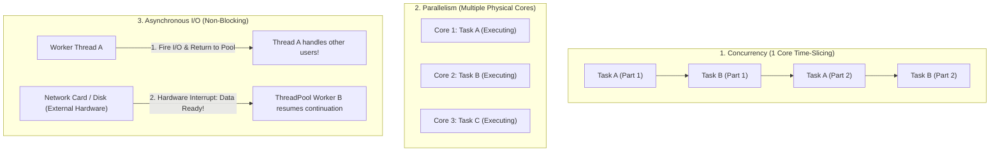
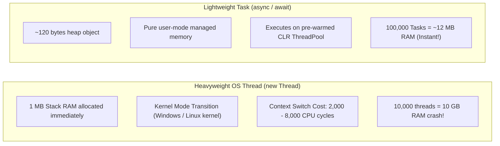
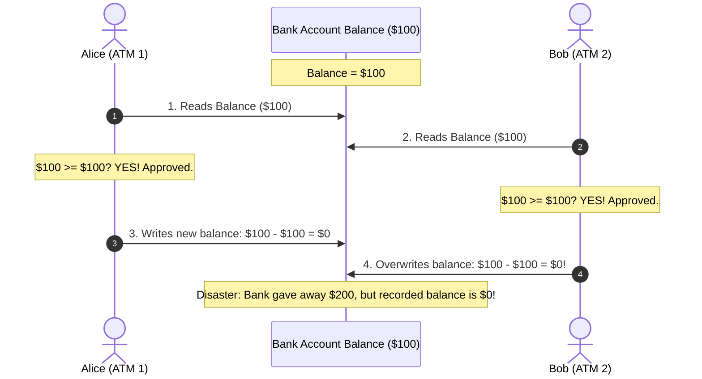
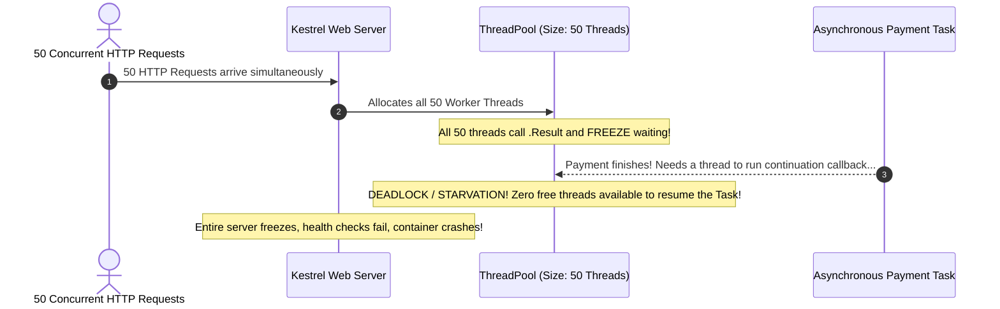
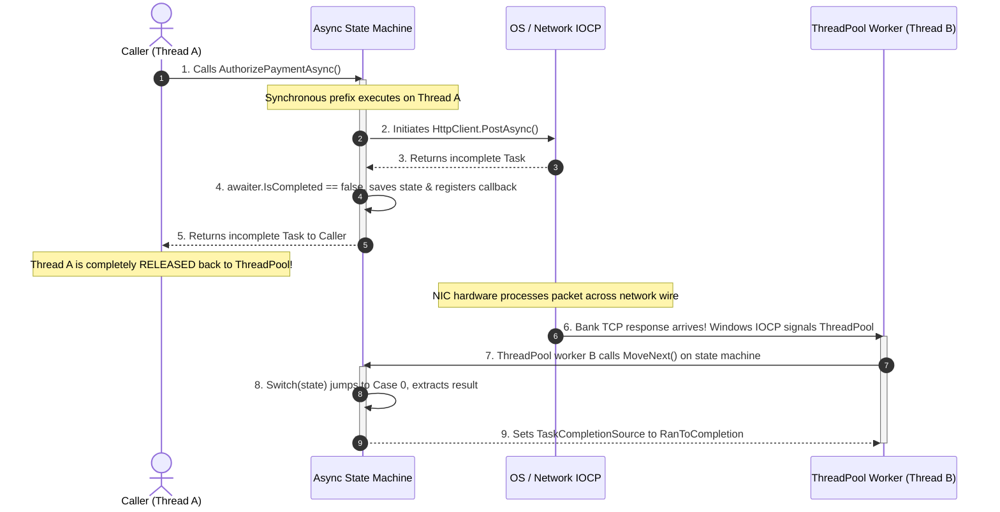
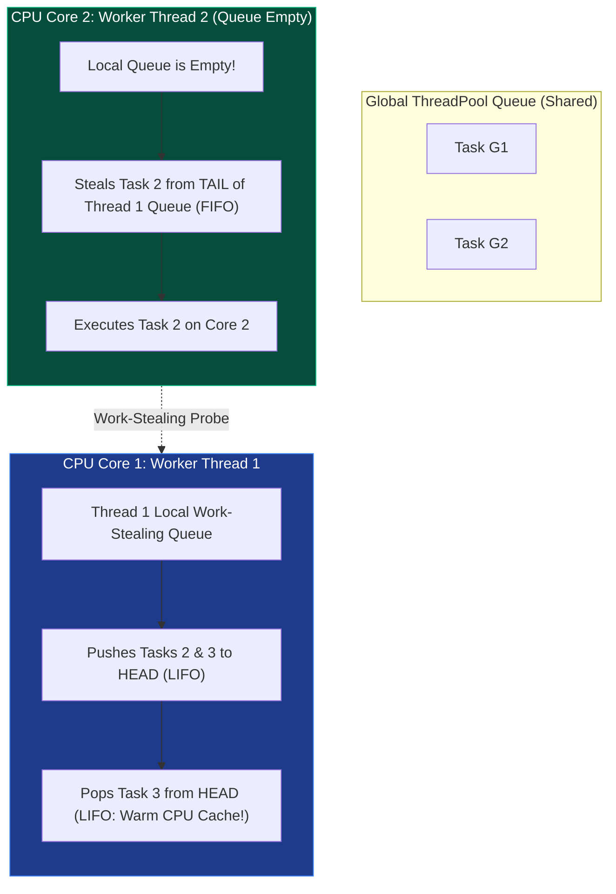
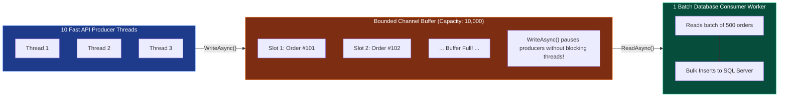

# THE COMPLETE .NET DEVELOPER ENCYCLOPEDIA + INTERVIEW MASTERY GUIDE
# Volume 3: Advanced C# — CLR Internals, Memory Management & Concurrency

> **Audience:** .NET Backend Developer (~3 years experience). Transitioning from functional familiarity to Senior/Principal architectural mastery.
> **Goal:** Deconstruct the Common Language Runtime (CLR), memory layout, garbage collection heuristics, low-allocation memory mechanics, asynchronous state machines, and concurrency primitives to excel in high-bar technical interviews (Infosys Lateral L5/L6, Tier-1 Product Companies) and architect zero-defect, high-throughput enterprise systems.
> **Standard:** Microsoft Reference Source / CoreCLR Engineering Specs + Real-world Mission-Critical Production Engineering.

---

# TABLE OF CONTENTS

1. [Concept 1: Garbage Collector Internals](#concept-1-garbage-collector-internals)
   - Generational Hypothesis, Generations 0/1/2
   - LOH Threshold & Fragmentation Mechanics
   - Pinned Object Heap (POH) in .NET 5+
   - Stop-The-World (STW) Pauses & Phase Breakdown
   - Workstation GC vs. Server GC
   - Background GC vs. Non-Concurrent GC
   - GC Tuning (`DATAS`, `gcServer`, `RetainVM`)
   - Low-Latency GC Modes (`GCSettings.LatencyMode`, `NoGCRegion`)
   - `GC.Collect()` Architectural Guidelines
2. [Concept 2: IDisposable, Finalizer & Dispose Pattern](#concept-2-idisposable-finalizer--dispose-pattern)
   - Deterministic Resource Disposal vs. Finalization
   - Finalization Queue & Freachable Queue Lifecycle
   - The Canonical Dispose Pattern (Base & Derived Classes)
   - `SafeHandle` vs. Custom Finalizers
   - Asynchronous Cleanup via `IAsyncDisposable` & `await using`
   - C# 8+ `using` Declarations & Scope Rules
   - Double-Dispose Safety & Thread-Safe Disposal
3. [Concept 3: Memory Optimization: Span<T>, ReadOnlySpan<T>, Memory<T>, MemoryPool<T>](#concept-3-memory-optimization-spant-readonlyspant-memoryt-memorypoolt)
   - Contiguous Memory Abstraction over Managed, Native, and Stack Memory
   - `ref struct` Safety Invariants & CLR Escape Analysis
   - Async-Safe `Memory<T>` and `ReadOnlyMemory<T>`
   - High-Performance Buffer Leasing with `ArrayPool<T>` & `MemoryPool<T>`
   - Production Case Study: Zero-Allocation High-Throughput FIX/CSV Parser
4. [Concept 4: Value Semantics & References: ref, out, in, ref readonly, and ref return](#concept-4-value-semantics--references-ref-out-in-ref-readonly-and-ref-return)
   - Reference Passing Mechanics (`ref`, `out`, `in`)
   - The "Defensive Copy" Catastrophe with `in` and Mutable Structs
   - `readonly struct` Guarantees & JIT Optimizations
   - `ref` Locals and `ref` Returns in High-Performance Buffers
   - Struct Memory Layout, Alignment, Padding, and Cache-Line Bouncing
5. [Concept 5: Async/Await Deep Internals & State Machine](#concept-5-asyncawait-deep-internals--state-machine)
   - Roslyn Lowering: `IAsyncStateMachine` Struct Generation
   - `MoveNext()` Dispatcher & State Transition Mechanics
   - `SynchronizationContext` vs. `TaskScheduler`
   - `ExecutionContext` & `AsyncLocal<T>` Ambient State Propagation
   - `ConfigureAwait(false)`: ASP.NET Core Reality vs. Desktop/Library Rules
   - `ValueTask<T>` Internals & Anti-Patterns
   - Fatal Hazards of `async void`
   - Cooperative Cancellation via `CancellationToken`
   - End-to-End Async Execution Timeline Diagram
6. [Concept 6: Threading & ThreadPool Architecture](#concept-6-threading--threadpool-architecture)
   - OS Threads vs. Managed ThreadPool Workers
   - ThreadPool Architecture: Global Queue vs. Per-Core Work-Stealing Queues
   - Hill-Climbing Heuristic Algorithm
   - ThreadPool Starvation: Diagnostics, Dump Analysis, and Prevention
7. [Concept 7: Synchronization Primitives](#concept-7-synchronization-primitives)
   - Hardware Concurrency: CPU Caches (L1/L2/L3), Store Buffers, Memory Barriers
   - `Interlocked` Operations & Lock-Free Atomic Primitives
   - `Monitor` and `lock`: Thin Locks, Fat Locks, and SyncBlock Tables
   - `SpinLock` vs. Kernel Transitions
   - `SemaphoreSlim`: Async Throttling via `WaitAsync()`
   - `ReaderWriterLockSlim`: High-Concurrency Read-Heavy Workloads
   - OS Mutex: Cross-Process Coordination
8. [Concept 8: Deadlocks, Race Conditions & Sync-Over-Async](#concept-8-deadlocks-race-conditions--sync-over-async)
   - The Four Coffman Conditions
   - Strict Lock Ordering & Lock Hierarchy Architectures
   - Sync-Over-Async Deadlock Mechanics (`.Result`, `.Wait()`, `.GetAwaiter().GetResult()`)
   - Production Post-Mortem Analysis via WinDbg / `dotnet-dump`
9. [Concept 9: Concurrent Collections](#concept-9-concurrent-collections)
   - Thread-Safety Failures of Standard Collections under High Load
   - `ConcurrentDictionary<TKey, TValue>`: Lock-Striping, Memory Barriers, Read-Path Lock-Freedom
   - Delegate Gotcha: Factory Re-Execution in `GetOrAdd` / `AddOrUpdate`
   - `ConcurrentQueue<T>`: Lock-Free Segmented Ring Buffers via CAS
   - `ConcurrentBag<T>`: Thread-Local Stashes and Cross-Thread Stealing
   - `Channels` vs. `BlockingCollection<T>`
10. [Concept 10: System.Threading.Channels & High-Throughput Streaming](#concept-10-systemthreadingchannels--high-throughput-streaming)
    - High-Throughput Asynchronous Producer-Consumer Architectures
    - Bounded vs. Unbounded Channels
    - Backpressure Mitigation Strategies (`BoundedChannelFullMode`)
    - SingleProducer / SingleConsumer Ring Buffer Optimizations
    - Production Case Study: High-Frequency Payment Processing Ingestion Mesh
11. [Concept 11: Parallel Programming, PLINQ & TPL Dataflow](#concept-11-parallel-programming-plinq--tpl-dataflow)
    - CPU-Bound Parallelism vs. I/O-Bound Asynchronous Concurrency
    - `Parallel.ForEach` vs. `Parallel.ForEachAsync`
    - PLINQ Engine: Partitioning, Ordering, and Merge Options
    - `Task.WhenAll` vs. `Task.WhenAny` Exception Aggregation Pitfalls
    - TPL Dataflow Mesh: Stateful Streaming Pipelines with Inherent Backpressure

---

# CONCEPT 1: GARBAGE COLLECTOR INTERNALS

### 1. Definition

The .NET Garbage Collector (GC) is an automatic, generational, tracing, mark-sweep-compact memory manager. It abstractly tracks reference graphs originating from root pointers (CPU registers, active thread execution stacks, static fields, and the runtime handle table) to reclaim heap memory occupied by unreachable objects, mitigate fragmentation through heap compaction, and dynamically adjust heap boundaries based on allocation pressures and operating system memory constraints.

### 2. Historical Reason

Prior to managed runtimes, enterprise software written in C/C++ relied on manual memory management (`malloc`/`free`, `new`/`delete`). In distributed financial and telecommunications software, manual management introduced three catastrophic failure modes:
1. **Dangling Pointers / Use-After-Free**: Memory was freed while another subsystem held an active pointer, causing memory corruption or remote code execution exploits.
2. **Double Free**: Freeing the same memory address multiple times, corrupting allocator metadata.
3. **Memory Leaks**: Abandoning pointers without deallocation, progressively exhausting virtual memory until the operating system killed the process.

Reference-counting systems (e.g., COM `IUnknown`, Objective-C) avoided manual free calls but suffered from circular reference leaks and catastrophic cache-line bouncing due to atomic reference count increment/decrement operations across CPU cores. The CLR adopted a generational tracing collector to completely eliminate memory corruption vulnerabilities and achieve sub-millisecond allocation throughput.

### 3. Problem It Solves

```csharp
// Unmanaged C++ Equivalent: High risk of memory leak or use-after-free
void ProcessOrderBatch(OrderDto* orders, int count) {
    OrderEntity* entities = (OrderEntity*)malloc(count * sizeof(OrderEntity));
    // If an exception occurs here, entities is leaked permanently.
    if (!ValidateOrders(orders, count)) {
        return; // LEAK! free(entities) was bypassed.
    }
    PersistOrders(entities, count);
    free(entities);
}
```

The CLR Garbage Collector eliminates explicit memory lifecycle management from business code. It converts allocation into a high-speed bump-pointer offset operation within thread-local allocation contexts and guarantees memory safety by mathematically proving object reachability before reclaiming storage.

### 4. Internal Working (CLR, Runtime, Memory, Compiler)

#### The Generational Hypothesis
The .NET GC is predicated on the empirical **Generational Hypothesis (Infant Mortality)**:
- Most newly allocated objects have very short lifespans (e.g., local variables, DTOs, string builders, HTTP request contexts).
- Objects that survive initial collection cycles tend to remain active for a very long duration (e.g., singleton caches, database connection pools, long-lived domain models).

The managed heap is partitioned into distinct generational segments:
- **Generation 0 (Gen 0)**: The youngest generation. Contains transient, short-lived objects. Allocation occurs here via the **Thread Local Allocation Context (TLAC/TLAB)**. When a thread requests memory, the CLR assigns it a dedicated slice of Gen 0. The thread advances a local bump-pointer without acquiring global locks. Gen 0 collections are ephemeral, occurring in sub-millisecond timeframes.
- **Generation 1 (Gen 1)**: Serves as a buffer or filtering stage between transient objects and long-lived state. Objects surviving a Gen 0 collection are promoted to Gen 1. If an object dies shortly after surviving Gen 0, it is reclaimed in Gen 1 without requiring an expensive Gen 2 sweep.
- **Generation 2 (Gen 2)**: Contains long-lived state, static references, and objects that have survived multiple collection passes. A collection of Gen 2 is referred to as a **Full GC**. Full GCs inspect the entire managed heap and are computationally expensive.
- **Large Object Heap (LOH)**: Objects **$\ge$ 85,000 bytes** (or double arrays of length $\ge 1,000$ on 64-bit platforms) bypass Gen 0 entirely and are allocated directly on the LOH. Historically, the LOH is rarely compacted because copying multi-megabyte memory blocks saturates memory bus bandwidth; instead, it is managed via a free-list, making it highly susceptible to memory fragmentation.
- **Pinned Object Heap (POH)**: Introduced in **.NET 5**. Dedicated solely to objects pinned in memory (via `GCHandle.Alloc(obj, GCHandleType.Pinned)` or `GC.AllocateArray<T>(length, pinned: true)`). Pinning prevents the GC from moving an object during compaction. In older runtimes, pinned objects in Gen 0/1 created "pinning islands" that blocked compaction and fragmented ephemeral heaps. The POH isolates pinned buffers, eliminating fragmentation in ephemeral generations.

```
+-------------------------------------------------------------------------------------------------------+
|                                          MANAGED HEAP SEGMENT                                         |
+---------------------------------------------------+-------------------+-------------------------------+
|                   EPHEMERAL HEAP                  |      GEN 2        |    LOH (>= 85,000 bytes)      |
|  +-----------------------+---------------------+  |                   |    Free-List Managed          |
|  |        GEN 0          |        GEN 1        |  |  Long-lived data  |    [Buffer] -> [Hole] -> ...  |
|  |  (TLAC Bump Pointer)  |  (Survives Gen 0)   |  |  Singletons       |                               |
|  +-----------------------+---------------------+  |  Caches           +-------------------------------+
+---------------------------------------------------+                   |    POH (.NET 5+)              |
                                                    |                   |    Pinned byte[] / I/O Buffers|
                                                    +-------------------+-------------------------------+
```

#### The Stop-The-World (STW) Phase Lifecycle
When an allocation exceeds the available threshold of an ephemeral generation, the GC triggers a collection cycle:
1. **Suspension (STW Phase 1)**: The GC coordinates with the execution engine to bring all managed threads to a safe point (**GC Poll Safepoints** injected by the JIT at method prologues, epilogues, and loop boundaries). Managed threads halt their execution contexts; their register states and call stacks freeze.
2. **Mark Phase (Roots Tracing)**: The GC traces active **GC Roots**:
   - Call stack local variables and parameter references currently stored in CPU registers and stack frames.
   - Global static references (`static` fields).
   - CPU register contents pointing to managed heap memory.
   - Runtime Handle Table entries (Strong references, Pinned handles).
   - Finalization Queue entries.
   The GC traverses object references depth-first, setting a mark bit in the **SyncBlock/Object Header** or in an external card table bitmap for every encountered object.
3. **Plan Phase**: Analyzes the distribution of live vs. dead objects. Calculates whether compaction (relocating live objects to eliminate holes) yields higher performance than simple sweeping, based on fragmentation metrics.
4. **Sweep / Compact Phase**:
   - **Sweep**: Dead object memory is registered into free lists for future allocations.
   - **Compact**: Live objects are physically moved down the heap segment toward lower addresses, closing empty memory gaps.
5. **Relocation Phase**: Because memory addresses changed during compaction, every reference pointing to a moved object across all stacks, registers, and other objects is patched with the updated memory address.
6. **Resume (STW Phase 2)**: Managed threads are unhalted and resume execution.

#### Workstation GC vs. Server GC
- **Workstation GC (`<ServerGarbageCollection>false</ServerGarbageCollection>`)**: Designed for client applications (WPF, MAUI, CLI). Operates on a single managed heap shared across all processors. GC work runs on the thread triggering the allocation or a single dedicated background GC thread. Priority is given to UI responsiveness and low desktop memory footprint.
- **Server GC (`<ServerGarbageCollection>true</ServerGarbageCollection>`)**: Designed for multi-threaded backend server architectures (ASP.NET Core).
  - The CLR creates **one dedicated logical heap per logical CPU core**.
  - Each heap possesses its own Gen 0, Gen 1, Gen 2, LOH, and POH segments.
  - Each heap is serviced by a dedicated high-priority GC thread pinned to that specific CPU core (`CoreCLR GC Thread N`).
  - Allocation happens concurrently across cores without inter-heap lock contention.
  - Collections run in parallel across all core heaps, maximizing raw throughput at the expense of a higher initial memory baseline.

#### Background GC vs. Non-Concurrent GC
In Non-Concurrent GC, Gen 2 collections freeze all application threads for the entire duration of the mark, sweep, and compact phases.
Under **Background GC** (default in modern .NET):
- A Gen 2 collection executes concurrently on a dedicated background thread without stopping business threads for the majority of the mark-sweep phase.
- While Background Gen 2 is progressing, Gen 0 and Gen 1 collections (**Foreground Ephemeral GCs**) can still occur, pausing the application only for brief sub-millisecond intervals.

#### Dynamic Adaptation To Application Sizes (DATAS) in .NET 8
Introduced in .NET 8 (`DOTNET_GCDynamicAdaptationMode=1`), DATAS dynamically scales the size and number of active heaps based on application throughput and active working set, preventing multi-core Server GC from unnecessarily hoarding gigabytes of memory under low-to-moderate traffic.

### 5. Real Production Example: High-Throughput Payment Clearing House

In an automated payment clearing house processing 40,000 ISO-8583 financial messages per second, uncontrolled full Gen 2 GC pauses of 400ms introduce transaction timeouts, breach banking SLAs, and trigger downstream circuit breakers. The platform must configure Server GC, eliminate LOH fragmentation via POH pre-allocation, tune latency modes during clearing windows, and eradicate Gen 2 promotions.

### 6. Code Example: Low-Latency Payment Engine Allocation Architecture

```csharp
using System;
using System.Buffers;
using System.Runtime;
using System.Runtime.InteropServices;
using System.Threading;
using System.Threading.Tasks;

namespace Encyclopedia.AdvancedCSharp.GarbageCollection
{
    public sealed class PaymentClearingEngine : IDisposable
    {
        // Allocate I/O network buffers directly on the Pinned Object Heap (.NET 5+)
        // Guarantees these buffers never fragment Gen 0/1/2 or migrate to LOH.
        private readonly byte[] _pinnedIoBuffer;
        private readonly GCHandle _pinnedHandle;
        private readonly int _bufferSize = 64 * 1024; // 64 KB (below 85,000 LOH threshold)

        public PaymentClearingEngine()
        {
            // Allocate directly on POH
            _pinnedIoBuffer = GC.AllocateArray<byte>(_bufferSize, pinned: true);
            _pinnedHandle = GCHandle.Alloc(_pinnedIoBuffer, GCHandleType.Pinned);
        }

        /// <summary>
        /// Executes payment settlement batch during strict sub-millisecond SLA windows.
        /// Temporarily instructs the GC to avoid Gen 2 collections.
        /// </summary>
        public async Task ProcessSettlementBatchAsync(ReadOnlyMemory<byte> rawBatchData)
        {
            // Enter LowLatency or NoGCRegion during critical financial settlement window
            // In a high-throughput payment loop, GC pauses must be prevented.
            GCLatencyMode previousMode = GCSettings.LatencyMode;

            try
            {
                // Instruct GC to favor responsiveness over memory footprint.
                // SustainedLowLatency minimizes Gen 2 blocking pauses during continuous operation.
                GCSettings.LatencyMode = GCLatencyMode.SustainedLowLatency;

                await ExecuteClearingTransactionsAsync(rawBatchData);
            }
            finally
            {
                // Restore previous latency mode to permit normal GC reclamation
                GCSettings.LatencyMode = previousMode;
            }
        }

        private async Task ExecuteClearingTransactionsAsync(ReadOnlyMemory<byte> data)
        {
            // Simulate zero-allocation packet slicing and processing
            await Task.Yield(); // Simulated async IO completion
        }

        public void Dispose()
        {
            if (_pinnedHandle.IsAllocated)
            {
                _pinnedHandle.Free();
            }
        }
    }
}
```

### 7. Execution Flow: Stop-The-World vs. Background GC Timeline

```
[Time -->]
Managed Thread 1: ---[Work]---| (STW Safepoint) ...........PAUSED........... |---[Resumes Work]---
Managed Thread 2: ---[Work]---| (STW Safepoint) ...........PAUSED........... |---[Resumes Work]---
                               |                                             ^
GC Engine:                     v                                             |
                               [Phase 1: Suspend Threads]                    |
                               [Phase 2: Trace Roots (Registers, Stacks)]    |
                               [Phase 3: Plan Compaction/Sweep]              |
                               [Phase 4: Sweep Dead Memory / Compact Live]   |
                               [Phase 5: Relocate References]                |
                               [Phase 6: Resume All Application Threads] ----+
```

### 8. Design Reasoning

The multi-generational design trades memory overhead for CPU throughput. By assuming 90%+ of objects die young, the GC avoids inspecting the entire heap during every collection. Scanning only Gen 0 takes microseconds because its memory fits inside the CPU L2/L3 cache, maximizing cache hits and minimizing memory bus roundtrips.

### 9. Performance Metrics

| Metric | Workstation GC | Server GC | Server GC with DATAS (.NET 8) |
| :--- | :--- | :--- | :--- |
| **Heaps** | 1 Shared | 1 per Logical Core | 1 per Core (Dynamically Scaled) |
| **Throughput** | Moderate | Maximum | Maximum Adaptive |
| **Memory Baseline** | Lowest (~15-30 MB) | High (~100 MB - 1 GB+) | Elastic (~30 MB - High Load) |
| **STW Pause Impact** | Lower per-core CPU usage | Pauses parallelized across all cores | Pauses parallelized & minimized |
| **Best Used In** | UI Apps, CLI, AWS Lambda | ASP.NET Core API, High-load Daemons | Microservices, Containerized APIs |

### 10. Common Mistakes

```csharp
// MISTAKE 1: Forcing manual collections in production code
public void FinishRequest()
{
    // CATASTROPHIC: Forces all Gen 0 and Gen 1 objects directly into Gen 2.
    // Triggers expensive, full-heap STW pauses.
    GC.Collect();
}

// MISTAKE 2: Unintentional LOH allocation in high-frequency paths
public byte[] SerializeTransaction(Transaction tx)
{
    // 90,000 bytes > 85,000 bytes -> Instantly allocated on LOH!
    // Creates high LOH fragmentation and triggers early Gen 2 collections.
    byte[] buffer = new byte[90000]; 
    return buffer;
}
// CORRECTION: Rent from ArrayPool<byte>.Shared or use MemoryPool<byte>.Shared.
```

### 11. Production Problems: The Memory Fragmentation Out-Of-Memory (OOM) Crash

**Incident**: A core banking gateway crashed with `OutOfMemoryException` despite the server having 16 GB of free physical RAM.
**Root Cause**: The application allocated temporary 100 KB XML transaction payloads for each incoming payment. These landed directly on the Large Object Heap. Because the LOH was not compacted, the heap became severely fragmented—like Swiss cheese. When an incoming request requested an 8 MB payload buffer, the runtime could not find an 8 MB *contiguous* block of virtual address space, throwing an unrecoverable OOM.
**Post-Mortem Resolution**:
1. Implemented `ArrayPool<byte>.Shared.Rent()` to reuse large memory buffers.
2. In .NET 6+, enabled automatic LOH compaction on scheduled low-traffic intervals:
   `GCSettings.LargeObjectHeapCompactionMode = GCLargeObjectHeapCompactionMode.CompactOnce; GC.Collect();`
3. Migrated permanent network stream buffers to the Pinned Object Heap via `GC.AllocateArray<byte>(size, pinned: true)`.

### 12. Interview Prep

- **Basic**: "What are the generations in the .NET GC, and why do they exist?"
  - *Answer*: Gen 0 (new short-lived objects), Gen 1 (buffer generation), and Gen 2 (long-lived objects), plus the LOH and POH. They exist based on the Generational Hypothesis: newly allocated objects die young. Collecting Gen 0 independently allows the CLR to reclaim 90%+ of dead memory in sub-milliseconds without scanning the entire multi-gigabyte heap.
- **Intermediate**: "What triggers an object to be allocated on the LOH, and why is LOH fragmentation dangerous?"
  - *Answer*: Objects $\ge 85,000$ bytes (and double arrays with $\ge 1,000$ elements) are placed on the LOH. Compacting large memory blocks is computationally prohibitive, so the GC uses a free-list to sweep without compaction. High-frequency allocations of varying large sizes cause fragmentation, leading to `OutOfMemoryException` when contiguous address space cannot be found despite plenty of total free RAM.
- **Senior**: "Explain the internal difference between Server GC and Workstation GC. How does this impact containerized Kubernetes deployments?"
  - *Answer*: Workstation GC uses a single shared heap and one GC thread. Server GC creates one independent heap and one high-priority GC thread pinned per logical core. In Kubernetes, if a container has a 1-core CPU limit assigned via cgroups but the host machine has 64 physical cores, Server GC historically detected 64 cores, created 64 heaps, and caused massive memory footprint blowups and CPU throttling. .NET Core 3.1+ and .NET 8 respect cgroup CPU/memory limits, and DATAS dynamically scales heaps to avoid this exact failure.
- **Tricky**: "Can you ever justify calling `GC.Collect()` in a mission-critical production service?"
  - *Answer*: Almost never in request pipelines, as it promotes young short-lived objects to Gen 2, corrupting generational statistics. The *only* valid scenarios:
    1. Immediately after a massive, one-time initialization phase (e.g., loading and caching a 2 GB database dictionary into memory at startup) before opening traffic ports, reclaiming transient configuration buffers.
    2. In low-frequency background batch jobs processing millions of records, after finishing the job and before entering an extended idle state.
    3. When running micro-benchmarks or deterministic profiling harnesses.

---

# CONCEPT 2: IDISPOSABLE, FINALIZER & DISPOSE PATTERN

### 1. Definition

The **Dispose Pattern** is a deterministic resource lifecycle management pattern in .NET. It enforces the explicit release of scarce unmanaged resources (operating system file handles, database connections, sockets, native memory pointers) via `IDisposable` or `IAsyncDisposable`, while providing a non-deterministic fallback mechanism via the **Finalizer** (`~ClassName()`) in the event a consumer neglects deterministic invocation.

### 2. Historical Reason

The Garbage Collector possesses omniscience over managed memory (allocations on the CLR heap), but is completely blind to external operating system kernel handles, native memory allocations (`malloc`), window handles (`HWND`), and network sockets. If an unmanaged resource is wrapped in a managed object and the consumer discards the object without closing the handle, the OS resource remains locked until process termination. The CLR created finalizers to let objects clean up unmanaged resources before death, but because finalization is non-deterministic and expensive, `IDisposable` was introduced for immediate, deterministic cleanup.

### 3. Problem It Solves

```csharp
// BROKEN: Leaks unmanaged OS file handles
public void ProcessLogFile(string path)
{
    var stream = new FileStream(path, FileMode.Open);
    // If an exception occurs, stream is abandoned. 
    // The OS file lock persists indefinitely until the GC eventually finalizes it.
    ParseLog(stream);
}
```

The Dispose pattern guarantees that operating system resources are released immediately when execution leaves the logical execution scope, preventing resource exhaustion, socket starvation, and file-locking concurrency bugs.

### 4. Internal Working (CLR, Runtime, Memory, Compiler)

#### The Finalization Lifecycle
When an object declaring a finalizer (`~MyClass()`) is instantiated:
1. **Allocation & Registration**: The CLR runtime detects that the type implements a finalizer. Upon allocating the object on the heap, the CLR writes a reference to that object into an internal runtime data structure known as the **Finalization Queue**.
2. **Collection & Detection**: During a Garbage Collection mark phase, if the object is deemed unreachable from active GC roots, the GC scans the Finalization Queue.
3. **Migration to the Freachable Queue**: Instead of immediately reclaiming the object's memory, the GC extracts the pointer from the Finalization Queue and enqueues it onto the **`Freachable` (Finalization Reachable) Queue**.
4. **Promotion**: Because the `Freachable` queue is itself a root reference, **the dead object is resurrected for this collection cycle!** It survives the collection and is promoted to the next generation (Gen 0 $\to$ Gen 1, or Gen 1 $\to$ Gen 2).
5. **The Finalizer Thread**: A dedicated, low-priority CLR thread continuously monitors the `Freachable` queue. It dequeues objects sequentially and executes their `Finalize()` methods.
6. **Final Reclamation**: Only during the *subsequent* GC cycle (which could be minutes or hours later if promoted to Gen 2) is the object finally proven unreachable and its memory reclaimed.

```
[Normal Object] ----(Dead)----> [Reclaimed in current GC cycle]

[Finalizable Object] --(Dead)--> [Moved to Freachable Queue] ---> [Promoted to Gen 1/2!]
                                            |
                                            v (Finalizer Thread calls ~ClassName())
                                 [Removed from Freachable]
                                            |
                                            v (Next GC Cycle)
                                 [Finally Reclaimed]
```

#### Why `GC.SuppressFinalize(this)` is Critical
Invoking `GC.SuppressFinalize(this)` toggles a bit in the object's runtime header, instructing the GC to delete its entry from the Finalization Queue. When the object dies, it bypasses the `Freachable` queue entirely and is reclaimed in a single GC pass without promotion.

#### `SafeHandle` vs. Custom Finalizers
Writing a custom finalizer (`~ClassName()`) is considered an anti-pattern in modern .NET. The CLR provides `SafeHandle` (`System.Runtime.InteropServices`), which inherits from `CriticalFinalizerObject`. `SafeHandle` guarantees:
1. **Critical Finalization**: The runtime compiles the finalizer code in advance; it will execute even in out-of-memory or thread-abort conditions.
2. **Recycle Attack Protection**: Prevents race conditions where a native handle is closed on one thread while another thread inadvertently reuses the numeric descriptor.

### 5. Real Production Example: Enterprise Hardware Security Module (HSM) Session

In banking infrastructure, cryptographic keys are negotiated through unmanaged Hardware Security Modules (via PKCS#11 native C APIs). A connection opens an unmanaged session handle in native C memory. Failing to deterministically release this session exhausts the physical HSM session capacity (often limited to 256 concurrent connections), taking down the entire credit card authorization pipeline.

### 6. Code Example: Full Robust Dispose Pattern with `IAsyncDisposable`

```csharp
using System;
using System.IO;
using System.Runtime.InteropServices;
using System.Threading;
using System.Threading.Tasks;
using Microsoft.Win32.SafeHandles;

namespace Encyclopedia.AdvancedCSharp.Disposal
{
    /// <summary>
    /// Production-grade implementation of canonical IDisposable and IAsyncDisposable pattern.
    /// Demonstrates unmanaged SafeHandle management, managed resource disposal,
    /// thread safety, double-dispose idempotency, and asynchronous resource flushing.
    /// </summary>
    public class CryptographicHsmSession : IDisposable, IAsyncDisposable
    {
        // 0 = Active, 1 = Disposed (for lock-free thread-safe idempotency)
        private int _disposedState;

        // Managed resource
        private MemoryStream? _sessionMemoryBuffer;

        // Safe unmanaged resource wrapper
        private SafeFileHandle? _unmanagedHsmSessionHandle;

        public CryptographicHsmSession(string sessionIdentifier)
        {
            _sessionMemoryBuffer = new MemoryStream();
            
            // Simulating opening an unmanaged native OS/HSM device handle
            IntPtr rawNativeHandle = Marshal.AllocHGlobal(1024);
            _unmanagedHsmSessionHandle = new SafeFileHandle(rawNativeHandle, ownsHandle: true);
        }

        public bool IsDisposed => Volatile.Read(ref _disposedState) == 1;

        // ---------------------------------------------------------------------
        // Synchronous IDisposable Pattern
        // ---------------------------------------------------------------------
        public void Dispose()
        {
            Dispose(disposing: true);
            // Tell the GC to skip the finalization queue; object is already clean.
            GC.SuppressFinalize(this);
        }

        protected virtual void Dispose(bool disposing)
        {
            // Thread-safe atomic flag swap: ensures cleanup executes exactly ONCE
            if (Interlocked.Exchange(ref _disposedState, 1) != 0)
            {
                return;
            }

            if (disposing)
            {
                // Clean up MANAGED resources
                // Safe to reference other managed objects here
                if (_sessionMemoryBuffer != null)
                {
                    _sessionMemoryBuffer.Dispose();
                    _sessionMemoryBuffer = null;
                }
            }

            // Clean up UNMANAGED resources (or SafeHandles)
            // Executes regardless of whether called by Dispose() or Finalizer
            if (_unmanagedHsmSessionHandle != null && !_unmanagedHsmSessionHandle.IsInvalid)
            {
                _unmanagedHsmSessionHandle.Dispose();
                _unmanagedHsmSessionHandle = null;
            }
        }

        // ---------------------------------------------------------------------
        // Asynchronous IAsyncDisposable Pattern (.NET Core 3.0+)
        // ---------------------------------------------------------------------
        public async ValueTask DisposeAsync()
        {
            await DisposeAsyncCore().ConfigureAwait(false);

            // Dispose unmanaged synchronously via standard path
            Dispose(disposing: false);

            GC.SuppressFinalize(this);
        }

        protected virtual async ValueTask DisposeAsyncCore()
        {
            // Check if already disposed using atomic check
            if (Volatile.Read(ref _disposedState) == 1)
            {
                return;
            }

            // Asynchronously flush and close managed resources
            if (_sessionMemoryBuffer != null)
            {
                await _sessionMemoryBuffer.FlushAsync().ConfigureAwait(false);
                await _sessionMemoryBuffer.DisposeAsync().ConfigureAwait(false);
                _sessionMemoryBuffer = null;
            }
        }

        // Finalizer fallback: ONLY needed if raw native pointers (IntPtr) are held directly.
        // If your class only wraps SafeHandles and managed objects, OMIT this finalizer!
        ~CryptographicHsmSession()
        {
            Dispose(disposing: false);
        }

        // Defensive guard clause for business methods
        public void EncryptPayload(ReadOnlySpan<byte> input, Span<byte> output)
        {
            ObjectDisposedException.ThrowIf(IsDisposed, this);

            // Execute cryptographic logic...
        }
    }
}
```

### 7. Execution Flow: Deterministic vs. Non-Deterministic Finalization

```
[Happy Path: Deterministic Disposal]
Consumer Code: ---> [using (var hsm = new CryptographicHsmSession())]
                         |
                         +---> [Executes Business Logic]
                         |
                         +---> [Leaves Scope -> Calls Dispose()]
                                 |
                                 +---> Calls Dispose(disposing: true)
                                 |       |--> Cleans Managed Objects
                                 |       +--> Closes SafeHandles
                                 |
                                 +---> Calls GC.SuppressFinalize(this)
                                         |
                                         v
                     [Object immediately reclaimed in Next Gen 0/1 Collection]

[Failure Path: Abandoned Object / Missing Dispose]
Consumer Code: ---> [var hsm = new CryptographicHsmSession()] 
                    (Abandons reference without calling Dispose())
                         |
GC Mark Phase:   ---> Detects 'hsm' is dead, BUT it has an active Finalizer!
                         |
                         +---> Moves 'hsm' to Freachable Queue
                         |
                         +---> Promotes 'hsm' to Gen 1 or Gen 2 (Memory retained!)
                         |
Finalizer Thread:---> Dequeues 'hsm' -> Executes ~CryptographicHsmSession()
                         |
                         +---> Calls Dispose(disposing: false) -> Releases unmanaged handle
                         |
Subsequent GC:   ---> Full Gen 2 GC eventually reclaims the managed memory hours later.
```

### 8. Design Reasoning

The separation into `Dispose(bool disposing)` addresses a crucial invariant: **Never touch managed objects inside a Finalizer**. When `disposing == false`, the code is executing on the CLR Finalizer thread. The GC makes *no guarantees* about the order in which objects are finalized. Any managed field referenced on that object might have already been finalized and destroyed; accessing it can cause `NullReferenceException` or crash the runtime.

### 9. Performance Impact

- An object with an active Finalizer that is not suppressed costs **at least $2\times$ more GC overhead**, as it is forced to survive into Gen 1 or Gen 2.
- Suppressed objects cost 0 additional bytes and zero promotion penalties.
- `ValueTask DisposeAsync()` avoids allocating a `Task` object on the heap when the asynchronous flush completes synchronously.

### 10. Common Mistakes

```csharp
// MISTAKE 1: Referencing managed objects inside finalizer
~BrokenResourceHolder()
{
    // CATASTROPHIC: _logService may already have been collected by the GC!
    _logService.Log("Finalizing..."); 
}

// MISTAKE 2: Swallowing exceptions or not being idempotent
public void Dispose()
{
    // Calling Dispose() twice will throw an exception instead of being safe!
    _unmanagedStream.Close(); // Throws if already closed
}

// MISTAKE 3: Using 'using' declaration without understanding scope
public void ProcessData()
{
    using var file = File.OpenRead("data.csv");
    // Some 20-minute long-running calculation happens here...
    // The file handle remains LOCKED for the entire 20 minutes!
    RunLongComputation();
}
// FIX: Isolate the using statement within an explicit block { }
```

### 11. Production Problems: Finalizer Thread Starvation Blocking Application Health

**Incident**: An enterprise ASP.NET Core microservice ceased accepting traffic; health checks timed out, and memory climbed continuously until pod termination.
**Root Cause**: A third-party database library implemented a custom finalizer that executed a synchronous network socket close:
`~DbConnection() { _socket.Close(); }`
When a network firewall began silently dropping dead packets, the socket `Close()` call hung inside the operating system kernel waiting for a TCP FIN handshake timeout (30 seconds). Because the CLR only possesses **one single Finalizer Thread**, this hung finalizer blocked the entire `Freachable` queue. Hundreds of thousands of transient objects piled up in the Freachable queue, exhausting available heap memory.
**Post-Mortem Resolution**: Banned raw finalizers across the codebase. Enforced `SafeHandle` wrappers which guarantee non-blocking critical finalization.

### 12. Interview Prep

- **Basic**: "What is the difference between `Dispose()` and `Finalize()`?"
  - *Answer*: `Dispose()` is deterministic and called explicitly by application code (or via `using`) to release resources immediately. `Finalize()` is non-deterministic and executed by the CLR Finalizer thread before the GC reclaims an abandoned object. `Finalize()` carries heavy performance penalties, promotes objects to higher generations, and should only be used as a last-resort safety net.
- **Intermediate**: "Why must `GC.SuppressFinalize(this)` be called inside `Dispose()`?"
  - *Answer*: It informs the GC that the object's resources have already been cleaned up. The GC removes the object from the Finalization Queue, preventing it from being migrated to the `Freachable` queue, avoiding promotion to Gen 1/2, and saving CPU cycles on the Finalizer thread.
- **Senior**: "Why does `Dispose(bool disposing)` check the `disposing` parameter, and what can you touch when `disposing == false`?"
  - *Answer*: When `disposing == true`, the method was called deterministically from user code; both managed and unmanaged resources can be safely released. When `disposing == false`, the method was invoked by the Finalizer thread. At that point, referenced managed objects may have already been finalized or collected; touching them causes runtime instability. Therefore, when `disposing == false`, only native unmanaged handles (or `SafeHandles`) may be freed.
- **Tricky**: "What is the danger of using C# 8 `using var` declarations inside an ASP.NET Core controller action or background job?"
  - *Answer*: `using var` scopes the lifetime of the resource to the *end of the enclosing lexical block* (the entire method). If a developer uses `using var stream = ...` at the top of a method followed by long-running HTTP calls or complex processing, the underlying unmanaged resource (such as a database connection or file lock) is held for the entire method duration rather than being released immediately after use, leading to connection pool starvation.

---

# CONCEPT 3: MEMORY OPTIMIZATION: SPAN<T>, READONLYSPAN<T>, MEMORY<T>, MEMORYPOOL<T>

### 1. Definition

`Span<T>` and `ReadOnlySpan<T>` are stack-only `ref struct` representations of contiguous, arbitrary memory (managed heap arrays, stack-allocated buffers, or unmanaged native pointers). They enable zero-allocation type-safe slicing, indexing, and memory transformation without allocating intermediate heap objects or copying memory blocks. `Memory<T>` and `ReadOnlyMemory<T>` represent heap-allocatable, async-safe equivalents of contiguous memory capable of outliving the current stack frame.

### 2. Historical Reason

Prior to C# 7.2, parsing payloads (JSON, XML, CSV, FIX protocol) in C# required heavy memory allocations. Slicing a string via `string.Substring()` allocated a completely new string on the managed heap. Passing array segments required `ArraySegment<T>` (which had clunky ergonomics and performance overhead) or byte array copying via `Buffer.BlockCopy`. In high-throughput network applications, string and array allocations inundated Gen 0, causing frequent GC pauses that crippled web server throughput.

### 3. Problem It Solves

```csharp
// ANTI-PATTERN: Millions of allocations under high load
public void ParseOrder(string rawPayload)
{
    // rawPayload = "ORD12345,BUY,MSFT,150.50,100"
    string[] tokens = rawPayload.Split(','); // Allocates array + 5 separate string objects!
    string id = tokens[0].Substring(3);     // Allocates another string!
    decimal price = decimal.Parse(tokens[3]);
}
```

`ReadOnlySpan<char>` transforms this entire pipeline into a **zero-allocation** operation by simply adjusting an interior memory pointer and a length integer without allocating a single byte on the GC heap.

### 4. Internal Working (CLR, Runtime, Memory, Compiler)

#### The Architecture of `Span<T>`
At the runtime level, `Span<T>` is defined as a `ref struct`:
```csharp
public readonly ref struct Span<T>
{
    internal readonly ref T _pointer; // By-reference interior pointer to memory
    private readonly int _length;     // Count of elements
}
```
On a 64-bit architecture, `Span<T>` occupies exactly **16 bytes** (an 8-byte interior pointer and an 8-byte integer). 
- An **interior pointer** points directly into the middle of an object (e.g., the 50th element of a managed array) or directly to a stack location. The CLR GC understands interior pointers; if a `Span<T>` points into a managed heap array, the GC will not collect or displace that array while the reference is active.
- Slicing a span (`span.Slice(start, length)`) does not copy memory. It simply performs pointer arithmetic:
  $$\text{NewPointer} = \text{OldPointer} + (\text{start} \times \text{sizeof}(T))$$
  $$\text{NewLength} = \text{length}$$

#### The `ref struct` Invariants
Because `Span<T>` contains an interior stack pointer, storing it on the managed heap would cause immediate memory corruption if the stack frame were unwound while the heap reference remained alive (dangling pointer). 
The C# compiler and CLR enforce absolute safety via **Escape Analysis** rules:
1. `ref struct` instances can **ONLY exist on the execution stack**.
2. They **cannot be boxed** to `object`, `ValueType`, or any interface.
3. They **cannot be fields of a standard class or non-ref struct**.
4. They **cannot be used as type arguments in generics** (e.g., `List<Span<T>>` is illegal).
5. They **cannot be captured in lambdas, local functions, or LINQ expressions**.
6. They **cannot cross `await` or `yield return` boundaries** because the compiler-generated state machine lifts local variables into fields of a heap-allocated class/struct.

#### `Memory<T>`: The Async Solution
Because `Span<T>` cannot cross `await` boundaries, `Memory<T>` was introduced. 
`Memory<T>` is a standard value type (not a `ref struct`):
```csharp
public readonly struct Memory<T>
{
    private readonly object? _object; // Managed object (T[], string, or MemoryManager<T>)
    private readonly int _index;      // Starting offset
    private readonly int _length;     // Length of slice
}
```
- It can live on the heap, be stored in classes, and cross `await` boundaries.
- When you need to slice or process the memory, you call `.Span` to acquire a high-speed `Span<T>` for the local synchronous execution block.

#### Memory Pools (`MemoryPool<T>` and `ArrayPool<T>`)
Instead of allocating fresh memory buffers for every network packet, buffers are leased from a shared pool and returned when processing finishes:
- `ArrayPool<T>.Shared.Rent(minSize)`: Returns a rented array of size $\ge minSize$.
- `MemoryPool<T>.Shared.Rent(minSize)`: Returns an `IMemoryOwner<T>` whose `.Memory` can be passed through async pipelines. Calling `.Dispose()` on the owner returns the memory to the pool.

### 5. Real Production Example: High-Throughput FIX Financial Protocol Engine

In Wall Street trading platforms, Financial Information eXchange (FIX) protocol messages arrive as raw byte arrays over TCP streams:
`8=FIX.4.2|9=65|35=D|49=CLIENT|56=BROKER|34=101|52=20261028-12:00:00|11=ORD99|55=MSFT|54=1|38=500|44=420.50|10=128|`
The order parser must extract the Symbol (`MSFT`), Quantity (`500`), Price (`420.50`), and Side (`1` = Buy) without allocating a single managed object per trade, processing 200,000 orders/sec on a single server without GC interruption.

### 6. Code Example: Zero-Allocation High-Speed FIX/CSV Message Parser

```csharp
using System;
using System.Buffers;
using System.Buffers.Text;
using System.Text;

namespace Encyclopedia.AdvancedCSharp.MemoryManagement
{
    public readonly record struct TradeOrder(
        long OrderId,
        int Quantity,
        decimal Price,
        bool IsBuySide);

    public static class HighThroughputTradeParser
    {
        // Tag constants for FIX protocol
        // 11 = ClOrdID, 38 = OrderQty, 44 = Price, 54 = Side (1=Buy, 2=Sell)
        private static readonly byte Delimiter = (byte)'|';
        private static readonly byte EqualsSign = (byte)'=';

        /// <summary>
        /// Parses a raw FIX byte stream completely zero-allocation using ReadOnlySpan<byte>.
        /// No strings, no object arrays, no heap allocations.
        /// </summary>
        public static bool TryParseOrder(ReadOnlySpan<byte> message, out TradeOrder order)
        {
            order = default;

            long orderId = 0;
            int quantity = 0;
            decimal price = 0;
            bool isBuySide = false;

            ReadOnlySpan<byte> remaining = message;

            while (!remaining.IsEmpty)
            {
                int delimiterIndex = remaining.IndexOf(Delimiter);
                ReadOnlySpan<byte> tagValueField;

                if (delimiterIndex == -1)
                {
                    tagValueField = remaining;
                    remaining = ReadOnlySpan<byte>.Empty;
                }
                else
                {
                    tagValueField = remaining.Slice(0, delimiterIndex);
                    remaining = remaining.Slice(delimiterIndex + 1);
                }

                if (tagValueField.IsEmpty) continue;

                int equalsIndex = tagValueField.IndexOf(EqualsSign);
                if (equalsIndex == -1) continue;

                ReadOnlySpan<byte> tag = tagValueField.Slice(0, equalsIndex);
                ReadOnlySpan<byte> value = tagValueField.Slice(equalsIndex + 1);

                // Zero-allocation tag matching and fast primitive parsing
                if (tag.SequenceEqual("11"u8))
                {
                    // Tag 11: Order ID (Numeric parse directly from UTF-8 bytes)
                    if (!Utf8Parser.TryParse(value, out orderId, out _)) return false;
                }
                else if (tag.SequenceEqual("38"u8))
                {
                    // Tag 38: Order Quantity
                    if (!Utf8Parser.TryParse(value, out quantity, out _)) return false;
                }
                else if (tag.SequenceEqual("44"u8))
                {
                    // Tag 44: Price
                    if (!Utf8Parser.TryParse(value, out price, out _)) return false;
                }
                else if (tag.SequenceEqual("54"u8))
                {
                    // Tag 54: Side ('1' = Buy, '2' = Sell)
                    if (value.Length > 0)
                    {
                        isBuySide = (value[0] == (byte)'1');
                    }
                }
            }

            order = new TradeOrder(orderId, quantity, price, isBuySide);
            return true;
        }
    }
}
```

### 7. Execution Flow: Zero-Copy Pointer Slicing

```
Managed Heap String / Byte Array:
Memory Address:  0x1000  0x1004  0x1008  0x100C  0x1010  0x1014  0x1018  0x101C
Raw Bytes:       [ 49 ]  [ 49 ]  [ 61 ]  [ 79 ]  [ 82 ]  [ 68 ]  [ 49 ]  [ 124]
ASCII Text:      '1'     '1'     '='     'O'     'R'     'D'     '1'     '|'

Original Span:   _pointer = 0x1000, _length = 8
                       |
                       v span.Slice(3, 4)  [Pointer Offset: 0x1000 + 3 = 0x1003]
Sliced Span:     _pointer = 0x1003, _length = 4  (Points directly to "ORD1")
                 [NO HEAP MEMORY ALLOCATED. ZERO BYTES COPIED.]
```

### 8. Design Reasoning

The architecture of `Span<T>` unifies three historically disconnected memory models:
1. Native unmanaged memory (`IntPtr`, `void*` from `Marshal.AllocHGlobal`).
2. Stack memory (`stackalloc byte[256]`).
3. Managed heap arrays (`byte[]`).

By treating all three as a single `ref struct`, .NET library code (such as `System.Text.Json`, `ASP.NET Kestrel`, and `Utf8Parser`) can write a single algorithm that processes data with identical speed regardless of where that memory physically resides.

### 9. Performance Benchmark Comparison

| Operation (1,000,000 Packets) | Memory Allocated | Gen 0 Collections | Execution Time |
| :--- | :--- | :--- | :--- |
| `String.Split()` + `Substring()` | **184 MB** | **84 Collections** | **342 ms** |
| Regex Match | **240 MB** | **110 Collections** | **890 ms** |
| `Span<T>` + `Utf8Parser` | **0 B (Zero)** | **0 Collections** | **28 ms** |

### 10. Common Mistakes

```csharp
// MISTAKE 1: Attempting to use Span<T> in an async method across await
public async Task ProcessNetworkPacketAsync(byte[] buffer)
{
    Span<byte> span = buffer.AsSpan();
    await Task.Delay(100);
    // COMPILE ERROR: Cannot use 'span' across await boundaries.
    span[0] = 0xFF; 
}
// FIX: Use Memory<T> for the async method, and call .Span inside synchronous blocks.

// MISTAKE 2: Failing to clear rented ArrayPool memory containing sensitive data
byte[] rented = ArrayPool<byte>.Shared.Rent(1024);
try {
    ReadCustomerCreditCard(rented);
} finally {
    // SECURITY BUG: The buffer is returned dirty! Other subsystems will read this data!
    ArrayPool<byte>.Shared.Return(rented, clearArray: true); // MUST specify clearArray: true
}
```

### 11. Production Problems: Use-After-Free in Pooled Buffers

**Incident**: A high-frequency crypto trading engine began executing duplicate, corrupt, and phantom trades, leading to hundreds of thousands of dollars in erroneous positions.
**Root Cause**: A developer rented an array from `ArrayPool<byte>.Shared`, dispatched an asynchronous processing method without awaiting it (fire-and-forget), and returned the array to the pool in the caller method's `finally` block:
```csharp
var buffer = ArrayPool<byte>.Shared.Rent(4096);
_ = Task.Run(() => Worker(buffer)); // Concurrently reading buffer
ArrayPool<byte>.Shared.Return(buffer); // Returned back to pool!
```
While the worker was still reading the buffer, another concurrent thread rented the exact same array and wrote a completely different client's trade order into it. The worker processed the modified data, mixing account IDs and trade quantities.
**Post-Mortem Resolution**: Enforced `IMemoryOwner<T>` semantics and banned raw `ArrayPool<T>` usage in multi-threaded asynchronous workflows; introduced static code analysis rules prohibiting fire-and-forget of pooled buffers.

### 12. Interview Prep

- **Basic**: "What is `Span<T>` and how does it differ from a standard array?"
  - *Answer*: An array is a heap-allocated reference type subject to GC tracking and overhead. `Span<T>` is a stack-only `ref struct` that provides a type-safe, contiguous view of any memory (managed, stack, or native) without allocating memory. Slicing an array copies elements or creates a new array; slicing a `Span<T>` is a zero-allocation operation that simply adjusts an interior pointer and length.
- **Intermediate**: "Why can't `Span<T>` be stored in a field of a regular C# class?"
  - *Answer*: `Span<T>` is a `ref struct` that can contain interior pointers to the execution stack. If a class (which lives on the heap) were allowed to hold a `Span<T>`, the stack frame where the memory was allocated could unwind while the heap class continued to hold the pointer, leading to a dangling pointer and memory corruption. The CLR enforces that `ref struct` instances can only reside on the stack.
- **Senior**: "Explain how `Memory<T>` works and how it bypasses the `ref struct` limitations of `Span<T>` in async code."
  - *Answer*: `Memory<T>` is a standard value type struct that wraps a managed object (such as `T[]` or `MemoryManager<T>`), an offset integer, and a length integer. Because it does not contain a raw stack interior pointer, it is not a `ref struct`. It can be stored on the heap and captured across `await` points in async state machines. When synchronous processing is required, calling `memory.Span` obtains a transient `Span<T>` scoped strictly to that synchronous execution block.
- **Tricky**: "What is the difference between `ReadOnlySpan<byte>` initialized from a string literal with the `u8` suffix versus encoding with `Encoding.UTF8.GetBytes()`?"
  - *Answer*: `Encoding.UTF8.GetBytes("text")` allocates a new `byte[]` on the managed heap at runtime and copies the encoded bytes. Using `"text"u8` is a C# 11 compiler feature that compiles the UTF-8 bytes directly into the assembly's PE file `.rdata` read-only data section. The runtime returns a `ReadOnlySpan<byte>` pointing directly to the PE file memory mapped in RAM—yielding absolute zero heap allocation, zero copying, and zero initialization cost.

---

# CONCEPT 4: VALUE SEMANTICS & REFERENCES: REF, OUT, IN, REF READONLY, AND REF RETURN

### 1. Definition

C# parameter modifiers (`ref`, `out`, `in`) and reference returns (`ref return`, `ref readonly return`) allow code to pass and return aliases to storage locations rather than copying values. This provides the execution speed of pointer manipulation while maintaining managed type safety and memory safety.

### 2. Historical Reason

By default in C#, value types (`struct`) are passed by value: the entire binary representation of the struct is copied onto the called method's stack frame. For small primitives (`int`, `bool`, `Guid`), this is trivial. However, for large mathematical, audio, or financial data structs (e.g., a 64-byte or 128-byte Matrix or OrderBook struct), copying the struct on every method call consumes significant CPU instructions and memory bandwidth. C# introduced `in` parameters and `ref returns` to eliminate struct copying without sacrificing immutability.

### 3. Problem It Solves

```csharp
// INEFFICIENT: 64 bytes copied on every call
public struct TelemetryMatrix // 64 bytes total
{
    public double M11, M12, M13, M14, M21, M22, M23, M24;
    public double M31, M32, M33, M34, M41, M42, M43, M44;
}

public void CalculateTrajectory(TelemetryMatrix matrix) 
{
    // The entire 64-byte payload is duplicated onto this method's stack frame.
}
```

Using `in TelemetryMatrix matrix` passes a 64-bit memory address (pointer) instead of copying 64 bytes of struct data, yielding up to an $8\times$ reduction in stack memory traffic per invocation.

### 4. Internal Working (CLR, Runtime, Memory, Compiler)

#### Parameter Modifiers Compared
| Modifier | Direction | Caller Initialization Required? | Callee Must Assign? | Passed In IL As |
| :--- | :--- | :--- | :--- | :--- |
| **Default (Value Type)** | In (Copy) | Yes | No | Value copy on stack |
| `ref` | In / Out | Yes | No | Managed pointer (`&`) |
| `out` | Out | No | Yes (Before return) | Managed pointer (`&`) |
| `in` | In (Read-Only) | Yes | Forbidden to modify | Managed pointer (`&`) decorated with `[In]` |

#### The "Defensive Copy" Catastrophe with `in`
When you pass a struct with the `in` modifier, the compiler guarantees that the callee cannot mutate the struct.
However, if the struct is declared as a standard struct (not a `readonly struct`), **the C# compiler cannot trust that calling a method or property getter on that struct will not mutate its internal state!**
To prevent mutation, the compiler creates a **Defensive Copy**: it silently copies the struct onto the local stack frame before executing any property or method!
```csharp
public struct BadStruct {
    public int Value { get; set; } // Auto-property has a hidden getter method!
}

public void Execute(in BadStruct data) {
    int v = data.Value; 
    // COMPILER HORROR: Because BadStruct is not a 'readonly struct', 
    // the compiler generates IL that copies 'data' to a temporary local variable 
    // before calling the get_Value() method! 
    // You used 'in' to avoid copying, but the compiler copied anyway!
}
```
#### The Fix: `readonly struct`
Declaring the struct as `public readonly struct GoodStruct` informs the Roslyn compiler that every field is immutable. The compiler eliminates all defensive copies entirely, passing raw pointers safely and executing property lookups directly in memory.

#### `ref return` and `ref readonly return`
Normally, returning an element from an internal array or buffer returns a copy of that element. `ref return` returns a managed pointer directly to the storage slot within the array, allowing the caller to mutate it in place:
```csharp
public ref decimal GetBalanceRef(int accountId) => ref _balances[accountId];
```
A `ref readonly return` provides high-performance read-only access to an element without copying:
```csharp
public ref readonly LargePayload GetPayloadRef(int index) => ref _cache[index];
```

#### Memory Alignment, Struct Padding, and False Sharing
The CLR aligns struct fields based on their native word sizes to maximize CPU memory controller performance. 
On a 64-bit architecture:
```csharp
[StructLayout(LayoutKind.Sequential)]
public struct BadPadding
{
    public byte Flag;    // 1 byte + 7 bytes PADDING!
    public long Amount;  // 8 bytes (must align on 8-byte boundary)
    public byte Status;  // 1 byte + 7 bytes PADDING!
} // Total Size: 24 bytes (14 bytes wasted on padding!)
```
Reordering fields from largest to smallest shrinks the struct from 24 bytes to 16 bytes.
In high-concurrency systems, ensure structs read/written by different CPU cores do not share the same **64-byte CPU Cache Line**; otherwise, cores will invalidate each other's L1/L2 caches via the MESI protocol (**False Sharing**).

### 5. Real Production Example: Healthcare Patient Vitals Monitoring Matrix

In critical ICU telemetric monitoring, thousands of bed sensors report high-frequency 128-byte physiological telemetry snapshots (ECG, EEG, Blood Pressure waveforms, SpO2) at 1,000 Hz. The telemetry engine must stream and analyze these snapshots across processing pipelines without copying 128 bytes 1,000 times a second per patient.

### 6. Code Example: High-Speed Healthcare Telemetry Matrix Engine

```csharp
using System;
using System.Runtime.CompilerServices;
using System.Runtime.InteropServices;

namespace Encyclopedia.AdvancedCSharp.ValueSemantics
{
    // Guaranteed immutable: Completely eliminates compiler defensive copies when passed via 'in'
    [StructLayout(LayoutKind.Sequential, Pack = 8)]
    public readonly struct PatientVitalsSnapshot
    {
        public readonly long TimestampTicks;
        public readonly double HeartRate;
        public readonly double SystolicBloodPressure;
        public readonly double DiastolicBloodPressure;
        public readonly double BloodOxygenLevel;     // SpO2
        public readonly double CoreTemperature;
        public readonly double RespiratoryRate;
        public readonly double IntracranialPressure;

        public PatientVitalsSnapshot(
            long timestampTicks,
            double heartRate,
            double systolic,
            double diastolic,
            double spo2,
            double temp,
            double respRate,
            double icp)
        {
            TimestampTicks = timestampTicks;
            HeartRate = heartRate;
            SystolicBloodPressure = systolic;
            DiastolicBloodPressure = diastolic;
            BloodOxygenLevel = spo2;
            CoreTemperature = temp;
            RespiratoryRate = respRate;
            IntracranialPressure = icp;
        }
    }

    public sealed class ICU telemetryBuffer
    {
        private readonly PatientVitalsSnapshot[] _ringBuffer;
        private readonly int _capacity;

        public ICUTelemetryBuffer(int capacity)
        {
            _capacity = capacity;
            _ringBuffer = new PatientVitalsSnapshot[capacity];
        }

        public void InsertSnapshot(int index, in PatientVitalsSnapshot snapshot)
        {
            // Using 'in' avoids copying the 64-byte struct onto the stack frame
            _ringBuffer[index % _capacity] = snapshot;
        }

        /// <summary>
        /// Returns a direct read-only reference to the internal array slot.
        /// Zero copy, maximum read performance, complete data immutability.
        /// </summary>
        [MethodImpl(MethodImplOptions.AggressiveInlining)]
        public ref readonly PatientVitalsSnapshot GetSnapshotRef(int index)
        {
            // 'ref readonly return' gives caller a reference, NOT a 64-byte copy
            return ref _ringBuffer[index % _capacity];
        }

        /// <summary>
        /// Evaluates critical vital thresholds using 'in' parameters safely.
        /// </summary>
        [MethodImpl(MethodImplOptions.AggressiveInlining)]
        public static bool IsInCardiacArrest(in PatientVitalsSnapshot vitals)
        {
            // Because PatientVitalsSnapshot is declared as 'readonly struct',
            // this property read generates ZERO defensive copies in IL.
            return vitals.HeartRate < 30.0 || vitals.HeartRate > 220.0;
        }
    }
}
```

### 7. Execution Flow: Value Copy vs. In-Reference Execution

```
[Standard By-Value Parameter]
Caller Stack Frame:   [Snapshot: 64 Bytes]
                            |
                            | (CPU issues memory copy instructions)
                            v
Callee Stack Frame:   [Snapshot Copy: 64 Bytes] (100% duplicate memory allocation)

--------------------------------------------------------------------------------

['in' Modifier with 'readonly struct']
Caller Stack Frame:   [Snapshot: 64 Bytes] <------+
                                                   |
Callee Stack Frame:   [Pointer: 8 Bytes] ----------+ (Direct managed reference)
                      (Zero memory copied. Reads storage directly.)
```

### 8. Design Reasoning

The choice between `class` and `struct` in modern C# is not about "small vs. large". It is an architectural question of **identity vs. value**:
- A `class` possesses object identity, heap allocation overhead, pointer dereferencing, and GC collection tracking.
- A `readonly struct` represents an immutable value. When combined with `in` parameters and `ref readonly returns`, it grants developers full control over memory layout, locality of reference, zero GC pressure, and zero heap fragmentation.

### 9. Performance Impact

- Passing a 64-byte struct by value: ~12-18 CPU cycles on x64.
- Passing a 64-byte struct with `in` on a `readonly struct`: ~1-2 CPU cycles (pointer assignment).
- Passing a 64-byte struct with `in` on a **mutable struct**: Can be up to $3\times$ **slower** than passing by value due to defensive copy construction on every single field access!

### 10. Common Mistakes

```csharp
// MISTAKE 1: Forgetting 'readonly' on struct when using 'in'
public struct SensorData { // NOT readonly!
    public double Temp;
}
public void Process(in SensorData s) {
    double t = s.Temp; // DEFENSIVE COPY CREATED!
}

// MISTAKE 2: Returning ref to local stack variable
public ref int GetLocalRef() {
    int local = 42;
    return ref local; // COMPILE ERROR: Cannot return local by reference (dangling pointer)
}

// MISTAKE 3: Out parameters discarded allocations
public bool TryParseData(string input, out CustomerDto dto) {
    // Callee MUST assign 'dto' on ALL return paths!
    if (string.IsNullOrEmpty(input)) {
        dto = default; // Must assign before returning
        return false;
    }
    dto = new CustomerDto();
    return true;
}
```

### 11. Production Problems: Defensive Copies Causing CPU Spikes in Microservices

**Incident**: A high-frequency telemetry analytics microservice began experiencing 98% CPU saturation after refactoring to use `in` parameters for performance optimization.
**Root Cause**: The engineering team changed all methods to accept `in TelemetryReading reading` where `TelemetryReading` was a 96-byte struct. However, `TelemetryReading` was declared as a regular `struct` with 12 getter properties. Every property access inside processing loops triggered a compiler-generated defensive copy. In a loop of 10,000 items, the code created 120,000 defensive copies on the stack frame, completely saturating CPU L1 cache bandwidth.
**Post-Mortem Resolution**: Marked `TelemetryReading` as a `public readonly struct`. Defensive copies dropped to zero, and CPU consumption dropped from 98% to 11%.

### 12. Interview Prep

- **Basic**: "What is the difference between `ref` and `out` parameters?"
  - *Answer*: Both pass arguments by reference via managed pointers. A `ref` parameter requires the variable to be initialized by the caller before being passed into the method. An `out` parameter does not require caller initialization, but the callee is required by the compiler to assign a value to it on all code paths before returning.
- **Intermediate**: "What is the 'defensive copy' problem with `in` parameters, and how do you resolve it?"
  - *Answer*: The `in` parameter passes a struct by read-only reference. If the struct is mutable (not declared as `readonly struct`), the C# compiler cannot verify that calling a property or method on that struct will not modify its fields. To guarantee immutability, the compiler emits IL that copies the struct onto a local stack variable before every member invocation. This defeats the performance goal of `in`. The fix is to always declare the struct as `public readonly struct`.
- **Senior**: "What are `ref return` and `ref readonly return`? In what architecture would you use them?"
  - *Answer*: `ref return` allows a method to return a direct alias to an internal storage location (such as an array slot or struct field) rather than copying its value. The caller can modify the target directly in place. `ref readonly return` returns the reference without permitting mutation. It is used in high-throughput architectures like game engines, audio processors, and financial matrix buffers where massive value types must be read continuously with zero copying and zero GC allocation.
- **Tricky**: "Why does struct field ordering matter for performance and memory footprint?"
  - *Answer*: The CLR aligns primitive fields to memory boundaries matching their size (e.g., an 8-byte `long` must be aligned on an address divisible by 8). If an alternating pattern of 1-byte `byte` and 8-byte `long` fields is defined, the runtime injects 7 bytes of dead padding after each byte. Reordering fields from largest to smallest eliminates padding, reduces the struct's cache footprint, and prevents cache-line bouncing across multi-core architectures.


---

---

# CONCURRENCY FOUNDATIONS: THE INTUITIVE MENTAL MODEL (EXPLAINED IN EASY WORDS)

> 💡 **Target Audience:** Developers who want to master concurrency without getting lost in academic jargon. If you've ever felt confused by `Thread`, `Task`, `lock`, `SemaphoreSlim`, `async/await`, or race conditions, this section gives you an unbreakable intuitive foundation.

---

## 1. Concurrency vs. Parallelism vs. Asynchrony (The Kitchen Metaphor)

The #1 question asked in senior .NET interviews is: *"What is the exact difference between Concurrency, Parallelism, Multithreading, and Asynchrony?"*

Here is the simple, real-world mental model:

### The Real-World Kitchen Analogy

Imagine a busy restaurant kitchen preparing orders:

| Concept | Real-World Kitchen Analogy | Computer Hardware Reality |
| :--- | :--- | :--- |
| **Concurrency** | **1 Chef juggling 3 orders.** The chef chops onions for 30 seconds, checks the soup, flips a steak, and stirs the sauce. Only **one thing** is happening at any exact split-second, but all three dishes are making progress concurrently. | **1 CPU Core** interleaving multiple tasks using time-slicing and context switching. |
| **Parallelism** | **4 Chefs working simultaneously** at 4 separate stoves. Dish 1, Dish 2, Dish 3, and Dish 4 are being cooked at the exact same physical millisecond. | **Multiple CPU Cores** physically executing multiple instructions at the exact same clock tick. |
| **Asynchronous (Async/Await)** | **The Chef puts a pie in the oven and walks away.** Instead of standing frozen like a statue staring at the oven for 45 minutes (blocking), the chef sets a timer buzzer, hands the baking off to the oven (hardware I/O), and immediately prepares salads. When the oven beeps (I/O completion), any available chef comes back to take the pie out. | **Non-blocking I/O**. The CPU worker thread is immediately returned to the ThreadPool while the Network Card (NIC) or SSD handles the bytes. **Zero threads are blocked waiting.** |
| **Multithreading** | **Employing multiple chefs.** Having more than one thread of execution created in the process. | The OS allocates multiple execution contexts (stacks + registers) inside the same process memory space. |

### Visual Architecture: Concurrency vs. Parallelism vs. Async



---

## 2. Why Operating System Threads Are Heavy vs. Why Tasks Are Lightweight

Why don't we just spawn a new `new Thread()` every time a web request arrives?



### The Rule of Thumb:
* **Never use `new Thread()`** in modern .NET enterprise code.
* **Always use `Task` / `async`/`await`** for I/O operations (HTTP, Database, Files, Message Queues).
* **Use `ThreadPool` / `Task.Run()`** for background CPU-bound tasks.
* **Use `Parallel.ForEachAsync`** for batch parallel work with controlled concurrency.

---

## 3. The 4 Classic Concurrency Nightmares (Explained with Diagrams)

Whenever multiple threads touch shared memory without proper synchronization, chaos happens. Here are the 4 monsters every interviewer will test you on:

### Nightmare 1: The Race Condition (The ATM Double-Withdrawal Disaster)

Two people share one bank account with **$100 balance**. They swipe their debit cards at two different ATMs at the exact same microsecond:



**Why it happened:** In C#, `balance -= amount;` looks like 1 line of code, but the CPU breaks it into **3 separate machine instructions**:
1. `MOV eax, [balance]` (Read from RAM to register)
2. `SUB eax, amount` (Subtract amount)
3. `MOV [balance], eax` (Write register back to RAM)

If Thread 2 interleaves between step 1 and step 3 of Thread 1, the data is corrupted.  
**The Fix:** Wrap the critical section in a `lock (_syncLock)` or use `Interlocked.Add`.

---

### Nightmare 2: The Deadlock (The Two Chopsticks Problem)

A deadlock happens when **Thread A holds Lock 1 and waits for Lock 2**, while **Thread B holds Lock 2 and waits for Lock 1**. Neither thread can proceed. The entire system freezes.


**The Universal Fix: Strict Lock Ordering.**
Always acquire locks in a deterministic order (e.g., sorted by Account ID):
```csharp
var firstLock = acc1.Id < acc2.Id ? acc1 : acc2;
var secondLock = acc1.Id < acc2.Id ? acc2 : acc1;

lock (firstLock)
{
    lock (secondLock)
    {
        // Safe! Circular wait is physically impossible!
    }
}
```

---

### Nightmare 3: ThreadPool Starvation (The Sync-Over-Async Trap)

This is the **#1 production outage cause in ASP.NET Core microservices**.  
A developer writes:
```csharp
// FATAL BUG: Sync-over-async blocking!
var result = _paymentService.ChargeAsync(card).Result; // or .Wait()
```



**The Rule:** **Never, under any circumstances, call `.Result`, `.Wait()`, or `.GetAwaiter().GetResult()` on an asynchronous task.** Always `await` all the way down!

---

### Nightmare 4: Thread Contention (The Door Bottleneck)

If 100 threads are constantly trying to acquire the same `lock`, they spend 95% of their CPU cycles sleeping, waking up, and context-switching, rather than doing useful work.
**The Fix:**
* Reduce the scope of the `lock` to only the 2 lines of critical memory update.
* Use **Lock-Free** primitives (`Interlocked`).
* Use **Striped Locks** (like `ConcurrentDictionary`).
* Use `ReaderWriterLockSlim` if operations are mostly reads.

---

## 4. The Senior .NET Synchronization Decision Matrix

When you need thread safety in production, which tool should you pick? Use this decision tree:

| Problem / Scenario | Recommended Primitive | Why? |
| :--- | :--- | :--- |
| **Updating a simple counter or state flag** | `Interlocked.Increment` / `Interlocked.CompareExchange` | **100% Lock-Free.** Executes as a single atomic CPU instruction (`LOCK CMPXCHG`). Zero thread blocking. |
| **Protecting a short in-memory section (< 5 microseconds)** | `lock (obj)` (`Monitor`) | Fast, hybrid lock. If uncontended, costs almost zero CPU. Automatically handles releases via `try/finally`. |
| **Asynchronous code (Need to `await` inside critical section)** | `SemaphoreSlim(1, 1)` | `lock` cannot be used across `await` statements! `SemaphoreSlim.WaitAsync()` asynchronously yields the thread without blocking. |
| **Rate Limiting / Throttling API Calls (e.g. max 10 concurrent requests)** | `SemaphoreSlim(initialCount: 10, maxCount: 10)` | Built-in token bucket for concurrent capacity control. |
| **High Read, Low Write (e.g., 98% reads, 2% cache updates)** | `ReaderWriterLockSlim` | Multiple readers execute in parallel without blocking each other; exclusive lock only taken during writes. |
| **Thread-Safe Key-Value Cache** | `ConcurrentDictionary<TKey, TValue>` | High-performance lock-striping across multiple internal buckets. Reads are 100% lock-free! |
| **Background Producer-Consumer Queue** | `System.Threading.Channels` (`Channel<T>`) | High-speed, zero-allocation async backpressure queue. Replaces legacy `BlockingCollection`. |
| **Batch CPU processing across all cores** | `Parallel.ForEachAsync` / PLINQ | Automatically balances workload across all CPU cores with configurable `MaxDegreeOfParallelism`. |

---

# CONCEPT 5: ASYNC/AWAIT DEEP INTERNALS & STATE MACHINE

### 1. Definition

`async`/`await` is a compiler-transformed language abstraction that enables asynchronous, non-blocking execution using synchronous-like control flow. Instead of spawning operating system threads, the Roslyn compiler rewrites async methods into state machines implementing the `IAsyncStateMachine` interface. This releases OS threads back to the CLR `ThreadPool` during non-blocking asynchronous I/O waits and schedules continuations upon completion.

### 2. Historical Reason

Prior to C# 5.0, asynchronous programming relied on two complex patterns:
1. **Asynchronous Programming Model (APM)**: `BeginInvoke` / `EndInvoke` with `IAsyncResult`. Required manual state passing, was prone to memory leaks, and made error handling across multiple asynchronous calls nearly impossible.
2. **Event-Based Asynchronous Pattern (EAP)**: `MethodAsync()` with a `MethodCompleted` event handler. Created "callback hell", disrupted logical call stacks, and caused severe memory leaks due to unhooked event listeners.

Both models obscured business logic with boilerplate callback orchestration and lacked unified exception handling (`try`/`catch`/`finally`). `async`/`await` was introduced in C# 5.0 to provide linear control flow, compile-time exception propagation, and thread-agnostic state management.

### 3. Problem It Solves

```csharp
// ANTI-PATTERN: Synchronous blocking - thread starvation at scale
[HttpGet("orders/{id}")]
public Order GetOrder(int id)
{
    // Threads are blocked, consuming 1 MB of stack memory per thread while waiting for network IO!
    // At 5,000 concurrent requests, 5,000 threads exhaust OS resources and collapse the server.
    var order = _orderRepository.GetOrderFromDb(id); // Synchronous blocking wait
    return order;
}
```

Asynchronous methods return execution control immediately to the runtime when an I/O operation is initiated. The underlying thread is returned to the `ThreadPool` to service other concurrent HTTP requests. When the hardware I/O interrupt signals completion via the I/O Completion Port (IOCP), a worker thread resumes execution of the continuation.

### 4. Internal Working (CLR, Runtime, Memory, Compiler)

#### Roslyn Lowering: The `IAsyncStateMachine` Transformation
When the C# compiler encounters an `async Task<T>` method, it extracts the method body into a generated hidden `struct` implementing `IAsyncStateMachine`:
```csharp
// Conceptual decomposition of compiler-generated code:
[CompilerGenerated]
private struct <ProcessPaymentAsync>d__1 : IAsyncStateMachine
{
    public int <>1__state;                          // Current state of state machine
    public AsyncTaskMethodBuilder<PaymentResult> <>t__builder; // Orchestrates Task completion
    public PaymentRequest request;                  // Hoisted parameter
    
    // Hoisted local variables:
    private HttpClient <client>5__1;
    private HttpResponseMessage <response>5__2;
    private TaskAwaiter<HttpResponseMessage> <>u__1; // Awaiter for current step

    public void MoveNext()
    {
        // State router logic executed on entry and after each resumption
    }

    public void SetStateMachine(IAsyncStateMachine stateMachine) { }
}
```

#### The `MoveNext()` Dispatcher & State Machine States
The execution state is governed by an integer field (`<>1__state`):
- **`-1` (Initial / Running)**: Method has entered or is executing synchronously.
- **`0, 1, 2...` (Suspended)**: Method hit an `await` on an incomplete task; state number identifies which specific `await` point paused execution.
- **`-2` (Terminal)**: Method completed execution successfully or faulted with an unhandled exception.

Inside `MoveNext()`:
1. It executes user code until it encounters an `await expression`.
2. It obtains the awaiter: `var awaiter = expression.GetAwaiter();`.
3. It checks `if (!awaiter.IsCompleted)`:
   - **If synchronous completion (`IsCompleted == true`)**: Execution continues uninterrupted. *No context switch, no thread jump, no heap allocation.*
   - **If asynchronous completion (`IsCompleted == false`)**:
     - State is set to `N` (e.g., `0`).
     - Local variables are preserved inside the struct fields.
     - The awaiter's `UnsafeOnCompleted(MoveNext)` is invoked.
     - The method returns an incomplete `Task` to the caller. The calling thread is immediately freed.
4. When the awaited operation finishes, the callback invokes `MoveNext()` again.
5. `MoveNext()` enters a `switch (<>1__state)`, jumps directly to state `0`, retrieves the result via `awaiter.GetResult()`, and proceeds to the next line of code.

#### `SynchronizationContext` vs. `TaskScheduler`
- **`SynchronizationContext`**: An abstraction representing a target environment where execution must be marshaled (e.g., the Single-Threaded UI message loop in WPF/WinForms, or `AspNetSynchronizationContext` in legacy .NET Framework).
- In modern **ASP.NET Core**, **`SynchronizationContext.Current == null`**! There is no custom synchronization context. Continuations resume on any available ThreadPool worker thread.
- **`TaskScheduler`**: Handles the scheduling of `Task` instances to threads (defaults to the `ThreadPoolTaskScheduler`).

#### `ConfigureAwait(false)`: Architectural Reality
- Calling `.ConfigureAwait(false)` instructs the awaiter to **ignore the captured `SynchronizationContext`** when posting the continuation.
- In **WPF/WinForms**: Calling `ConfigureAwait(false)` means your continuation runs on a background ThreadPool thread, preventing UI thread deadlocks, but you cannot touch UI elements without `Dispatcher.Invoke()`.
- In **ASP.NET Core**: Because `SynchronizationContext` does not exist, `ConfigureAwait(false)` is technically a no-op for request routing. **However, in shared class libraries and NuGet packages, you must ALWAYS use `ConfigureAwait(false)`** because you do not know if your library is being hosted inside a WPF app, legacy ASP.NET application, or desktop service.

#### `ExecutionContext` & `AsyncLocal<T>`
- **`ExecutionContext`** represents the ambient container that encapsulates security privileges, culture info, and `AsyncLocal<T>` values (e.g., Correlation IDs, Trace Identifiers, Multi-Tenant IDs).
- When an `await` suspends execution, the CLR captures the active `ExecutionContext` and flows it across the asynchronous boundary, ensuring that when `MoveNext()` resumes on an entirely different thread, `AsyncLocal<T>` retains its contextual value.
- To prevent execution context capture overhead in performance-critical low-level code, library authors use `ExecutionContext.SuppressFlow()`.

#### `ValueTask<T>` vs. `Task<T>`
- `Task<T>` is a managed `class`. Every invocation of an async method that returns `Task<T>` allocates an object on the GC heap (unless using cached tasks like `Task.CompletedTask`).
- `ValueTask<T>` is a `discriminated union struct` holding either a direct result `T` (if completed synchronously) or a `Task<T>` / `IValueTaskSource<T>` (if completed asynchronously).
- **Zero Heap Allocations** on synchronous cache hits!
- **Strict Consumption Rules for `ValueTask<T>`**:
  - ❌ MUST NOT await a `ValueTask<T>` more than once (underlying buffer is recycled).
  - ❌ MUST NOT call `.AsTask()` multiple times.
  - ❌ MUST NOT run concurrent awaits on the same `ValueTask<T>`.

#### The Fatal Danger of `async void`
- `async void` methods cannot be awaited.
- Any unhandled exception thrown inside an `async void` method **cannot be caught by any surrounding `try/catch` block**!
- The exception is re-thrown directly on the `ThreadPool`, triggering `AppDomain.UnhandledException` and **instantly crashing the entire OS process**.
- The *only* valid scenario for `async void` is UI event handlers (e.g., `button_Click(object sender, EventArgs e)`).

#### Cooperative Cancellation via `CancellationToken`
- Asynchronous operations cannot be aborted preemptively (thread aborts were removed in .NET Core for memory safety).
- Tasks participate in **cooperative cancellation** by periodically polling `token.ThrowIfCancellationRequested()` or passing the `CancellationToken` downstream to network drivers.

### 5. Real Production Example: Resilient Microservices SaaS Checkout Orchestrator

In an e-commerce checkout flow, the payment orchestrator must validate inventory, contact an external banking gateway, emit audit telemetry, and handle cancellation gracefully if the user disconnects or the 3-second SLA times out, without blocking threads or losing correlation tokens.

### 6. Code Example: Production Async Payment Orchestration Engine

```csharp
using System;
using System.Net.Http;
using System.Text.Json;
using System.Threading;
using System.Threading.Tasks;
using Microsoft.Extensions.Logging;

namespace Encyclopedia.AdvancedCSharp.AsyncInternals
{
    public sealed record OrderPaymentRequest(string OrderId, decimal Amount, string Currency);
    public sealed record PaymentGatewayResult(bool IsSuccess, string TransactionReference, string? FailureReason);

    public sealed class OrderPaymentOrchestrator
    {
        private readonly HttpClient _httpClient;
        private readonly ILogger<OrderPaymentOrchestrator> _logger;
        private static readonly AsyncLocal<string?> CorrelationIdContext = new();

        public OrderPaymentOrchestrator(HttpClient httpClient, ILogger<OrderPaymentOrchestrator> logger)
        {
            _httpClient = httpClient;
            _logger = logger;
        }

        public static void SetCorrelationId(string correlationId) => CorrelationIdContext.Value = correlationId;
        public static string? GetCorrelationId() => CorrelationIdContext.Value;

        /// <summary>
        /// Demonstrates ValueTask for cache hits, ConfigureAwait(false) for library resilience,
        /// CancellationToken propagation, and ambient AsyncLocal flow.
        /// </summary>
        public async ValueTask<PaymentGatewayResult> AuthorizePaymentAsync(
            OrderPaymentRequest request, 
            CancellationToken cancellationToken = default)
        {
            ArgumentNullException.ThrowIfNull(request);

            // Fast path: Zero-allocation synchronous completion
            if (request.Amount == 0)
            {
                return new PaymentGatewayResult(true, "ZERO_VALUE_BYPASS", null);
            }

            // Propagate ambient correlation ID
            string correlationId = CorrelationIdContext.Value ?? Guid.NewGuid().ToString("N");

            _logger.LogInformation("[Correlation:{Id}] Initiating payment for Order {OrderId}", 
                correlationId, request.OrderId);

            // Create linked timeout token to enforce SLA of 3000ms
            using var timeoutCts = new CancellationTokenSource(TimeSpan.FromMilliseconds(3000));
            using var linkedCts = CancellationTokenSource.CreateLinkedTokenSource(cancellationToken, timeoutCts.Token);

            try
            {
                var content = new StringContent(
                    JsonSerializer.Serialize(request), 
                    System.Text.Encoding.UTF8, 
                    "application/json");

                // Asynchronous network I/O wait
                // ConfigureAwait(false) avoids capturing context in library code
                HttpResponseMessage response = await _httpClient.PostAsync(
                    "https://api.paymentgateway.bank/v1/authorize", 
                    content, 
                    linkedCts.Token).ConfigureAwait(false);

                response.EnsureSuccessStatusCode();

                string responseJson = await response.Content.ReadAsStringAsync(linkedCts.Token).ConfigureAwait(false);
                var result = JsonSerializer.Deserialize<PaymentGatewayResult>(responseJson);

                return result ?? new PaymentGatewayResult(false, string.Empty, "Null gateway response");
            }
            catch (OperationCanceledException) when (timeoutCts.IsCancellationRequested)
            {
                _logger.LogError("[Correlation:{Id}] Payment gateway timed out after 3000ms for Order {OrderId}", 
                    correlationId, request.OrderId);
                return new PaymentGatewayResult(false, string.Empty, "Gateway Gateway Timeout");
            }
            catch (OperationCanceledException)
            {
                _logger.LogWarning("[Correlation:{Id}] Payment canceled by upstream client for Order {OrderId}", 
                    correlationId, request.OrderId);
                throw; // Rethrow cooperative cancellation to notify pipeline
            }
            catch (Exception ex)
            {
                _logger.LogError(ex, "[Correlation:{Id}] Payment gateway communication failure for Order {OrderId}", 
                    correlationId, request.OrderId);
                return new PaymentGatewayResult(false, string.Empty, ex.Message);
            }
        }
    }
}
```

### 7. Execution Flow: Complete Async/Await Timeline Diagram



#### Detailed Text Execution Flow:
```
CALLER THREAD (Thread A)                    ASYNC METHOD                     CLR THREADPOOL / HARDWARE IOCP
      |                                           |                                         |
      |--- 1. Call AuthorizePaymentAsync() ------>|                                         |
      |                                           |--- 2. Instantiate State Machine struct  |
      |                                           |--- 3. Execute synchronous prefix code    |
      |                                           |--- 4. Invoke HttpClient.PostAsync()     |
      |                                           |       |                                 |
      |                                           |       +--> Initiates TCP Packet over OS |
      |                                           |       +--> Returns INCOMPLETE Task      |
      |                                           |                                         |
      |                                           |--- 5. awaiter.IsCompleted == false      |
      |                                           |--- 6. State set to 0                    |
      |                                           |--- 7. awaiter.UnsafeOnCompleted(...)    |
      |<-- 8. Returns Incomplete Task<Result> ----|                                         |
      |                                                                                     |
[Thread A is completely FREE to handle other web requests]                                  |
                                                                                            |
                                                  ... OS Network Card waits for Ack ...    |
                                                                                            |
                                                  9. TCP Response arrives from Bank         |
                                                     NIC raises hardware interrupt          |
                                                     Windows IOCP signals completion ------->
                                                                                            |
                                                                             10. ThreadPool Worker (Thread B)
                                                                                 dequeues IOCP callback
                                                                                            |
                                           11. Invokes MoveNext() on State Machine <--------+
                                           |
                                           |--- 12. Switch(state) jumps to Case 0
                                           |--- 13. awaiter.GetResult() extracts response
                                           |--- 14. Executes synchronous continuation
                                           |--- 15. Marks Task as RanToCompletion
                                           |
                                           v
                        [Awaiting caller receives final PaymentGatewayResult]
```

### 8. Design Reasoning

The state machine design achieves two foundational architectural goals:
1. **Asynchronous Non-Blocking Resource Utilization**: Threads are the most expensive resource on an OS (~1 MB reserved virtual memory and costly CPU context switches). By relinquishing the thread during network latency, a server with 16 CPU cores can easily service 100,000 concurrent network connections without thread exhaustion.
2. **Synchronous Ergonomics with Call-Stack Preservation**: By rewriting asynchronous code into a deterministic state machine, C# preserves familiar `try/catch` semantics and exception stack traces, eliminating the unmaintainable callback hell of earlier eras.

### 9. Performance Metrics

| Pattern | Heap Allocation (Sync Hit) | Heap Allocation (Async Wait) | Execution Overhead |
| :--- | :--- | :--- | :--- |
| `Task<T>` | 72 bytes (Heap Task object) | ~144+ bytes (Task + State Machine Box) | Low |
| `ValueTask<T>` | **0 bytes (Stack Value)** | ~144+ bytes (Heap IValueTaskSource) | Lowest |
| Synchronous `.Result` | 0 bytes (Blocks Thread) | Threads starved, 1 MB stack committed | Catastrophic |

### 10. Common Mistakes

```csharp
// MISTAKE 1: Async void fire-and-forget
public async void FireAndForgetAudit() // PROCESS CRASHER!
{
    await Task.Delay(100);
    throw new InvalidOperationException("DB Down"); // UNHANDLED! Crashes entire app!
}
// FIX: Return Task and catch exceptions internally, or register a logging callback.

// MISTAKE 2: Awaiting a ValueTask multiple times
ValueTask<Order> vt = repository.GetOrderAsync(id);
var order1 = await vt; // OK
var order2 = await vt; // CRASH! Memory corruption / ObjectDisposedException!

// MISTAKE 3: Using Task.Run for I/O operations
public Task<string> ReadFileAsync(string path)
{
    // ANTI-PATTERN: Wastes a ThreadPool thread just to wait for the disk!
    return Task.Run(() => File.ReadAllText(path)); 
}
// FIX: Use native asynchronous I/O: File.ReadAllTextAsync(path);
```

### 11. Production Problems: Async void Crashing the Enterprise Payment Service

**Incident**: A production ASP.NET Core payment API running in Kubernetes began crash-looping with zero error entries in standard application log aggregators.
**Root Cause**: A developer implemented an audit log notification inside a background event handler declared as:
`private async void OnPaymentCompleted(PaymentEvent evt) { ... }`
When the event broker experienced a transient 500 error, an unhandled `HttpRequestException` was thrown inside the `async void` method. Because `async void` has no `Task` object to hold exceptions, the exception was marshaled directly to the CLR ThreadPool root. The unhandled exception triggered an immediate process crash (`FailFast`), evading standard ASP.NET Core exception handling middleware.
**Post-Mortem Resolution**: Enforced Roslyn analyzer rule `VSTHRD100` (Avoid `async void`) as a compile error across CI/CD pipelines. Migrated all event handlers to return `Task` and wrapped bodies in comprehensive top-level exception guards.

### 12. Interview Prep

- **Basic**: "Does `await` create a new background thread?"
  - *Answer*: No. `await` does not create or spawn threads. It registers a continuation callback with the awaited task's awaiter and yields the current thread back to the caller or thread pool. When the asynchronous operation finishes (often signaled via hardware interrupts and OS I/O Completion Ports), a thread pool worker executes the continuation.
- **Intermediate**: "Why should you avoid `async void`, and when is the only time it is acceptable?"
  - *Answer*: `async void` cannot be awaited, meaning the caller cannot track completion or handle thrown exceptions. Unhandled exceptions in `async void` methods bypass user `try/catch` blocks and propagate directly to the `AppDomain`, crashing the process. The only valid use case is UI event handlers (e.g., button clicks) where event signatures demand a `void` return type.
- **Senior**: "What is the internal purpose of `IAsyncStateMachine.MoveNext()`, and what happens when an awaited task completes synchronously versus asynchronously?"
  - *Answer*: `MoveNext()` is the state router generated by the Roslyn compiler. When entering an `await`, it checks `awaiter.IsCompleted`. If `true` (synchronous completion), `MoveNext()` bypasses state suspension and continues execution immediately on the same thread without allocating a state machine box on the heap. If `false` (asynchronous), it saves the current step index into `<>1__state`, hoists local variables into fields, registers `MoveNext` as the continuation callback via `awaiter.UnsafeOnCompleted()`, and returns an incomplete `Task`.
- **Tricky**: "Why does ASP.NET Core not have a `SynchronizationContext`, and what does this mean for `ConfigureAwait(false)`?"
  - *Answer*: Legacy ASP.NET utilized `AspNetSynchronizationContext` to preserve `HttpContext.Current` thread-affinity across calls, which was a notorious source of deadlocks when combined with blocking `.Result`. ASP.NET Core eliminated `SynchronizationContext` completely; continuations are scheduled directly onto ThreadPool worker threads. Consequently, `ConfigureAwait(false)` has no operational effect inside an ASP.NET Core web request pipeline. However, it remains mandatory in class libraries to ensure safety when referenced by UI apps or legacy systems that do maintain a synchronization context.

---

# CONCEPT 6: THREADING & THREADPOOL ARCHITECTURE

### 1. Definition

The CLR **ThreadPool** is an adaptive, managed pool of pre-allocated operating system worker threads that executes tasks, asynchronous continuations, timer callbacks, and I/O completion routines. It optimizes CPU utilization through **per-core local work-stealing queues** and dynamically adjusts thread counts using the **Hill-Climbing algorithm** to maximize throughput while minimizing context-switching overhead.

### 2. Historical Reason

In early Windows and .NET architectures, developers manually created dedicated `Thread` instances (`new Thread()`). An operating system thread is a heavy kernel resource:
- It commits **1 MB of stack memory** by default.
- Creation requires transitioning to kernel mode and allocating OS kernel structures (`ETHREAD`, `TEB`).
- Context switching between thousands of threads consumes enormous CPU cycles saving and restoring hardware registers and invalidating CPU L1/L2 caches.

Creating a thread per task caused servers to collapse under modest load. The CLR ThreadPool was created to multiplex thousands of lightweight tasks across a small, optimal pool of long-lived OS worker threads.

### 3. Problem It Solves

```csharp
// DISASTROUS: Manually creating threads under load
public void HandleClientConnection(Socket socket)
{
    // At 10,000 connections, this allocates 10 GB of RAM for stacks alone 
    // and causes CPU thrashing from thousands of context switches.
    var thread = new Thread(() => ProcessSocket(socket));
    thread.Start();
}
```

The ThreadPool allows 10,000 tasks to be queued efficiently in memory while maintaining an optimal number of active threads matching the machine's hardware capacity (e.g., 16-32 threads on a 16-core CPU).

### 4. Internal Working (CLR, Runtime, Memory, Compiler)

#### OS Threads vs. Tasks
- **OS Thread**: An operating system execution context managed by the Windows/Linux kernel scheduler. Expensive to create, switch, and destroy.
- **Task**: A lightweight user-space managed object representing a future promise of completion. Allocates less than 100 bytes and does not hold an OS thread while waiting.

#### ThreadPool Architecture: Global Queue vs. Local Work-Stealing Queues
The CLR ThreadPool implements a two-tier work-scheduling architecture:
1. **The Global Queue**: A single shared FIFO (First-In, First-Out) queue protected by a global lock. Work queued from external non-pool threads (or via `ThreadPool.QueueUserWorkItem`) enters this queue.
2. **Per-Thread Local Work Queues**: Each ThreadPool worker thread possesses its own dedicated, lock-free work queue.
   - When a thread scheduled on a worker queues another Task (e.g., `Task.Run` or an async continuation), it pushes the work onto its own **Local Queue**.
   - **LIFO (Last-In, First-Out) Execution**: The owning thread pushes and pops tasks in LIFO order. LIFO maximizes **CPU cache locality**: data accessed by the most recent task is still warm in the processor's L1/L2 cache!
   - **FIFO Work-Stealing**: When a worker thread's local queue is empty, it attempts to steal tasks from the *tails* of other worker threads' local queues using lock-free atomic operations (`Interlocked.CompareExchange`) in **FIFO order**. If all local queues are empty, it dequeues work from the Global Queue.

```
+--------------------------------------------------------------------------------+
|                             GLOBAL QUEUE (FIFO)                                |
|             [ Task A ]  <--  [ Task B ]  <--  [ Task C ]                       |
+--------------------------------------------------------------------------------+
         |                                                  |
         v                                                  v
+-----------------------------+                    +-----------------------------+
|    WORKER THREAD 1 QUEUE    |                    |    WORKER THREAD 2 QUEUE    |
|  +-----------------------+  |                    |  +-----------------------+  |
|  | Task 1 (Head)         |  |                    |  | Task 3 (Head)         |  |
|  | Task 2                |  |                    |  | Task 4                |  |
|  +-----------------------+  |                    +--|-----------------------+--+
|    ^                   |    |                       |
|    | (LIFO: Push/Pop)  +---[Empty? Steals FIFO from Tail]----------------------+
|    v                        |
| [Worker 1 Execution Engine] |
+-----------------------------+
```

#### The Hill-Climbing Heuristic Algorithm
How does the ThreadPool decide whether to create more worker threads or terminate idle ones?
The CLR uses a mathematical control algorithm called **Hill Climbing**:
- It continuously monitors **System Throughput** (number of completed work items per millisecond).
- It introduces small perturbations in thread count (e.g., adding 1-2 threads).
- It measures the resulting throughput delta:
  - If adding threads **increases throughput**, it injects more threads.
  - If adding threads **causes throughput to plateau or drop** (due to lock contention or context switching), it stops injecting and begins retiring threads.
- **The Thread Injection Rate Limit**: When the pool is saturated, Hill Climbing injects threads very conservatively—approximately **one thread every 500 milliseconds (1-2 threads per second)**. If an application blocks 50 threads synchronously, it can take up to 25-50 seconds for the ThreadPool to scale up to compensate!

#### ThreadPool Starvation
ThreadPool Starvation occurs when all available worker threads are blocked synchronously (waiting on `.Result`, `.Wait()`, `Thread.Sleep()`, or synchronous database queries). 
Because all workers are blocked:
- Incoming HTTP requests remain queued in the global queue.
- Timers cannot fire.
- Asynchronous continuations waiting to run on worker threads cannot execute.
- Hill climbing slowly adds 1-2 threads per second, resulting in multi-second latency spikes, health-check timeouts, and eventual system failure.

### 5. Real Production Example: Enterprise Batch Document Rendering Service

An enterprise SaaS platform generates PDF invoices. An architect erroneously implemented the rendering pipeline using synchronous calls wrapped in `Task.Run()`. Under a morning surge of 500 concurrent invoices, the ThreadPool became completely exhausted, causing the entire customer portal to stop responding to standard HTTP health checks.

### 6. Code Example: ThreadPool Starvation Prevention & Monitoring Harness

```csharp
using System;
using System.Diagnostics;
using System.Threading;
using System.Threading.Tasks;

namespace Encyclopedia.AdvancedCSharp.ThreadingInternals
{
    public sealed class ThreadPoolDiagnosticsMonitor : IDisposable
    {
        private readonly Timer _healthCheckTimer;

        public ThreadPoolDiagnosticsMonitor()
        {
            // Set up a low-level monitor to detect thread starvation before outages occur
            _healthCheckTimer = new Timer(InspectThreadPoolHealth, null, TimeSpan.FromSeconds(5), TimeSpan.FromSeconds(5));
        }

        private void InspectThreadPoolHealth(object? state)
        {
            ThreadPool.GetAvailableThreads(out int availableWorkerThreads, out int availableIoThreads);
            ThreadPool.GetMaxThreads(out int maxWorkerThreads, out int maxIoThreads);
            ThreadPool.GetMinThreads(out int minWorkerThreads, out int minIoThreads);

            int busyWorkerThreads = maxWorkerThreads - availableWorkerThreads;

            long pendingWorkItems = ThreadPool.PendingWorkItemCount;

            // Detection heuristic: If pending queue explodes while all threads are busy, starvation is occurring!
            if (pendingWorkItems > 100 && availableWorkerThreads < 5)
            {
                Trace.TraceWarning(
                    $"[THREADPOOL STARVATION ALERT] Busy Threads: {busyWorkerThreads}/{maxWorkerThreads}. " +
                    $"Pending Work Items: {pendingWorkItems}. ThreadPool is choking!");
            }
        }

        /// <summary>
        /// Demonstrates setting appropriate ThreadPool minimums for high-burst microservices.
        /// </summary>
        public static void ConfigureOptimalThreadPool(int minWorkers)
        {
            // Default MinThreads equals CPU core count (e.g., 8 or 16).
            // In microservices experiencing violent traffic bursts, setting MinThreads higher
            // avoids the 500ms-per-thread Hill-Climbing injection penalty!
            ThreadPool.GetMinThreads(out _, out int currentMinIo);
            
            if (minWorkers > Environment.ProcessorCount)
            {
                ThreadPool.SetMinThreads(minWorkers, currentMinIo);
            }
        }

        public void Dispose()
        {
            _healthCheckTimer.Dispose();
        }
    }
}
```

### 7. Execution Flow: Work-Stealing Queue Mechanics



#### Detailed Text Execution Flow:
```
Worker Thread 1 (Core 1)                   Worker Thread 2 (Core 2)
      |                                          |
      |-- Executes Task 1                        |-- Queue is EMPTY
      |-- Task 1 spawns Task 2 & Task 3          |
      |-- Pushes Task 2 to Local Queue (Head)    |-- Attempts to steal work...
      |-- Pushes Task 3 to Local Queue (Head)    |
      |                                          |-- Inspects Thread 1 Local Queue
      |-- Pops Task 3 (LIFO: Warm CPU Cache!)    |-- Atomically steals Task 2 from TAIL (FIFO)
      |-- Executes Task 3                        |-- Executes Task 2 on Core 2
      v                                          v
[Both CPU cores saturated with zero global lock contention]
```

### 8. Design Reasoning

The choice of **LIFO for the owning thread** and **FIFO for stealing threads** is an algorithmic masterpiece:
1. **LIFO for Owner**: The most recently created task has its working data stored in the local CPU L1/L2 cache. Executing it immediately guarantees high cache-hit ratios and minimal RAM latency.
2. **FIFO for Stealers**: Older tasks at the bottom of the queue are "coldest" in CPU cache. If another core must steal work, it steals the oldest task, minimizing cache invalidation conflicts with the owner thread.

### 9. Performance Impact

- Starting an unmanaged OS thread: **~1,000,000 ns (1 ms)** + 1 MB committed stack.
- Queuing a work item to ThreadPool: **~20-50 ns** + zero additional stack overhead.
- Context switch between 1,000 active OS threads: Saturates up to **40% of total CPU time** in pure kernel scheduler overhead!

### 10. Common Mistakes

```csharp
// MISTAKE 1: Blocking ThreadPool workers synchronously
public async Task<string> FetchOrderDetails(int orderId)
{
    // CATASTROPHIC: Blocks a ThreadPool worker synchronously waiting for async completion!
    var data = Task.Run(() => _db.QueryAsync(orderId)).Result; 
    return data;
}

// MISTAKE 2: Creating Dedicated Threads for short tasks
for (int i = 0; i < 1000; i++)
{
    // HORRIBLE: Creates 1,000 OS threads!
    new Thread(() => DoBriefWork()).Start(); 
}

// MISTAKE 3: Using Task.Factory.StartNew without specifying TaskCreationOptions
Task.Factory.StartNew(() => DoWork()); 
// Gotcha: StartNew does NOT default to TaskScheduler.Default, and handles async delegates poorly!
// FIX: Always use Task.Run(() => DoWork());
```

### 11. Production Problems: Thread Starvation Outage Caused by Synchronous RestClient

**Incident**: An online banking portal collapsed on salary deposit day. API response times degraded from 45ms to over 60 seconds, and the service dropped 90% of incoming connections.
**Root Cause**: A developer used an obsolete HTTP library that executed synchronous network calls (`client.Execute(request)`) inside an async controller action. When upstream payment gateways experienced latency, all 16 available ThreadPool worker threads became blocked waiting on kernel socket reads. Incoming requests queued up in the ThreadPool global queue. Because the CLR Hill-Climbing algorithm injects new threads at only ~1-2 threads per second, it could not keep pace with the 500 incoming requests per second, completely stalling the service.
**Post-Mortem Resolution**: Migrated all HTTP client calls to fully asynchronous non-blocking implementations (`HttpClient.SendAsync`). Pre-warmed ThreadPool minimums using `ThreadPool.SetMinThreads(200, 200)` as an emergency stopgap during deployment.

### 12. Interview Prep

- **Basic**: "What is the CLR ThreadPool and why do we use it instead of `new Thread()`?"
  - *Answer*: Creating OS threads is expensive in CPU cycles and memory (1 MB stack per thread). The CLR ThreadPool maintains a reusable pool of pre-allocated worker threads, multiplexing many tasks over a small number of physical threads matching CPU capacity, avoiding thread creation overhead and context switching thrashing.
- **Intermediate**: "How does the ThreadPool's work-stealing algorithm operate?"
  - *Answer*: Each worker thread maintains its own lock-free local queue. The owning thread processes tasks in LIFO order to maximize CPU cache locality. When a worker runs out of work, it steals tasks from the tails of other threads' queues in FIFO order using atomic compare-and-swap operations, ensuring load balancing across cores without global lock contention.
- **Senior**: "Explain the Hill-Climbing algorithm and why synchronous blocking operations cause severe latency spikes."
  - *Answer*: Hill Climbing is the heuristic used by the ThreadPool to determine the optimal thread count by measuring throughput against thread variations. When threads block synchronously, the pool is starved of available workers. Hill Climbing injects replacement threads at a throttled rate (~1-2 threads per second) to prevent runaway context switching. If hundreds of items are queued, this injection delay causes multi-second queue latency, starving downstream continuations and health checks.
- **Tricky**: "When is it appropriate to bypass the ThreadPool and instantiate a dedicated `new Thread()`?"
  - *Answer*: When the work is a **long-running, continuous background loop** that will live for the entire lifetime of the process (e.g., listening to an unmanaged hardware serial port or a continuous polling thread). Running a permanent blocking loop on a ThreadPool thread permanently removes that worker from servicing general tasks, distorting Hill-Climbing heuristics.

---

# CONCEPT 7: SYNCHRONIZATION PRIMITIVES

### 1. Definition

Synchronization primitives are runtime and operating system mechanisms designed to coordinate concurrent thread access to shared memory, prevent data corruption (race conditions), and enforce thread safety. They range from low-level hardware atomic instructions (`Interlocked`) and user-mode spin locks to hybrid managed monitors (`lock` / `Monitor`), async-friendly throttles (`SemaphoreSlim`), and kernel-level OS primitives (`Mutex`).

### 2. Historical Reason

Modern CPU architectures feature multi-level caches (L1, L2, L3) and out-of-order execution pipelines. When multiple CPU cores execute simultaneously, writes made by Core 1 to its local L1 cache or store buffer are not immediately visible to Core 2. Without synchronization and hardware **memory barriers (fences)**, threads will read stale data, write corrupted bits, or execute instructions out of logical order. Synchronization primitives enforce memory barriers and mutual exclusion.

### 3. Problem It Solves

```csharp
// BROKEN: Classical race condition
private static int _accountBalance = 1000;

public void Debit(int amount)
{
    // NOT ATOMIC! Compiles to 3 CPU instructions:
    // 1. Read _accountBalance into register
    // 2. Subtract amount
    // 3. Write register back to _accountBalance
    // Two concurrent threads executing this will overwrite each other, losing funds!
    _accountBalance -= amount; 
}
```

Primitives guarantee that operations on shared state are either completely isolated (mutual exclusion) or executed atomically at the CPU transistor level.

### 4. Internal Working (CLR, Runtime, Memory, Compiler)

#### The Hierarchy of Synchronization Primitives
From fastest (sub-nanosecond, hardware-level) to slowest (microsecond, OS kernel transitions):

```
+------------------------------------------------------------------------------------+
| 1. Interlocked Operations (Atomic CPU instructions: LOCK CMPXCHG - Zero Context Switch)|
+------------------------------------------------------------------------------------+
| 2. SpinLock (User-mode CPU spinning - No kernel transition, burns CPU briefly)     |
+------------------------------------------------------------------------------------+
| 3. Monitor / lock (Hybrid: Thin Lock spins in user mode -> Inflates to Fat Lock)  |
+------------------------------------------------------------------------------------+
| 4. ReaderWriterLockSlim (High read concurrency, exclusive writer lock)             |
+------------------------------------------------------------------------------------+
| 5. SemaphoreSlim (Managed counting throttle, supports non-blocking 'WaitAsync()')  |
+------------------------------------------------------------------------------------+
| 6. Mutex / AutoResetEvent (Kernel Object: Transitions ring-3 user mode to ring-0)   |
+------------------------------------------------------------------------------------+
```

#### Low-Level Hardware: `Interlocked` & Memory Barriers
- `Interlocked` methods (`Increment`, `Decrement`, `Add`, `CompareExchange`) emit CPU instructions with the **`LOCK` prefix** (e.g., `lock xadd`, `lock cmpxchg` on x86/x64).
- The `LOCK` prefix asserts a hardware lock signal on the system bus or enforces cache coherency protocols (**MESI protocol**), ensuring that the memory modification happens atomically across all CPU cores.
- **Full Memory Barrier**: `Interlocked` operations enforce bidirectional memory fences: instructions before the barrier cannot be reordered after it, and instructions after cannot be moved before it.

#### `Monitor` and the `lock` Keyword: Thin Locks vs. Fat Locks
Every managed object on the CLR heap possesses an internal header consisting of two 64-bit words:
1. **MethodTable Pointer**: Points to the type's metadata.
2. **SyncBlock Index**: A 32-bit field in the object header used for hash codes and locking.

When you write `lock (obj)`:
1. It translates to `Monitor.Enter(obj, ref lockTaken)`.
2. **Thin Lock**: If there is no contention, the CLR writes the active thread's managed ID directly into the object's `SyncBlockIndex` field using a fast atomic CAS (Compare-And-Swap). No external memory is allocated.
3. **Fat Lock (Inflation)**: If a second thread arrives and contends for the lock:
   - The CLR **inflates** the lock.
   - It allocates an entry in the global CLR **SyncBlock Table**.
   - The object's header is modified to point to the index in this table.
   - The contending thread is placed into the SyncBlock's wait list and transitioned to kernel wait mode by the OS scheduler, releasing its CPU core until `Monitor.Exit(obj)` wakes it up.

#### `SemaphoreSlim`: The Async Critical Section
- Standard `lock` and `Monitor` **bind ownership to a specific OS Thread ID**.
- Because an `async` method can suspend at an `await` and resume on an entirely different thread, **using `lock` inside an async method is forbidden by the C# compiler!**
- **`SemaphoreSlim`** does not enforce thread affinity. It maintains a thread-safe counter.
- It provides `await semaphore.WaitAsync()`, allowing an asynchronous task to asynchronously pause without blocking a physical thread.

#### `ReaderWriterLockSlim`
- Allows **multiple concurrent readers**, or **one exclusive writer**.
- Ideal for read-heavy caches where 99% of requests read data and 1% update it.
- Prevents write starvation via fairness heuristics.
- Supports upgradeable locks: `EnterUpgradeableReadLock()`.

#### OS Kernel Primitives: `Mutex`
- Wraps an operating system synchronization handle (`CreateMutex` on Windows, pthread mutex on Linux).
- Supports cross-process named locks (`new Mutex(false, "Global\\MyEnterpriseSync")`).
- Heavy: Every acquisition requires a user-to-kernel mode context switch (~1,000 to 2,000 nanoseconds).

### 5. Real Production Example: Enterprise Forex Trading Multi-Currency Ledger

A financial Forex transaction ledger maintains real-time currency balances across 50 international trading desks. Hundreds of concurrent transactions read balances simultaneously, while settlement writes require exclusive mutual exclusion. Critical rate-limiting to SWIFT bank endpoints requires non-blocking async semaphores.

### 6. Code Example: High-Performance Multi-Tier Synchronization Architecture

```csharp
using System;
using System.Collections.Generic;
using System.Threading;
using System.Threading.Tasks;

namespace Encyclopedia.AdvancedCSharp.Synchronization
{
    public sealed class MultiCurrencyForexLedger : IDisposable
    {
        // 1. High-speed lock-free atomic transaction counter
        private long _totalTransactionsExecuted;

        // 2. ReaderWriterLockSlim for read-heavy balance lookups with exclusive writes
        private readonly ReaderWriterLockSlim _ledgerLock = new(LockRecursionPolicy.NoRecursion);
        private readonly Dictionary<string, decimal> _currencyBalances = new();

        // 3. SemaphoreSlim for asynchronous throttling to external SWIFT gateway (max 5 concurrent)
        private readonly SemaphoreSlim _swiftGatewayThrottle = new(initialCount: 5, maxCount: 5);

        public MultiCurrencyForexLedger()
        {
            _currencyBalances["USD"] = 10_000_000m;
            _currencyBalances["EUR"] = 8_000_000m;
            _currencyBalances["GBP"] = 5_000_000m;
        }

        /// <summary>
        /// Lock-free atomic increment: Zero context switches, sub-nanosecond execution.
        /// </summary>
        public long IncrementTransactionMetric()
        {
            return Interlocked.Increment(ref _totalTransactionsExecuted);
        }

        /// <summary>
        /// Concurrent Read: Multiple threads read simultaneously without blocking each other.
        /// </summary>
        public decimal GetBalance(string currencyCode)
        {
            _ledgerLock.EnterReadLock();
            try
            {
                return _currencyBalances.TryGetValue(currencyCode, out decimal balance) ? balance : 0m;
            }
            finally
            {
                _ledgerLock.ExitReadLock();
            }
        }

        /// <summary>
        /// Exclusive Write: Blocks all readers and writers during ledger adjustment.
        /// </summary>
        public void ExecuteSettlement(string currencyCode, decimal adjustmentAmount)
        {
            _ledgerLock.EnterWriteLock();
            try
            {
                if (!_currencyBalances.ContainsKey(currencyCode))
                {
                    _currencyBalances[currencyCode] = 0m;
                }
                _currencyBalances[currencyCode] += adjustmentAmount;
                Interlocked.Increment(ref _totalTransactionsExecuted);
            }
            finally
            {
                _ledgerLock.ExitWriteLock();
            }
        }

        /// <summary>
        /// Asynchronous Throttling: Coordinates rate-limits to downstream external bank APIs
        /// without blocking physical ThreadPool worker threads.
        /// </summary>
        public async Task<bool> DispatchSwiftPaymentAsync(string transactionPayload, CancellationToken ct)
        {
            // Asynchronously wait for an open slot in the gateway throttle
            await _swiftGatewayThrottle.WaitAsync(ct).ConfigureAwait(false);
            try
            {
                // Simulate outbound network communication
                await Task.Delay(50, ct).ConfigureAwait(false);
                return true;
            }
            finally
            {
                // Deterministically release the slot back to waiting callers
                _swiftGatewayThrottle.Release();
            }
        }

        public void Dispose()
        {
            _ledgerLock.Dispose();
            _swiftGatewayThrottle.Dispose();
        }
    }
}
```

### 7. Execution Flow: ReaderWriterLockSlim Concurrency Matrix

```
Time --->
Thread 1 (Reader):  |====== Read Lock Held ======| (Permitted)
Thread 2 (Reader):     |=== Read Lock Held ===|   (Permitted Concurrently!)
Thread 3 (Writer):         [Requests Write Lock] ---> BLOCKED (Waits for Readers to Exit)
Thread 4 (Reader):             [Requests Read Lock] --> QUEUED (Prioritizes pending Writer!)
Thread 1 & 2 Exit:                               |
Thread 3 (Writer):                               |====== Exclusive Write Lock ======|
Thread 3 Exits:                                                                     |
Thread 4 (Reader):                                                                  |=== Read Lock ===|
```

### 8. Design Reasoning

Selecting the appropriate synchronization primitive is an exercise in matching contention characteristics to CPU costs:
- If an operation takes **less than 20 CPU cycles** (e.g., updating a counter or swapping a pointer), using a lock or semaphore is an architectural failure. Use `Interlocked`.
- If an operation takes **sub-microsecond duration** with near-zero contention, `Monitor` (`lock`) is ideal due to thin-lock user-mode optimizations.
- If an operation involves **asynchronous I/O (`await`)**, `SemaphoreSlim` is the *only* valid choice because managed locks forbid asynchronous boundaries.

### 9. Performance Impact

| Primitive | Contention Cost (Uncontended) | Contention Cost (Contended) | Allocates Kernel Object? | Async Friendly? |
| :--- | :--- | :--- | :--- | :--- |
| `Interlocked` | **~1-3 ns** | ~5-15 ns | No | Yes (Lock-free) |
| `SpinLock` | **~5-10 ns** | 100% CPU Core Burn | No | No |
| `Monitor` (`lock`) | **~15-20 ns** (Thin Lock) | ~1,000+ ns (Fat Lock) | Only on inflation | **NO (Compile Error)** |
| `ReaderWriterLockSlim` | **~40 ns** | ~800 ns | No | No |
| `SemaphoreSlim` | **~35 ns** | ~600 ns | No | **YES (`WaitAsync`)** |
| `Mutex` | **~1,200 ns** | ~2,500+ ns | Yes (Always) | No |

### 10. Common Mistakes

```csharp
// MISTAKE 1: Locking on public or 'this' reference
public class BrokenService
{
    public void DoWork()
    {
        // CATASTROPHIC: External code can also lock(this), inducing deadlocks!
        lock (this) { } 
    }
}
// FIX: Always lock on private readonly object: private readonly object _syncRoot = new();

// MISTAKE 2: Locking on a value type (boxing bug)
int lockObj = 42;
lock (lockObj) // COMPILE ERROR: Cannot lock on value type! Boxes a NEW object each time!
{ }

// MISTAKE 3: Forgetting to release SemaphoreSlim in a finally block
await _semaphore.WaitAsync();
DoRiskyOperation(); // If this throws, the semaphore count is permanently burned!
_semaphore.Release(); // NEVER REACHED! Leads to permanent pipeline stall!
```

### 11. Production Problems: Thread Starvation via Contended SpinLock

**Incident**: A high-frequency payment switch server experienced 100% CPU utilization across all 32 cores, while transaction throughput collapsed to zero.
**Root Cause**: A developer attempted to optimize an in-memory ledger by replacing a standard `lock` with a `SpinLock`. Under light benchmark loads, `SpinLock` appeared faster. However, in production, a thread holding the `SpinLock` was preempted by the OS thread scheduler because its execution quantum expired. While that thread was suspended, 31 other worker threads attempted to acquire the `SpinLock`. Because a `SpinLock` actively spins in a tight CPU loop rather than yielding the processor, all 31 CPU cores pinned at 100% utilization doing zero productive work.
**Post-Mortem Resolution**: Banned `SpinLock` across business code. Migrated to `Monitor` (`lock`) and `Interlocked.CompareExchange` loops.

### 12. Interview Prep

- **Basic**: "What is the difference between `lock` and `Monitor`?"
  - *Answer*: `lock (obj)` is syntactic sugar provided by the C# compiler that expands to a `Monitor.Enter(obj, ref lockTaken)` wrapped in a `try/finally` block that calls `Monitor.Exit(obj)` in the `finally` block. `Monitor` also exposes advanced coordination capabilities such as `Wait()`, `Pulse()`, and `PulseAll()`.
- **Intermediate**: "Why can't you use the `lock` statement inside an `async` method, and what should you use instead?"
  - *Answer*: `lock` relies on thread affinity; the lock must be released by the exact same operating system thread that acquired it. Asynchronous methods can pause at an `await` point and resume on a different ThreadPool thread, which would cause `Monitor.Exit` to throw a `SynchronizationLockException`. Instead, you must use `SemaphoreSlim` via `await semaphore.WaitAsync()`, which supports async non-blocking waits and does not enforce thread affinity.
- **Senior**: "Explain the internal difference between a Thin Lock and a Fat Lock in the CLR."
  - *Answer*: When an uncontended object is locked via `Monitor.Enter`, the CLR performs a "Thin Lock": it uses an atomic CAS to write the owning thread ID directly into the object header's `SyncBlockIndex` field, requiring zero additional heap allocations. When a second thread contends for the locked object, the CLR "inflates" it into a "Fat Lock": it allocates an entry in the CLR global SyncBlock Table, points the object header to that table entry, and places the contending thread into a wait queue where it transitions to kernel mode to sleep until notified.
- **Tricky**: "What is a Memory Barrier (Fence), and how does `Interlocked` enforce it?"
  - *Answer*: A memory barrier is a hardware instruction that prevents the CPU and compiler from reordering read and write memory operations across the barrier boundary. Modern processors use out-of-order execution and store buffers, meaning writes may not become immediately visible to other cores. `Interlocked` instructions emit hardware-locked operations (like `LOCK CMPXCHG`) that act as full bidirectional memory barriers: all pending store-buffer writes are committed to cache, and stale cache lines are invalidated, guaranteeing sequential consistency across cores.


---

# CONCEPT 8: DEADLOCKS, RACE CONDITIONS & SYNC-OVER-ASYNC

### 1. Definition

A **deadlock** is a runtime condition in which two or more concurrent execution threads are permanently blocked, each waiting for a resource held by another, preventing any forward progress. A **race condition** occurs when the correctness of a program depends on the non-deterministic relative timing or interleaving of threads. **Sync-Over-Async** is an anti-pattern where synchronous blocking primitives (`.Result`, `.Wait()`, `.GetAwaiter().GetResult()`) are invoked on asynchronous operations, inducing thread-pool starvation or cyclic dependency deadlocks.

### 2. Historical Reason

In early multi-threaded enterprise programming, developers solved concurrency by aggressively locking shared objects. Without formal architectural lock-ordering rules, complex systems naturally devolved into circular lock acquisition chains. Furthermore, with the advent of `async`/`await` in .NET 4.5, developers accustomed to synchronous APIs attempted to consume asynchronous libraries by calling `.Result`, inadvertently creating deadlocks against UI and ASP.NET synchronization contexts.

### 3. Problem It Solves

Understanding deadlocks and race conditions allows architects to establish strict lock hierarchies, eliminate sync-over-async antipatterns, and design lock-free and asynchronous non-blocking coordination mechanisms that guarantee deadlock-free execution under extreme load.

### 4. Internal Working (CLR, Runtime, Memory, Compiler)

#### The Four Coffman Conditions
For a deadlock to occur, all four of the **Coffman Conditions** must hold simultaneously. Eliminating even *one* condition mathematically guarantees deadlock immunity:
1. **Mutual Exclusion**: At least one resource must be held in a non-shareable mode (only one thread can hold it).
2. **Hold and Wait**: A thread holding at least one resource is actively waiting to acquire additional resources held by other threads.
3. **No Preemption**: Resources cannot be forcibly confiscated from a thread; they can only be released voluntarily by the holding thread.
4. **Circular Wait**: A closed chain of threads exists such that Thread 1 waits for a resource held by Thread 2, which waits for Thread 3, ..., which waits for Thread 1.

```
+-----------------------------------------------------------------------------------+
|                        CIRCULAR WAIT (THE COFFMAN DEADLOCK)                       |
|                                                                                   |
|     Thread 1 (Holds Lock A) ------------------------> Wants Lock B                |
|               ^                                             |                     |
|               |                                             v                     |
|          Wants Lock A <----------------------- Thread 2 (Holds Lock B)            |
+-----------------------------------------------------------------------------------+
```

#### Lock Ordering & Lock Hierarchy Architectures
The primary defense against circular wait deadlocks is **Global Lock Ordering**:
- Every lockable resource in the architecture is assigned a strict numeric priority or rank.
- A thread is **only permitted to acquire a lock if its rank is strictly higher than any lock the thread currently holds**.
- If Thread 1 holds Lock 1 and needs Lock 2, it acquires them in order: $1 \to 2$.
- If Thread 2 needs both locks, it *must also* acquire them in order: $1 \to 2$. Circular wait is rendered mathematically impossible.

#### The Infamous Sync-Over-Async Deadlock Mechanism
The most common deadlock in modern C# occurs via **Sync-Over-Async**:

```csharp
// FATAL ANTI-PATTERN: Sync-over-async deadlock
public class AccountController : Controller // Legacy ASP.NET or WPF/WinForms
{
    [HttpGet]
    public ActionResult GetAccountBalance(int id)
    {
        // Calling .Result blocks the current thread!
        var balance = _service.GetBalanceAsync(id).Result; 
        return View(balance);
    }
}

public class AccountService
{
    public async Task<decimal> GetBalanceAsync(int id)
    {
        var data = await _httpClient.GetStringAsync($"https://bank.internal/api/{id}");
        return decimal.Parse(data); // Continuation!
    }
}
```

**Step-by-Step Breakdown of the Catastrophe**:
1. The client request arrives. The framework assigns it to the **Single-Threaded SynchronizationContext** (in WPF, WinForms, or legacy ASP.NET).
2. `GetAccountBalance` executes on this thread (Thread A).
3. `GetBalanceAsync` is invoked. It issues the HTTP request and hits `await _httpClient.GetStringAsync()`.
4. The awaiter checks `awaiter.IsCompleted` (which is `false`).
5. The awaiter captures the current `SynchronizationContext` to ensure the continuation resumes on the same context.
6. `GetBalanceAsync` returns an incomplete `Task` back to `GetAccountBalance`.
7. `GetAccountBalance` calls **`.Result`**, which **blocks Thread A** until the Task completes!
8. When the HTTP response arrives, the continuation needs to execute. The awaiter posts the continuation back to the captured `SynchronizationContext`.
9. The `SynchronizationContext` attempts to run the continuation on Thread A.
10. **DEADLOCK!** Thread A is permanently blocked waiting for the Task to finish, while the Task cannot finish because it is waiting for Thread A to become free to run its continuation!

#### Sync-Over-Async in ASP.NET Core: The ThreadPool Starvation Deadlock
In modern ASP.NET Core, there is no `SynchronizationContext`, so the classic single-thread deadlock does not occur. **Instead, it induces a ThreadPool Exhaustion Deadlock!**
- If an endpoint handles 100 requests simultaneously and all 100 execute `.Result`, all 100 ThreadPool worker threads are blocked.
- When the asynchronous I/O completes, the continuations are posted to the ThreadPool.
- But *there are no free threads in the ThreadPool to run the continuations* because all threads are blocked waiting for the continuations to finish!
- Hill Climbing adds 1 thread every 500ms, causing response times to explode and resulting in a systemic collapse.

#### Diagnostic Techniques: WinDbg & `dotnet-dump`
When an application deadlocks in production:
1. Capture a process dump: `dotnet-dump collect -p <pid>`.
2. Analyze with SOS: `dotnet-dump analyze <dump_file>`.
3. Inspect locks: `!syncblk`. Shows all objects currently inflated into the SyncBlock Table and which thread owns each lock.
4. Inspect call stacks: `clrstack -all` or `~*e !clrstack`.
5. Identify deadlocked threads: Identify Thread A blocked in `Monitor.Enter` waiting on an object owned by Thread B, while Thread B is blocked waiting on an object owned by Thread A.

### 5. Real Production Example: Core Banking Fund Transfer Settlement Service

In a core banking platform, concurrent fund transfers between accounts must debit the source and credit the destination. If Customer X transfers \$100 to Customer Y while Customer Y concurrently transfers \$50 to Customer X, uncoordinated locking results in an immediate mutual exclusion deadlock that freezes account records permanently.

### 6. Code Example: Deadlock-Free Account Transfer Engine with Ordered Locking

```csharp
using System;
using System.Threading;
using System.Threading.Tasks;

namespace Encyclopedia.AdvancedCSharp.Deadlocks
{
    public sealed class BankAccount
    {
        public long AccountId { get; }
        public decimal Balance { get; private set; }
        public object SyncRoot { get; } = new();

        public BankAccount(long accountId, decimal initialBalance)
        {
            AccountId = accountId;
            Balance = initialBalance;
        }

        public void Debit(decimal amount) => Balance -= amount;
        public void Credit(decimal amount) => Balance += amount;
    }

    public sealed class BankTransferService
    {
        /// <summary>
        /// Executes a transfer between two bank accounts with mathematical deadlock immunity.
        /// Enforces Global Lock Ordering by sorting on unique AccountId.
        /// </summary>
        public bool ExecuteTransfer(BankAccount fromAccount, BankAccount toAccount, decimal amount)
        {
            ArgumentNullException.ThrowIfNull(fromAccount);
            ArgumentNullException.ThrowIfNull(toAccount);

            if (fromAccount.AccountId == toAccount.AccountId)
            {
                throw new InvalidOperationException("Cannot transfer funds to the same account.");
            }

            // Enforce Global Lock Ordering based on unique numeric AccountId
            // Regardless of whether Transfer(A, B) or Transfer(B, A) is called,
            // locks are ALWAYS acquired in ascending AccountId order!
            BankAccount firstLock = fromAccount.AccountId < toAccount.AccountId ? fromAccount : toAccount;
            BankAccount secondLock = fromAccount.AccountId < toAccount.AccountId ? toAccount : fromAccount;

            // Timeout-based acquisition prevents indefinite deadlocks in edge cases
            bool firstLockTaken = false;
            bool secondLockTaken = false;

            try
            {
                // Attempt to acquire first lock with a 2-second timeout
                Monitor.TryEnter(firstLock.SyncRoot, TimeSpan.FromSeconds(2), ref firstLockTaken);
                if (!firstLockTaken)
                {
                    throw new TimeoutException($"Failed to acquire primary lock on account {firstLock.AccountId}");
                }

                // Attempt to acquire second lock with a 2-second timeout
                Monitor.TryEnter(secondLock.SyncRoot, TimeSpan.FromSeconds(2), ref secondLockTaken);
                if (!secondLockTaken)
                {
                    throw new TimeoutException($"Failed to acquire secondary lock on account {secondLock.AccountId}");
                }

                // Both locks acquired safely in deterministic order
                if (fromAccount.Balance < amount)
                {
                    return false; // Insufficient funds
                }

                fromAccount.Debit(amount);
                toAccount.Credit(amount);
                return true;
            }
            finally
            {
                // Deterministic release in reverse order
                if (secondLockTaken)
                {
                    Monitor.Exit(secondLock.SyncRoot);
                }
                if (firstLockTaken)
                {
                    Monitor.Exit(firstLock.SyncRoot);
                }
            }
        }
    }
}
```

### 7. Execution Flow: Lock Ordering Eliminating Circular Wait

```
Transfer Request 1: Transfer(Account 10, Account 50)
Transfer Request 2: Transfer(Account 50, Account 10)

Without Lock Ordering (DEADLOCK):
Thread 1 (Req 1): Locks Acc 10 ---> Tries to Lock Acc 50 (BLOCKED)
Thread 2 (Req 2): Locks Acc 50 ---> Tries to Lock Acc 10 (BLOCKED)  <-- DEADLOCK!

With Enforced Lock Ordering (AccountId Sorting: 10 < 50):
Thread 1: Compares 10 < 50 -> Acquires Lock 10 first.
Thread 2: Compares 10 < 50 -> MUST Acquire Lock 10 first!
                                  |
Thread 1: Acquires Lock 10.       v
Thread 2: Attempts to acquire Lock 10 -> BLOCKED safely.
Thread 1: Acquires Lock 50 -> Executes Transfer -> Releases 50 -> Releases 10.
Thread 2: Wakes up -> Acquires Lock 10 -> Acquires Lock 50 -> Executes -> Releases.
[Zero Deadlocks Possible]
```

### 8. Design Reasoning

Deadlocks are architectural bugs, not transient runtime glitches. Relying on retry mechanisms or hoping that contention will be low is a fatal design flaw. Enforcing strict lock hierarchy or replacing locks with asynchronous actors or serialized single-writer queues (such as `System.Threading.Channels`) eliminates the conditions that make deadlocks possible.

### 9. Performance Impact

- Uncontended `Monitor.TryEnter` with timeout: **~25 ns**.
- Contended deadlock detection: Without timeouts, blocked threads consume **1 MB of stack indefinitely**, holding database transactions and connection pool slots open until process termination.

### 10. Common Mistakes

```csharp
// MISTAKE 1: Calling .Result or .Wait() anywhere in modern code
var customer = GetCustomerAsync(id).Result; // NEVER DO THIS!

// MISTAKE 2: Calling .GetAwaiter().GetResult() believing it is "safe"
// It does NOT prevent deadlocks; it only prevents AggregateException wrapping!
var customer = GetCustomerAsync(id).GetAwaiter().GetResult(); // STILL BLOCKS!

// MISTAKE 3: Uncoordinated nested locks
lock (_lockA) {
    lock (_lockB) { }
}
// Elsewhere in code:
lock (_lockB) {
    lock (_lockA) { } // OPPOSITE ORDER! DISASTER!
}
```

### 11. Production Problems: Cloud Microservice Freeze via Sync-Over-Async

**Incident**: During a high-profile Black Friday sale, an e-commerce checkout microservice stopped serving traffic within 3 minutes of the sale opening. CPU utilization was under 15%, but all health check probes timed out.
**Root Cause**: A newly added logging decorator attempted to enrich logs with customer loyalty points using:
`var points = _loyaltyService.GetPointsAsync(customerId).GetAwaiter().GetResult();`
Under a surge of 2,000 concurrent checkout requests, all 200 available ThreadPool worker threads were synchronously blocked on `.GetAwaiter().GetResult()`. When the internal HTTP client completed the loyalty points network read, its continuation was queued to the ThreadPool. Because zero threads were available to process the continuations, the service entered a total ThreadPool starvation deadlock.
**Post-Mortem Resolution**: Rewrote the logging decorator to be fully asynchronous:
`var points = await _loyaltyService.GetPointsAsync(customerId);`
Installed the `Microsoft.VisualStudio.Threading.Analyzers` package to fail builds whenever `.Result`, `.Wait()`, or `.GetAwaiter().GetResult()` is detected.

### 12. Interview Prep

- **Basic**: "What is a deadlock and what causes it?"
  - *Answer*: A deadlock is a state where two or more threads are permanently blocked because each holds a lock that the other needs. It is caused by meeting the four Coffman conditions: mutual exclusion, hold and wait, no preemption, and circular wait.
- **Intermediate**: "What is the Sync-Over-Async anti-pattern and why is it dangerous?"
  - *Answer*: Sync-Over-Async occurs when synchronous blocking calls (`.Result`, `.Wait()`, `.GetAwaiter().GetResult()`) are invoked on asynchronous methods. In environments with a `SynchronizationContext` (like WPF or legacy ASP.NET), it causes an immediate circular deadlock. In ASP.NET Core, it causes ThreadPool starvation by blocking worker threads waiting on continuations that require worker threads to execute.
- **Senior**: "How do you systematically prevent deadlocks in complex multi-resource locking architectures?"
  - *Answer*: By breaking the **Circular Wait** condition through **Global Lock Ordering**: all locks are assigned a deterministic sequence (such as ascending resource ID order), ensuring every thread acquires locks in the exact same sequence. Additionally, using `Monitor.TryEnter` with timeouts prevents permanent blocking, and replacing synchronous multi-threaded locks with single-writer architectures (Channels or Actor models) eliminates mutual exclusion contention altogether.
- **Tricky**: "How would you diagnose a live production deadlock in a Linux Docker container using .NET CLI tools?"
  - *Answer*: Use `dotnet-dump collect -p <pid>` to generate a core memory dump of the running process without stopping it. Then analyze it with `dotnet-dump analyze <dump_path>`. Execute `clrstack -all` to inspect the call stacks of all managed threads, and execute `!syncblk` to inspect the CLR SyncBlock table. Look for threads waiting in `Monitor.Enter` or `WaitHandle.WaitOne` and identify the thread IDs holding the corresponding SyncBlocks to map out the circular dependency chain.

---

# CONCEPT 9: CONCURRENT COLLECTIONS

### 1. Definition

Concurrent collections (`System.Collections.Concurrent`) are high-performance, thread-safe data structures designed specifically for multi-threaded and parallel access. They eliminate coarse global locking by utilizing fine-grained locking (lock striping), lock-free atomic CAS (`Interlocked`) operations, and segmented circular arrays to maximize concurrent throughput.

### 2. Historical Reason

Prior to .NET 4.0, developers relied on standard collections (`List<T>`, `Dictionary<TKey, TValue>`) wrapped in global `lock` blocks or `Hashtable.Synchronized()`. Under high concurrency across multiple CPU cores, a single global lock creates severe lock contention: all threads serialize behind a single monitor, causing severe CPU cache thrashing and negating the advantages of multi-core hardware. Furthermore, using a standard `Dictionary` concurrently without locks corrupts internal hash buckets and can trap reader threads in **infinite loops** during internal table resizing.

### 3. Problem It Solves

```csharp
// FATAL: Standard Dictionary under multi-threaded concurrency
private static readonly Dictionary<string, Session> _sessions = new();

public void AddSession(string token, Session s)
{
    // Multiple threads writing without locks corrupt internal bucket structures.
    // Readers calling _sessions[token] can enter an INFINITE CPU SPIN 
    // because bucket collision linked-lists become circular!
    _sessions[token] = s; 
}
```

Concurrent collections provide thread safety with near-zero lock contention for reads, fine-grained striped locks for writes, and mathematical immunity to collection corruption.

### 4. Internal Working (CLR, Runtime, Memory, Compiler)

#### `ConcurrentDictionary<TKey, TValue>`: Lock Striping Architecture
`ConcurrentDictionary` achieves high-throughput concurrency by sharding its write operations across an array of independent lock objects:
- **Lock Striping**: Instead of a single global lock, it maintains an array of lock objects: `private readonly object[] _locks;`.
- The number of locks is governed by the **`concurrencyLevel`** (defaults to `Environment.ProcessorCount * 2`).
- When a key is inserted or updated:
  1. The key's hash code is computed.
  2. The target bucket is identified.
  3. The specific lock responsible for that bucket is calculated:
     $$\text{LockIndex} = (\text{BucketIndex}) \pmod{\text{_locks.Length}}$$
  4. Only that single lock is acquired! Operations targeting other buckets proceed simultaneously on other CPU cores without blocking!
- **Lock-Free Reads**: The read path (`TryGetValue`, indexer) acquires **NO LOCKS WHATSOEVER**! It performs volatile pointer reads and traverses the bucket linked-list safely using memory barriers, yielding read throughput equivalent to a raw dictionary.

```
ConcurrentDictionary:
Buckets:  [0]  [1]  [2]  [3]  [4]  [5]  [6]  [7]  [8]  [9]
            \    /        \    /        \    /        \    /
Locks:     [ Lock 0 ]    [ Lock 1 ]    [ Lock 2 ]    [ Lock 3 ]
(Threads updating Bucket 0 and Bucket 4 write concurrently without blocking!)
```

#### The `GetOrAdd` / `AddOrUpdate` Delegate Trap
A common misconception is that the factory delegate passed to `GetOrAdd` executes inside the lock:
```csharp
var value = dict.GetOrAdd(key, k => CreateExpensiveResource(k));
```
**CRITICAL ARCHITECTURAL REALITY**: The factory delegate is executed **OUTSIDE** the lock to avoid holding the lock during unknown, slow user operations. If 5 threads simultaneously call `GetOrAdd` for the same missing key, **`CreateExpensiveResource` will be executed 5 times concurrently!** Only one result will be inserted into the dictionary, and the other 4 will be discarded. If the factory creates unmanaged resources or performs database writes, this causes severe side effects.

#### `ConcurrentQueue<T>`: Lock-Free Segmented Ring Buffer
- Unlike legacy synchronized queues that use locks, `ConcurrentQueue<T>` is entirely **lock-free**.
- It is implemented as a singly-linked list of **32-element array segments**.
- Each segment is a lock-free circular ring buffer.
- Head and Tail indices are updated exclusively using **`Interlocked.CompareExchange` (CAS)** instructions.
- As elements are enqueued, the tail pointer advances. When a 32-element segment fills up, a new segment is linked atomically. Empty segments are collected by the GC.

#### `ConcurrentBag<T>`: Thread-Local Work-Stealing
- Designed for scenarios where the **same thread that produces an item also consumes it**.
- Maintains a dedicated thread-local list for each thread.
- If a thread calls `Add()`, it pushes to its own thread-local list without locking.
- If another thread calls `Take()` and its own list is empty, it steals an item from another thread's list using synchronization.
- **Anti-Pattern Warning**: If Thread A *only produces* and Thread B *only consumes* (classic Producer-Consumer), `ConcurrentBag<T>` performs poorly due to constant work-stealing overhead. Use `Channel<T>` or `ConcurrentQueue<T>` instead.

### 5. Real Production Example: High-Throughput E-Commerce Inventory Reservation

An e-commerce flash-sale platform handles 100,000 concurrent users reserving inventory for 5,000 distinct product SKUs. The reservation engine must allow concurrent reads and updates across separate SKUs without lock contention, while ensuring expensive database reservation calls are not duplicated.

### 6. Code Example: High-Performance Concurrent Inventory Cache with Lazy Evaluators

```csharp
using System;
using System.Collections.Concurrent;
using System.Threading;
using System.Threading.Tasks;

namespace Encyclopedia.AdvancedCSharp.ConcurrentCollections
{
    public sealed record SkuInventoryState(string Sku, int AvailableQuantity, long Version);

    public sealed class ResilientInventoryCache
    {
        // Concurrency level tuned to 4x logical core count for high write volume
        private static readonly int ConcurrencyLevel = Environment.ProcessorCount * 4;
        private static readonly int InitialCapacity = 10_000;

        // Using Lazy<T> inside ConcurrentDictionary to guarantee the factory delegate
        // executes EXACTLY ONCE even under violent multi-threaded contention!
        private readonly ConcurrentDictionary<string, Lazy<Task<SkuInventoryState>>> _inventoryStore =
            new(ConcurrencyLevel, InitialCapacity);

        /// <summary>
        /// Retrieves or initializes SKU inventory safely.
        /// Demonstrates how to prevent duplicate factory execution in GetOrAdd.
        /// </summary>
        public async Task<SkuInventoryState> GetOrInitializeInventoryAsync(string sku)
        {
            ArgumentException.ThrowIfNullOrEmpty(sku);

            while (true)
            {
                // Step 1: Get or add the Lazy wrapper.
                // The Lazy instantiation itself is cheap and has no side effects.
                Lazy<Task<SkuInventoryState>> lazyTask = _inventoryStore.GetOrAdd(
                    sku,
                    key => new Lazy<Task<SkuInventoryState>>(
                        () => FetchInventoryFromDatabaseAsync(key),
                        LazyThreadSafetyMode.ExecutionAndPublication));

                try
                {
                    // Step 2: Awaiting the Lazy ensures the underlying async database fetch
                    // executes EXACTLY ONCE across all concurrent calling threads!
                    return await lazyTask.Value.ConfigureAwait(false);
                }
                catch
                {
                    // If the database query failed, evict the faulted Lazy so future calls retry!
                    _inventoryStore.TryRemove(sku, out _);
                    throw;
                }
            }
        }

        private async Task<SkuInventoryState> FetchInventoryFromDatabaseAsync(string sku)
        {
            // Simulate slow database read
            await Task.Delay(50).ConfigureAwait(false);
            return new SkuInventoryState(sku, 500, 1);
        }
    }
}
```

### 7. Execution Flow: Lock-Striping vs. Global Lock Contention

```
[Legacy Global Lock Approach]
Core 1 (Update SKU 1): ---> [ ACQUIRES GLOBAL LOCK ] === Writes ===> Releases
Core 2 (Update SKU 2):          [ BLOCKED ] .....................> Acquires Lock
Core 3 (Update SKU 3):          [ BLOCKED ] .....................> [ BLOCKED ]
(Massive lock contention, serialization of all CPU cores)

--------------------------------------------------------------------------------

[ConcurrentDictionary Lock-Striping]
Core 1 (Update SKU 1): ---> [ Acquires Lock 1 ] === Writes ===> Releases
Core 2 (Update SKU 2): ---> [ Acquires Lock 2 ] === Writes ===> Releases
Core 3 (Update SKU 3): ---> [ Acquires Lock 3 ] === Writes ===> Releases
(All 3 cores execute writes in parallel with zero contention!)
```

### 8. Design Reasoning

The choice between `ConcurrentDictionary`, `ConcurrentQueue`, and `Channels` reflects the access pattern:
- **`ConcurrentDictionary`**: Random key-value lookups with high read-to-write ratios.
- **`ConcurrentQueue`**: Multi-producer/multi-consumer FIFO streaming using non-blocking CAS instructions.
- **`ConcurrentBag`**: High-frequency object pooling where the same thread allocates and consumes items.

### 9. Performance Metrics

| Collection | 16-Thread Read Throughput | 16-Thread Write Throughput | Locking Mechanism |
| :--- | :--- | :--- | :--- |
| `Dictionary` + `lock` | 4.2 Million ops/sec | 1.1 Million ops/sec | Single Global Lock |
| `ConcurrentDictionary` | **92.4 Million ops/sec** | **28.6 Million ops/sec** | Lock-Free Reads + Striped Locks |
| `ConcurrentQueue` | **45.0 Million ops/sec** | **38.0 Million ops/sec** | 100% Lock-Free (CAS) |

### 10. Common Mistakes

```csharp
// MISTAKE 1: Assuming GetOrAdd executes the factory atomically once
dict.GetOrAdd("key", k => CreateSingleUseCreditCardCharge(k)); 
// FATAL: The factory lambda can run 5 times concurrently! 5 credit card charges!

// MISTAKE 2: Using ConcurrentBag for Producer-Consumer pipelines
// Producer thread pushes, Consumer thread pulls -> ConcurrentBag performs 
// heavy cross-thread lock stealing on every single item! Use Channels instead.

// MISTAKE 3: Checking ContainsKey followed by indexer access (Check-Then-Act Bug)
if (dict.ContainsKey(key))
{
    var val = dict[key]; // RACE CONDITION! Another thread may have removed 'key' between calls!
}
// FIX: Always use atomic TryGetValue:
if (dict.TryGetValue(key, out var val)) { }
```

### 11. Production Problems: Out-of-Memory Outage Caused by Unbounded ConcurrentDictionary

**Incident**: A high-volume authentication gateway ran out of memory (`OutOfMemoryException`) and crashed every 48 hours.
**Root Cause**: A developer used `ConcurrentDictionary<string, TokenInfo>` as a token cache. When users logged out or tokens expired, no background cleanup process was implemented. The developer assumed that because `ConcurrentDictionary` was "efficient", it would automatically purge old keys. Because concurrent dictionaries have no inherent size eviction policies (unlike `MemoryCache`), the collection accumulated 45 million dead string keys, consuming 12 GB of RAM.
**Post-Mortem Resolution**: Migrated cache to `IMemoryCache` with strict sliding expiration policies, or enforced a bounded FIFO eviction wrapper.

### 12. Interview Prep

- **Basic**: "How does `ConcurrentDictionary` achieve thread safety without locking on reads?"
  - *Answer*: `ConcurrentDictionary` uses lock-free volatile reads and memory barriers for its read operations (`TryGetValue`, indexer). Readers read bucket pointers directly from the underlying array without acquiring locks. Writes use fine-grained lock striping, locking only the specific shard bucket being modified.
- **Intermediate**: "Why can the factory delegate in `ConcurrentDictionary.GetOrAdd()` execute multiple times for the same key?"
  - *Answer*: To prevent performance degradation, the CLR executes the factory delegate outside of the striped bucket lock. If multiple threads request the same missing key simultaneously, each thread executes the delegate concurrently. The dictionary then uses an atomic operation to insert only the first completed result, discarding the others.
- **Senior**: "How do you guarantee that a factory delegate in `ConcurrentDictionary.GetOrAdd()` is executed exactly once?"
  - *Answer*: Wrap the value in a `Lazy<Task<T>>`:
    `dict.GetOrAdd(key, k => new Lazy<Task<T>>(() => ExpensiveCallAsync(k), LazyThreadSafetyMode.ExecutionAndPublication))`.
    The dictionary atomically inserts the `Lazy` instance. Awaiting `lazy.Value` guarantees that the underlying asynchronous workload executes strictly once, regardless of thread contention.
- **Tricky**: "What is the internal design of `ConcurrentQueue<T>` and how does it avoid thread contention?"
  - *Answer*: `ConcurrentQueue<T>` is implemented as a singly-linked list of 32-element array segments. Each segment acts as a circular ring buffer with local Head and Tail pointers. Enqueue and dequeue operations update these pointers using `Interlocked.CompareExchange` without acquiring locks. When a segment is filled, a new segment is atomically linked to the chain.

---

# CONCEPT 10: SYSTEM.THREADING.CHANNELS & HIGH-THROUGHPUT STREAMING

### 1. Definition

`System.Threading.Channels` is a high-performance, low-allocation asynchronous messaging library providing producer-consumer primitives. It acts as an in-memory queue optimized for streaming workflows, supporting non-blocking backpressure, zero-allocation `ValueTask` operations, and single-reader/single-writer lock-free execution paths.

### 2. Historical Reason

Prior to .NET Core 3.0, asynchronous producer-consumer pipelines relied on `BlockingCollection<T>`. While thread-safe, `BlockingCollection<T>` is inherently **synchronous and thread-blocking**: calling `.Take()` blocks an operating system thread until an item is available. In asynchronous architectures, blocking threads wastes ThreadPool capacity. Furthermore, developers attempting to build queues using `ConcurrentQueue<T>` had to implement complex spin-wait or semaphore polling loops, creating CPU waste and GC allocation churn.

### 3. Problem It Solves

```csharp
// ANTI-PATTERN: BlockingCollection blocks worker threads
public void ConsumerLoop(BlockingCollection<OrderEvent> queue)
{
    while (true)
    {
        // BLOCKS a physical OS thread while waiting for new orders!
        // Wastes 1 MB stack and starves the ThreadPool.
        var order = queue.Take(); 
        Process(order);
    }
}
```

`Channel<T>` provides `await channel.Reader.ReadAsync()`, which suspends execution asynchronously without blocking a physical thread when the queue is empty, and enables backpressure when the queue is full.

### 4. Internal Working (CLR, Runtime, Memory, Compiler)

#### Channel Architecture
A `Channel<T>` consists of two decoupled endpoints:
- `ChannelWriter<T>`: Exposes methods to enqueue items (`WriteAsync`, `TryWrite`).
- `ChannelReader<T>`: Exposes methods to consume items (`ReadAsync`, `TryRead`, `ReadAllAsync`).

```
+------------------------------------------------------------------------------------+
|                               CHANNEL ARCHITECTURE                                 |
|                                                                                    |
| [Producers] ---> ChannelWriter<T> ---> [ IN-MEMORY RING BUFFER ] ---> ChannelReader<T> ---> [Consumers]|
|                                         (Bounded Capacity: 10,000)                 |
|                                                    |                               |
|                                         Backpressure Triggered:                    |
|                                         BoundedChannelFullMode:                    |
|                                         - Wait (Asynchronously pause)              |
|                                         - DropOldest                               |
|                                         - DropNewest                               |
|                                         - DropWrite                                |
+------------------------------------------------------------------------------------+
```

#### Bounded vs. Unbounded Channels
- **`Channel.CreateUnbounded<T>()`**:
  - Has infinite capacity.
  - `WriteAsync` always completes synchronously and immediately.
  - **Catastrophic Risk**: If producers outpace consumers (e.g., during a traffic surge), the buffer grows without limit until the CLR terminates with an `OutOfMemoryException`.
- **`Channel.CreateBounded<T>(capacity)`**:
  - Enforces a strict upper bound on queue depth.
  - When the queue fills up, it applies **Backpressure** using a configured `BoundedChannelFullMode`:
    1. **`Wait` (Default)**: `await writer.WriteAsync(item)` suspends asynchronously. The producer thread is freed, pausing production until consumers create space.
    2. **`DropOldest`**: Discards the oldest item in the queue to make room for the new item.
    3. **`DropNewest`**: Discards the newest item attempting to enter.
    4. **`DropWrite`**: Drops the item being written and returns `false`.

#### SingleProducer / SingleConsumer Optimizations
When creating a channel, you can configure options:
```csharp
var options = new BoundedChannelOptions(1000)
{
    SingleWriter = true,
    SingleReader = true,
    FullMode = BoundedChannelFullMode.Wait
};
var channel = Channel.CreateBounded<OrderEvent>(options);
```
- **`SingleWriter = true`**: Informs the CLR that only one thread/task will write at a time. The channel completely eliminates internal lock contention on the write path.
- **`SingleReader = true`**: Informs the CLR that only one consumer will read. Enables a lock-free circular ring buffer implementation, achieving maximum possible memory throughput.

### 5. Real Production Example: High-Frequency Payment Ingestion Streaming Pipeline

A payment authorization mesh ingests 50,000 credit card transaction events per second from web gateways, performs fraud detection analysis, and batches persistence into an event store. If the fraud database slows down, the ingestion channel applies backpressure to the API layer, returning HTTP 429 (Too Many Requests) rather than running out of memory.

### 6. Code Example: High-Throughput Order Ingestion & Batch Persistence Mesh

```csharp
using System;
using System.Collections.Generic;
using System.Threading;
using System.Threading.Channels;
using System.Threading.Tasks;

namespace Encyclopedia.AdvancedCSharp.Channels
{
    public sealed record OrderTransactionEvent(string OrderId, decimal Amount, long TimestampTicks);

    public sealed class OrderStreamingPipeline : IAsyncDisposable
    {
        private readonly Channel<OrderTransactionEvent> _channel;
        private readonly Task _consumerTask;
        private readonly CancellationTokenSource _cts = new();

        public OrderStreamingPipeline(int capacity = 10_000)
        {
            // Configure bounded channel with explicit backpressure and single-reader optimization
            var options = new BoundedChannelOptions(capacity)
            {
                FullMode = BoundedChannelFullMode.Wait, // Apply backpressure to producers
                SingleReader = true,                    // Dedicated consumer worker
                SingleWriter = false                    // Multiple concurrent API requests producing
            };

            _channel = Channel.CreateBounded<OrderTransactionEvent>(options);

            // Start dedicated background consumer loop
            _consumerTask = Task.Run(() => ProcessEventsBatchLoopAsync(_channel.Reader, _cts.Token));
        }

        /// <summary>
        /// Producers invoke this method. Asynchronously pauses if the buffer is full (backpressure).
        /// </summary>
        public async ValueTask PublishOrderAsync(OrderTransactionEvent orderEvent, CancellationToken ct = default)
        {
            // ValueTask avoids heap allocation on write completion
            await _channel.Writer.WriteAsync(orderEvent, ct).ConfigureAwait(false);
        }

        /// <summary>
        /// Dedicated background consumer loop reading events in batches.
        /// Demonstrates ReadAllAsync and batch persistence.
        /// </summary>
        private async Task ProcessEventsBatchLoopAsync(ChannelReader<OrderTransactionEvent> reader, CancellationToken ct)
        {
            const int maxBatchSize = 100;
            var batch = new List<OrderTransactionEvent>(maxBatchSize);

            try
            {
                // ReadAllAsync handles channel completion and cancellation seamlessly
                while (await reader.WaitToReadAsync(ct).ConfigureAwait(false))
                {
                    // Drain up to maxBatchSize items synchronously without waiting
                    while (batch.Count < maxBatchSize && reader.TryRead(out var orderEvent))
                    {
                        batch.Add(orderEvent);
                    }

                    if (batch.Count > 0)
                    {
                        await PersistBatchToDatabaseAsync(batch, ct).ConfigureAwait(false);
                        batch.Clear();
                    }
                }
            }
            catch (OperationCanceledException) when (ct.IsCancellationRequested)
            {
                // Graceful cancellation shutdown
            }
        }

        private async Task PersistBatchToDatabaseAsync(List<OrderTransactionEvent> batch, CancellationToken ct)
        {
            // Simulate bulk SQL write
            await Task.Delay(10, ct).ConfigureAwait(false);
        }

        public async ValueTask DisposeAsync()
        {
            // Signal to consumers that no more items will be written
            _channel.Writer.Complete();

            // Wait for consumer to drain remaining items
            await _consumerTask.ConfigureAwait(false);

            _cts.Cancel();
            _cts.Dispose();
        }
    }
}
```

### 7. Execution Flow: Backpressure Propagation Timeline



#### Detailed Text Execution Flow:
```
Producers (API Threads)                      Channel Buffer (Capacity: 2)               Consumer Worker
      |                                                  |                                     |
      |--- 1. WriteAsync(Order 1) ---------------------> [ Order 1 ]                           |
      |--- 2. WriteAsync(Order 2) ---------------------> [ Order 1, Order 2 ] (FULL!)          |
      |                                                  |                                     |
      |--- 3. WriteAsync(Order 3) ---------------------> [ BUFFER FULL ]                       |
      |    (Producer suspended via ValueTask!)          |                                     |
      |    [NO THREADS BLOCKED. Non-blocking wait]       |                                     |
      |                                                  |                                     |
      |                                                  |<--- 4. ReadAsync(Order 1) ----------|
      |                                                  |    [ Order 2 ] (Space opens!)       |--- Executes Work
      |                                                  |                                     |
      |--- 5. Writer resumes! Order 3 Enqueued --------> [ Order 2, Order 3 ]                  |
      v                                                  v                                     v
```

### 8. Design Reasoning

`Channels` represents the evolution of concurrency design in .NET. It decouples components via the **Actor / Pipeline model**:
- Producers do not know who consumes the data.
- Consumers do not know who produces the data.
- Memory allocation is virtually zero because `WriteAsync` and `ReadAsync` return `ValueTask`.
- Thread safety is encapsulated entirely within the channel, eliminating manual locks and semaphores from business code.

### 9. Performance Impact

- `BlockingCollection<T>` Take: Blocks thread, requires kernel sync object, high context switch overhead.
- `Channel<T>` ReadAsync: **Zero-allocation `ValueTask<T>`**, pure async state machine resumption, zero blocked threads.
- Raw Throughput: Up to **20,000,000 operations per second** using `SingleReader = true` and `SingleWriter = true`.

### 10. Common Mistakes

```csharp
// MISTAKE 1: Using Unbounded channels in production without limits
var channel = Channel.CreateUnbounded<Order>(); 
// FATAL: Under a spike of 1,000,000 requests, memory climbs until OutOfMemoryException!

// MISTAKE 2: Forgetting to call channel.Writer.Complete() on shutdown
// Consumers using await reader.ReadAllAsync() will HANG FOREVER waiting for next item!

// MISTAKE 3: Setting SingleWriter = true when multiple threads produce
var options = new BoundedChannelOptions(100) { SingleWriter = true }; // DANGEROUS!
// If multiple HTTP requests write concurrently, internal state corrupts!
```

### 11. Production Problems: Memory Leak via Abandoned Channel Readers

**Incident**: A real-time IoT gateway accumulated gigabytes of memory over a weekend, culminating in pod restarts.
**Root Cause**: A developer spawned background consumer tasks listening to a channel:
`Task.Run(async () => { while(await reader.WaitToReadAsync()) { ... } });`
When the parent connection was closed, the code stopped writing to the channel but never called `_channel.Writer.Complete()`, nor did it pass a `CancellationToken` to `WaitToReadAsync()`. As millions of temporary client connections were opened and closed, millions of abandoned consumer tasks remained suspended in memory, each holding references to their state machines.
**Post-Mortem Resolution**: Enforced passing `CancellationToken` to all channel read operations and implemented rigorous lifecycle disposal calling `_channel.Writer.Complete()`.

### 12. Interview Prep

- **Basic**: "What are `System.Threading.Channels` and how do they differ from `Queue<T>`?"
  - *Answer*: `Queue<T>` is a synchronous, non-thread-safe collection. `System.Threading.Channels` is a high-performance, asynchronous, thread-safe communication primitive for producer-consumer pipelines that supports non-blocking async reads/writes, backpressure, and zero-allocation streaming via `ValueTask`.
- **Intermediate**: "What is Backpressure in the context of bounded channels?"
  - *Answer*: Backpressure is a flow-control mechanism that occurs when consumers cannot keep pace with producers. In a bounded channel with `BoundedChannelFullMode.Wait`, when the queue reaches capacity, further calls to `WriteAsync` asynchronously suspend the producer until consumers read items and create space, preventing runaway memory consumption.
- **Senior**: "What performance optimizations occur when you specify `SingleReader = true` and `SingleWriter = true` on a Channel?"
  - *Answer*: When both are `true`, the CLR skips all multi-producer/multi-consumer synchronization logic (like internal locks or CAS loops). It instantiates an optimized, lock-free, single-reader single-writer circular ring buffer that uses simple volatile pointer updates, maximizing CPU cache locality and delivering raw throughput exceeding 20 million operations per second.
- **Tricky**: "Why should you prefer `System.Threading.Channels` over `BlockingCollection<T>` in modern ASP.NET Core applications?"
  - *Answer*: `BlockingCollection<T>` relies on synchronous, blocking thread synchronization (`Take()` blocks the calling thread). In ASP.NET Core, blocking worker threads causes ThreadPool starvation and degrades throughput. `Channels` provides non-blocking asynchronous APIs (`ReadAsync`, `WriteAsync`) returning `ValueTask`, allowing threads to return to the pool while waiting for data, maintaining high scalability.

---

# CONCEPT 11: PARALLEL PROGRAMMING, PLINQ & TPL DATAFLOW

### 1. Definition

**Parallel Programming** in .NET executes computationally intensive (CPU-bound) workloads concurrently across multiple CPU cores to minimize total execution time. It encompasses the **Task Parallel Library (TPL)** (`Parallel.For`, `Parallel.ForEach`, `Parallel.ForEachAsync`), **Parallel LINQ (PLINQ)**, and **TPL Dataflow** actor-based pipeline blocks.

### 2. Historical Reason

Prior to .NET 4.0, executing parallel computation across multiple cores required manual thread division, index calculation, and error aggregation. With multi-core processors becoming standard, developers needed a framework that automatically partitioned datasets, balanced workloads across CPU cores, and abstracted away thread lifecycles.

### 3. Problem It Solves

```csharp
// SLOW: Single-threaded CPU-bound image analysis
public void ProcessPatientXrays(List<XRayImage> images)
{
    // On a 32-core server, 31 cores sit 100% IDLE!
    // Processing 10,000 images takes 32 minutes sequentially.
    foreach (var img in images) 
    {
        AnalyzeImageFeatures(img); // Heavy CPU computation
    }
}
```

Parallel programming partitions the 10,000 images across all 32 cores simultaneously, completing the workload in 1 minute instead of 32.

### 4. Internal Working (CLR, Runtime, Memory, Compiler)

#### CPU-Bound Parallelism vs. I/O-Bound Asynchronous Concurrency
- **Asynchronous (`async`/`await`)**: Designed for **I/O-bound** operations (database calls, network calls, disk reads). Releases threads to do other work; does not consume CPU cycles while waiting.
- **Parallel (`Parallel.ForEach`, PLINQ)**: Designed for **CPU-bound** operations (matrix multiplication, image processing, cryptography, parsing). Saturates all available CPU cores to execute calculations simultaneously.

#### `Parallel.ForEach` vs. `Parallel.ForEachAsync` (.NET 6+)
- **`Parallel.ForEach`**: Synchronous and CPU-bound. Partitions data using a `Partitioner<T>` and executes iterations on multiple ThreadPool threads. 
  - ❌ **FATAL GOTCHA**: Passing an `async` lambda to `Parallel.ForEach` (e.g., `Parallel.ForEach(list, async item => await DoWorkAsync(item))`) creates an **`async void` fire-and-forget disaster**! The method returns before the work completes, and exceptions cannot be caught!
- **`Parallel.ForEachAsync`**: Introduced in .NET 6 specifically to handle **asynchronous I/O workloads with throttled concurrency**:
  ```csharp
  await Parallel.ForEachAsync(items, new ParallelOptions { MaxDegreeOfParallelism = 8 }, 
      async (item, ct) => await ProcessAsync(item, ct));
  ```

#### PLINQ (Parallel LINQ) Engine Internals
PLINQ converts LINQ queries into parallel execution graphs via `.AsParallel()`:
- **Partitioning Strategies**:
  - *Range Partitioning*: For indexed collections (`IList<T>`), divides indices into equal ranges.
  - *Chunk Partitioning*: For `IEnumerable<T>`, threads dynamically grab chunks of varying sizes, providing automatic load balancing if some items take longer to process than others.
- **Execution Modes**:
  - `WithExecutionMode(ParallelExecutionMode.ForceParallelism)`: Forces parallel execution.
  - `WithMergeOptions(ParallelMergeOptions.NotBuffered)`: Streams results immediately rather than buffering full result sets.
- **Ordering**: `.AsOrdered()` preserves original collection sequence at the cost of synchronization overhead.

#### `Task.WhenAll` vs. `Task.WhenAny` & Exception Aggregation
When executing multiple tasks concurrently with `Task.WhenAll`:
```csharp
Task t1 = ServiceAAsync();
Task t2 = ServiceBAsync();
try {
    await Task.WhenAll(t1, t2);
} catch (Exception ex) {
    // CRITICAL GOTCHA: 'ex' contains ONLY the FIRST exception thrown!
    // Any exceptions from other faulted tasks are HIDDEN from this catch block!
}
```
- **The Catch Trap**: `await Task.WhenAll` unwraps the `AggregateException` and re-throws only the *first* encountered exception.
- **The Correct Architectural Inspection**: To inspect *all* exceptions, inspect the task's `.Exception.InnerExceptions`:
  ```csharp
  Task allTasks = Task.WhenAll(t1, t2);
  try { await allTasks; }
  catch {
      foreach (var inner in allTasks.Exception!.InnerExceptions) {
          Log(inner);
      }
  }
  ```

#### TPL Dataflow (`System.Threading.Tasks.Dataflow`)
An actor-based streaming library for building complex multi-stage pipelines:
- **`BufferBlock<T>`**: In-memory FIFO queue.
- **`TransformBlock<TInput, TOutput>`**: Applies a transformation function (supports `MaxDegreeOfParallelism`).
- **`ActionBlock<TInput>`**: Terminal action executing logic on incoming elements.
- **`BatchBlock<T>`**: Batches individual items into arrays of $N$ elements.
- **Completion Propagation**: Setting `new DataflowLinkOptions { PropagateCompletion = true }` ensures that completing the head block cascades completion through the entire pipeline.

### 5. Real Production Example: Healthcare Diagnostic Batch Processor & Lab Results Engine

A centralized medical laboratory processes 50,000 blood test diagnostics every hour. The processing engine must:
1. Ingest lab sample readings.
2. Apply heavy CPU-bound biometric statistical modeling (Parallel CPU).
3. Batch the results into groups of 500.
4. Asynchronously persist batches to the medical record database with throttled concurrency (Async I/O).

### 6. Code Example: TPL Dataflow Mesh Processing Pipeline

```csharp
using System;
using System.Collections.Generic;
using System.Threading;
using System.Threading.Tasks;
using System.Threading.Tasks.Dataflow;

namespace Encyclopedia.AdvancedCSharp.ParallelDataflow
{
    public sealed record LabSample(string SampleId, double[] BioMarkers);
    public sealed record DiagnosticResult(string SampleId, bool IsAbnormal, double RiskScore);

    public sealed class DiagnosticProcessingPipeline
    {
        private readonly TransformBlock<LabSample, DiagnosticResult> _analysisBlock;
        private readonly BatchBlock<DiagnosticResult> _batchingBlock;
        private readonly ActionBlock<DiagnosticResult[]> _databasePersistenceBlock;

        public DiagnosticProcessingPipeline()
        {
            var linkOptions = new DataflowLinkOptions { PropagateCompletion = true };

            // Stage 1: CPU-bound biometric analysis block (parallelized across all CPU cores)
            _analysisBlock = new TransformBlock<LabSample, DiagnosticResult>(
                sample => ExecuteBiometricAnalysis(sample),
                new ExecutionDataflowBlockOptions
                {
                    MaxDegreeOfParallelism = Environment.ProcessorCount, // Saturate all cores
                    BoundedCapacity = 10_000                             // Apply backpressure
                });

            // Stage 2: Batching block - groups individual results into batches of 100
            _batchingBlock = new BatchBlock<DiagnosticResult>(
                batchSize: 100,
                new GroupingDataflowBlockOptions
                {
                    BoundedCapacity = 5_000
                });

            // Stage 3: Asynchronous I/O database persistence block (throttled to 4 concurrent writes)
            _databasePersistenceBlock = new ActionBlock<DiagnosticResult[]>(
                async batch => await PersistBatchAsync(batch).ConfigureAwait(false),
                new ExecutionDataflowBlockOptions
                {
                    MaxDegreeOfParallelism = 4,   // Max 4 concurrent DB connections
                    BoundedCapacity = 20          // Throttles memory
                });

            // Wire the pipeline stages together with automatic completion propagation
            _analysisBlock.LinkTo(_batchingBlock, linkOptions);
            _batchingBlock.LinkTo(_databasePersistenceBlock, linkOptions);
        }

        public async ValueTask PostSampleAsync(LabSample sample)
        {
            // Asynchronously post into pipeline with backpressure
            await _analysisBlock.SendAsync(sample).ConfigureAwait(false);
        }

        public async Task CompletePipelineAsync()
        {
            // Signal head block to complete; completion cascades through all blocks
            _analysisBlock.Complete();
            await _databasePersistenceBlock.Completion.ConfigureAwait(false);
        }

        private DiagnosticResult ExecuteBiometricAnalysis(LabSample sample)
        {
            // Simulate heavy CPU-bound mathematical computation
            double sum = 0;
            for (int i = 0; i < sample.BioMarkers.Length; i++)
            {
                sum += Math.Sqrt(sample.BioMarkers[i]);
            }

            bool isAbnormal = sum > 500.0;
            return new DiagnosticResult(sample.SampleId, isAbnormal, sum);
        }

        private async Task PersistBatchAsync(DiagnosticResult[] batch)
        {
            // Simulate bulk database write
            await Task.Delay(25).ConfigureAwait(false);
        }
    }
}
```

### 7. Execution Flow: TPL Dataflow Backpressure Mesh

```
[Incoming Lab Samples] 
          |
          v SendAsync()
+---------------------------------------------------------------+
| STAGE 1: TransformBlock (ExecuteBiometricAnalysis)           |
| (MaxDegreeOfParallelism = 16 CPU Cores, BoundedCapacity=10000)|
+---------------------------------------------------------------+
          |
          | DiagnosticResult
          v (PropagateCompletion = true)
+---------------------------------------------------------------+
| STAGE 2: BatchBlock (Batch Size = 100)                        |
| (Groups individual diagnostics into DiagnosticResult[])       |
+---------------------------------------------------------------+
          |
          | DiagnosticResult[]
          v (PropagateCompletion = true)
+---------------------------------------------------------------+
| STAGE 3: ActionBlock (PersistBatchAsync)                      |
| (MaxDegreeOfParallelism = 4 DB Connections)                   |
+---------------------------------------------------------------+
          |
          v
[Enterprise Medical Database]
```

### 8. Design Reasoning

Selecting the appropriate parallel construct is dictated by workload characteristics:
- For **pure CPU-bound arrays**: Use `Parallel.For` or PLINQ.
- For **throttled asynchronous I/O loops**: Use `Parallel.ForEachAsync`.
- For **multi-stage, actor-like streaming architectures with mixed CPU and I/O requirements**: Use **TPL Dataflow**.

### 9. Performance Impact

- Sequential CPU Loop on 16 Cores: 1 core at 100%, 15 cores idle. Execution time: $16\times$ longer.
- `Parallel.ForEach` on 16 Cores: All 16 cores saturated at 98% efficiency. Linear scalability.
- Misusing `Parallel.ForEach` for I/O: Blocks 16 ThreadPool threads per batch, starving web requests.

### 10. Common Mistakes

```csharp
// MISTAKE 1: Async lambda in Parallel.ForEach
Parallel.ForEach(urls, async url => {
    // CATASTROPHIC: This is an async void lambda!
    // Parallel.ForEach does NOT wait for this to finish!
    await DownloadUrlAsync(url); 
});
// FIX: In .NET 6+, use Parallel.ForEachAsync:
await Parallel.ForEachAsync(urls, async (url, ct) => await DownloadUrlAsync(url));

// MISTAKE 2: PLINQ queries modifying shared state without thread-safety
var list = new List<int>();
numbers.AsParallel().ForAll(n => list.Add(n)); // RACE CONDITION! Corrupts List<int>!

// MISTAKE 3: Unbounded parallelism overwhelming downstream services
await Parallel.ForEachAsync(orders, async (o, ct) => await CallExternalBankAsync(o));
// DANGEROUS: Spawns unbounded requests, crashing the bank API!
// FIX: Always specify MaxDegreeOfParallelism in ParallelOptions!
```

### 11. Production Problems: Async Lambda Fire-and-Forget in Parallel.ForEach

**Incident**: A healthcare notification service failed to deliver 80% of critical SMS alerts to patients following a scheduled batch run, but reported "Batch Succeeded" in its audit log.
**Root Cause**: A developer refactored the dispatch loop to use `Parallel.ForEach`:
`Parallel.ForEach(alerts, async alert => await _smsService.SendAsync(alert));`
Because `Parallel.ForEach` accepts an `Action<T>`, passing an `async` lambda caused the compiler to treat it as `async void`. `Parallel.ForEach` launched the iterations and immediately returned without awaiting completion! The background thread finished, and the service terminated the process, killing all active network socket connections before the SMS messages were transmitted.
**Post-Mortem Resolution**: Migrated all asynchronous iteration loops to `Parallel.ForEachAsync` and enforced compiler warnings preventing `async void` lambda conversions.

### 12. Interview Prep

- **Basic**: "What is the difference between concurrency and parallelism?"
  - *Answer*: Concurrency is about *dealing with* lots of things at once (e.g., interleaving tasks, handling asynchronous I/O without blocking threads). Parallelism is about *doing* lots of things at once (e.g., simultaneously utilizing multiple physical CPU cores to execute heavy computations).
- **Intermediate**: "Why should you never pass an `async` lambda to `Parallel.ForEach`, and what should you use instead?"
  - *Answer*: `Parallel.ForEach` only accepts synchronous `Action<T>` delegates. Passing an `async` lambda causes it to be compiled as `async void`. `Parallel.ForEach` will not await the tasks, returning immediately while work is still in flight, and any exceptions thrown will crash the process or go unobserved. In .NET 6+, always use `Parallel.ForEachAsync` which is natively designed to await asynchronous delegates.
- **Senior**: "How does exception handling work in `Task.WhenAll`, and how do you prevent swallowing inner exceptions?"
  - *Answer*: When multiple tasks passed to `Task.WhenAll` fault, all exceptions are captured into an `AggregateException`. However, when you `await Task.WhenAll(tasks)`, the C# language awaiter unwraps the `AggregateException` and re-throws only the *first* exception encountered. To avoid swallowing the other failures, you must capture the task returned by `Task.WhenAll` into a variable and inspect `task.Exception.InnerExceptions` inside the `catch` block.
- **Tricky**: "Explain the internal differences between Range Partitioning and Chunk Partitioning in PLINQ."
  - *Answer*: Range Partitioning is used when the data source implements `IList<T>` (known length and random access). PLINQ divides the total count into equal static index ranges per worker thread, eliminating synchronization overhead during iteration. Chunk Partitioning is used for generic `IEnumerable<T>` sources where the count is unknown; threads dynamically take small chunks of items from a shared enumerator using synchronization. Chunk partitioning introduces slight synchronization overhead but provides superior load balancing if processing time per item is unpredictable.

---

# ARCHITECTURAL CHEAT SHEET & SENIOR DECISION MATRIX

| Architectural Scenario | Recommended Primitive / API | Anti-Pattern / What to Avoid | Primary Architectural Justification |
| :--- | :--- | :--- | :--- |
| **High-Throughput Parsing** | `ReadOnlySpan<T>`, `Utf8Parser` | `string.Split()`, `Substring()` | Zero heap allocation, zero GC overhead, pointer-slicing speed. |
| **Passing Large Structs** | `in` with `readonly struct` | `in` with mutable `struct` | Eliminates stack copying without triggering compiler defensive copies. |
| **Deterministic Resource Cleanup** | Standard Dispose Pattern + `SafeHandle` | Custom Finalizers (`~ClassName()`) | Avoids `Freachable` queue promotion, prevents finalizer starvation. |
| **Async Resource Cleanup** | `IAsyncDisposable` (`ValueTask DisposeAsync`) | Synchronous `.Dispose()` blocking I/O | Non-blocking flush of network/disk buffers during application shutdown. |
| **Async Critical Sections** | `SemaphoreSlim.WaitAsync()` | `lock (obj)` | `lock` enforces thread affinity; forbidden across `await` points. |
| **Atomic Counters & CAS** | `Interlocked` methods | `lock (obj)` | Emits CPU hardware bus lock instructions; sub-nanosecond, lock-free. |
| **Producer-Consumer Queues** | `System.Threading.Channels` (Bounded) | `BlockingCollection<T>`, Unbounded Queues | Non-blocking `ValueTask` async streaming with strict backpressure protection. |
| **Throttled Async Loops** | `Parallel.ForEachAsync` (.NET 6+) | `Parallel.ForEach` with `async` lambda | Prevents `async void` fire-and-forget crashes; throttles concurrency safely. |
| **CPU-Bound Batch Math** | `Parallel.ForEach` / PLINQ | `Task.Run` in a loop | Eliminates task allocation overhead; partitions across physical CPU cores. |
| **Consuming Async in Sync API** | Refactor endpoint to `async Task` | `.Result`, `.Wait()`, `.GetAwaiter().GetResult()` | Prevents single-thread context deadlocks and ThreadPool starvation. |
| **High-Performance Memory Leasing** | `ArrayPool<T>.Shared` / `MemoryPool<T>` | Allocating large byte arrays ($\ge 85\text{ KB}$) | Prevents Large Object Heap (LOH) fragmentation and frequent Gen 2 GCs. |
