# THE COMPLETE .NET DEVELOPER ENCYCLOPEDIA + INTERVIEW MASTERY GUIDE
# Volume X: .NET Platform & .NET Core Runtime Architecture (Basic to Advanced)

> **Target Audience:** .NET Backend Developers (~3 Years Experience), Senior .NET Engineers, Aspiring Solution & Technical Architects.  
> **Interview Targets:** Lateral Technical Rounds at Tier-1 IT Consultancies (Infosys, TCS, Wipro, Cognizant, LTIMindtree) and Global Product Engineering Hubs (FinTech, SaaS, Cloud-Native Enterprises).  
> **Technical Scope:** Modern .NET Architecture (.NET Core 1.0 through .NET 8 LTS, .NET 9, and .NET 10 LTS roadmap), CoreCLR Runtime Internals, RyuJIT Dynamic PGO, Native AOT, SDK Project System, Generic Host, Kestrel Low-Level I/O, Advanced Dependency Injection, Configuration & Options Mechanics, Structured Observability, Middleware Chains, Background Channels, and Production Troubleshooting.  
> **Enterprise Production Contexts:** High-Volume Payment Gateways, Core Banking Ledgers, Distributed Order Orchestration Engines, Multi-Tenant B2B SaaS, and Real-Time Settlement Platforms.

---

## TABLE OF CONTENTS

1. [The Evolution & Ecosystem (Historical Context & Architecture)](#1-the-evolution--ecosystem-historical-context--architecture)
   - 1.1 The Legacy .NET Framework Landscape
   - 1.2 The Genesis of .NET Core
   - 1.3 .NET Standard: The Bridge and Its Obsolescence
   - 1.4 The Great Unification: .NET 5+ Architecture
   - 1.5 Release Cadence: LTS vs STS Governance Strategy
   - 1.6 The Open-Source Revolution & Governance
   - 1.7 TechEmpower Benchmark Revolution & Performance Metrics
2. [.NET Internal Architecture & Runtime Pipeline](#2-net-internal-architecture--runtime-pipeline)
   - 2.1 Runtime Spectrum: CLR vs CoreCLR vs Mono vs Native AOT
   - 2.2 End-to-End Execution Pipeline (Roslyn to CPU)
   - 2.3 Managed vs Unmanaged Execution & Interop Mechanics
   - 2.4 CoreCLR Type System & Metadata Tables (ECMA-335)
   - 2.5 Assembly Loading Architecture & AssemblyLoadContext (ALC)
   - 2.6 RyuJIT Compilation Engine Deep Dive (Tiered Compilation, Dynamic PGO, ReadyToRun, Native AOT)
3. [Project Structure & Anatomy](#3-project-structure--anatomy)
   - 3.1 Solution Topology: `.sln` vs Modern XML `.slnx`
   - 3.2 Modern SDK-Style Project System (`.csproj`) Internals
   - 3.3 Development Profiles: `launchSettings.json`
   - 3.4 Entry Point Evolution: Top-Level Statements vs Classic `Startup.cs`
   - 3.5 Configuration Layering & Environment Hierarchy
   - 3.6 NuGet Dependency Resolution & Package Lock Files
   - 3.7 Execution Lifecycle of `dotnet run` / Native Host Activation
4. [Hosting Model & Application Startup Lifecycle](#4-hosting-model--application-startup-lifecycle)
   - 4.1 Hosting Evolution: Legacy `WebHost` to `IHostBuilder` to `WebApplicationBuilder`
   - 4.2 Kestrel Web Server Architecture & Socket Transport (`System.IO.Pipelines`)
   - 4.3 Hosting Topologies: Kestrel Direct, IIS In-Process/Out-of-Process, Linux Reverse Proxies
   - 4.4 The Complete Startup & Graceful Shutdown Lifecycle
5. [Dependency Injection (Deep Internal Mechanics)](#5-dependency-injection-deep-internal-mechanics)
   - 5.1 Inversion of Control & Microsoft.Extensions.DependencyInjection (MEDI)
   - 5.2 Service Lifetimes: Transient, Scoped, Singleton
   - 5.3 The Captive Dependency Anti-Pattern
   - 5.4 Why EF Core `DbContext` Must Be Scoped
   - 5.5 Internal Resolution Mechanics: CallSite Generation & DynamicMethod Compilation
   - 5.6 Keyed Services (.NET 8+)
6. [Configuration System & Options Pattern](#6-configuration-system--options-pattern)
   - 6.1 Layered Configuration Provider Chain & Precedence Rules
   - 6.2 The Options Pattern Triad: `IOptions<T>` vs `IOptionsSnapshot<T>` vs `IOptionsMonitor<T>`
   - 6.3 Reload Mechanics, File Watchers, and Memory Implications
   - 6.4 Strongly-Typed Options Validation & `ValidateOnStart()`
7. [Logging & Observability](#7-logging--observability)
   - 7.1 The `ILogger<T>` Abstraction & High-Performance Structured Logging
   - 7.2 Message Template Anti-Patterns vs Zero-Allocation `[LoggerMessage]`
   - 7.3 Enterprise Serilog Pipeline Architecture
   - 7.4 Distributed Tracing, W3C TraceContext, and OpenTelemetry
8. [Middleware Pipeline & Request Flow](#8-middleware-pipeline--request-flow)
   - 8.1 The Russian-Doll Pipeline: Composed `RequestDelegate` Architecture
   - 8.2 Critical Middleware Ordering Rules & Security Vulnerabilities
   - 8.3 Short-Circuiting Mechanics
   - 8.4 Writing Custom Middleware: Inline, Conventional, and Factory-Based (`IMiddleware`)
   - 8.5 End-to-End Request Journey Flow
9. [ASP.NET Core Core Building Blocks](#9-aspnet-core-core-building-blocks)
   - 9.1 Controllers vs Minimal APIs: Architectural & Performance Trade-offs
   - 9.2 Advanced Parameter Binding & Custom Parsing (`IParsable<T>`)
   - 9.3 Validation Architectures: `ModelState` vs `FluentValidation` Endpoint Filters
   - 9.4 Action Results: `IActionResult` vs `ActionResult<T>` vs `TypedResults`
10. [Background Processing & Queues](#10-background-processing--queues)
    - 10.1 `IHostedService` vs `BackgroundService` Architecture
    - 10.2 Safe Scoped Service Resolution in Singleton Workers
    - 10.3 High-Throughput In-Memory Messaging via `System.Threading.Channels`
    - 10.4 Modern Asynchronous Polling: `PeriodicTimer` vs Legacy Timers
11. [Testing Strategy](#11-testing-strategy)
    - 11.1 Isolated Unit Testing with xUnit and Mocking Frameworks
    - 11.2 In-Memory Integration Testing with `WebApplicationFactory<TProgram>`
    - 11.3 Ephemeral Integration Testing using Testcontainers
12. [Packaging, Deployment & Modern Runtime](#12-packaging-deployment--modern-runtime)
    - 12.1 Publishing Topologies: Framework-Dependent vs Self-Contained
    - 12.2 Single-File Compilation & Extraction Mechanics
    - 12.3 Hardened Cloud-Native Containerization (Chiseled Distroless & Non-Root)
    - 12.4 Native AOT Compilation for Microservices
13. [Master Interview Section for .NET Core / Platform](#13-master-interview-section-for-net-core--platform)
    - 13.1 Conceptual Matrix: Basic to Senior Follow-up to Trap
    - 13.2 Real-World Incident Troubleshooting Playbooks (High CPU, Memory Leaks, Socket Depletion)

---

# 1. THE EVOLUTION & ECOSYSTEM (Historical Context & Architecture)

### 1.1 The Legacy .NET Framework Landscape

To appreciate modern .NET Core and .NET 8+, an architect must first analyze the fundamental engineering constraints that bound the classic **.NET Framework (versions 1.0 through 4.8.1)**. Released in 2002 as Microsoft's flagship response to Java, the legacy .NET Framework was tightly coupled to the Windows operating system at both the compilation and execution layers.

```
+---------------------------------------------------------------------------------+
|                         LEGACY .NET FRAMEWORK (Windows Only)                   |
+---------------------------------------------------------------------------------+
| Web Apps (ASP.NET WebForms / MVC) | Desktop (WPF, WinForms) | Services (WCF)    |
+---------------------------------------------------------------------------------+
| System.Web.dll (Hard-coded to IIS, COM, Win32 Native APIs, Monolithic HttpContext)|
+---------------------------------------------------------------------------------+
| mscorlib.dll (Monolithic BCL, GAC dependency, Machine-Wide Shared Assemblies)    |
+---------------------------------------------------------------------------------+
| CLR (Common Language Runtime) -> Bound to Windows OS APIs & Registry Configuration|
+---------------------------------------------------------------------------------+
| Windows Kernel & IIS (w3wp.exe Native Worker Process)                           |
+---------------------------------------------------------------------------------+
```

#### The Architecture of Legacy Constraints:
1. **The Monolithic `mscorlib.dll` & Base Class Library (BCL):**
   In .NET Framework, core primitives (`System.String`, `System.Int32`), reflection, cryptography, collections, file I/O, and threading lived inside a monolithic binary called `mscorlib.dll`. Because `mscorlib` was tightly coupled to the specific installed version of the runtime, upgrading a single security patch or library required an in-place machine-wide update that risked breaking every other application running on the same Windows host.
2. **The Global Assembly Cache (GAC) Hell:**
   Shared assemblies were installed machine-wide into `C:\Windows\Assembly` (or `C:\Windows\Microsoft.NET\assembly`). Assemblies required strong-naming (SNK keys) and public key tokens. When multiple applications required conflicting sub-versions of the same third-party dependency, binding redirects in `web.config` or `app.config` became unmanageable, leading to the infamous "DLL Hell".
3. **`System.Web.dll` & Native IIS Coupling:**
   ASP.NET was inextricably bound to `System.Web.dll`, which was directly tied to the native Internet Information Services (**IIS**) process (`w3wp.exe`) via ISAPI filters. The legacy `HttpContext` contained hundreds of properties wrapping COM objects and native Windows handles. A single dummy request allocated several kilobytes of memory before user code even executed. Furthermore, the pipeline was constrained to synchronous OS thread execution across dozens of legacy event stages (`BeginRequest`, `AuthenticateRequest`, `ResolveRequestCache`), causing rapid thread-pool starvation under high concurrent traffic.

---

### 1.2 The Genesis of .NET Core

Around 2013-2014, cloud computing (Microsoft Azure, AWS), Linux microservices, and Docker containers fundamentally altered software infrastructure. Running lightweight, containerized microservices on high-density Linux virtual machines rendered Windows Server licensing, massive image sizes (Windows Server Core images exceeded 10 GB), and monolithic architectures economically and technically non-viable.

Microsoft initiated internal skunkworks projects (Project "Helios" to run lightweight web services without `System.Web`, followed by Project "K" / ASP.NET vNext / ASP.NET 5). This culminated in the complete ground-up rewrite known as **.NET Core 1.0** (released June 2016).

#### Core Architectural Pillars of .NET Core:
- **True Cross-Platform Portability:** Runs identically across Linux distributions (RHEL, Alpine, Ubuntu, Debian), macOS, and Windows.
- **Side-by-Side (SxS) Runtime Isolation:** Different applications on the same host can execute on completely different runtime versions without touching machine-level registry or shared system directories.
- **Modular NuGet-First Architecture:** The monolithic `mscorlib` was broken down into hundreds of granular, composable packages (`System.Collections`, `System.IO.Pipelines`, `System.Text.Json`).
- **Cloud-Native & Container Optimization:** Sub-100MB base images, tiny memory footprint (<30 MB baseline resident set size), and fast startup times.
- **Uncompromising Performance:** Stripping legacy abstraction layers enabled hardware-level vectorization (SIMD), zero-allocation memory paradigms (`Span<T>`, `Memory<T>`), and modern asynchronous non-blocking I/O.

---

### 1.3 .NET Standard: The Bridge and Its Obsolescence

During the transition era (2016-2020), developers faced a fragmented runtime ecosystem:
1. **.NET Framework:** Legacy Windows desktop and enterprise apps.
2. **.NET Core:** Modern cross-platform microservices and cloud workloads.
3. **Mono / Xamarin:** iOS, Android, and cross-platform mobile apps.

```
+---------------------------------------------------------------------------------+
|                        THE .NET STANDARD CONTRACT ERA                           |
+---------------------------------------------------------------------------------+
| Specification: | .NET Standard 1.x / 2.0 / 2.1 (Formal Uniform API Surface)     |
+----------------+----------------------------------------------------------------+
| Target Runtimes|  .NET Framework 4.6.1+   |  .NET Core 2.x/3.x  |  Mono/Xamarin |
| Implementing:  |  (Implements .NET Std)   |  (Implements .NET)  |  (Implements) |
+---------------------------------------------------------------------------------+
```

#### What Was .NET Standard?
**.NET Standard was not an executable runtime or an assembly containing code.** It was an architectural **specification**—a formal contract defining a uniform set of BCL APIs that any compliant runtime had to implement, analogous to POSIX in operating systems or an interface in C#.
- A library targeting `netstandard2.0` could run on .NET Framework 4.6.1+, .NET Core 2.0+, and Xamarin.Android/iOS simultaneously without conditional compilation (`#if NETCOREAPP`).

#### Why .NET Standard Was Superseded by .NET 5+:
While .NET Standard solved code sharing temporarily, it introduced architectural friction:
- **Slow Innovation Velocity:** New C# runtime features (such as `Span<T>` or default interface methods introduced in C# 8 and .NET Standard 2.1) could not be supported by .NET Framework, breaking the contract.
- **Developer Cognitive Load:** Developers struggled with the complex matrix of which .NET Standard version mapped to which runtime version.
- **Redundancy Post-Unification:** Once Microsoft unified the runtimes into a single modern code base (.NET 5), a separate specification layer became redundant. Today, libraries simply target `net8.0` or `net9.0`.

---

### 1.4 The Great Unification: .NET 5+ Architecture

In November 2020, Microsoft launched **.NET 5**, intentionally skipping the number "4" to eliminate confusion with .NET Framework 4.8. This marked the **Great Unification**: merging the separate branches (.NET Core, Mono, Xamarin) into a single, cohesive product, SDK, and BCL.

```
+---------------------------------------------------------------------------------------------------+
|                                  MODERN UNIFIED .NET PLATFORM                                     |
|                            (.NET 5, .NET 6, .NET 7, .NET 8 LTS, .NET 9, .NET 10)                  |
+---------------------------------------------------------------------------------------------------+
|  Workloads:  Cloud / Web    |  Desktop      |  Mobile / Tablet |  IoT / Edge    |  AI & ML        |
|              (ASP.NET Core) |  (WPF, WinUI) |  (.NET MAUI)     |  (System.IO)   |  (ML.NET, ONNX) |
+---------------------------------------------------------------------------------------------------+
|                                 Unified BCL (Base Class Library)                                  |
|            System.Collections, System.Text.Json, System.Threading, System.Net.Http                |
+---------------------------------------------------------------------------------------------------+
|                           Runtimes Configured Per Target Workload:                                |
|   CoreCLR (High-Throughput Server / Desktop)    |   Mono (WebAssembly / Low-Memory Mobile)       |
|   Native AOT (Ahead-of-Time Machine Code)       |                                                 |
+---------------------------------------------------------------------------------------------------+
|                      Unified Tooling: .NET CLI, Roslyn Compiler, MSBuild                          |
+---------------------------------------------------------------------------------------------------+
```

#### Target Framework Monikers (TFMs):
Modern .NET projects define their target platform cleanly via Target Framework Monikers:
- `net8.0`: Cross-platform base API surface (can run on Linux, Windows, macOS, Android, iOS).
- `net8.0-windows`: Cross-platform base + Windows-specific OS APIs (WPF, WinForms, Windows Registry).
- `net8.0-android` / `net8.0-ios`: Cross-platform base + native mobile platform bindings.

---

### 1.5 Yearly Release Cadence: LTS vs STS Governance Strategy

Enterprise IT leaders and financial institutions require predictable upgrade cycles. Microsoft established a formalized, yearly release heartbeat:

```
Year:      2021 (Nov)       2022 (Nov)       2023 (Nov)       2024 (Nov)       2025 (Nov)
Release:   .NET 6 (LTS) --> .NET 7 (STS) --> .NET 8 (LTS) --> .NET 9 (STS) --> .NET 10 (LTS)
Lifecycle: 36 Months        18 Months        36 Months        18 Months        36 Months
Support:   Enterprise Gold  Fast Innovation  Enterprise Gold  Fast Innovation  Enterprise Gold
```

| Dimension | Long Term Support (LTS) | Standard Term Support (STS / Current) |
| :--- | :--- | :--- |
| **Release Year** | Even-numbered years (.NET 6, .NET 8, .NET 10) | Odd-numbered years (.NET 7, .NET 9) |
| **Supported Duration** | **36 Months** (3 full years from release) | **18 Months** (6 months after subsequent release) |
| **Target Audience** | Enterprise Core Banking, Regulated Systems, Healthcare | Greenfield SaaS, Rapid Innovation Teams |
| **Patching Policy** | Critical security, bug fixes, zero breaking API changes | Security patches, cutting-edge language features |
| **Enterprise Strategy** | Adopt LTS-to-LTS (e.g., migrate from .NET 6 directly to .NET 8) | Adopt continuously or evaluate in experimental branches |

---

### 1.6 The Open-Source Revolution & Governance

The modernization of .NET was underpinned by a radical cultural and technical shift: open-sourcing the entire stack.
- **The Roslyn Compiler (2014):** C# and VB.NET compilers were completely rewritten in C# itself and released on GitHub as open source, exposing compiler APIs as an interactive analysis service.
- **CoreCLR and CoreFX (2015):** The runtime execution engine and foundational libraries were placed on GitHub under the permissive **MIT License**.
- **The .NET Foundation:** An independent non-profit organization established to foster open-source collaboration, commercial neutrality, and intellectual property health for the ecosystem.
- **Open Engineering Model:** Every commit, architectural design review, issue triage, and PR occurs in public repositories (`github.com/dotnet/runtime`, `github.com/dotnet/aspnetcore`). Any enterprise architect can review the exact commit and assembly instructions generated for PRs in CoreCLR.

---

### 1.7 TechEmpower Benchmark Revolution & Performance Metrics

In the early days of .NET Framework, ASP.NET consistently ranked near the bottom of the globally recognized **TechEmpower Web Framework Benchmarks** (often in the 200–300 range), lagging far behind lightweight C++, Go, and Java runtimes.

Through the engineering work in .NET Core 2.1 through .NET 8:
- **TechEmpower Round 21+ Fortunes & Plaintext Benchmarks:** ASP.NET Core with Kestrel now processes over **7,000,000 to 12,000,000 plaintext requests per second** on physical hardware, consistently ranking in the top 10 web servers on earth—outperforming Node.js, Go (net/http), Spring Boot, and competing toe-to-toe with Rust (`actix-web`) and C++ (`drogon`).
- **Key Architectural Drivers:**
  1. `Span<T>` and `Memory<T>` allowing slicing of contiguous memory buffers without heap allocation.
  2. `System.IO.Pipelines` eliminating duplicate stream copying and socket buffer allocations.
  3. Memory pooling via `ArrayPool<byte>.Shared`.
  4. Vectorization and SIMD hardware intrinsics (AVX-512, ARM Neon).
  5. Dynamic Profile-Guided Optimization (Dynamic PGO) in the JIT compiler.

---

# 2. .NET INTERNAL ARCHITECTURE & RUNTIME PIPELINE

### 2.1 Runtime Spectrum: CLR vs CoreCLR vs Mono vs Native AOT

Modern .NET provides multiple execution engines optimized for distinct computational envelopes:

```
+-------------------------------------------------------------------------------------------------------+
|                                    THE RUNTIME SPECTRUM                                              |
+------------------+-----------------------+-----------------------+------------------------------------+
| Feature          | CoreCLR               | Mono                  | Native AOT                         |
+------------------+-----------------------+-----------------------+------------------------------------+
| Compilation      | JIT (RyuJIT) + Tiered | JIT / Full AOT /      | Full Ahead-Of-Time Native Machine  |
| Model            | Dynamic PGO           | Interpreter           | Code (No JIT at runtime)           |
+------------------+-----------------------+-----------------------+------------------------------------+
| Primary Targets  | Enterprise Cloud, Web,| Mobile (.NET MAUI),   | CLI Tools, Microservices,          |
|                  | Microservices, PC     | WebAssembly (Blazor)  | Serverless Lambdas, Low-Memory Pods|
+------------------+-----------------------+-----------------------+------------------------------------+
| Startup Time     | Fast (with R2R / PGO) | Medium                | Instantaneous (Sub-10ms)           |
+------------------+-----------------------+-----------------------+------------------------------------+
| Memory (Base RSS)| ~25 MB - 35 MB        | ~15 MB - 25 MB        | Tiny (~8 MB - 15 MB)               |
+------------------+-----------------------+-----------------------+------------------------------------+
| Dynamic Code Gen | Supported             | Supported (Disabled on| Unsupported (No Reflection Emit,   |
| (Reflection.Emit)|                       | iOS / Wasm)           | Everything statically resolved)    |
+------------------+-----------------------+-----------------------+------------------------------------+
```

---

### 2.2 End-to-End Execution Pipeline (Roslyn to CPU)

Every line of C# code undergoes a sophisticated multi-stage compilation and execution journey before physical CPU transistors execute it:

```mermaid
flowchart TD
    Src["<b>C# Source Code</b><br/>(e.g., Program.cs)"] --> Roslyn["<b>Roslyn Compiler (csc)</b><br/>Lexing &rarr; Parsing &rarr; Semantic Binding &rarr; IL Lowering"]
    Roslyn --> Asm["<b>Managed Assembly (.dll / .exe)</b><br/>CIL Bytecode + ECMA-335 Metadata"]
    Asm --> Loader["<b>CLR Runtime / AssemblyLoader</b><br/>Loads Assembly into AssemblyLoadContext (ALC)"]
    Loader --> MT["<b>MethodTable Initialized</b><br/>Slot points to PreJIT Stub"]
    
    MT --> TieredJIT{"<b>Tiered JIT Compilation</b><br/>(RyuJIT)"}
    
    TieredJIT -->|"1st Invocation (Fast Startup)"| Tier0["<b>Tier 0: Quick JIT</b><br/>&bull; No heavy loop unrolling or inlining<br/>&bull; Injects call & branch counters"]
    
    Tier0 --> Native0["<b>Native Machine Code (Tier 0)</b>"]
    Native0 --> CallCounter{"Method Called 30+ Times?<br/>(Dynamic PGO)"}
    
    CallCounter -->|"Hot Method Threshold Met"| Tier1["<b>Tier 1: Highly Optimized JIT</b><br/>&bull; Dynamic Profile-Guided Optimization (PGO)<br/>&bull; Method Inlining & SIMD Vectorization<br/>&bull; Loop Unrolling & Dead Code Elimination"]
    
    Tier1 --> Native1["<b>Native CPU Instructions (x86_64 / ARM64)</b><br/>Direct Physical Silicon Execution"]

    style Src fill:#1e3a8a,stroke:#3b82f6,color:#fff
    style Roslyn fill:#312e81,stroke:#6366f1,color:#fff
    style Asm fill:#064e3b,stroke:#10b981,color:#fff
    style Loader fill:#1f2937,stroke:#9ca3af,color:#fff
    style MT fill:#7c2d12,stroke:#f97316,color:#fff
    style TieredJIT fill:#581c87,stroke:#a855f7,color:#fff
    style Tier0 fill:#854d0e,stroke:#eab308,color:#fff
    style Tier1 fill:#065f46,stroke:#34d399,color:#fff
    style Native1 fill:#1e293b,stroke:#38bdf8,color:#fff
```



---

### 2.3 Managed vs Unmanaged Execution & Interop Mechanics

#### Managed Code:
Code executed under the direct supervision of the CoreCLR execution engine. CoreCLR provides:
1. **Automated Memory Management:** Garbage Collection (Generations 0, 1, 2, and Large Object Heap) tracks live object references and compacts memory.
2. **Type Safety & Bounds Verification:** Array indices are verified; memory cannot be addressed arbitrarily without `unsafe` flags.
3. **Structured Exception Handling (SEH):** Managed stack unwinding, `finally` block guarantees, and thread-safe propagation.

#### Unmanaged Code:
Code executed directly by the operating system outside the CLR runtime boundary (e.g., C/C++ libraries, Win32 API, Linux POSIX system calls). The developer is solely responsible for memory allocation (`malloc`), deallocation (`free`), pointer arithmetic, and buffer overrun prevention.

#### Interoperability (Interop):
When a high-performance banking application must invoke native HSM (Hardware Security Module) libraries or high-frequency trading C engines, it traverses the managed/unmanaged boundary.

```csharp
// Modern .NET 7/8 Source-Generated P/Invoke (Zero Runtime Marshalling Overhead)
using System.Runtime.InteropServices;

public static partial class NativeHsmSecurityEngine
{
    // The C# 11+ [LibraryImport] attribute triggers the Roslyn compiler to emit
    // high-performance IL marshalling code at compile time, eliminating runtime reflection.
    [LibraryImport("libhsm_payment_crypto.so", EntryPoint = "SignTransactionPayload")]
    [UnmanagedCallConv(CallConvs = new Type[] { typeof(System.Runtime.CompilerServices.CallConvCdecl) })]
    public static partial int SignPayload(
        ReadOnlySpan<byte> rawPayload, 
        int payloadLength, 
        Span<byte> outputSignatureBuffer, 
        ref int signatureActualLength);
}
```

```
+-----------------------------------------------------------------------------+
|                          THE MARSHALLING BOUNDARY                           |
+-----------------------------------------------------------------------------+
| Managed Heap: byte[] buffer                                                 |
|    |                                                                        |
|    | Pinned via 'fixed' or GCHandleType.Pinned (Prevents GC from moving it) |
|    v                                                                        |
| [Physical RAM Address 0x00FF812A] <========> Unmanaged C Code (Native Ptr)  |
+-----------------------------------------------------------------------------+
```

---

### 2.4 CoreCLR Type System & Metadata Tables (ECMA-335)

Under the ECMA-335 standard, a compiled .NET binary contains structured metadata tables that completely describe every type, method, parameter, and reference.

#### Essential Metadata Tables:
- `TypeDef`: Records every class, struct, interface, and enum declared in the assembly.
- `MethodDef`: Defines method signatures, flags (public, static, virtual), and the Relative Virtual Address (RVA) offset pointing to the method's IL byte stream.
- `TypeRef`: Pointers to external types located in other assemblies.
- `MemberRef`: Pointers to external fields and methods invoked by this assembly.

#### In-Memory Object Layout:
When an object instance is instantiated on the managed heap (e.g., `new PaymentLedgerEntry()`), CoreCLR allocates a specific physical memory layout on 64-bit architectures:

```
+-----------------------------------------------------------------------------+
|                    64-BIT MANAGED HEAP OBJECT ANATOMY                       |
+-----------------------+-----------------------+-----------------------------+
| Byte Offset           | Field Name            | Architectural Purpose       |
+-----------------------+-----------------------+-----------------------------+
| [0x00 to 0x07] 8 Bytes| Object Header         | SyncBlockIndex, HashCode,   |
|                       | (SyncBlock / Lock)    | Thin Lock, GC pinning flags |
+-----------------------+-----------------------+-----------------------------+
| [0x08 to 0x0F] 8 Bytes| MethodTable Pointer   | Points to MethodTable (EE)  |
|                       | (TypeHandle)          | Defines type, vtable, size  |
+-----------------------+-----------------------+-----------------------------+
| [0x10 to 0x17] 8 Bytes| Field: decimal Amount | Instance field data         |
+-----------------------+-----------------------+-----------------------------+
| [0x18 to 0x1F] 8 Bytes| Field: string TxId    | Reference pointer to string |
+-----------------------+-----------------------+-----------------------------+
```

1. **Object Header (8 bytes on 64-bit):** Stores the `SyncBlockIndex`. When a thread synchronizes on this object via `lock(obj)`, CoreCLR allocates a SyncBlock in an internal table and writes the index here. It also caches object hash codes and GC tracking marks.
2. **MethodTable Pointer (8 bytes on 64-bit):** Points to the type's `MethodTable` in native process memory. This enables runtime polymorphism, virtual dispatch (VTables), interface mapping, and runtime type inspection (`is`, `as`, `GetType()`).
3. **Instance Fields:** Packed efficiently according to CLR alignment rules (padding added to satisfy 8-byte word alignment).

---

### 2.5 Assembly Loading Architecture & AssemblyLoadContext (ALC)

In legacy .NET Framework, isolating conflicting assemblies or executing untrusted plugins required creating a separate **`AppDomain`**. In modern .NET Core / .NET 8+, `AppDomain` boundaries were removed due to heavy cross-domain remoting serialization costs. They are replaced by **`AssemblyLoadContext` (ALC)**.

#### The Three Core ALC Variants:
1. **Default ALC (`AssemblyLoadContext.Default`):** Loads the application entry assembly and its static dependency graph.
2. **Individual Custom ALC:** Allows loading multiple, conflicting versions of the same assembly (e.g., Plugin A requiring `Newtonsoft.Json 11.0` and Plugin B requiring `Newtonsoft.Json 13.0`) in the same process.
3. **Collectible ALC:** Instantiated with `isCollectible: true`. Allows loading plugins dynamically, executing them, and completely **unloading** them from physical memory when no references remain, freeing both managed and JIT-compiled native code.

```csharp
// Enterprise Plugin Architecture using Collectible AssemblyLoadContext
using System.Reflection;
using System.Runtime.CompilerServices;
using System.Runtime.Loader;

public class PaymentGatewayPluginContext : AssemblyLoadContext
{
    private readonly AssemblyDependencyResolver _resolver;

    public PaymentGatewayPluginContext(string pluginPath) 
        : base(name: "CollectiblePaymentPlugin", isCollectible: true)
    {
        _resolver = new AssemblyDependencyResolver(pluginPath);
    }

    protected override Assembly? Load(AssemblyName assemblyName)
    {
        string? assemblyPath = _resolver.ResolveAssemblyToPath(assemblyName);
        return assemblyPath != null ? LoadFromAssemblyPath(assemblyPath) : null;
    }
}

public class PluginManager
{
    [MethodImpl(MethodImplOptions.NoInlining)]
    public void ExecuteAndUnloadPlugin(string pluginDllPath)
    {
        var alc = new PaymentGatewayPluginContext(pluginDllPath);
        WeakReference alcWeakRef = new(alc);

        // Load plugin and execute in isolated context
        Assembly pluginAssembly = alc.LoadFromAssemblyPath(pluginDllPath);
        Type? processorType = pluginAssembly.GetType("PaymentGateway.StripeProcessor");
        var instance = Activator.CreateInstance(processorType!);
        MethodInfo? runMethod = processorType?.GetMethod("ProcessSettlement");
        runMethod?.Invoke(instance, null);

        // Trigger unload
        alc.Unload();

        // Ensure no local strong references remain
        instance = null;
        processorType = null;
        pluginAssembly = null;
        alc = null;

        // Force GC to verify complete physical memory deallocation
        for (int i = 0; alcWeakRef.IsAlive && i < 10; i++)
        {
            GC.Collect();
            GC.WaitForPendingFinalizers();
        }

        Console.WriteLine($"Plugin Memory Cleared: {!alcWeakRef.IsAlive}");
    }
}
```

---

### 2.6 RyuJIT Compilation Engine Deep Dive

Modern .NET uses **RyuJIT**, an optimizing compiler that translates CIL into native x86-64 or ARM64 instructions.

#### 1. Tiered Compilation
Balancing fast application cold-start times against maximum steady-state throughput:
- **Tier 0 (Quick JIT):** Compiles code as fast as possible without performing aggressive optimizations or inlining. Generates call counters for each method. The application starts up instantly.
- **Tier 1 (Optimized JIT):** Once a method's invocation counter crosses a threshold (typically 30 executions) or when loops run frequently (On-Stack Replacement - OSR), RyuJIT places the method in a background compilation queue. A fully optimized version is generated using aggressive loop unrolling, register allocation, SIMD vectorization, and dead-code elimination. The method pointer is then atomically swapped in the `MethodTable`.

#### 2. Dynamic PGO (Profile Guided Optimization)
Introduced experimentally in .NET 6 and enabled **by default in .NET 8**, Dynamic PGO is one of the greatest performance breakthroughs in CoreCLR history.
- **Mechanics:** In Tier 0, RyuJIT instruments the code to collect runtime profile data: which branches (`if/else`) are taken 99.9% of the time, what exact concrete types implement an interface, and what array lengths are typical.
- **Guarded Devirtualization (GDV):** In polymorphic code (`IPaymentProcessor.Process()`), a virtual or interface dispatch normally requires an indirect memory lookup via the vtable, preventing inlining. Dynamic PGO observes that 98% of payments use `CreditCardProcessor`. In Tier 1, it rewrites the machine code:

```csharp
// Conceptual RyuJIT transformation under Dynamic PGO:
if (processor.GetType() == typeof(CreditCardProcessor))
{
    // DIRECT INLINED CALL: No virtual dispatch, registers reused directly!
    ((CreditCardProcessor)processor).ProcessDirectly();
}
else
{
    // Fallback slow path: Virtual dispatch via vtable
    processor.Process();
}
```

#### 3. ReadyToRun (R2R)
- ReadyToRun is an ahead-of-time compilation format. When publishing with `PublishReadyToRun=true`, the SDK runs `crossgen2` to pre-compile IL into native machine code and embed both inside the assembly.
- At runtime, CoreCLR skips Tier 0 JIT compilation and executes the pre-compiled native code immediately. If Dynamic PGO is enabled, Tier 1 will still re-compile hot methods with runtime telemetry!

#### 4. Native AOT (Ahead-of-Time Compilation)
- **Zero JIT at Runtime:** Compiles C# directly to an OS-native ELF binary (Linux) or PE executable (Windows).
- **Tree Shaking & Trimming:** An IL linker scans the entire application graph starting from `Main()`. Any class, method, or property never referenced statically is completely stripped from the final binary.
- **Trade-offs & Constraints:**
  - **No `Reflection.Emit`:** Dynamic code emission at runtime is physically impossible because no compiler exists in the executable.
  - **Restricted Reflection:** Reflection on unreferenced private types fails unless preserved via `TrimmerRootDescriptor` or `[DynamicallyAccessedMembers]`.
  - **Instant Startup:** Zero JIT overhead produces startup times below 10 milliseconds, making it ideal for scale-to-zero serverless containers (AWS Lambda, Azure Container Apps).

---

# 3. PROJECT STRUCTURE & ANATOMY

### 3.1 Solution Topology: `.sln` vs Modern XML `.slnx`

For over two decades, Visual Studio and the .NET CLI relied on legacy `.sln` files. These files were notoriously difficult to parse, mixed GUIDs (`{FAE04EC0-301F-11D3-BF4B-00C04F79EFBC}`), and suffered from frequent Git merge conflicts when multiple developers added projects simultaneously.

#### The Modern `.slnx` (Visual Studio 2022 v17.10+ / .NET 9+):
The `.slnx` format replaces arcane text blocks with a clean, standardized, human-readable XML syntax that can be edited by hand without merge friction.

```xml
<!-- Modern Solution File: PaymentSystem.slnx -->
<Solution>
  <Folder Name="/src/">
    <Project Path="src/PaymentGateway.Api/PaymentGateway.Api.csproj" />
    <Project Path="src/PaymentGateway.Core/PaymentGateway.Core.csproj" />
    <Project Path="src/PaymentGateway.Infrastructure/PaymentGateway.Infrastructure.csproj" />
  </Folder>
  <Folder Name="/tests/">
    <Project Path="tests/PaymentGateway.UnitTests/PaymentGateway.UnitTests.csproj" />
    <Project Path="tests/PaymentGateway.IntegrationTests/PaymentGateway.IntegrationTests.csproj" />
  </Folder>
</Solution>
```

---

### 3.2 Modern SDK-Style Project System (`.csproj`) Internals

Legacy `.csproj` files explicitly listed every individual `.cs` file on disk. Modern SDK-style projects use automatic wildcard globbing (`**/*.cs` is automatically compiled) and modular properties:

```xml
<Project Sdk="Microsoft.NET.Sdk.Web">

  <PropertyGroup>
    <!-- Target Framework: Modern LTS Unified BCL -->
    <TargetFramework>net8.0</TargetFramework>
    
    <!-- Compiler Directives -->
    <Nullable>enable</Nullable>
    <ImplicitUsings>enable</ImplicitUsings>
    <TreatWarningsAsErrors>true</TreatWarningsAsErrors>
    <EnforceCodeStyleInBuild>true</EnforceCodeStyleInBuild>
    
    <!-- Deterministic CI Builds & Security -->
    <Deterministic>true</Deterministic>
    <RestorePackagesWithLockFile>true</RestorePackagesWithLockFile>
    
    <!-- Deployment Optimization -->
    <ServerGarbageCollection>true</ServerGarbageCollection>
    <ConcurrentGarbageCollection>true</ConcurrentGarbageCollection>
  </PropertyGroup>

  <ItemGroup>
    <PackageReference Include="Microsoft.EntityFrameworkCore.SqlServer" Version="8.0.8" />
    <PackageReference Include="OpenTelemetry.Exporter.OpenTelemetryProtocol" Version="1.9.0" />
    <PackageReference Include="Serilog.AspNetCore" Version="8.0.2" />
  </ItemGroup>

</Project>
```

#### Core Property Mechanics:
1. **`<Nullable>enable</Nullable>`:** Activates the C# Nullable Reference Types (NRT) analysis engine. The compiler treats reference types as non-nullable by default (`string` cannot be null; `string?` explicitly permits null), eliminating `NullReferenceException` at compile time.
2. **`<ImplicitUsings>enable</ImplicitUsings>`:** Automatically imports standard root namespaces based on the project SDK (`Microsoft.NET.Sdk.Web` imports `System`, `System.Threading.Tasks`, `Microsoft.AspNetCore.Builder`, `Microsoft.Extensions.DependencyInjection`, etc.) into an auto-generated file (`obj/Debug/net8.0/PaymentGateway.Api.GlobalUsings.g.cs`).

---

### 3.3 Development Profiles: `launchSettings.json`

Located strictly under the `Properties/` folder, `launchSettings.json` configures local execution behavior for development tooling (Visual Studio, VS Code, `dotnet run`).

```json
{
  "$schema": "https://json.schemastore.org/launchsettings.json",
  "profiles": {
    "PaymentGateway.Api.Local": {
      "commandName": "Project",
      "dotnetRunMessages": true,
      "launchBrowser": false,
      "applicationUrl": "https://localhost:7001;http://localhost:5001",
      "environmentVariables": {
        "ASPNETCORE_ENVIRONMENT": "Development",
        "DOTNET_PRINT_TELEMETRY_MESSAGE": "false"
      }
    },
    "Docker": {
      "commandName": "Docker",
      "launchBrowser": false,
      "environmentVariables": {
        "ASPNETCORE_ENVIRONMENT": "Development"
      }
    }
  }
}
```

> [!CRITICAL]
> **Enterprise Production Rule:** `launchSettings.json` is **never deployed to production environments**. It is ignored when running compiled binaries via `dotnet PaymentGateway.Api.dll` or inside Docker containers. Production environment variables must be supplied via Kubernetes ConfigMaps, Docker environments, or host environment variables.

---

### 3.4 Entry Point Evolution: Top-Level Statements vs Classic `Startup.cs`

Prior to .NET 6, ASP.NET Core applications split boot responsibilities across two files: `Program.cs` (process creation and host configuration) and `Startup.cs` (`ConfigureServices` for DI and `Configure` for the middleware pipeline).

#### Modern Top-Level Statements (.NET 6/7/8/9):
Modern .NET consolidates this into a single, unified pipeline using the **`WebApplicationBuilder`** pattern.

```csharp
// Program.cs - Modern Enterprise Top-Level Architecture
using PaymentGateway.Infrastructure;

var builder = WebApplication.CreateBuilder(args);

// 1. Service Container Configuration (formerly ConfigureServices)
builder.Services.AddPaymentInfrastructure(builder.Configuration);
builder.Services.AddControllers();
builder.Services.AddEndpointsApiExplorer();

var app = builder.Build();

// 2. Middleware Pipeline Configuration (formerly Configure)
if (app.Environment.IsDevelopment())
{
    app.UseDeveloperExceptionPage();
}

app.UseHttpsRedirection();
app.UseAuthentication();
app.UseAuthorization();

app.MapControllers();

app.Run();
```

#### Under the Hood (Compiler Lowering):
Top-level statements are syntactic sugar. During compilation, Roslyn lowers the entire file into an internal class and entry point:
```csharp
namespace PaymentGateway.Api
{
    internal static class <Program>$
    {
        private static void <Main>$(string[] args)
        {
            // The entire contents of Program.cs are placed here
        }
    }
}
```

---

### 3.5 Configuration Layering & Environment Hierarchy

ASP.NET Core implements a layered configuration system where each subsequent provider overrides keys defined by earlier providers.

```
+-----------------------------------------------------------------------------+
|                     CONFIGURATION PRECEDENCE CHAIN                          |
+-----------------------------------------------------------------------------+
|  Lowest Priority:   1. appsettings.json                                     |
|                     2. appsettings.{Environment}.json (e.g. Staging, Prod)  |
|                     3. User Secrets (Local Development Only)                |
|                     4. Environment Variables                                |
|  Highest Priority:  5. Command-Line Arguments (--Database:Timeout=60)       |
+-----------------------------------------------------------------------------+
```

#### Nested JSON Key Overrides in Environment Variables:
To override a nested JSON key in Linux or Docker environments, use **double underscores (`__`)**, which map directly to JSON colons (`:`):

```json
// appsettings.json
{
  "PaymentEngine": {
    "SettlementTimeoutSeconds": 30
  }
}
```

To override this in Kubernetes or a Dockerfile:
```bash
export PaymentEngine__SettlementTimeoutSeconds=90
```

---

### 3.6 NuGet Dependency Resolution & Package Lock Files

Modern package restore uses transitive dependency resolution. When Project A references Package B (v1.0), and Package B depends on Package C (v2.0), the build system automatically pulls Package C.

#### Diamond Dependency Conflict:
If Project A references Package X (which requires `Newtonsoft.Json 12.0.1`) and Package Y (which requires `Newtonsoft.Json 13.0.1`), NuGet applies the **Nearest Wins Rule**. If the package is declared directly in `.csproj`, that version takes absolute priority over transitive versions.

#### Deterministic Builds with `packages.lock.json`:
In corporate banking pipelines, allowing arbitrary transitive package updates during CI/CD can introduce breaking changes or supply chain vulnerabilities. By enabling `<RestorePackagesWithLockFile>true</RestorePackagesWithLockFile>`, NuGet writes an exact dependency hash map to `packages.lock.json`. In CI pipelines, running `dotnet restore --locked-mode` forces the build to fail if any dependency differs by even a single patch version from the lock file.

---

### 3.7 Execution Lifecycle of `dotnet run` / Native Host Activation

When a developer executes `dotnet run` or invokes `PaymentGateway.exe` on a production host, the following exact steps occur:

1. **Host Multiplexer (`dotnet.exe`):** Analyzes the command line. If executing an assembly (`dotnet app.dll`), it delegates to the host library.
2. **Host FX Resolver (`hostfxr.dll`):** 
   - Locates the appropriate .NET runtime version specified in `PaymentGateway.runtimeconfig.json`.
   - If Framework-Dependent, searches host directories (`/usr/share/dotnet/shared/Microsoft.NETCore.App/`).
   - If Self-Contained, loads the collocated runtime directly.
3. **Host Policy Engine (`hostpolicy.dll`):** Evaluates `PaymentGateway.deps.json` to construct the assembly resolution paths.
4. **CoreCLR Initialization (`coreclr.dll` / `libcoreclr.so`):**
   - Allocates the GC heap (reserves virtual address space for Ephemeral, Gen 2, and LOH).
   - Initializes thread pool management and synchronization primitives.
   - Bootstraps the Default `AssemblyLoadContext`.
5. **Entry Point Invocation:** Identifies `<Program>$.<Main>$` from assembly metadata, compiles it via Tier 0 JIT, and executes the first CPU instruction.

---

# 4. HOSTING MODEL & APPLICATION STARTUP LIFECYCLE

### 4.1 Hosting Evolution: Legacy `WebHost` to `IHostBuilder` to `WebApplicationBuilder`

The hosting abstraction governs dependency injection, configuration, logging, and server execution.

```
+-----------------------------------------------------------------------------------+
|                            THE HOSTING EVOLUTION                                  |
+-----------------------------------------------------------------------------------+
| 1. WebHost (ASP.NET Core 1.x - 2.x): Tightly bound to HTTP web server workloads.   |
| 2. Generic Host (IHostBuilder, .NET Core 3.x - .NET 5): Universal host for Web,  |
|    Console, Queue Workers, and Event-Driven Microservices.                       |
| 3. WebApplicationBuilder (.NET 6 - .NET 8+): Streamlined, high-performance,       |
|    zero-boilerplate initialization with instant service registration.             |
+-----------------------------------------------------------------------------------+
```

#### Why `WebApplicationBuilder` Is Architecturally Superior:
In the older `IHostBuilder` model, configuration and services were configured via nested lambda delegates (`builder.ConfigureServices((ctx, services) => ...)`). This required building multiple intermediate service containers and hindered performance. 
`WebApplicationBuilder` simplifies this into a flat, readable API where `builder.Services` and `builder.Configuration` are exposed as direct properties, avoiding redundant allocations.

---

### 4.2 Kestrel Web Server Architecture & Socket Transport (`System.IO.Pipelines`)

**Kestrel** is ASP.NET Core’s cross-platform, asynchronous, high-throughput HTTP server.

```
+---------------------------------------------------------------------------------+
|                       KESTREL ARCHITECTURAL PIPELINE                            |
+---------------------------------------------------------------------------------+
| Physical Network Interface (Ethernet / Fiber)                                   |
+---------------------------------------------------------------------------------+
                                 |  Raw TCP / UDP Packets
                                 v
+---------------------------------------------------------------------------------+
| Operating System Network Stack (Linux epoll / Windows IOCP Completion Ports)    |
+---------------------------------------------------------------------------------+
                                 |  Non-Blocking Socket Events
                                 v
+---------------------------------------------------------------------------------+
| Managed Sockets Transport (SocketConnectionListener)                           |
| - Leases memory buffers from ArrayPool<byte>.Shared                             |
| - Pushes raw bytes directly into PipeWriter (System.IO.Pipelines)               |
+---------------------------------------------------------------------------------+
                                 |  Zero-Copy Buffer Stream
                                 v
+---------------------------------------------------------------------------------+
| Kestrel HTTP Parser (Zero-Allocation Span<byte> Parsing)                        |
| - Parses HTTP/1.1 (ASCII), HTTP/2 (Binary Frames), HTTP/3 (QUIC/UDP)            |
| - Constructs DefaultHttpContext and Feature Collection                          |
+---------------------------------------------------------------------------------+
                                 |  HttpContext
                                 v
+---------------------------------------------------------------------------------+
| ASP.NET Core Middleware Pipeline (RequestDelegate)                              |
+---------------------------------------------------------------------------------+
```

#### Key Low-Level Engineering Feats of Kestrel:
1. **Migration from Libuv to Managed Sockets:** Early versions of Kestrel used Libuv (a native C library). Since .NET Core 2.1, Microsoft rewrote the transport layer entirely in managed C# using **Socket Async Extension (SAEA)** and Windows I/O Completion Ports (IOCP) / Linux `epoll`. The managed implementation outperforms Libuv by eliminating cross-boundary native marshalling.
2. **`System.IO.Pipelines` & Zero-Copy Parsing:** Instead of reading network streams into newly allocated `byte[]` arrays, Kestrel writes socket buffers directly into a circular `Pipe`. The HTTP parser uses `ReadOnlySequence<byte>` and `Span<byte>` to parse headers directly within the pooled memory blocks without allocating string objects for standard headers.
3. **Multiplexing Protocols:**
   - **HTTP/1.1:** Traditional text-based protocol with Keep-Alive connection pooling.
   - **HTTP/2:** Single TCP connection multiplexing thousands of concurrent bidirectional streams using binary framing and HPACK header compression.
   - **HTTP/3 (QUIC):** Operates over **UDP**. Solves Head-of-Line (HoL) blocking inherent in TCP packet loss and enables seamless client connection migration (e.g., mobile device switching from Wi-Fi to 5G without dropping active requests).

---

### 4.3 Hosting Topologies: Kestrel Direct, IIS, and Linux Reverse Proxies

```
Topology A: Kestrel Direct-Facing (Cloud-Native / Kubernetes)
[Client / Cloud Load Balancer] ---> HTTPS (Port 443) ---> [Kestrel in Linux Pod]

Topology B: Reverse Proxy on Linux (Enterprise DMZ)
[Client] ---> HTTPS ---> [Nginx / YARP Reverse Proxy] ---> HTTP ---> [Kestrel (localhost:5000)]

Topology C: IIS In-Process Hosting (Windows Enterprise)
[Client] ---> [HTTP.sys] ---> [w3wp.exe (IIS Native Worker)]
                                    |
                                    +-> aspNetCore InProcess Handler
                                    +-> Loads CoreCLR directly inside w3wp.exe
                                    +-> Kestrel bypasses network stack; uses direct native memory!
```

#### In-Process vs Out-of-Process on Windows IIS:
- **In-Process (`InProcess`):** The .NET Core runtime (`coreclr.dll`) and Kestrel execute directly inside the native IIS worker process (`w3wp.exe`). Requests arriving via HTTP.sys are dispatched directly to the managed pipeline through native pointers without an intermediate loopback HTTP network hop. **This delivers 3x-4x higher throughput.**
- **Out-of-Process (`OutOfProcess`):** IIS acts merely as an external reverse proxy. It listens on port 80/443 and forwards the HTTP request over a loopback TCP socket (or named pipe) to a separate `dotnet.exe` process running Kestrel. This incurs process context switching and network serialization overhead.

---

### 4.4 The Complete Startup & Graceful Shutdown Lifecycle

Understanding the exact sequence of lifecycle events is critical for zero-downtime rolling deployments in Kubernetes.

```
+-----------------------------------------------------------------------------+
|                         APPLICATION STARTUP FLOW                            |
+-----------------------------------------------------------------------------+
| 1. Process Spawn & Host Initialization                                      |
| 2. Configuration Sources Loaded (appsettings, EnvVars, Secrets)             |
| 3. Service Container Built (builder.Build())                                |
| 4. Middleware Pipeline Frozen (RequestDelegate compiled)                    |
| 5. IHostedService.StartAsync() invoked for all registered background workers |
| 6. Kestrel Server Binds to Physical Socket Ports                            |
| 7. IHostApplicationLifetime.ApplicationStarted event triggered             |
| 8. Traffic Acceptance Loop Begins                                           |
+-----------------------------------------------------------------------------+
                                       |
                                       v   [SIGTERM / Ctrl+C Received from OS / K8s]
+-----------------------------------------------------------------------------+
|                    GRACEFUL SHUTDOWN SEQUENCE                               |
+-----------------------------------------------------------------------------+
| 1. OS sends SIGTERM to process                                              |
| 2. IHostApplicationLifetime.ApplicationStopping event fires                 |
| 3. Kestrel stops accepting NEW connections; returns 503 to new incoming SYN |
| 4. In-flight requests granted drain grace period (Default: 30 seconds)      |
| 5. IHostedService.StopAsync() executed in REVERSE registration order         |
| 6. IHostApplicationLifetime.ApplicationStopped event fires                  |
| 7. Dependency Injection Root Container disposes all IDisposable singletons  |
| 8. Process exits with Return Code 0                                         |
+-----------------------------------------------------------------------------+
```

```csharp
// Enterprise Lifecycle Listener for Kubernetes Rolling Updates
public class PodLifecycleService : IHostedService
{
    private readonly IHostApplicationLifetime _lifetime;
    private readonly ILogger<PodLifecycleService> _logger;

    public PodLifecycleService(
        IHostApplicationLifetime lifetime, 
        ILogger<PodLifecycleService> logger)
    {
        _lifetime = lifetime;
        _logger = logger;
    }

    public Task StartAsync(CancellationToken cancellationToken)
    {
        _lifetime.ApplicationStarted.Register(() => 
            _logger.LogInformation("K8s Readiness: Application fully warm and accepting traffic."));

        _lifetime.ApplicationStopping.Register(() =>
        {
            _logger.LogWarning("SIGTERM received. Draining active banking transactions...");
            // Kubernetes sends SIGTERM, then waits 'terminationGracePeriodSeconds' before SIGKILL.
            // Flush in-memory queues and complete active ledger locks here.
        });

        _lifetime.ApplicationStopped.Register(() => 
            _logger.LogInformation("Process terminated cleanly. All resources released."));

        return Task.CompletedTask;
    }

    public Task StopAsync(CancellationToken cancellationToken) => Task.CompletedTask;
}
```


---

# 5. DEPENDENCY INJECTION (DEEP INTERNAL MECHANICS)

### 5.1 Inversion of Control & Microsoft.Extensions.DependencyInjection (MEDI)

**Inversion of Control (IoC)** is a fundamental architectural principle in which the control flow of a program is inverted: instead of a component instantiating its own dependencies directly, external infrastructure injects those dependencies at runtime.

**Dependency Injection (DI)** is the concrete design pattern used to realize IoC. In modern .NET, the DI engine is not an afterthought or a third-party plugin—it is baked into the foundation via the `Microsoft.Extensions.DependencyInjection` (MEDI) library. Every ASP.NET Core subsystem (Kestrel, Logging, Routing, Entity Framework Core) relies entirely on MEDI.

```
+---------------------------------------------------------------------------------+
|                   DEPENDENCY INJECTION REGISTRATION & RUNTIME                   |
+---------------------------------------------------------------------------------+
| 1. Registration Phase (IServiceCollection):                                     |
|    - Appends ServiceDescriptor objects to an internal list                      |
|    - ServiceDescriptor = { ServiceType, ImplementationType/Instance, Lifetime }|
+---------------------------------------------------------------------------------+
                                  |
                                  v   builder.Build() / services.BuildServiceProvider()
+---------------------------------------------------------------------------------+
| 2. Compilation Phase (ServiceProviderEngine):                                   |
|    - Validates service graph for cycles and missing registrations               |
|    - Compiles CallSites into IL DynamicMethods or Expression Trees              |
+---------------------------------------------------------------------------------+
                                  |
                                  v   app.Services.GetRequiredService<T>()
+---------------------------------------------------------------------------------+
| 3. Resolution Phase (IServiceProvider / IServiceScope):                         |
|    - Instant invocation of compiled delegates; caches instances per lifetime    |
+---------------------------------------------------------------------------------+
```

---

### 5.2 Service Lifetimes: Transient, Scoped, Singleton

The DI container manages the lifecycle, caching, and disposal of all registered services across three distinct lifetimes:

```
+-----------------------------------------------------------------------------------+
|                            SERVICE LIFETIME TOPOLOGY                              |
+-----------------------------------------------------------------------------------+
|  SINGLETON: One single instance shared across entire process lifetime.           |
|  [Root Container] =======================> Instance A                            |
+-----------------------------------------------------------------------------------+
|  SCOPED: One instance per boundary (e.g. per incoming HTTP Request).             |
|  [HTTP Request 1 Scope] ===============> Instance B1                             |
|  [HTTP Request 2 Scope] ===============> Instance B2                             |
+-----------------------------------------------------------------------------------+
|  TRANSIENT: New instance instantiated every single time requested.               |
|  Service A asks for T ===> Instance C1                                            |
|  Service B asks for T ===> Instance C2                                            |
+-----------------------------------------------------------------------------------+
```

#### 1. Transient (`AddTransient<TInterface, TImplementation>()`):
- **Behavior:** The container generates a brand-new instance every single time the service is requested from the container or injected into a constructor.
- **Appropriate Scenarios:** Lightweight, stateless utilities (e.g., cryptographic calculators, payload formatting parsers).
- **The Hidden `IDisposable` Memory Leak Danger:**
  > [!CAUTION]
  > When a Transient service implements `IDisposable` or `IAsyncDisposable`, the DI container **keeps a strong reference to that instance in its internal disposal tracking list** until the parent scope is closed!
  > If a Transient `IDisposable` service is resolved from the **Root Provider** (outside an HTTP request scope), the container tracks it for the lifetime of the entire application. The GC cannot collect it, leading to a massive, silent memory leak!

#### 2. Scoped (`AddScoped<TInterface, TImplementation>()`):
- **Behavior:** Exactly one instance is created per `IServiceScope`. In ASP.NET Core, the middleware pipeline automatically creates a new `IServiceScope` for every incoming HTTP request and disposes of that scope when the request completes.
- **Appropriate Scenarios:** State that must remain consistent across an entire single request (e.g., Entity Framework Core `DbContext`, Unit of Work, current authenticated tenant context).

#### 3. Singleton (`AddSingleton<TInterface, TImplementation>()`):
- **Behavior:** Created exactly once—either eagerly when the container is built or lazily upon the very first resolution. That single physical instance is shared globally across all threads, background workers, and HTTP requests until application shutdown.
- **Appropriate Scenarios:** Thread-safe in-memory caches, connection pools, configuration option monitors, telemetry clients.
- **Concurreny Prerequisite:** Singleton services **must be 100% thread-safe**. Any mutable state must be guarded by locks, `ConcurrentDictionary`, or atomic `Interlocked` operations.

---

### 5.3 The Captive Dependency Anti-Pattern

A **Captive Dependency** occurs when a service with a longer lifetime captures and retains a service with a shorter lifetime.

```
+---------------------------------------------------------------------------------+
|                       CAPTIVE DEPENDENCY ANTI-PATTERN                           |
+---------------------------------------------------------------------------------+
|  SINGLETON SERVICE (Lives for 6 months)                                         |
|    |                                                                            |
|    +---> INJECTS: SCOPED SERVICE (Intended to live for 50 milliseconds!)         |
|             |                                                                   |
|             v                                                                   |
|         The Scoped Service is now CAPTIVE! It never gets disposed.             |
|         - Uses stale database connections                                       |
|         - Causes cross-request state contamination                              |
|         - Throws DbContext concurrency exceptions across multiple threads!      |
+---------------------------------------------------------------------------------+
```

#### Production Code Demonstrating the Anti-Pattern and Detection:

```csharp
public interface IPaymentRepository { void RecordAudit(string txId); }
public class PaymentRepository : IPaymentRepository
{
    // Scoped dependency holding database connection
    public void RecordAudit(string txId) { /* Writes to SQL */ }
}

public interface IPaymentMetricsCollector { void Track(string txId); }
public class PaymentMetricsCollector : IPaymentMetricsCollector
{
    private readonly IPaymentRepository _repository; // Scoped service captured!

    public PaymentMetricsCollector(IPaymentRepository repository)
    {
        _repository = repository;
    }

    public void Track(string txId) => _repository.RecordAudit(txId);
}
```

```csharp
// Program.cs
var builder = WebApplication.CreateBuilder(args);

builder.Services.AddScoped<IPaymentRepository, PaymentRepository>();
// FATAL FLAW: Singleton capturing Scoped!
builder.Services.AddSingleton<IPaymentMetricsCollector, PaymentMetricsCollector>();

// By default in Development environment, WebApplicationBuilder enables scope validation:
builder.Host.UseDefaultServiceProvider((context, options) =>
{
    // Forces DI container to fail fast at startup if a Captive Dependency exists
    options.ValidateScopes = true;
    options.ValidateOnBuild = true;
});

var app = builder.Build(); // Throws InvalidOperationException at startup in Development!
```

**Exception Thrown:**
`InvalidOperationException: Cannot consume scoped service 'IPaymentRepository' from singleton 'IPaymentMetricsCollector'.`

#### How to Solve Captive Dependencies Legitimate Requirements:
If a Singleton genuinely needs to execute scoped operations (such as a Singleton Kafka message consumer needing a database context), inject `IServiceScopeFactory`:

```csharp
public class KafkaPaymentConsumer : BackgroundService
{
    private readonly IServiceScopeFactory _scopeFactory;

    public KafkaPaymentConsumer(IServiceScopeFactory scopeFactory)
    {
        _scopeFactory = scopeFactory;
    }

    protected override async Task ExecuteAsync(CancellationToken stoppingToken)
    {
        while (!stoppingToken.IsCancellationRequested)
        {
            // Explicitly create an isolated scope for the message batch
            using (var scope = _scopeFactory.CreateScope())
            {
                var repo = scope.ServiceProvider.GetRequiredService<IPaymentRepository>();
                repo.RecordAudit("TX-9901");
            } // Scope disposed: Database connections and tracked entities released cleanly!

            await Task.Delay(1000, stoppingToken);
        }
    }
}
```

---

### 5.4 Why EF Core `DbContext` Must Be Scoped

Interviewers at top product companies and tier-1 IT firms frequently test candidates on why Entity Framework Core's `DbContext` is registered as **Scoped** by default:

```csharp
// In Microsoft.Extensions.DependencyInjection:
builder.Services.AddDbContext<BankingDbContext>(options => ...); // Default lifetime: SCOPED
```

#### Why Not Singleton?
1. **Thread Safety:** `DbContext` is **not thread-safe**. If registered as a Singleton, concurrent HTTP requests accessing the database simultaneously will cause immediate runtime crashes:
   `InvalidOperationException: A second operation was started on this context instance before a previous operation completed.`
2. **Infinite Memory Leak:** The `ChangeTracker` inside `DbContext` retains references to every single entity ever loaded or tracked. Over time, the Singleton context will consume gigabytes of heap memory, continuously degrading query performance because EF checks every tracked entity during change detection.
3. **Stale Data:** A Singleton `DbContext` caches first-level entities indefinitely. If another service modifies data directly in the database, the Singleton context will continue returning outdated, cached in-memory entities.

#### Why Not Transient?
1. **Breaks the Unit of Work Pattern:** If `DbContext` were Transient, two services invoked during the same HTTP request (e.g., `OrderService` and `InventoryService`) would each receive a separate instance of `DbContext`. They would operate on separate transactions, making atomic `SaveChangesAsync()` calls across both components impossible!
2. **Resource Waste:** Spawning multiple `DbContext` instances within a single request causes redundant database connection openings and connection pool exhaustion.

---

### 5.5 Internal Resolution Mechanics: CallSite Generation & DynamicMethod Compilation

How does `IServiceProvider.GetRequiredService<T>()` achieve near-zero resolution overhead in high-throughput production?

In early .NET versions, DI engines relied on runtime reflection via `Activator.CreateInstance()`, which was painfully slow due to repeated metadata lookups.

#### The MEDI CallSite Architecture:
1. **`ServiceCallSite` Tree:** When a type is requested for the first time, MEDI recursively builds an abstract syntax tree representing the dependency graph:
   `ConstructorCallSite(PaymentController -> ConstructorCallSite(PaymentService -> ConstructorCallSite(PaymentRepository)))`.
2. **Engine Compilation Options:**
   - In .NET Core 3.0+, MEDI uses a **Tiered Resolution Strategy**:
     - **First 1-2 calls (Interpretation):** Evaluates the CallSite tree dynamically via expression interpretation to avoid startup JIT delay.
     - **Subsequent calls (DynamicMethod Compilation):** If a CallSite is invoked repeatedly, MEDI emits raw CIL bytecode using `System.Reflection.Emit.DynamicMethod` or compiles an `Expression<Func<ServiceProviderEngineScope, object>>`.
3. **Generated Invocation Delegate:** The compiled delegate instantiates the entire object graph via direct `new` instructions in IL without any runtime reflection:

```csharp
// Conceptually, MEDI compiles and caches a delegate equivalent to:
(scope) => new PaymentController(
    new PaymentService(
        (IPaymentRepository)scope.GetOrAddScopedInstance(
            serviceId: 4, 
            () => new PaymentRepository(scope.DbContext))));
```

---

### 5.6 Keyed Services (.NET 8+)

Prior to .NET 8, registering multiple implementations of the same interface (e.g., different payment processors: Stripe, PayPal, Adyen) required complex Factory patterns or custom dictionary resolvers.

.NET 8 introduced **Keyed Services** natively into the core DI container:

```csharp
// Registration: Mapping keys to distinct implementations
builder.Services.AddKeyedScoped<IPaymentGateway, StripePaymentGateway>("stripe");
builder.Services.AddKeyedScoped<IPaymentGateway, PayPalPaymentGateway>("paypal");
builder.Services.AddKeyedScoped<IPaymentGateway, AdyenPaymentGateway>("adyen");

// Fallback default registration
builder.Services.AddScoped<IPaymentGateway, StripePaymentGateway>();
```

```csharp
// Resolution via Dependency Injection
[ApiController]
[Route("api/payments")]
public class CheckoutController : ControllerBase
{
    private readonly IPaymentGateway _stripeGateway;
    private readonly IPaymentGateway _paypalGateway;

    public CheckoutController(
        [FromKeyedServices("stripe")] IPaymentGateway stripeGateway,
        [FromKeyedServices("paypal")] IPaymentGateway paypalGateway)
    {
        _stripeGateway = stripeGateway;
        _paypalGateway = paypalGateway;
    }

    [HttpPost("process/{provider}")]
    public async Task<IActionResult> ProcessCheckout(
        string provider, 
        [FromBody] PaymentRequest request,
        [FromServices] IServiceProvider sp)
    {
        // Dynamic Keyed Resolution at runtime
        IPaymentGateway gateway = sp.GetKeyedService<IPaymentGateway>(provider.ToLowerInvariant()) 
            ?? throw new NotSupportedException($"Gateway '{provider}' is not configured.");

        var result = await gateway.ExecuteTransactionAsync(request);
        return Ok(result);
    }
}
```

---

# 6. CONFIGURATION SYSTEM & OPTIONS PATTERN

### 6.1 Layered Configuration Provider Chain & Precedence Rules

Configuration in modern .NET is decoupled from physical files. It is represented as a unified in-memory key-value dictionary built by chaining ordered **Configuration Providers**.

```csharp
// How WebApplicationBuilder bootstraps configuration under the hood:
var builder = WebApplication.CreateBuilder(args);

// The builder automatically initializes the default provider chain:
// 1. ChainedConfigurationSource (Exposes host configuration)
// 2. JSON: appsettings.json
// 3. JSON: appsettings.{Environment}.json
// 4. User Secrets (When environment is "Development")
// 5. Environment Variables
// 6. Command-Line Arguments
```

#### Enterprise Multi-Cloud Setup with Azure Key Vault & Memory Overrides:

```csharp
builder.Configuration
    .AddJsonFile("custom-bank-rules.json", optional: false, reloadOnChange: true)
    .AddEnvironmentVariables(prefix: "BANKING_") // Filter only BANKING_ prefixed vars
    .AddCommandLine(args);

// Production Secret Integration via Azure Key Vault
if (builder.Environment.IsProduction())
{
    var keyVaultUrl = new Uri(builder.Configuration["KeyVault:Endpoint"]!);
    builder.Configuration.AddAzureKeyVault(keyVaultUrl, new DefaultAzureCredential());
}
```

---

### 6.2 The Options Pattern Triad: `IOptions<T>` vs `IOptionsSnapshot<T>` vs `IOptionsMonitor<T>`

The **Options Pattern** binds structured configuration sections to strongly-typed C# POCO classes. Choosing the incorrect interface can cause critical memory leaks, concurrency locks, or failure to read updated runtime configurations.

```
+-------------------------------------------------------------------------------------------------------+
|                                    OPTIONS PATTERN COMPARISON                                         |
+---------------------+---------------------+-----------------------+-----------------------------------+
| Feature             | IOptions<T>         | IOptionsSnapshot<T>   | IOptionsMonitor<T>                |
+---------------------+---------------------+-----------------------+-----------------------------------+
| Service Lifetime    | Singleton           | Scoped                | Singleton                         |
+---------------------+---------------------+-----------------------+-----------------------------------+
| Value Calculated    | Once at startup     | Once per HTTP request | Dynamically on demand             |
+---------------------+---------------------+-----------------------+-----------------------------------+
| Live File Reload    | NO                  | YES (On next request) | YES (Immediately in real-time)    |
+---------------------+---------------------+-----------------------+-----------------------------------+
| Named Options       | NO (Default only)   | YES (Get(name))       | YES (Get(name))                   |
+---------------------+---------------------+-----------------------+-----------------------------------+
| Safe in Singleton?  | YES                 | NO (Throws exception!)| YES                               |
+---------------------+---------------------+-----------------------+-----------------------------------+
| Change Event Stream | NO                  | NO                    | YES (OnChange listener)           |
+---------------------+---------------------+-----------------------+-----------------------------------+
```

#### Architectural Deep Dive:
1. **`IOptions<T>`:** Registered as a Singleton. The options instance is bound once upon initial access and cached forever. It incurs zero allocation on subsequent reads. Perfect for immutable infrastructural settings (e.g., database connection strings, server port limits).
2. **`IOptionsSnapshot<T>`:** Registered as a **Scoped** service. For every incoming HTTP request, it re-reads configuration sources. If an operator changes `appsettings.json` on disk, the very next HTTP request reads the new values, while all components executing within the *current* request observe an immutable snapshot.
   > [!WARNING]
   > You cannot inject `IOptionsSnapshot<T>` into a Singleton service or a `BackgroundService`! Doing so violates scope validation and throws an `InvalidOperationException`.
3. **`IOptionsMonitor<T>`:** Registered as a **Singleton**. It maintains real-time synchronization with configuration providers via `CurrentValue`. It exposes an `OnChange(Action<T, string>)` notification stream, allowing background services and singletons to react instantly to configuration updates without restarting the host.

---

### 6.3 Reload Mechanics, File Watchers, and Memory Implications

When you configure:
```csharp
builder.Configuration.AddJsonFile("appsettings.json", optional: false, reloadOnChange: true);
```

#### How `reloadOnChange` Works Internally:
1. `PhysicalFileProvider` registers a **`FileSystemWatcher`** with the underlying operating system (Linux `inotify` or Windows ReadDirectoryChangesW).
2. When the file is saved, the OS fires an interrupt that creates a change token (`IChangeToken`).
3. The change token triggers an internal callback on the `ConfigurationRoot`, which re-parses the JSON file into a new configuration dictionary and notifies registered `IOptionsMonitor` listeners.

#### Production Pitfalls:
- **Kubernetes ConfigMap Symlink Latency:** Kubernetes updates ConfigMaps by altering a symbolic link directory (`..data`). Standard file watchers often miss symlink rewrites unless the parent directory is watched.
- **Docker CIFS / NFS Mounts:** Network file shares often fail to emit OS-level file notifications, causing `reloadOnChange` to fail silently.
- **High File I/O & Allocations:** Constantly triggering reloads on large configuration files forces repetitive heap allocations and Gen 1/2 garbage collection cycles.

---

### 6.4 Strongly-Typed Options Validation & `ValidateOnStart()`

A classic enterprise anti-pattern is allowing an application with invalid configuration (e.g., missing API keys or out-of-range timeout values) to boot successfully, only to fail in production hours later when a customer triggers an execution path.

Modern .NET enforces the **Fail-Fast Principle** using `ValidateDataAnnotations()` and `ValidateOnStart()`:

```csharp
// 1. Strongly-Typed Configuration POCO with Data Annotations
public class PaymentGatewayOptions
{
    public const string SectionName = "PaymentGateway";

    [Required(ErrorMessage = "MerchantId is mandatory")]
    [StringLength(32, MinimumLength = 8)]
    public string MerchantId { get; set; } = string.Empty;

    [Required]
    [Url(ErrorMessage = "ApiEndpoint must be a valid HTTPS URL")]
    public string ApiEndpoint { get; set; } = string.Empty;

    [Range(1, 120, ErrorMessage = "TimeoutSeconds must be between 1 and 120")]
    public int TimeoutSeconds { get; set; } = 30;
}
```

```csharp
// Program.cs - Fail-Fast Startup Validation
var builder = WebApplication.CreateBuilder(args);

builder.Services.AddOptions<PaymentGatewayOptions>()
    .Bind(builder.Configuration.GetSection(PaymentGatewayOptions.SectionName))
    .ValidateDataAnnotations()
    .Validate(options =>
    {
        // Custom enterprise business logic validation
        return options.ApiEndpoint.StartsWith("https://", StringComparison.OrdinalIgnoreCase);
    }, "API Endpoint must enforce TLS/HTTPS encryption.")
    .ValidateOnStart(); // CRITICAL: Runs validation when app.Build() runs!

var app = builder.Build(); // Throws OptionsValidationException immediately if invalid!
```

---

# 7. LOGGING & OBSERVABILITY

### 7.1 The `ILogger<T>` Abstraction & High-Performance Structured Logging

In enterprise architectures, logging must not be treated as arbitrary console text. Modern distributed systems require **Structured Logging**, where log events consist of structured, queryable key-value properties.

The `Microsoft.Extensions.Logging` abstraction decouples application code from concrete logging destinations (Sinks) such as Elasticsearch, Seq, or OpenTelemetry collectors.

---

### 7.2 Message Template Anti-Patterns vs Zero-Allocation `[LoggerMessage]`

#### The String Interpolation Anti-Pattern:
```csharp
// DISASTROUS ANTI-PATTERN:
_logger.LogInformation($"Payment {paymentId} failed for customer {customerId} with amount {amount}");
```
**Why This Ruins Production Systems:**
1. **Destroys Searchability:** Log ingestion engines (Elasticsearch, Datadog) receive an unstructured string. You cannot execute queries like `WHERE Amount > 1000` or aggregate metrics by `CustomerId`.
2. **Massive Heap Allocations:** Even if the logging level is set to `Warning` (meaning this `Information` log is discarded), C# executes the string interpolation, allocating a `System.String` on the GC heap on every single execution!

#### The Correct Semantic Template Approach:
```csharp
_logger.LogInformation(
    "Payment {PaymentId} failed for customer {CustomerId} with amount {Amount:C}", 
    paymentId, customerId, amount);
```

#### The Ultimate High-Performance Solution: `[LoggerMessage]` Source Generation:
Introduced in .NET 6, compile-time source generation delivers **zero heap allocations** and eliminates runtime boxing of value types (`int`, `decimal`, `Guid`):

```csharp
public static partial class PaymentLogExtensions
{
    // The Roslyn Source Generator emits optimized IL that caches log templates
    // and writes directly to log buffers without boxing or heap strings!
    [LoggerMessage(
        EventId = 1001,
        Level = LogLevel.Information,
        Message = "Payment {PaymentId} successfully processed for Merchant {MerchantId} in {ElapsedMs}ms")]
    public static partial void LogPaymentSuccess(
        this ILogger logger, 
        Guid paymentId, 
        string merchantId, 
        long elapsedMs);

    [LoggerMessage(
        EventId = 1002,
        Level = LogLevel.Error,
        Message = "Payment settlement failed for Account {AccountNumber}. ErrorCode: {ErrorCode}")]
    public static partial void LogPaymentFailure(
        this ILogger logger, 
        Exception ex, 
        string accountNumber, 
        int errorCode);
}
```

---

### 7.3 Enterprise Serilog Pipeline Architecture

```csharp
// Program.cs - Production-Grade Serilog Bootstrap
using Serilog;
using Serilog.Events;

Log.Logger = new LoggerConfiguration()
    .MinimumLevel.Override("Microsoft", LogEventLevel.Warning)
    .MinimumLevel.Override("Microsoft.Hosting.Lifetime", LogEventLevel.Information)
    .Enrich.FromLogContext()
    .Enrich.WithMachineName()
    .Enrich.WithEnvironmentName()
    .Enrich.WithProperty("Microservice", "PaymentOrchestrationService")
    .WriteTo.Console(outputTemplate: "[{Timestamp:HH:mm:ss} {Level:u3}] [{CorrelationId}] {Message:lj}{NewLine}{Exception}")
    .WriteTo.Seq("http://seq-telemetry.internal.bank:5341")
    .CreateBootstrapLogger();

try
{
    var builder = WebApplication.CreateBuilder(args);
    builder.Host.UseSerilog((context, services, configuration) => configuration
        .ReadFrom.Configuration(context.Configuration)
        .ReadFrom.Services(services));

    var app = builder.Build();
    app.UseSerilogRequestLogging(options =>
    {
        // Enriches HTTP request logs with status codes and execution time
        options.MessageTemplate = "HTTP {RequestMethod} {RequestPath} responded {StatusCode} in {Elapsed:0.0000} ms";
    });
    
    app.Run();
}
catch (Exception ex)
{
    Log.Fatal(ex, "Host terminated unexpectedly during startup.");
}
finally
{
    Log.CloseAndFlush();
}
```

---

### 7.4 Distributed Tracing, W3C TraceContext, and OpenTelemetry

In a distributed banking architecture, a single checkout operation may touch 10 independent microservices (API Gateway -> Order Service -> Payment Service -> Fraud Check -> Ledger Service). 

#### W3C Trace Context Standard:
Tracing relies on standardized HTTP headers:
- `traceparent`: `00-4bf92f3577b34da6a3ce929d0e0e4736-00f067aa0ba902b7-01`
  - Version: `00`
  - Trace ID: `4bf92f3577b34da6a3ce929d0e0e4736` (Identifies the entire distributed transaction)
  - Span / Parent ID: `00f067aa0ba902b7` (Identifies current segment of execution)
  - Trace Flags: `01` (Recorded / Sampled)

#### OpenTelemetry Implementation (.NET 8):

```csharp
using System.Diagnostics;
using OpenTelemetry.Resources;
using OpenTelemetry.Trace;

var builder = WebApplication.CreateBuilder(args);

// Define custom business activity source
var paymentActivitySource = new ActivitySource("Banking.PaymentEngine.Core");

builder.Services.AddOpenTelemetry()
    .ConfigureResource(resource => resource.AddService("PaymentService"))
    .WithTracing(tracing => tracing
        .AddSource(paymentActivitySource.Name)
        .AddAspNetCoreInstrumentation()
        .AddHttpClientInstrumentation()
        .AddEntityFrameworkCoreInstrumentation()
        .AddOtlpExporter(opt => opt.Endpoint = new Uri("http://otel-collector:4317")));

builder.Services.AddSingleton(paymentActivitySource);
```

```csharp
// Emitting Custom Trace Spans during Payment Execution
public class PaymentExecutor
{
    private readonly ActivitySource _activitySource;

    public PaymentExecutor(ActivitySource activitySource)
    {
        _activitySource = activitySource;
    }

    public async Task ProcessLedgerSettlementAsync(string transactionId, decimal amount)
    {
        // Spawns a child span linked to ambient distributed trace
        using Activity? activity = _activitySource.StartActivity("ExecuteLedgerSettlement");
        activity?.SetTag("payment.transaction_id", transactionId);
        activity?.SetTag("payment.amount", amount);

        try
        {
            await Task.Delay(150); // Simulating settlement
            activity?.SetStatus(ActivityStatusCode.Ok);
        }
        catch (Exception ex)
        {
            activity?.SetStatus(ActivityStatusCode.Error, ex.Message);
            activity?.RecordException(ex);
            throw;
        }
    }
}
```

---

# 8. MIDDLEWARE PIPELINE & REQUEST FLOW

### 8.1 The Russian-Doll Pipeline: Composed `RequestDelegate` Architecture

An ASP.NET Core middleware component is a callable component that forms a bi-directional processing chain. Each middleware executes logic **before** calling the next delegate and **after** the downstream components complete.

```
+-----------------------------------------------------------------------------------+
|                        THE RUSSIAN-DOLL MIDDLEWARE CHAIN                          |
+-----------------------------------------------------------------------------------+
| Request Inbound ===============================================================>  |
|                                                                                   |
| [Middleware 1: ExceptionHandler]                                                  |
|    |                                                                              |
|    +---> [Middleware 2: Authentication]                                           |
|             |                                                                     |
|             +---> [Middleware 3: Authorization]                                   |
|                      |                                                            |
|                      +---> [Middleware 4: Endpoint Action (Controller/Minimal)]    |
|                      |                                                            |
|             +<-------+ [Post-Processing / Response Headers]                       |
|    |<-------+                                                                     |
| Response Outbound <=============================================================  |
+-----------------------------------------------------------------------------------+
```

#### Under the Hood: `RequestDelegate`:
```csharp
public delegate Task RequestDelegate(HttpContext context);
```
The entire pipeline compiles down to a single root `RequestDelegate`. Each middleware wraps the next:
`Func<RequestDelegate, RequestDelegate>`.

---

### 8.2 Critical Middleware Ordering Rules & Security Vulnerabilities

The sequence in which middleware is registered in `Program.cs` is **strictly ordinal**. Reversing the registration order of security middleware can introduce catastrophic vulnerabilities:

```
+---------------------------------------------------------------------------------+
|                         CORRECT MIDDLEWARE PIPELINE ORDER                       |
+---------------------------------------------------------------------------------+
| 1. UseExceptionHandler / UseDeveloperExceptionPage (Catches all downstream errs)|
| 2. UseHsts & UseHttpsRedirection (Forces TLS transport security)                |
| 3. UseStaticFiles (Short-circuits immediately for asset files)                  |
| 4. UseRouting (Matches URL pattern against Endpoint metadata)                   |
| 5. UseCors (Must precede Auth so pre-flight OPTIONS requests pass)              |
| 6. UseAuthentication (Validates credentials; populates HttpContext.User)        |
| 7. UseAuthorization (Enforces role/policy permissions on HttpContext.User)      |
| 8. UseRateLimiter (Throttles authenticated requests)                            |
| 9. MapControllers / MapEndpoints (Terminal endpoint execution)                  |
+---------------------------------------------------------------------------------+
```

> [!CRITICAL]
> **Vulnerability Scenario:**
> If you place `app.UseAuthorization()` **before** `app.UseAuthentication()`, the authorization middleware runs while `HttpContext.User.Identity.IsAuthenticated` is still `false`! Any policy checking roles fails or bypasses intended checks.
> Similarly, placing `app.UseRouting()` after `app.UseAuthentication()` prevents endpoint authorization metadata (`[Authorize]`) from being read during authentication!

---

### 8.3 Short-Circuiting Mechanics

A middleware **short-circuits** the pipeline when it intentionally chooses **not** to invoke `await next(context)`. It writes directly to `HttpResponse` and returns, causing the request to immediately unwind back up the pipeline:

```csharp
// Enterprise IP Whitelisting Middleware (Short-circuiting example)
app.Use(async (context, next) =>
{
    var remoteIp = context.Connection.RemoteIpAddress;
    if (!IpSecurityEngine.IsAllowedAdminIp(remoteIp))
    {
        // Short-circuit: Do NOT call next(context)
        context.Response.StatusCode = StatusCodes.Status403Forbidden;
        await context.Response.WriteAsync("Forbidden: Access Denied from untrusted IP.");
        return;
    }

    // Call downstream middleware
    await next(context);
});
```

---

### 8.4 Writing Custom Middleware: Inline, Conventional, and Factory-Based (`IMiddleware`)

ASP.NET Core supports three distinct middleware authoring patterns:

#### 1. Inline Middleware (Lambda):
Fast and convenient for prototyping, but clutters `Program.cs`.
```csharp
app.Use(async (context, next) =>
{
    context.Response.Headers.Append("X-Bank-Cluster", "US-East-Primary");
    await next(context);
});
```

#### 2. Conventional Middleware:
Does not implement any interface. Relies on runtime duck-typing: requires a constructor taking `RequestDelegate` and an `InvokeAsync(HttpContext context, ...)` method.
- **Lifetime:** The middleware class itself is instantiated as a **Singleton** when the pipeline builds.
- **Scoped Service Injection:** Scoped services (like `DbContext`) **must never be injected into the constructor** (Captive Dependency!). They must be passed as method arguments to `InvokeAsync`.

```csharp
public class TransactionCorrelationMiddleware
{
    private readonly RequestDelegate _next;

    // Singleton constructor: Only inject Singletons or Configurations here!
    public TransactionCorrelationMiddleware(RequestDelegate next)
    {
        _next = next;
    }

    // Scoped services (like IAuditLedger) injected directly into InvokeAsync
    public async Task InvokeAsync(HttpContext context, IAuditLedger ledger)
    {
        const string headerName = "X-Correlation-ID";
        string correlationId = context.Request.Headers[headerName].FirstOrDefault() 
                               ?? Guid.NewGuid().ToString("N");

        context.Items[headerName] = correlationId;
        context.Response.Headers[headerName] = correlationId;

        using (Serilog.Context.LogContext.PushProperty("CorrelationId", correlationId))
        {
            await ledger.RecordInboundPingAsync(correlationId);
            await _next(context);
        }
    }
}

// Extension Method registration
public static class CorrelationMiddlewareExtensions
{
    public static IApplicationBuilder UseTransactionCorrelation(this IApplicationBuilder builder) =>
        builder.UseMiddleware<TransactionCorrelationMiddleware>();
}
```

#### 3. Factory-Based Middleware (`IMiddleware`):
Implements the `IMiddleware` interface.
- **Lifetime:** Resolved from the DI container on every request. Can be registered with **Scoped** lifetime!
- **Safety:** Registered via `builder.Services.AddScoped<PaymentAuditMiddleware>()` and invoked via `app.UseMiddleware<PaymentAuditMiddleware>()`. Eliminates accidental captive dependency bugs.

```csharp
public class PaymentAuditMiddleware : IMiddleware
{
    private readonly IAuditLedger _ledger;

    public PaymentAuditMiddleware(IAuditLedger ledger) // Safe constructor injection!
    {
        _ledger = ledger;
    }

    public async Task InvokeAsync(HttpContext context, RequestDelegate next)
    {
        await _ledger.RecordAuditAsync(context.Request.Path);
        await next(context);
    }
}
```

---

### 8.5 End-to-End Request Journey Flow

```
[Web Client / Mobile App]
          |
          | 1. TLS 1.3 / TCP Socket Connection
          v
[Operating System Kernel: Linux epoll / Windows IOCP]
          |
          | 2. Socket Event Dispatch
          v
[Kestrel Socket Transport Engine]
          | - Rents byte[] buffers from ArrayPool<byte>.Shared
          | - Writes to PipeReader (System.IO.Pipelines)
          v
[Kestrel HTTP Protocol Engine]
          | - Zero-allocation parsing of verb, route, headers (Span<byte>)
          | - Instantiates DefaultHttpContext + FeatureCollection
          v
[Root RequestDelegate]
          |
          +---> ExceptionHandlingMiddleware (Try/Catch envelope)
          +---> HttpsRedirectionMiddleware
          +---> RoutingMiddleware (Matches URL to Endpoint, attaches Endpoint to HttpContext)
          +---> CorsMiddleware
          +---> AuthenticationMiddleware (Validates JWT / Cookies, sets HttpContext.User)
          +---> AuthorizationMiddleware (Evaluates policies against Endpoint metadata)
          +---> EndpointFilter / ActionFilters
                    |
                    v
          [Target Endpoint Handler: Minimal API / Controller Action]
                    | - Model Binding parses JSON payload
                    | - Business logic execution (Banking Transfer)
                    | - Emits ActionResult / TypedResult
                    v
          [Response Serialization (System.Text.Json -> PipeWriter)]
                    |
[Response unwinds backwards through middleware stack (adding security headers)]
          |
[Kestrel flushes pooled buffers to socket]
          |
[Client receives 200 OK with JSON response]
```

---

# 9. ASP.NET CORE CORE BUILDING BLOCKS

### 9.1 Controllers vs Minimal APIs: Architectural & Performance Trade-offs

ASP.NET Core offers two development paradigms for exposing HTTP endpoints:

```
+---------------------------------------------------------------------------------------------------+
|                                CONTROLLERS VS MINIMAL APIS                                        |
+--------------------+---------------------------------------+--------------------------------------+
| Architectural Area | Controllers (MVC Engine)              | Minimal APIs (.NET 6+)               |
+--------------------+---------------------------------------+--------------------------------------+
| Pipeline Overhead  | Heavy (ActionInvoker, Filters,        | Ultra-Light (Direct compilation to   |
|                    | ControllerFactory, ModelMetadata)     | RequestDelegate via DynamicMethods)  |
+--------------------+---------------------------------------+--------------------------------------+
| Memory Allocation  | Allocates Controller instance per req | Zero allocation for handler instance |
+--------------------+---------------------------------------+--------------------------------------+
| Startup Time       | Slower (Assembly scanning reflection) | Instantaneous (Explicit mapping)     |
+--------------------+---------------------------------------+--------------------------------------+
| Native AOT Support | Very Limited (Heavy reflection deps)  | First-Class Full Native AOT Support  |
+--------------------+---------------------------------------+--------------------------------------+
| Filter Paradigm    | MVC Action / Result / Resource Filters| Endpoint Filters (IEndpointFilter)   |
+--------------------+---------------------------------------+--------------------------------------+
| Organization       | File per controller class             | Route Groups (`MapGroup`), Modules   |
+--------------------+---------------------------------------+--------------------------------------+
```

#### Production Minimal API with Route Groups and Endpoint Filters:

```csharp
// Program.cs - High-Throughput Minimal API Banking Service
var builder = WebApplication.CreateBuilder(args);
builder.Services.AddScoped<IPaymentService, PaymentService>();

var app = builder.Build();

// 1. Defining Route Groups with Versioning and Common Security Policies
var paymentsGroup = app.MapGroup("/api/v1/payments")
    .RequireAuthorization("PaymentsOperatorPolicy")
    .AddEndpointFilter<BankingValidationFilter>();

// 2. High-Performance Endpoint Mapping
paymentsGroup.MapPost("/transfer", async (
    TransferRequest request, 
    IPaymentService paymentService, 
    CancellationToken ct) =>
{
    var receipt = await paymentService.ExecuteTransferAsync(request, ct);
    return TypedResults.Ok(receipt);
})
.WithName("ExecuteTransfer")
.WithOpenApi();

app.Run();

// 3. Strongly-Typed Endpoint Filter
public class BankingValidationFilter : IEndpointFilter
{
    public async ValueTask<object?> InvokeAsync(
        EndpointFilterInvocationContext context, 
        EndpointFilterDelegate next)
    {
        var request = context.GetArgument<TransferRequest>(0);

        if (request.Amount <= 0)
        {
            return TypedResults.BadRequest(
                new ProblemDetails { Title = "Invalid Amount", Detail = "Transfer must exceed 0.00" });
        }

        return await next(context);
    }
}

public record TransferRequest(string SourceAccount, string TargetAccount, decimal Amount);
public record TransferReceipt(Guid TransactionId, DateTime ProcessedAtUtc);
```

---

### 9.2 Advanced Parameter Binding & Custom Parsing (`IParsable<T>`)

ASP.NET Core binds HTTP request data from multiple sources:
- `[FromBody]`: Deserializes JSON request body using `System.Text.Json`.
- `[FromQuery]`: Binds query string parameters (`?page=1&limit=50`).
- `[FromRoute]`: Extracts values from route URL templates (`/accounts/{id}`).
- `[FromHeader]`: Extracts HTTP headers (`[FromHeader(Name = "X-Api-Key")] string key`).
- `[FromServices]`: Injects a service directly from the DI container into the action method signature.
- `[AsParameters]`: Packs multiple query, route, and header parameters into a single structured record or class.

#### Zero-Allocation Custom Type Binding via `IParsable<T>` (.NET 7+):

```csharp
// Strong-typed domain identifier bound directly from URL route without custom model binders
public readonly record struct BankAccountNumber : IParsable<BankAccountNumber>
{
    public string Value { get; }

    private BankAccountNumber(string value) => Value = value;

    public static BankAccountNumber Parse(string s, IFormatProvider? provider)
    {
        if (TryParse(s, provider, out var result)) return result;
        throw new FormatException($"Invalid Bank Account Number: {s}");
    }

    public static bool TryParse(string? s, IFormatProvider? provider, out BankAccountNumber result)
    {
        if (!string.IsNullOrWhiteSpace(s) && s.Length == 12 && s.All(char.IsDigit))
        {
            result = new BankAccountNumber(s);
            return true;
        }

        result = default;
        return false;
    }
}

// In Minimal API or Controller:
// GET /api/accounts/123456789012
app.MapGet("/api/accounts/{account}", (BankAccountNumber account) => 
    TypedResults.Ok(new { Account = account.Value }));
```

---

### 9.3 Validation Architectures: `ModelState` vs `FluentValidation`

While MVC Controllers utilize `ModelState.IsValid` and Data Annotations (`[Required]`, `[Range]`), enterprise software standardizes on **FluentValidation** to achieve separation of concerns, testability, and complex domain rule verification.

```csharp
// Enterprise FluentValidation Rule Set
public class PaymentOrderValidator : AbstractValidator<PaymentOrderDto>
{
    public PaymentOrderValidator()
    {
        RuleFor(x => x.OrderId).NotEmpty().WithMessage("OrderId is mandatory.");
        RuleFor(x => x.Amount)
            .GreaterThan(0)
            .WithMessage("Amount must be positive.")
            .LessThanOrEqualTo(1_000_000)
            .WithMessage("Single transaction limit exceeded ($1,000,000).");

        RuleFor(x => x.Currency)
            .Must(c => new[] { "USD", "EUR", "GBP" }.Contains(c))
            .WithMessage("Currency not supported for automated clearing.");
    }
}
```

---

### 9.4 Action Results: `IActionResult` vs `ActionResult<T>` vs `TypedResults`

```
+---------------------------------------------------------------------------------------------------+
|                                  ACTION RESULTS COMPARISON                                        |
+---------------------+---------------------+-----------------------+-------------------------------+
| Dimension           | IActionResult       | ActionResult<T>       | TypedResults (.NET 7+)        |
+---------------------+---------------------+-----------------------+-------------------------------+
| Return Model        | Untyped interface   | Union of T or Result  | Strongly-typed exact structs  |
+---------------------+---------------------+-----------------------+-------------------------------+
| Unit Testing        | Requires casting    | Direct access to      | Direct compile-time access    |
| Ergonomics          | (as OkObjectResult) | .Value property       | (.Result.Value)               |
+---------------------+---------------------+-----------------------+-------------------------------+
| OpenAPI / Swagger   | Requires manual     | Automatically detects | Automatically infers all HTTP |
| Schema Generation   | [ProducesResponseType]| schema for T        | status codes and types        |
+---------------------+---------------------+-----------------------+-------------------------------+
| Memory Allocation   | Heap object boxing  | Minor struct wrap     | Zero-allocation struct results|
+---------------------+---------------------+-----------------------+-------------------------------+
```

#### Production Pattern using `Results<T1, T2, T3>`:
```csharp
app.MapGet("/api/orders/{id}", async Task<Results<Ok<OrderResponse>, NotFound, BadRequest<ProblemDetails>>> (
    Guid id, 
    IOrderRepository repo) =>
{
    if (id == Guid.Empty) 
        return TypedResults.BadRequest(new ProblemDetails { Detail = "Invalid ID" });

    var order = await repo.FindByIdAsync(id);
    return order != null 
        ? TypedResults.Ok(order.ToDto()) 
        : TypedResults.NotFound();
});
```


---

# 10. BACKGROUND PROCESSING & QUEUES

### 10.1 `IHostedService` vs `BackgroundService` Architecture

Enterprise backend services frequently require asynchronous background computation: processing asynchronous payment settlements, polling external banking clearing networks, draining queues, or flushing audit buffers.

```
+-----------------------------------------------------------------------------+
|                      BACKGROUND HOSTING ABSTRACTIONS                        |
+-----------------------------------------------------------------------------+
| IHostedService (Interface)                                                  |
| - StartAsync(CancellationToken) -> Executed during application startup     |
| - StopAsync(CancellationToken)  -> Executed during application shutdown    |
| * WARNING: Blocking StartAsync blocks the ENTIRE application from booting!  |
+-----------------------------------------------------------------------------+
                                      |
                                      | Implements
                                      v
| BackgroundService (Abstract Base Class)                                     |
| - Wraps StartAsync by offloading work to a long-running Task.Run()          |
| - Exposes ExecuteAsync(CancellationToken) for simple loop processing        |
+-----------------------------------------------------------------------------+
```

> [!CRITICAL]
> **The `IHostedService.StartAsync` Startup Blocker Trap:**
> In `IHostedService`, `StartAsync` is awaited sequentially by the Generic Host before the web server begins listening on HTTP ports! If you write an infinite loop inside `StartAsync` without yielding via `Task.Yield()` or returning a `Task`, the web server will **never open its network ports**, and the application will hang indefinitely.
> `BackgroundService` solves this by automatically starting `ExecuteAsync` in an unawaited background task.

---

### 10.2 Safe Scoped Service Resolution in Singleton Workers

`IHostedService` and `BackgroundService` instances are registered as **Singletons** in the DI container. Because Entity Framework Core `DbContext` and business repositories are **Scoped**, injecting them into the constructor of a `BackgroundService` causes an immediate **Captive Dependency** failure or leads to concurrent access crashes.

#### The Correct Enterprise Pattern: `IServiceScopeFactory`:

```csharp
public class TransactionClearingWorker : BackgroundService
{
    private readonly IServiceScopeFactory _scopeFactory;
    private readonly ILogger<TransactionClearingWorker> _logger;

    public TransactionClearingWorker(
        IServiceScopeFactory scopeFactory, 
        ILogger<TransactionClearingWorker> logger)
    {
        _scopeFactory = scopeFactory;
        _logger = logger;
    }

    protected override async Task ExecuteAsync(CancellationToken stoppingToken)
    {
        _logger.LogInformation("Transaction Clearing Worker started.");

        using var timer = new PeriodicTimer(TimeSpan.FromSeconds(10));

        // Wait for next tick asynchronously without drifting
        while (!stoppingToken.IsCancellationRequested && 
               await timer.WaitForNextTickAsync(stoppingToken))
        {
            try
            {
                // Create an isolated scope for every discrete unit of work
                using (var scope = _scopeFactory.CreateScope())
                {
                    // Resolve Scoped dependencies safely within this scope boundary
                    var dbContext = scope.ServiceProvider.GetRequiredService<BankingDbContext>();
                    var clearingEngine = scope.ServiceProvider.GetRequiredService<IClearingEngine>();

                    var pendingTransactions = await dbContext.Settlements
                        .Where(s => s.Status == SettlementStatus.Pending)
                        .Take(50)
                        .ToListAsync(stoppingToken);

                    foreach (var tx in pendingTransactions)
                    {
                        await clearingEngine.ClearAsync(tx, stoppingToken);
                    }

                    await dbContext.SaveChangesAsync(stoppingToken);
                } // The scope ends here: DbContext is disposed, releasing database connections!
            }
            catch (Exception ex) when (!stoppingToken.IsCancellationRequested)
            {
                _logger.LogError(ex, "Error occurred during transaction clearing cycle.");
            }
        }

        _logger.LogInformation("Transaction Clearing Worker stopped cleanly.");
    }
}
```

---

### 10.3 High-Throughput In-Memory Messaging via `System.Threading.Channels`

When building high-performance decoupled pipelines (such as ingesting 100,000 credit card transaction webhooks per second and processing them in the background), relying on naive thread synchronization (`lock`, `Monitor`) or thread-blocking collections (`BlockingCollection<T>`) causes extreme CPU contention and thread pool exhaustion.

**`System.Threading.Channels<T>`** provides a lock-free, zero-allocation asynchronous producer-consumer channel based on hardware memory barriers and interlocked operations.

```
+-----------------------------------------------------------------------------------+
|                        PRODUCER-CONSUMER CHANNEL ARCHITECTURE                     |
+-----------------------------------------------------------------------------------+
| Producers (HTTP Minimal APIs):                                                    |
| Request 1 ---> ChannelWriter.WriteAsync(tx1) --+                                  |
| Request 2 ---> ChannelWriter.WriteAsync(tx2) --|                                  |
|                                                v                                  |
|                       +-----------------------------------+                       |
|                       | BoundedChannel<PaymentWebhook>    |                       |
|                       | Capacity = 10,000                 |                       |
|                       | FullMode = BoundedChannelFullMode.|                       |
|                       |            Wait (Backpressure!)   |                       |
|                       +-----------------------------------+                       |
|                                                |                                  |
| Consumers (Background Processing Nodes):       v                                  |
| Worker Task 1 <---------------- ChannelReader.ReadAllAsync()                      |
| Worker Task 2 <---------------- ChannelReader.ReadAllAsync()                      |
+-----------------------------------------------------------------------------------+
```

#### Production Implementation of Bounded Channel Infrastructure:

```csharp
// 1. Channel Queue Abstraction
public interface IPaymentProcessingQueue
{
    ValueTask EnqueueAsync(PaymentWebhook webhook, CancellationToken ct = default);
    IAsyncEnumerable<PaymentWebhook> ReadAllAsync(CancellationToken ct = default);
}

public class PaymentProcessingQueue : IPaymentProcessingQueue
{
    private readonly Channel<PaymentWebhook> _channel;

    public PaymentProcessingQueue(int capacity = 50_000)
    {
        // BoundedChannel provides automatic Backpressure protection:
        // If consumers fall behind, writers wait asynchronously instead of exhausting RAM!
        var options = new BoundedChannelOptions(capacity)
        {
            FullMode = BoundedChannelFullMode.Wait,
            SingleWriter = false,
            SingleReader = false
        };

        _channel = Channel.CreateBounded<PaymentWebhook>(options);
    }

    public async ValueTask EnqueueAsync(PaymentWebhook webhook, CancellationToken ct = default)
    {
        await _channel.Writer.WriteAsync(webhook, ct);
    }

    public IAsyncEnumerable<PaymentWebhook> ReadAllAsync(CancellationToken ct = default)
    {
        return _channel.Reader.ReadAllAsync(ct);
    }
}
```

```csharp
// 2. Channel Drain Consumer Worker
public class ChannelPaymentConsumerWorker : BackgroundService
{
    private readonly IPaymentProcessingQueue _queue;
    private readonly IServiceScopeFactory _scopeFactory;
    private readonly ILogger<ChannelPaymentConsumerWorker> _logger;

    public ChannelPaymentConsumerWorker(
        IPaymentProcessingQueue queue,
        IServiceScopeFactory scopeFactory,
        ILogger<ChannelPaymentConsumerWorker> logger)
    {
        _queue = queue;
        _scopeFactory = scopeFactory;
        _logger = logger;
    }

    protected override async Task ExecuteAsync(CancellationToken stoppingToken)
    {
        // Concurrently consume from channel using multiple worker threads
        var consumerTasks = Enumerable.Range(1, 4).Select(workerId => ProcessQueueAsync(workerId, stoppingToken));
        await Task.WhenAll(consumerTasks);
    }

    private async Task ProcessQueueAsync(int workerId, CancellationToken ct)
    {
        _logger.LogInformation("Channel consumer {WorkerId} started listening.", workerId);

        await foreach (var webhook in _queue.ReadAllAsync(ct))
        {
            try
            {
                using var scope = _scopeFactory.CreateScope();
                var processor = scope.ServiceProvider.GetRequiredService<IPaymentProcessor>();
                await processor.ProcessAsync(webhook, ct);
            }
            catch (Exception ex)
            {
                _logger.LogError(ex, "Failed to process webhook {WebhookId} on worker {WorkerId}", 
                    webhook.Id, workerId);
            }
        }
    }
}
```

---

### 10.4 Modern Asynchronous Polling: `PeriodicTimer` vs Legacy Timers

| Dimension | `System.Threading.Timer` | `System.Timers.Timer` | `PeriodicTimer` (.NET 6+) |
| :--- | :--- | :--- | :--- |
| **Model** | Thread-pool callback delegate | Event-based (`Elapsed`) | Asynchronous loop with `await` |
| **Overlapping Execution** | **Yes!** If tick executes longer than interval, next tick runs simultaneously! | **Yes!** Causes race conditions unless manually disabled | **No.** Execution is sequential; the next tick cannot begin until previous cycle completes |
| **Async/Await Integration**| Requires `async void` callback (dangerous!) | Requires `async void` event handler | Native `ValueTask<bool>` via `WaitForNextTickAsync()` |
| **Exception Handling** | Unhandled exception terminates process | Swallowed or crashes worker | Standard `try/catch` wrapping the loop |
| **Memory Allocation** | Callback allocations | Event registration allocations | Zero allocations per tick |

---

# 11. TESTING STRATEGY

### 11.1 Isolated Unit Testing with xUnit and Mocking Frameworks

Unit tests verify business logic in isolation without touching physical network sockets, file systems, or databases.

```csharp
// Business Service to Test
public class PaymentTransferService
{
    private readonly IAccountRepository _accountRepository;
    private readonly INotificationService _notificationService;

    public PaymentTransferService(
        IAccountRepository accountRepository, 
        INotificationService notificationService)
    {
        _accountRepository = accountRepository;
        _notificationService = notificationService;
    }

    public async Task<bool> ExecuteTransferAsync(Guid fromId, Guid toId, decimal amount)
    {
        if (amount <= 0) throw new ArgumentOutOfRangeException(nameof(amount));

        var source = await _accountRepository.GetByIdAsync(fromId) 
                     ?? throw new InvalidOperationException("Source account not found.");

        if (source.Balance < amount) return false;

        var target = await _accountRepository.GetByIdAsync(toId) 
                     ?? throw new InvalidOperationException("Target account not found.");

        source.Debit(amount);
        target.Credit(amount);

        await _accountRepository.UpdateAsync(source);
        await _accountRepository.UpdateAsync(target);
        await _notificationService.SendTransferReceiptAsync(source.OwnerEmail, amount);

        return true;
    }
}
```

```csharp
// Enterprise xUnit Test Suite using NSubstitute
using NSubstitute;
using Xunit;

public class PaymentTransferServiceTests
{
    private readonly IAccountRepository _accountRepo = Substitute.For<IAccountRepository>();
    private readonly INotificationService _notifier = Substitute.For<INotificationService>();
    private readonly PaymentTransferService _sut; // System Under Test

    public PaymentTransferServiceTests()
    {
        _sut = new PaymentTransferService(_accountRepo, _notifier);
    }

    [Fact]
    public async Task ExecuteTransfer_WhenSufficientFunds_DebitsSourceAndCreditsTarget()
    {
        // Arrange
        var fromId = Guid.NewGuid();
        var toId = Guid.NewGuid();
        var sourceAccount = new BankAccount(fromId, initialBalance: 5000m, ownerEmail: "corp@bank.com");
        var targetAccount = new BankAccount(toId, initialBalance: 1000m, ownerEmail: "payee@bank.com");

        _accountRepo.GetByIdAsync(fromId).Returns(sourceAccount);
        _accountRepo.GetByIdAsync(toId).Returns(targetAccount);

        // Act
        var result = await _sut.ExecuteTransferAsync(fromId, toId, 2000m);

        // Assert
        Assert.True(result);
        Assert.Equal(3000m, sourceAccount.Balance);
        Assert.Equal(3000m, targetAccount.Balance);

        // Verify Mock Interactions
        await _accountRepo.Received(1).UpdateAsync(sourceAccount);
        await _accountRepo.Received(1).UpdateAsync(targetAccount);
        await _notifier.Received(1).SendTransferReceiptAsync("corp@bank.com", 2000m);
    }

    [Theory]
    [InlineData(0)]
    [InlineData(-50)]
    public async Task ExecuteTransfer_WhenAmountNonPositive_ThrowsArgumentOutOfRangeException(decimal invalidAmount)
    {
        await Assert.ThrowsAsync<ArgumentOutOfRangeException>(() =>
            _sut.ExecuteTransferAsync(Guid.NewGuid(), Guid.NewGuid(), invalidAmount));
    }
}
```

---

### 11.2 In-Memory Integration Testing with `WebApplicationFactory<TProgram>`

`WebApplicationFactory<TProgram>` bootstraps the entire ASP.NET Core application in-memory using an internal `TestServer`. This allows testing the complete HTTP stack (Routing, Model Binding, Middleware, Authorization, Filters) without opening physical TCP network ports.

```csharp
// Modern Program.cs exposing entry point for tests:
// At the bottom of Program.cs:
public partial class Program { }
```

```csharp
// Custom Test Application Factory
using Microsoft.AspNetCore.Hosting;
using Microsoft.AspNetCore.Mvc.Testing;
using Microsoft.Extensions.DependencyInjection;

public class CustomBankingApiFactory : WebApplicationFactory<Program>
{
    protected override void ConfigureWebHost(IWebHostBuilder builder)
    {
        builder.ConfigureServices(services =>
        {
            // Swap out external third-party payment gateway with a Test Fake
            var descriptor = services.SingleOrDefault(d => d.ServiceType == typeof(IThirdPartyPaymentProvider));
            if (descriptor != null) services.Remove(descriptor);

            services.AddScoped<IThirdPartyPaymentProvider, FakeThirdPartyPaymentProvider>();
        });
    }
}

public class PaymentApiIntegrationTests : IClassFixture<CustomBankingApiFactory>
{
    private readonly HttpClient _client;

    public PaymentApiIntegrationTests(CustomBankingApiFactory factory)
    {
        _client = factory.CreateClient();
    }

    [Fact]
    public async Task PostTransfer_WithValidAuthorization_Returns200Ok()
    {
        // Arrange
        _client.DefaultRequestHeaders.Add("Authorization", "Bearer TEST-JWT-TOKEN-XYZ");
        var requestBody = new TransferRequest("ACC-101", "ACC-202", 500.00m);

        // Act
        var response = await _client.PostAsJsonAsync("/api/v1/payments/transfer", requestBody);

        // Assert
        response.EnsureSuccessStatusCode();
        var receipt = await response.Content.ReadFromJsonAsync<TransferReceipt>();
        Assert.NotNull(receipt);
        Assert.NotEqual(Guid.Empty, receipt.TransactionId);
    }
}
```

---

### 11.3 Ephemeral Integration Testing using Testcontainers

In-memory database providers (like EF Core In-Memory) fail to catch SQL-specific errors, transaction locking bugs, foreign key violations, or stored procedure behavior. **Testcontainers for .NET** spins up real Docker containers (SQL Server, PostgreSQL, Redis) on-the-fly during test execution and tears them down immediately afterward.

```csharp
using Testcontainers.MsSql;
using Xunit;

public class RealDatabaseBankingTests : IAsyncLifetime
{
    // Spins up an ephemeral containerized Microsoft SQL Server instance
    private readonly MsSqlContainer _dbContainer = new MsSqlBuilder()
        .WithImage("mcr.microsoft.com/mssql/server:2022-latest")
        .WithPassword("StrongP@ssw0rd123!")
        .Build();

    public async Task InitializeAsync()
    {
        await _dbContainer.StartAsync();
    }

    public async Task DisposeAsync()
    {
        await _dbContainer.StopAsync();
    }

    [Fact]
    public async Task Database_EnforcesAccountBalanceCheckConstraint()
    {
        var options = new DbContextOptionsBuilder<BankingDbContext>()
            .UseSqlServer(_dbContainer.GetConnectionString())
            .Options;

        using var context = new BankingDbContext(options);
        await context.Database.EnsureCreatedAsync();

        var invalidAccount = new BankAccount(Guid.NewGuid(), -500m, "illegal@bank.com");
        context.Accounts.Add(invalidAccount);

        // Verifies real SQL Server constraint violation throws DbUpdateException
        await Assert.ThrowsAsync<DbUpdateException>(() => context.SaveChangesAsync());
    }
}
```

---

# 12. PACKAGING, DEPLOYMENT & MODERN RUNTIME

### 12.1 Publishing Topologies: Framework-Dependent vs Self-Contained

```
+---------------------------------------------------------------------------------------------------+
|                                 PUBLISHING STRATEGY MATRIX                                        |
+---------------------+---------------------------------------+-------------------------------------+
| Dimension           | Framework-Dependent Deployment (FDD)  | Self-Contained Deployment (SCD)     |
+---------------------+---------------------------------------+-------------------------------------+
| Deployment Payload  | Tiny (~5 MB - 15 MB)                  | Larger (~65 MB - 90 MB)             |
+---------------------+---------------------------------------+-------------------------------------+
| Host Requirement    | Host machine MUST have target .NET    | Host needs NO .NET runtime installed|
|                     | runtime pre-installed                 | at all!                             |
+---------------------+---------------------------------------+-------------------------------------+
| Runtime Isolation   | Shared with other apps on the OS;     | 100% Isolated; app brings its own   |
|                     | host security patches update runtime  | pinned CoreCLR and BCL binaries     |
+---------------------+---------------------------------------+-------------------------------------+
| Command             | dotnet publish -c Release             | dotnet publish -c Release -r linux-x64|
|                     |                                       | --self-contained true               |
+---------------------+---------------------------------------+-------------------------------------+
```

---

### 12.2 Single-File Executables (`PublishSingleFile=true`)

Modern .NET allows packaging the entire application, its dependencies, and native runtime libraries into a single executable binary.

```xml
<PropertyGroup>
  <PublishSingleFile>true</PublishSingleFile>
  <SelfContained>true</SelfContained>
  <RuntimeIdentifier>linux-x64</RuntimeIdentifier>
  <!-- In .NET 6+, managed assemblies run directly from memory without extracting to disk! -->
  <IncludeNativeLibrariesForSelfExtract>true</IncludeNativeLibrariesForSelfExtract>
  <EnableCompressionInSingleFile>true</EnableCompressionInSingleFile>
</PropertyGroup>
```

```bash
dotnet publish -c Release -r linux-x64 -p:PublishSingleFile=true --self-contained true -o ./publish
```

---

### 12.3 Hardened Cloud-Native Containerization (Chiseled Distroless & Non-Root)

In production Kubernetes clusters, enterprise security standards dictate:
1. Multi-stage builds to exclude the SDK from final production images.
2. Removal of package managers (`apt`, `apk`), shells (`bash`, `sh`), and system utilities to prevent reverse-shell attacks.
3. Execution as an unprivileged, non-root user (`USER app`).

#### Hardened Production Dockerfile (.NET 8):

```dockerfile
# -------------------------------------------------------------
# STAGE 1: Build & Compile
# -------------------------------------------------------------
FROM mcr.microsoft.com/dotnet/sdk:8.0-jammy AS build-env
WORKDIR /app

# Step 1: Copy project files and restore packages (Optimizes Docker Layer Caching)
COPY src/PaymentGateway.Api/*.csproj ./src/PaymentGateway.Api/
COPY src/PaymentGateway.Core/*.csproj ./src/PaymentGateway.Core/
COPY packages.lock.json ./src/PaymentGateway.Api/
RUN dotnet restore ./src/PaymentGateway.Api/PaymentGateway.Api.csproj --locked-mode

# Step 2: Copy remaining source and publish Release artifact
COPY . ./
RUN dotnet publish ./src/PaymentGateway.Api/PaymentGateway.Api.csproj \
    -c Release \
    -o /app/publish \
    --no-restore \
    -p:UseAppHost=false

# -------------------------------------------------------------
# STAGE 2: Hardened Production Runtime (Chiseled Distroless)
# -------------------------------------------------------------
# Chiseled Ubuntu contains ONLY the .NET runtime and OS dependencies.
# NO shell, NO curl, NO package manager. 60% smaller footprint.
FROM mcr.microsoft.com/dotnet/aspnet:8.0-jammy-chiseled AS final
WORKDIR /app

# Run as dedicated unprivileged user 'app' (UID 1654) created by Microsoft
USER app

# Expose Kestrel default non-root port (8080 in .NET 8+)
EXPOSE 8080
ENV ASPNETCORE_URLS=http://+:8080
ENV DOTNET_EnableDiagnostics=0

COPY --from=build-env /app/publish .

ENTRYPOINT ["dotnet", "PaymentGateway.Api.dll"]
```

---

### 12.4 Native AOT Deployment for Microservices

For extreme low-latency and scale-to-zero serverless scenarios, Native AOT produces a standalone C++-like binary.

```xml
<Project Sdk="Microsoft.NET.Sdk.Web">
  <PropertyGroup>
    <TargetFramework>net8.0</TargetFramework>
    <Nullable>enable</Nullable>
    <PublishAot>true</PublishAot>
    <InvariantGlobalization>true</InvariantGlobalization>
  </PropertyGroup>
</Project>
```

```bash
dotnet publish -c Release -r linux-x64 -o ./aot-output
```
The resulting executable is ~12 MB, requires no external dependencies, and launches in **under 8 milliseconds**.

---

# 13. MASTER INTERVIEW SECTION FOR .NET CORE / PLATFORM

This section simulates a grueling multi-tier technical interview at top tier-1 IT consultancies (Infosys, TCS) and high-bar product engineering firms.

---

### 13.1 Conceptual Matrix: Basic to Senior Follow-up to Trap

---

#### Topic 1: Execution Pipeline & JIT Internals
- **Basic Question:** What is the difference between IL and Native Machine Code?
- **3 YOE Expected Answer:** C# code is compiled by the Roslyn compiler into Intermediate Language (IL), which is platform-agnostic bytecode. When the application runs, the Just-In-Time (JIT) compiler compiles the IL into native machine instructions specific to the host CPU architecture (x86, x64, ARM).
- **Senior Follow-up Question:** How does Tiered Compilation work in CoreCLR, and what role does Dynamic PGO play?
- **Senior Answer:** CoreCLR uses RyuJIT with a two-tiered compilation strategy:
  1. *Tier 0 (Quick JIT):* Compiles methods instantly without optimization to accelerate startup. Methods are instrumented with invocation counters.
  2. *Tier 1 (Optimized JIT):* Once a method crosses invocation thresholds (typically 30 calls) or runs inside a hot loop (OSR), the background JIT recompiles it with full optimizations (inlining, loop unrolling, SIMD).
  *Dynamic PGO (Profile Guided Optimization)* takes this further: Tier 0 collects runtime data (concrete types executing through interfaces, branch probabilities). Tier 1 then performs **Guarded Devirtualization (GDV)**, replacing slow polymorphic virtual calls with direct, inlined method calls guarded by a single pointer comparison.
- **Interviewer Trap:** "If JIT compiles IL to machine code at runtime, why does a method execute slower the very first time it is invoked, and how do you eliminate this in high-frequency trading systems?"
- **Master Trap Answer:** The first invocation incurs a **JIT compilation pause** because the method's VTable entry points to a JIT Pre-Stub. When hit, the Pre-Stub compiles the IL, updates the method pointer in the MethodTable, and then executes the code. 
To eliminate this in latency-sensitive systems:
1. Use **ReadyToRun (R2R)** to pre-compile IL into native code at build time.
2. Execute warmup routines at application boot using `RuntimeHelpers.PrepareMethod(method.MethodHandle)` to force Tier 1 JIT compilation before traffic is routed to the node.
3. Use **Native AOT** to pre-compile the entire application ahead-of-time.

---

#### Topic 2: Dependency Injection & Lifetimes
- **Basic Question:** What are the three service lifetimes in ASP.NET Core?
- **3 YOE Expected Answer:** Transient (new instance every time requested), Scoped (one instance per HTTP request scope), and Singleton (one instance shared across the entire application).
- **Senior Follow-up Question:** What is a Captive Dependency, and what are its exact real-world consequences on an Entity Framework `DbContext`?
- **Senior Answer:** A Captive Dependency occurs when a service with a longer lifetime captures a service with a shorter lifetime (e.g., a Singleton capturing a Scoped service). 
If a Singleton captures an EF Core `DbContext`:
1. *Concurrency Exceptions:* `DbContext` is not thread-safe. Multiple simultaneous HTTP requests will invoke methods on the same captured instance, triggering `InvalidOperationException: A second operation was started on this context before a previous operation completed`.
2. *Memory Leak:* The `DbContext` Change Tracker will retain entity instances indefinitely in Gen 2 heap memory.
3. *Data Corruption:* Stale entities cached in the first-level cache will be returned across different users' requests.
- **Interviewer Trap:** "Can a Transient service cause a memory leak if it implements `IDisposable`? Why?"
- **Master Trap Answer:** **Yes, absolutely.** If a Transient service implements `IDisposable` and is resolved from the **Root ServiceProvider** (outside an active `IServiceScope`), the root container maintains a reference to that instance in its internal disposal tracking list (`_disposables`). Because the root container lives for the entire duration of the process, those Transient instances cannot be garbage-collected, creating a continuous memory leak.

---

#### Topic 3: Configuration & Options System
- **Basic Question:** How does ASP.NET Core read configuration from different sources?
- **3 YOE Expected Answer:** Through an ordered chain of configuration providers: `appsettings.json`, environment-specific files (`appsettings.Development.json`), environment variables, and command-line arguments. Later providers override earlier ones.
- **Senior Follow-up Question:** What is the difference between `IOptions<T>`, `IOptionsSnapshot<T>`, and `IOptionsMonitor<T>`?
- **Senior Answer:**
  - `IOptions<T>`: Singleton lifetime. Bound once at startup. Cannot detect configuration file changes. Lowest overhead.
  - `IOptionsSnapshot<T>`: Scoped lifetime. Re-reads and re-binds configuration on every HTTP request. Supports named options. Cannot be injected into Singletons!
  - `IOptionsMonitor<T>`: Singleton lifetime. Reflects real-time configuration updates immediately via `CurrentValue`. Exposes an `OnChange` event listener. Thread-safe and safe to inject into Singletons and BackgroundServices.
- **Interviewer Trap:** "What happens if you inject `IOptionsSnapshot<T>` into a Singleton service?"
- **Master Trap Answer:** If scope validation is enabled (`ValidateScopes = true`), the application crashes at startup with an `InvalidOperationException` because a Singleton cannot capture a Scoped service. If scope validation is disabled, it will throw a runtime exception upon the first resolution attempt because no active `IServiceScope` exists on the root container.

---

#### Topic 4: Middleware Pipeline Architecture
- **Basic Question:** What is middleware and how do you add it to the request pipeline?
- **3 YOE Expected Answer:** Middleware is software assembled into an application pipeline to handle requests and responses. It is registered in `Program.cs` using `app.Use...` methods.
- **Senior Follow-up Question:** Why is middleware ordering critical? What happens if `UseAuthorization` is placed before `UseAuthentication`?
- **Senior Answer:** The middleware pipeline executes as a nested Russian-doll chain. If `app.UseAuthorization()` is placed **before** `app.UseAuthentication()`, the authorization middleware evaluates policies against `HttpContext.User` before the authentication middleware has had the opportunity to validate credentials (e.g., JWT tokens) and populate the `ClaimsPrincipal`. Consequently, every request appears unauthenticated, causing unauthorized failures or security check bypasses.
- **Interviewer Trap:** "What is the difference between conventional middleware and factory-based `IMiddleware` regarding service injection?"
- **Master Trap Answer:** Conventional middleware is instantiated as a **Singleton** when the pipeline builds. Therefore, you **cannot inject Scoped services into its constructor** without creating a Captive Dependency; Scoped services must be passed as method arguments to `InvokeAsync`. Conversely, factory-based middleware implements `IMiddleware`, is registered in DI, and is resolved on every request via `IMiddlewareFactory`. This allows `IMiddleware` to be registered as **Scoped**, enabling safe constructor injection of Scoped services.

---

### 13.2 Real-World Incident Troubleshooting Playbooks

---

#### Incident Playbook 1: ThreadPool Starvation & High CPU Under Load
**Symptoms:** Under high concurrent traffic, API latency spikes from 15ms to 8,000ms. CPU utilization reaches 100%, and incoming HTTP requests time out with 504 Gateway Timeout.

```
+-----------------------------------------------------------------------------+
|                     THREADPOOL STARVATION DIAGNOSIS                         |
+-----------------------------------------------------------------------------+
| Root Cause: Sync-over-Async (.Result / .Wait() / .GetAwaiter().GetResult()) |
|                                                                             |
| Request arrives on ThreadPool Worker Thread A                               |
|   |                                                                         |
|   +---> Calls synchronous blocking wrapper: Task.Result                     |
|            |                                                                |
|            +---> Thread A is now BLOCKED, waiting for Thread B to complete! |
|            +---> Inbound requests continue arriving on port 8080            |
|            +---> ThreadPool runs out of available threads                   |
|            +---> CLR ThreadPool Hill-Climbing algorithm injects new threads |
|                  painfully slowly (typically 1-2 threads per 500ms!)        |
|            +---> Mass Request Queueing & Cascade Timeout Disaster           |
+-----------------------------------------------------------------------------+
```

**Diagnostic Procedure:**
1. Capture a production memory dump using `dotnet-dump`:
   ```bash
   dotnet-dump collect -p <PID> --type Full
   ```
2. Analyze the dump in `dotnet-dump analyze`:
   ```bash
   dotnet-dump analyze dump_20261029.dmp
   > clrstack -all
   > dumpasync
   > threadpool
   ```
3. Look for multiple threads sitting in `System.Threading.Tasks.Task.Wait()` or `Monitor.Wait()`.
4. **Remediation:** Eradicate all `.Result` and `.GetAwaiter().GetResult()` calls. Ensure pure, unbroken `async/await` chaining from the controller down to database queries.

---

#### Incident Playbook 2: Memory Leak via Captive Scopes and Unmanaged Handles
**Symptoms:** Application memory (Resident Set Size - RSS) continuously climbs over 48 hours from 200 MB to 4 GB until the Kubernetes pod is killed by the OS (OOMKilled - Exit Code 137).

**Diagnostic Procedure:**
1. Collect GC memory dumps at 1-hour intervals:
   ```bash
   dotnet-gcdump collect -p <PID>
   ```
2. Open `.gcdump` in Visual Studio or PerfView:
   - Run **Object Comparison** between Dump 1 and Dump 2.
   - Observe which type count is increasing monotonically without deallocation.
3. Common culprits revealed:
   - Millions of `System.Action` delegates tied to an `IOptionsMonitor.OnChange` event subscription that was never unsubscribed.
   - Thousands of `EntityEntry` instances retained because a `DbContext` was accidentally injected into a Singleton background worker.
   - `HttpClient` instances repeatedly instantiated via `new HttpClient()` instead of `IHttpClientFactory`.

---

#### Incident Playbook 3: Socket Exhaustion & Port Depletion
**Symptoms:** Backend service throwing `System.Net.Sockets.SocketException: Only one usage of each socket address (protocol/network address/port) is normally permitted`.

**Root Cause:** Instantiating `new HttpClient()` inside a loop or scoped request. Even when `HttpClient` is wrapped in a `using` block, the underlying OS socket is not immediately released upon disposal; it lingers in the **`TIME_WAIT`** state for 120–240 seconds to ensure trailing TCP packets arrive safely. Under high traffic, all available outbound ephemeral ports (typically ~16,000) are exhausted.

```
+-----------------------------------------------------------------------------+
|                          SOCKET EXHAUSTION DISASTER                         |
+-----------------------------------------------------------------------------+
| using (var client = new HttpClient())                                       |
| {                                                                           |
|     await client.GetAsync("https://api.bank.com/rates");                    |
| } // Client disposed, BUT physical TCP socket stays in TIME_WAIT for 4 mins!|
|                                                                             |
| 10,000 requests/minute ===> 10,000 sockets stuck in TIME_WAIT               |
| RESULT: OS runs out of ephemeral ports -> CRASH!                            |
+-----------------------------------------------------------------------------+
```

**The Architect's Fix: `IHttpClientFactory` or `SocketsHttpHandler`:**
```csharp
// Program.cs
builder.Services.AddHttpClient("BankingClearingClient", client =>
{
    client.BaseAddress = new Uri("https://clearing.federalreserve.gov/");
    client.Timeout = TimeSpan.FromSeconds(10);
})
.ConfigurePrimaryHttpMessageHandler(() => new SocketsHttpHandler
{
    // Reuses physical TCP connection while recycling DNS after 5 minutes
    PooledConnectionLifetime = TimeSpan.FromMinutes(5),
    PooledConnectionIdleTimeout = TimeSpan.FromMinutes(2),
    MaxConnectionsPerServer = 200
});
```

---

## MASTER REFERENCE & RAPID-FIRE MATRIX

| Concept | What It Is | Why It Matters | Fatal Trap / Interview Gotcha |
| :--- | :--- | :--- | :--- |
| **Roslyn Compiler** | C# compiler written in C# | Exposes compilation pipeline; powers analyzers and source generators | Does not generate native code; emits IL only |
| **RyuJIT** | CoreCLR Just-In-Time compiler | Translates IL to native instructions at runtime; executes Dynamic PGO | Tier 0 introduces slight first-call JIT overhead |
| **Native AOT** | Full ahead-of-time compilation to machine code | Instant startup (<10ms), tiny memory footprint, no JIT | Eliminates `Reflection.Emit` and unreferenced dynamic reflection |
| **AssemblyLoadContext** | Assembly isolation and loading boundary | Replaces `AppDomain`; enables hot-reloading and plugin unloading | Assemblies cannot unload if strong references persist |
| **Generic Host** | Application runtime orchestrator | Unifies DI, Configuration, Logging for Web, Console, and Workers | Blocking `StartAsync` hangs the entire boot pipeline |
| **Kestrel** | Cross-platform web server | Zero-allocation `System.IO.Pipelines` processing millions of req/sec | Must use reverse proxy or proper TLS limits when exposed to internet |
| **Captive Dependency** | Long-lived service capturing short-lived service | Causes state contamination, memory leaks, and concurrency crashes | Only validated at startup if `ValidateScopes = true` |
| **Options Pattern** | Binds configuration to strong POCOs | Decouples app code from config source; supports live reload | Cannot inject `IOptionsSnapshot` into a Singleton |
| **PeriodicTimer** | Asynchronous timer (.NET 6+) | Prevents overlapping ticks; clean async/await loop integration | Must pass `CancellationToken` to avoid infinite worker hangs |
| **System.Threading.Channels** | In-memory producer-consumer queue | Lock-free high-throughput messaging with native backpressure | Unbounded channels can cause OOM under heavy producer spikes |

---
